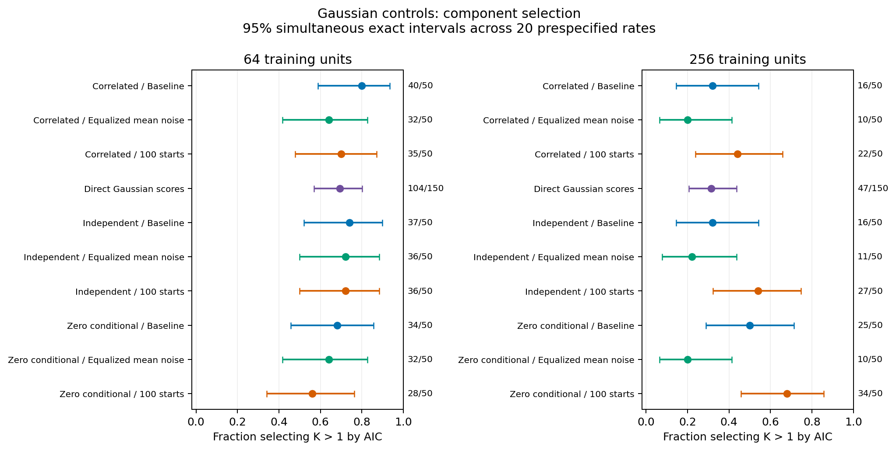

# Gaussian-control AIC diagnosis: completed study

The diagnostic reproduces frequent AIC selection of multiple mixture components
under Gaussian controls. Finite-sample mixture flexibility is a substantial
mechanism: the behavior persists in independent Gaussian scores that have no
unequal sampling, ingestion or PCA. Count-related measurement variation and
optimization also matter, but these comparisons establish no single correction.
Defaults, production fitting/sampling and historical p-values are unchanged.

## Completion and evidence

All **1,250 main searches** completed: 900 paired raw-data pipelines, 300
independent Gaussian-score searches and 50 verified archived point replays.
There were no failed or replaced searches. The separate 25-search storage
preflight passed. The numerical audit checked every fresh pipeline, candidate
density/membership/criterion, raw simulation law, count/identity, saved PCA map
and held-out projection without refitting. A standard-library checker verified
600 lossless observation archives, 4,800 candidate records and primary totals.
All 50 archived point replays matched their original exported arrays and scores.

The read-only source audit independently checked all 2,550 archived observed
candidate pools. No reference draw, significance test or stability bootstrap
was rerun. The [frozen design](aic-gaussian-diagnostics.md) defines the hypotheses,
interventions, fit budgets, seeds, prediction scope and failure policy.

## Fresh component selection

The table reports AIC `K>1` events. Each raw cell has 50 independent datasets;
each direct-score cell has 150. The three raw arms are paired; score controls
are independent. Rates are component-selection behavior, not calibrated
false-positive rates or species counts.

| Gaussian law | N | Baseline: 10 starts | Equalized mean noise | 100 starts |
|---|---:|---:|---:|---:|
| Independent | 64 | 37/50 (74%) | 36/50 (72%) | 36/50 (72%) |
| Correlated | 64 | 40/50 (80%) | 32/50 (64%) | 35/50 (70%) |
| Zero conditional | 64 | 34/50 (68%) | 32/50 (64%) | 28/50 (56%) |
| Independent | 256 | 16/50 (32%) | 11/50 (22%) | 27/50 (54%) |
| Correlated | 256 | 16/50 (32%) | 10/50 (20%) | 22/50 (44%) |
| Zero conditional | 256 | 25/50 (50%) | 10/50 (20%) | 34/50 (68%) |

Direct four-dimensional Gaussian scores selected multiple components in
**104/150 (69.3%)** at N=64 and **47/150 (31.3%)** at N=256. Their exact pointwise
95% intervals are 61.3–76.6% and 24.0–39.4%; simultaneous intervals across all
20 primary rates are 57.0–80.0% and 20.6–43.7%.

All 20 rates, pointwise/simultaneous exact intervals, Monte Carlo standard
errors and failure bounds are in the small
[rate table](../examples/aic-gaussian-diagnostics/results/rates.csv) and
[summary](../examples/aic-gaussian-diagnostics/results/summary.json).
Fifty raw datasets/cell provide limited precision: all 12 conservative paired
intervals adjusted across the prespecified comparisons include zero. For example,
the zero-conditional N=256 baseline-minus-equalized difference is 30 percentage
points, with an adjusted interval of −2.8 to 54.6 points. The observed direction
is informative for mechanism diagnosis, but it does not establish a general
effect or a validated correction.

Descriptive BIC selected K=1 in 1,198/1,200 fresh searches. The two exceptions
were one N=64 direct-score control and one independent N=64 100-start fit, both
selecting K=2. This observation does not establish that BIC has adequate power
under alternatives; no alternative or new significance calibration was run here.

## Independent prediction and mechanisms

Every fresh observation had 2,048 independent held-out units projected through
its frozen training transformations. All **732 AIC-selected multicomponent
fits** had negative observed mean held-out log-density gain relative to their
own K=1 candidate. K=1 selections have zero gain by construction. Individual
conditional Monte Carlo errors and densities remain local; aggregate gains are
published. This is evidence of predictive overfitting in these learned score
spaces, not a comparison of absolute densities across arms or proof of expected
prediction loss for every possible dataset.

For the original raw-data baseline, multicomponent-selected fits had mean
held-out gains of approximately −0.81, −0.95 and −0.88 log units per held-out
unit under the independent, correlated and zero-conditional N=64 laws. At
N=256 the corresponding means were about −0.16 in each law. Direct-score
multicomponent fits averaged −0.96 and −0.18 at N=64 and N=256.

The following findings constrain the explanation:

- **Finite-sample flexibility persists without the raw pipeline.** A four-PC,
  four-component full-covariance GMM has 59 parameters for 64 training units.
  The AIC penalty is only 30 units of twice-log-likelihood gain per added
  component. Independent score controls show that unequal counts or PCA are
  unnecessary for substantial overpartitioning in this configuration.
- **Count-dependent noise is not the only mechanism.** Equalizing group-mean
  residual variance leaves 64–72% selection at N=64 and 20–22% at N=256.
  The intervention also changes the fitted representation, so its difference
  includes the PCA response. Count-label associations remain descriptive.
- **More starts are not a consistent remedy.** They lower the observed N=64
  rates but raise every N=256 raw-law rate. They change selected K in 26–30 of
  50 paired N=64 datasets and 13–16 of 50 at N=256. At N=64, K=4 eligibility
  changes in 17–23 pairs/cell because the existing procedure screens the
  best-likelihood start after optimization. The numerical audit preserves this
  policy. A few reconstructed final likelihoods decrease slightly with the
  larger start budget (largest decrease about 0.012), so the arm should not
  be interpreted as guaranteed monotonic improvement.
- **Near-floor covariances occur but are not necessary.** Some selected N=64
  fits have minimum covariance eigenvalues close to the existing regularizer.
  In contrast, direct N=256 multicomponent fits have minimum eigenvalue ratios
  of at least 719 relative to that regularizer, yet 47 select multiple components
  and all have negative observed held-out gains. No variance floor was changed.

Candidate spectra, sizes, entropy, extreme-observation summaries, specimen-count
associations, penalties and optimization comparisons are retained in the compact
[mechanism aggregates](../examples/aic-gaussian-diagnostics/results/mechanisms.json).
No extreme observation was deleted, and these diagnostics do not certify a
global likelihood optimum.

## Archived controls and historical significance

The five original N=64 Gaussian cohorts each contain 500 observations:

| Archived law | AIC K>1 | Unchanged likelihood-test rejections |
|---|---:|---:|
| Independent | 377/500 (75.4%) | 27/500 (5.4%) |
| Correlated | 322/500 (64.4%) | 26/500 (5.2%) |
| Zero conditional | 370/500 (74.0%) | 26/500 (5.2%) |
| Rank two | 359/500 (71.8%) | 22/500 (4.4%) |
| Weak conditional | 352/500 (70.4%) | 23/500 (4.6%) |

The separate prior power-study controls reproduce AIC K>1 in 18/25 at N=64 and
4/25 at N=256, with unchanged test rejections of 1/25 and 0/25. These cohorts
are reported separately and are not pooled with the fresh study. Original
significance uncertainties and limitations remain in their original reports;
the values above were copied read-only, not newly calibrated.

Component selection and calibrated departure testing answer different questions.
The current evidence supports neither using AIC-selected K as a species count
nor treating frequent AIC K>1 as inflation of the separately calibrated test.
Any remedy needs a separately prespecified validation covering prediction,
null behavior, alternative recovery and the retained eligibility policy.
No remedy or new default is selected at this checkpoint.

## Local retention and verification

Full raw training/held-out inputs, fitted transformations, all candidate parameters,
predictions, logs, manifests, private indexes, frozen seeds and runtime hashes
remain local under `~/.codex/outputs/super-deli/grouped-aic-diagnostics-20261024/`.
The main numerical runtime is Python 3.12.10, NumPy 2.2.6, SciPy 1.15.3 and
scikit-learn 1.6.1. The measured projection passed the 1 GiB/8 GiB storage gate.
Only small aggregates, settings and figures accompany the source changes.
All 143 older Python modules other than the CLI/version entry points are
byte-identical to master at the start of this checkpoint.

Local verification passed **1,383 scientific tests** and **867 foundation tests**
(97 optional-dependency skips). Ruff lint/formatting, all 154 Python modules'
Python 3.11 grammar, the 20-search installed workflow and independent candidate
checker passed. The final wheel preserves the frozen numerical sources; wheel
and source-distribution contents are checked against source and public checksums.
The before/after preservation inventories are byte-identical across 779,477
prior-study files, nine pre-existing checkouts and the preceding power checkpoint.
An initial local test invocation used a relative import path that resolved to
an older installed package outside the checkout; the complete passing reruns
use the absolute frozen installed runtime. Test outputs, including the initial
failure/interruption, are retained in verified lossless local archives.

Both Python 3.11 and 3.12 are retained in the final master CI matrix. The final
commit's four CI jobs are verified after publication, with job evidence retained
locally. This diagnostic checkpoint introduces no production-model change.
