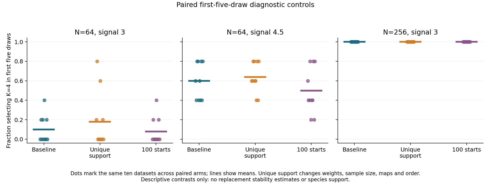

# N=64 shared predictive-bootstrap diagnosis

The small-sample losses arise mainly at fitted-component eligibility inside the
training folds, with additional nonpositive held-out gains. Every archived and
fresh four-group draw had enough distinct localities in total to permit K=4.
Increasing EM starts did not recover the N=64 losses. Removing multiplicities
helped modestly in these datasets, but changes several parts of the analysis and
is not a validated bootstrap correction. Production fitting/sampling, defaults
and historical p-values are unchanged.

## Completed design and evidence

The [frozen protocol](bootstrap-instability.md) was approved before implementation.
The archival audit checked 40 prior observations and 3,960 retained draws without
refitting: 24,000 searches and 4,000 available point/draw workflows. The 792 old
probe draws are outside that cohort.

The fresh study completed 40 independent datasets, 13,680 candidate searches and
1,080 separate truth-initialized forced-K=4 fits. Ten archived points and their
first two draws replayed exactly, adding 180 searches. Main total: 13,860 searches,
plus the separate forced fits. The independently seeded full-settings probe added
1,368 searches and 108 forced fits. There were no failed/unattempted fits,
withheld workflows or unavailable diagnostics. No significance tests or new
p-values were run.

Raw data came from the unchanged `benchmarking.predictive_study.simulate`
hierarchical continuous-data generator. Each locality has 1–4 morphology specimens
and one ecology row, four features/view, and fixed noninformative specimen counts.
Four-group simulations have balanced generating labels and complementary axes in
the two views; the Gaussian control represents one hierarchical population.
These are simulated validation data, not new empirical species datasets.
Generating labels are evaluated after fitting and never enter ordinary selection.

Independent numerical audits reconstructed raw laws, identities/counts, group-mean
standardization/PCA, fusion, projections, shared mixture densities, memberships,
criteria, original-ID sizes, gates and forced-fit initialization. A separate
standard-library verifier checked archive/member bytes, folds, gates, assignment
changes and counters. Public exports and their conditional intervals were audited
again against retained diagnostics. Detailed evidence remains local.

## Point results and paired draw contrasts

All entries below describe ten independent datasets per row. Draws repeat
measurements within those datasets. Frequencies are means of their conditional
per-dataset K=4 frequencies. The paired comparison uses exactly the same first
five draws for every arm; it does not compare 25-draw and five-draw budgets.

| Generating cell | Baseline point K=4 | Baseline first five | Unique support first five | 100 starts first five | Baseline all 25 |
|---|---:|---:|---:|---:|---:|
| N=64, signal 3 | 9/10 | 10% | 18% | 8% | 9.6% |
| N=64, signal 4.5 | 10/10 | 60% | 64% | 50% | 60% |
| N=256, signal 3 | 10/10 | 100% | 100% | 100% | 100% |

The 100-start point fits retained the same K=4 counts as baseline. Unique support
has no separate point fit. Its all-25 K=4 frequencies were 16%, 65.2% and 100%.
On the paired prefix, unique-minus-baseline dataset effects averaged +8 and +4
percentage points at N=64, with observed ranges -20 to +60 and 0 to +20 points.
The 100-start effects averaged -2 and -10 points, with ranges -20 to 0 and -40 to
0. N=256 effects were zero. These ten-dataset descriptive contrasts do not
establish population-performance improvements.

Unique support keeps the same sampled IDs, members and original folds, removing
frequency multiplicities in first-occurrence order. It also changes the fitted
maps, likelihood sample size and optimization ordering. It cannot isolate a pure
weighting effect or replace the existing bootstrap.

## Which gates remove K=4?

The following first-failing-gate counts describe the 250 baseline draws in each
fresh alternative cell: ten independent datasets with 25 repeated draws each.
They are accounting totals, not 250 independent biological replicates.

| Cell | Total distinct feasibility | Full eligibility | Fold eligibility | Nonpositive gain | AIC ranking | Selected K=4 |
|---|---:|---:|---:|---:|---:|---:|
| N=64, signal 3 | 0 | 29 | 150 | 46 | 1 | 24 |
| N=64, signal 4.5 | 0 | 1 | 87 | 12 | 0 | 150 |
| N=256, signal 3 | 0 | 0 | 0 | 0 | 0 | 250 |

Failures overlap. At signal 3, 179 draws had an ineligible K=4 training fold and
202 had nonpositive pooled K=4 gain; at signal 4.5 these counts were 88 and 36.
Diagnostic gains use retained fitted parameters even when another gate excludes
the candidate. They do not overwrite the production screen's eligibility policy.
All retained fits converged: a numerical convergence failure is not the cause of
these losses.

The generating four-group partition itself satisfied five-distinct-ID sizes in
all training folds in 163/250 and 183/250 N=64 draws, versus 250/250 at N=256.
Its full-draw partition was feasible in 248/250 and 249/250. These differ from
both total feasibility and fitted-partition eligibility. A deficient generating
group does not prove every possible fitted K=4 partition impossible.

The old cohort shows the same broad pattern. At N=64/signal 3, the 495 retained
draws had first failures at full eligibility (80), fold eligibility (283), gain
(85) and AIC ranking (1), selecting K=4 in 46. At signal 4.5 the corresponding
counts were 1, 222, 48 and 0, selecting K=4 in 224. No total-size feasibility
failures occurred. All 495 old N=256 draws selected K=4.

## Frozen-model counterfactuals

For the fresh N=64 baseline draws, removing only fold-size exclusions would select
K=4 in 46/250 and 213/250 draws, compared with 24/250 and 150/250 actually selected.
Removing only the positive-gain requirement gives 70/250 and 162/250. Using copied
occurrence counts instead of distinct IDs gives 40/250 and 193/250; that violates
the intended independent-unit size rule. Equal weight per distinct held-out ID,
without refitting models, gives 20/250 and 151/250. Removing only full-size
exclusions gives 24/250 and 150/250.

These are descriptive changes to frozen gate accounting across all K candidates,
not corrected selections. Original decisions remain retained. Counterfactuals
requiring unfitted candidate parameters are explicitly unavailable; public
summaries include their availability denominators. No gate is relaxed here.

## Signal and optimization

Mean full-draw generating-axis R-squared traces were:

| Cell | Raw means, axes A/B | Fused view scores, axes A/B | Joint scores, axes A/B |
|---|---:|---:|---:|
| N=64, signal 3 | 0.929 / 0.903 | 0.884 / 0.818 | 0.884 / 0.818 |
| N=64, signal 4.5 | 0.968 / 0.944 | 0.942 / 0.897 | 0.942 / 0.897 |
| N=256, signal 3 | 0.912 / 0.883 | 0.870 / 0.811 | 0.870 / 0.811 |

View PCA loses some signal, but both generating axes remain represented. Four
joint PCs retain the four fused dimensions, so this joint step does not truncate
additional dimensions. Source-row projections, group profiles and OOB signal
traces are retained separately. Count/axis R-squared averages were about
0.034/0.028, 0.044/0.026 and 0.015/0.009; counts were generated independently,
and these finite-sample associations are descriptive.

For the baseline fresh alternatives, maximum K=4 iteration counts were 34, 29
and 28, below the unchanged 500 limit. Maximum shared-covariance condition numbers
were about 69.4, 101.9 and 11.8. Independent density/criterion checks passed.

Truth-initialized fits exceeded ordinary K=4 log likelihood by more than one in
30/360, 33/360 and 6/360 full/fold diagnostics, with maximum gains about 17.8,
20.0 and 8.6. Some ordinary fits are therefore suboptimal relative to these
truth-informed fits. However, 37, 15 and zero truth-initialized fits failed the
original-ID size criterion, and truth initialization sometimes gave lower
likelihood. More ordinary starts did not restore small-sample recovery under the
unchanged start/size policy. Forced fits never enter ordinary selection and are
not a deployable initialization or biological evidence.

## K stability, assignments and controls

At N=256 all baseline draws selected K=4, yet label-invariant matching found an
average 3.79 changed assignments among the 256 original localities. Mean agreement
with generating groups was ARI 0.909 for all-original projections and 0.903 for
OOB projections. Stable K does not imply identical assignments or exact recovery
of every original point cluster.

At N=64, average all-original assignment changes were 31.22 at signal 3 and
12.74 at signal 4.5, including draws that merged groups. All-original generating
ARI averaged 0.349 and 0.766; OOB ARI averaged 0.338 and 0.770. Conditional on
retaining the point K, within-dataset mean changes at signal 4.5 ranged from zero
to 1.33 localities. The exports distinguish training-occurrence, all-original
and global-OOB measures and their denominators.

All ten Gaussian-control baseline and 100-start points selected K=1. Across all
25 draws, baseline and unique support each selected K>1 in three draws, spread
across three original datasets per arm (mean per-dataset frequency 1.2%). In the
paired first-five prefix, baseline had zero such draws, versus one for unique
support and one for 100 starts (0%, 2% and 2% mean frequencies). No control draw
selected K=4. These small descriptive control cells establish no general
false-positive or species-boundary guarantee.

## Uncertainty, resources and verification

Each dataset's event counts have explicit requested/available denominators,
unknown-outcome bounds and unadjusted exact binomial 95% intervals for conditional
Monte Carlo precision. For perspective, zero events in five draws has an upper
bound about 52.2%; five-draw effects are coarse diagnostics. These intervals are
not simultaneous population confidence, biological uncertainty or species
probabilities. Draws/folds are not independent datasets. All failure bounds
collapsed to observed frequencies because no outcome was unavailable.

The audited storage gate projected 1.80 GiB, including measured probe archives
and manifests, 25% growth, a 128 MiB reserve and explicit replay allowance, within
the approved 3 GiB retained-evidence cap. At least 8 GiB free and no more than
four single-thread numerical workers were required. Complete detailed evidence
remains local. GitHub contains code, fixed configurations, this report, figures
and small aggregate JSON/CSV exports only.

Local verification passed 1,500 scientific tests and 956 foundation tests with
102 optional skips. Package integrity, Python 3.11 grammar, installed smoke,
source preservation and all four final Python 3.11/3.12 CI jobs are required
before checkpoint completion; final CI status is recorded with the published
commit. The numerical production modules are unchanged. No default, p-value,
threshold, variance floor or optimizer eligibility rule was changed or promoted.

Public [dataset/cell aggregates](../examples/bootstrap-instability/results/summary.json),
[cell CSV](../examples/bootstrap-instability/results/cells.csv) and
[paired CSV](../examples/bootstrap-instability/results/paired.csv) retain the
prespecified comparisons. The figure is also available as
[SVG](figures/bootstrap-instability/paired-recovery.svg) and
[PDF](figures/bootstrap-instability/paired-recovery.pdf).
