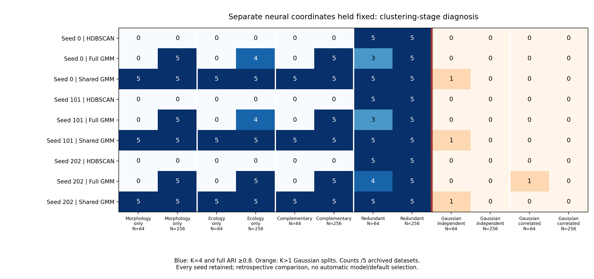

# Frozen neural coordinates: clustering-stage diagnosis

The separate encoders retained useful group information. Changing only the
clustering stage recovered groups that HDBSCAN merged. This checkpoint diagnoses
that failure; it adds no production clustering head and changes no defaults,
historical p-values, empirical gates or neural weights.

## What was compared

The [frozen protocol](coordinate-diagnosis.md) binds the completed separate-encoder
archive at commit `c4dde4cb9c1524e8c9c182987f3edbfbfc57dd25`. All 80 archived
observations were reused: eight simulation laws, N=64/256, five datasets per cell.
Ten saved representations include every neural seed (0, 101, 202), separate
encoders, joint two/four-coordinate encoders and per-view PCA. Each representation
received an exact HDBSCAN replay and full/shared-covariance GMM searches using BIC,
K=1..4, minimum size five and ten starts. Coordinates were neither rescaled nor
refitted. Labels entered evaluation only.

There were 2,400 main evaluations after a separate 480-evaluation preflight. The
preflight uses the first archived replicate in each cell; its repeated main
outputs are exact, not independent observations. No new scientific datasets,
neural training, resampling or significance calculations were performed.

## Recovery and control splitting

Entries below give counts out of five datasets **for each seed**, in order
0/101/202. Recovery requires selected K=4 and full-partition adjusted Rand
agreement at least 0.8. Noise receives singleton labels in that full-partition
metric. Gaussian-control entries instead count K>1 selections.

| Generating law | N | HDBSCAN | Full GMM | Shared GMM |
|---|---:|---:|---:|---:|
| Morphology signal only | 64 | 0/0/0 | 0/0/0 | 5/5/5 |
| Morphology signal only | 256 | 0/0/0 | 5/5/5 | 5/5/5 |
| Ecology signal only | 64 | 0/0/0 | 0/0/0 | 5/5/5 |
| Ecology signal only | 256 | 0/0/0 | 4/4/5 | 5/5/5 |
| Complementary four groups | 64 | 0/0/0 | 0/0/0 | 5/5/5 |
| Complementary four groups | 256 | 0/0/0 | 5/5/5 | 5/5/5 |
| Redundant four groups | 64 | 5/5/5 | 3/3/4 | 5/5/5 |
| Redundant four groups | 256 | 5/5/5 | 5/5/5 | 5/5/5 |
| Independent Gaussian: splits | 64 | 0/0/0 | 0/0/0 | 1/1/1 |
| Independent Gaussian: splits | 256 | 0/0/0 | 0/0/0 | 0/0/0 |
| Correlated Gaussian: splits | 64 | 0/0/0 | 0/0/1 | 0/0/0 |
| Correlated Gaussian: splits | 256 | 0/0/0 | 0/0/0 | 0/0/0 |

The shared-family Gaussian split is the **same archived input** across all three
seeds, not three independent false positives. Seed 0 selected K=3 and the other
seeds K=2. The full-family correlated-Gaussian split occurred on another input at
seed 202. These are descriptive splits after neural transformation, not calibrated
type-I error rates. None of the three heads recovered the two moons groups in
the separate-encoder cells. Discordant-view results retain both incompatible
references rather than inventing a common truth.

## Why recovery was lost

**Density connectivity and hierarchy selection contribute.** On complementary
separate-encoder coordinates, HDBSCAN selected its root for every dataset and
seed at both sample sizes. For seed 0, median root stability margins were 36.0
at N=64 and 173.1 at N=256. The median between-group bridge to within-group
bottleneck ratios were 0.524/0.574 for Euclidean distances and 0.608/0.503 for
mutual reachability. Ratios below one exclude a separating single global distance
threshold for these inputs; they do not prove clustering is impossible.

Surviving condensed branches were often mixed. The median minimum, across the
four generating groups, of each group's best branch Jaccard agreement was 0.419
at N=64 and 0.547 at N=256 for seed 0. These independently best branches can
overlap and do not imply a compatible four-branch partition. Deriving no-root EOM
or leaf selections from the same trees generally failed to restore recovery:
all N=64 complementary cells remained 0/5; only seed 202's N=256 no-root arm
recovered 1/5. Disabling root selection alone is not a general repair.

**Small-sample full GMM selection loses to its complexity cost.** At N=64,
accurate, eligible K=4 candidates existed on complementary coordinates, but full
GMM BIC selected K=2 or K=3. For seed 0, median K=4 candidate ARI was 1.0
(minimum 0.958). Relative to K=2, its median twice-log-likelihood gain was 77.25,
below the 124.77 BIC parameter cost. The median BIC improvement was therefore
−47.52. Shared covariance reduces that parameter cost: its median gain was
60.35 against a 41.59 cost, giving an 18.76 improvement. These decompositions
compare candidates within the same coordinate space, not absolute BIC between
different dimensions or covariance families.

At N=256, full GMMs selected four complementary groups in all five datasets and
seeds. Thus information loss in the neural representation alone cannot explain
the observed HDBSCAN failures. This does not establish that shared covariance
will work for unequal-shape clusters, new empirical data or arbitrary sample sizes.

## Evidence and limits

Independent checks covered all 960 source density replays and 7,680 candidate
Gaussian fits across both phases: frozen transformations, distances/neighbors,
MST/condensation/stability integrals, all three tree-selection policies, dense
Gaussian likelihoods, memberships, parameter costs, candidate eligibility and BIC
selection. All 480 overlapping preflight/main evaluations matched exactly. There
were zero failed searches and zero neural optimizer updates. The main workers
used 91.17 serial seconds; the independent main audit used 31.90 seconds. The
resource gate projected 668 MiB retained evidence under a 1 GiB cap and 151 serial
seconds including allowance under a one-hour cap. Detailed inputs, assignments,
parameters, hierarchy traces and per-fit audits remain local.

The [small public aggregates](../examples/coordinate-diagnosis/results/summary.json)
include all 480 cell summaries, 108 prespecified rates and 72 paired comparisons;
intervals and denominators are retained. Five previously examined datasets per
cell support mechanism diagnosis, not broad performance estimates. Neural seeds,
models and tree policies repeatedly measure the same inputs. The comparison is
retrospective; no configuration, seed or family is automatically promoted and no
species-boundary or significance guarantee follows.

## One targeted follow-up

Consider a separately approved opt-in shared-GMM head for separate encoders,
validated on fresh signal, Gaussian-control and covariance-stress simulations,
with frozen transforms and native matched subsampling. The control split and
unrepaired moons must remain visible. That workflow is not implemented here.
