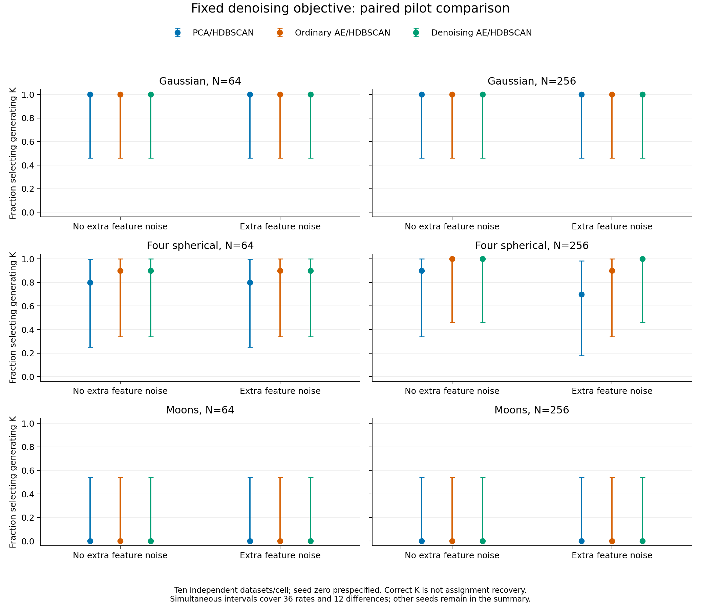
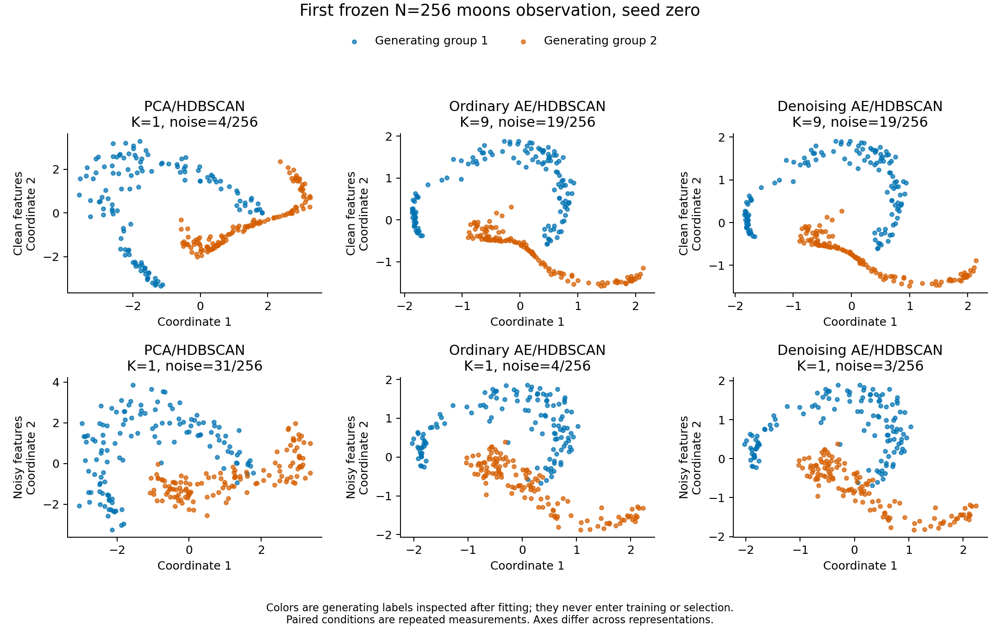

# Denoising autoencoder: completed paired pilot

The new [opt-in workflow](tabular-denoising.md) works reproducibly, but its fixed
denoising objective **does not repair curved-moons clustering** in this study.
It preserves strong four-group performance and offers modest changes in some
assignment/coverage measures. These results do not justify a new default,
winning seed or general noise-robustness claim.

The [frozen protocol](denoising-study.md) used 60 fresh independent source
observations, with paired eight-feature tables with/without extra measurement
noise. The 266-fit preflight and 2,618-fit main comparison completed without
failed workflows. The latter included 2,190 neural trainings, 1,680 paired
subsampling refits, 60 oracle-reference density fits, 30 fresh exact replays and
eight legacy exact replays. These categories overlap as described in the
protocol; they are not additional independent datasets. Main execution took
347 seconds using two one-thread CPU workers.

Independent audits verified source laws, raw measurement noise, identities and
draws, 546,000 main-training corruption matrices, checkpoint objectives, the
first Adam update, PCA, density invariants/distances, exports and coassignment
denominators. The preflight checked another 54,000 corruption matrices and eight
legacy replays. A separate report audit checked 900 point agreements, all 36
primary rate tails, 12 paired comparisons and the public aggregates. HDBSCAN
itself was not independently reimplemented.

## Recovery and coverage

The following summaries use prespecified neural seed zero. Each row has ten
independent datasets; clean/noisy conditions are paired, and all other seeds
remain in the [small public aggregates](../examples/denoising/results/all-seeds.json).
Clean means no **additional feature noise**; the source moons still have their
original coordinate noise. Simulated measurement noise is on the raw-feature
scale, whereas training corruption is on the standardized scale.

| Four-group condition | PCA K=4 / 10 | Ordinary AE K=4 / 10 | Denoising AE K=4 / 10 | Ordinary / denoising mean full-unit ARI |
|---|---:|---:|---:|---:|
| N=64, clean | 8 | 9 | 9 | 0.975 / 0.979 |
| N=64, noisy | 8 | 9 | 9 | 0.973 / 0.981 |
| N=256, clean | 9 | 10 | 10 | 0.970 / 0.974 |
| N=256, noisy | 7 | 9 | 10 | 0.962 / 0.973 |

The noisy N=256 four-group comparison has one dataset where denoising selected
the generating count and ordinary training did not, with no reverse discordance.
All other seed-zero primary correct-K comparisons were tied. One paired event
and broad simultaneous intervals cannot establish a reliable improvement.

| Moons condition | Ordinary / denoising K=2 / 10 | Ordinary / denoising mean full-unit ARI | Ordinary / denoising assigned fraction |
|---|---:|---:|---:|
| N=64, clean | 0 / 0 | 0.199 / 0.257 | 0.898 / 0.892 |
| N=64, noisy | 0 / 0 | 0.050 / 0.048 | 0.939 / 0.939 |
| N=256, clean | 0 / 0 | 0.220 / 0.214 | 0.868 / 0.882 |
| N=256, noisy | 0 / 0 | approximately 0 / 0 | 0.975 / 0.978 |

Denoising seeds 101 and 202 also selected K=2 in 0/10 observations in every moons
cell. In clean N=256 tables, the denoising arms often fragmented the curves into
many groups; in noisy N=256 tables, all three seeds merged them into one group
in all ten observations. The fixed training change did not resolve the density
connectivity/selection issues identified in the [earlier diagnosis](neural-moons-results.md).
These observations do not isolate a single remaining cause or prove that no
other neural representation could work.

All seven candidate arms selected K=1 in all Gaussian point observations. This
does **not** mean every unit was retained correctly: for seed-zero denoising,
mean assigned fractions ranged from 0.516 to 0.749 across the four Gaussian
conditions. Full-unit ARI was zero because noise units are unresolved singletons.
No extra Gaussian point clusters were selected under these particular laws;
this is not a calibrated species false-positive guarantee.

The 36 rates and 12 paired differences use conservative simultaneous uncertainty
from 60 exact binomial intervals. With ten independent observations/cell, even
0/10 and 10/10 have wide bounds. Correct K, assignment recovery, unassigned
coverage and biological species validity are separate outcomes.

## Stability and geometry

Only the first underlying observation per law/N cell received 20 paired 80%
subsamples. These 1,680 refits are repeated measurements on six datasets, not
another validation cohort. In the noisy N=64 four-group example, both seed-zero
neural arms selected K=4 in 16/20 draws; mean draw ARI was 0.962 ordinary and
0.965 denoising. In the noisy N=256 four-group example, K=4 counts were 12/20
versus 14/20, with mean ARI 0.939 versus 0.942.

For noisy moons, seed-zero denoising selected K=1 in all twenty N=64 draws and
19/20 N=256 draws. The one K=2 draw at N=256 did not imply recovered moons:
mean draw ARI was only 0.003. Stability of a merged or fragmented partition is
not evidence that the generating groups, let alone species, were recovered.
Read coverage, positive-cluster coassignment and failure bounds alongside point
agreement; unresolved singleton agreement is not positive-cluster support.

All [stability summaries](../examples/denoising/results/stability.json) and
[geometry aggregates](../examples/denoising/results/geometry.json) are retained.
Changing denoising seeds varies the registered initialization and corruption
streams together. Within a seed, clean/noisy tables share corruption innovations
and subsampling identities. No best-seed selection was performed.

This example is the first frozen observation, not a selected favorable run.
Colors show generating labels inspected after fitting. Axes differ across
representations; training never sees those labels or the source coordinates.

## Scientific and implementation limits

The method reconstructs observed measurements from corrupted versions of those
same measurements. It does not observe the unknown noiseless biological truth,
and better reconstruction is not a clustering objective. The pilot covers one
architecture, corruption level, density setting, three stylized laws and two
sample sizes. It does not validate other noise laws, empirical species, missing
data, grouped dependence, images, shapes, genomes or multimodal neural fusion.

Existing configurations, numerical trainers, density behavior, defaults,
historical p-values and empirical evidence gates are preserved. No neural
significance workflow is enabled. No empirical data were fitted and nobody was
contacted. Full inputs, weights, corruption/draw traces, source bundles and logs
remain local; only code, documentation, invented fixtures, figures and small
aggregates are published. See the [audit summary](../examples/denoising/results/independent-audit.json).
