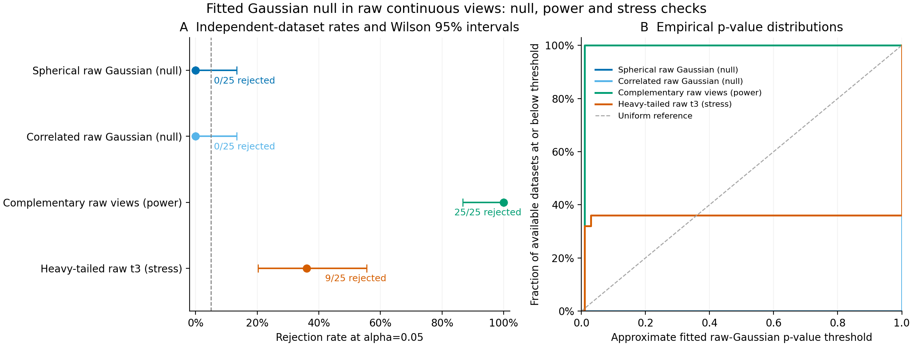

# Empirical fitted-null validation results

The prespecified study completed **all 10,000 planned full-pipeline clustering
fits**: 100 observed datasets and 9,900 fresh fitted-null datasets, with **zero
failed or unattempted fits**. Each observed dataset received its own fitted raw
Gaussian and 99 bootstrap draws. All primary p-values were available. No main
attempt was retried, repaired or replaced, and no settings were tuned to results.

## Results and Monte Carlo uncertainty

| Raw-data case | Rejections / available tests | Rate | Pointwise Wilson 95% interval | MCSE |
| --- | ---: | ---: | ---: | ---: |
| Spherical raw Gaussian | 0/25 | 0.0% | 0.0–13.3% | 0.0 pp |
| Correlated raw Gaussian | 0/25 | 0.0% | 0.0–13.3% | 0.0 pp |
| Complementary four-group alternative | 25/25 | 100.0% | 86.7–100.0% | 0.0 pp |
| Unimodal heavy-tailed t3 stress | 9/25 | 36.0% | 20.2–55.5% | 9.8 pp |

Both Gaussian cases had 0/25 rejections, consistent with conservative behavior
in this small study. Their 0–13.3% intervals are too broad to certify precise
nominal 5% error control. All 50 Gaussian point fits selected K=1, T=0 and p=1;
the large tie mass explains these conservative p-values. Both the fitted-null
assumption and the finite-sample distribution remain relevant on other data.

All 25 complementary alternatives rejected with K=4 and p=0.01. This is power
for one strong constructed signal at a K ceiling of four, not sensitivity to
weak alternatives, significance of K=4, or recovery of every true membership.

The **unimodal heavy-tailed population rejected in 9/25 datasets (36%)** despite
having no generating groups. Nine point fits selected K=2 (eight p=0.01, one
p=0.03); the other 16 selected K=1/p=1. This is sensitivity to Gaussian model
misspecification. It is **not species/clustering type-I error**, because this
population is outside the Gaussian null. It demonstrates why this p-value
cannot be read as evidence establishing biological species boundaries.

Intervals and MCSE weight independent observed datasets equally. Intervals are
pointwise and unadjusted across cases. A zero plug-in MCSE at a rate of zero or
one does not imply zero uncertainty; the Wilson intervals remain informative.



The left panel shows independent-dataset rates and Wilson intervals; the dashed
line marks alpha=0.05. The right panel shows discrete p-value empirical CDFs.
The two null curves coincide at p=1. The uniform diagonal is only a reference;
conservative, discrete fitted-null p-values need not follow it exactly.
[PDF](figures/empirical-calibration/empirical-calibration.pdf) and editable
[SVG](figures/empirical-calibration/empirical-calibration.svg) are included.
The [dataset table](../examples/empirical-calibration/results/datasets.csv)
records seeds, statistics, K, p-values and counts. The
[diagnostic table](../examples/empirical-calibration/results/diagnostics.csv)
reports centers/ranges and selected-K counts as descriptive diagnostics.

## Prespecified design

The [exact declaration](../examples/empirical-calibration/results/study.json)
fixes N=64 matched specimens, four continuous raw features per morphology/ecology
view, two PCs per view and jointly, equal weights, K=1..4, minimum hard size 5,
10 EM starts, alpha=0.05, B=99 and one numerical thread per fit. Analysis seed
71323 is the same for observed and bootstrap fits. Master seed 20261023 derives
separate observed-data and per-dataset null streams. There is no shared null
bank, adaptive stopping, outcome-dependent tuning or nested stability bootstrap.

There are 25 independent observed datasets per case. Gaussian nulls are spherical
or have AR(1) correlation 0.6, SDs 0.5..2 and means -2..2. The alternative is a
balanced four-group construction with complementary view axes, shift strength
3 and unit normal noise. The stress case is one elliptical multivariate t3 with
the correlated scatter and means. See the [method](empirical-null-calibration.md)
for the precise raw generator, assumptions and input contract.

Each null is fitted to the observed raw concatenated measurements before any
PCA, using the joint sample mean and full MLE covariance (divisor N), including
cross-view covariance. Nulls are unregularized; singular fits are rejected.
Every draw reruns CSV ingestion, preprocessing, both view PCAs, normalization/
fusion, joint PCA and the complete GMM search. The null parameters are held at
the observed estimates while drawing these bootstrap inputs. Each independently
observed validation dataset receives an independently fitted null.

## Interpretation limits

The hypothesis is a fitted **joint Gaussian population of raw continuous
measurements**. P-values remain approximate because nuisance parameters are
estimated. Full pipeline refits and the plus-one calculation do not supply the
known-reference-law exact-rank guarantee. Conditional binomial intervals cover
finite simulation error, not parameter uncertainty or null misspecification.
No double-bootstrap calibration or general size guarantee is claimed.

This validates an estimator fitted to observed data using simulated experiments;
it does not establish performance on empirical biological species ground truth.
Genomic/count/shape distributions, unequal group precision, missingness,
spatial/related sampling and anatomical detector error are outside this empirical
null checkpoint. No cluster-specific significance, significance of the selected
K, species confidence, or multiplicity correction across analyses is supplied.
Rejecting can reflect misspecification; non-rejection does not establish one
species. Stability and conditional membership remain separate evidence.

## Provenance and verification

The read-only audit verified **309,700 archived members** across
**10,000 successful pipelines** and inventoried
**11,824 raw study files**. It regenerated all observed and bootstrap
raw inputs, reconstructed the fitted means/full covariance, checked archive
bytes and raw source arrays/identities, and reconstructed block fusion, joint
projection, selected GMM likelihood/BIC/membership, candidate selection and
every p-value/denominator. No clustering was refitted for reporting. View PCA
and nonselected likelihoods were preserved/checksummed, not independently refitted.

All frozen Super Deli Python source hashes match the reporting implementation.
Python 3.12.10, NumPy 2.2.6,
SciPy 1.15.3, scikit-learn
1.6.1 and threadpoolctl
3.6.0 ran the campaign. No SNPio or
image input is used by this calibration. The four-case preflight completed 12
fits and a read-only audit before the unchanged main campaign. It is excluded
from reported validation denominators.

Full raw ZIP archives, initial null ingestion, fitted parameters, draw records,
logs, frozen wheel, runtime import/version records and preflight artifacts are
preserved locally at:

`/Users/btm002/.codex/outputs/super-deli/empirical-null-20261020/`

This is local preservation, not a public raw-data deposition. The frozen runtime
references recorded local scientific libraries and is not a self-contained
environment image. Public compact results, settings, source/runtime hashes and
figures are committed. The [manifest](../examples/empirical-calibration/results/manifest.json)
records their hashes, the full raw-file inventory hash, wheel hash and per-case
host wall times. Those times describe this host/storage environment and are not
a comparative performance claim.

## Reproduce

```bash
python -m pip install '.[dev,clustering]'
python -m pytest -q
# Run each of the four case commands in the method into a separate new directory.
super-deli analyze-empirical-calibration /path/to/study --output-dir /path/to/new-audit
python scripts/plot_score_calibration.py /path/to/new-audit \
  --empirical-pipeline --output-dir /path/to/new-figures
```

Python 3.11/3.12 are supported. CI runs bounded tests and installed calibration,
study and audit commands; it does not repeat the larger campaign. Numerical
libraries, BLAS, versions and platform can affect PCA/GMM decisions, so exact
numerical agreement across hosts is not promised.
