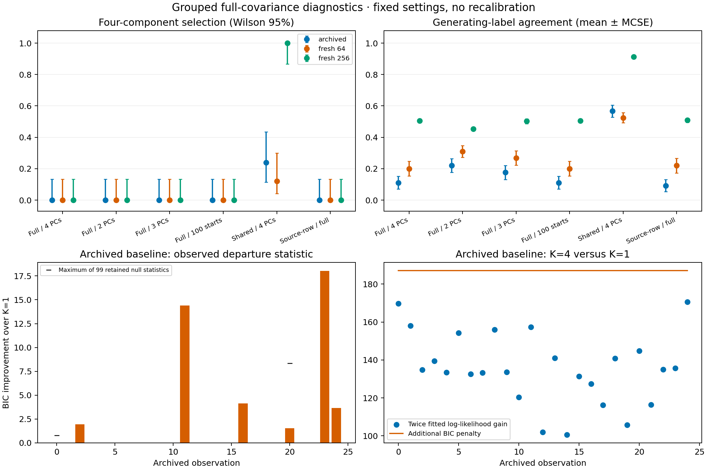

# Completed full-covariance grouped power and recovery diagnosis

The frozen study completed **450/450 point pipelines** and **225/225 separate
truth-initialized optimization diagnostics**, with zero failed, unattempted or
replacement fits. All **25 archived baselines reproduced**. The independent
no-refit audit verified **15,689 diagnostic files**, **175 archived tests** and
**17,325 retained null draws**. There were no new significance or stability draws.
Production models, defaults, historical p-values and existing evidence are unchanged.

**BIC's full-covariance parameter cost is the main observed bottleneck for these
settings under this generating law.** Four PCs retain both generating axes, but
full-covariance models select fewer components than the generating partition.
Neither 100 starts, fewer joint PCs nor source-row PCA recovers four components.
The shared-family control improves recovery on the same score matrices, especially
at N=256. This is a diagnosis, not an automatic recommendation or recalibration.

## Paired recovery

| Cohort | Setting | K=1 / 2 / 3 / 4 | Mean ARI | K=4 Wilson 95% |
| --- | --- | --- | ---: | --- |
| archived | baseline | 19 / 6 / 0 / 0 | 0.111 | 0.0%–13.3% |
| archived | pcs_2 | 12 / 12 / 1 / 0 | 0.221 | 0.0%–13.3% |
| archived | pcs_3 | 15 / 10 / 0 / 0 | 0.176 | 0.0%–13.3% |
| archived | starts_100 | 19 / 6 / 0 / 0 | 0.111 | 0.0%–13.3% |
| archived | shared_4 | 0 / 19 / 0 / 6 | 0.567 | 11.5%–43.4% |
| archived | source_4 | 20 / 5 / 0 / 0 | 0.093 | 0.0%–13.3% |
| fresh_64 | baseline | 14 / 11 / 0 / 0 | 0.201 | 0.0%–13.3% |
| fresh_64 | pcs_2 | 6 / 19 / 0 / 0 | 0.311 | 0.0%–13.3% |
| fresh_64 | pcs_3 | 10 / 15 / 0 / 0 | 0.268 | 0.0%–13.3% |
| fresh_64 | starts_100 | 14 / 11 / 0 / 0 | 0.201 | 0.0%–13.3% |
| fresh_64 | shared_4 | 0 / 22 / 0 / 3 | 0.525 | 4.2%–30.0% |
| fresh_64 | source_4 | 13 / 12 / 0 / 0 | 0.220 | 0.0%–13.3% |
| fresh_256 | baseline | 0 / 21 / 4 / 0 | 0.505 | 0.0%–13.3% |
| fresh_256 | pcs_2 | 0 / 23 / 2 / 0 | 0.454 | 0.0%–13.3% |
| fresh_256 | pcs_3 | 0 / 17 / 8 / 0 | 0.502 | 0.0%–13.3% |
| fresh_256 | starts_100 | 0 / 21 / 4 / 0 | 0.505 | 0.0%–13.3% |
| fresh_256 | shared_4 | 0 / 0 / 0 / 25 | 0.913 | 86.7%–100.0% |
| fresh_256 | source_4 | 0 / 21 / 4 / 0 | 0.509 | 0.0%–13.3% |

All arms use the [prespecified protocol](full-grouped-diagnostics.md): two PCs/view,
equal weights, K=1..4, minimum size 5, 10 starts except the explicit 100-start arm,
and the same model seed. Each cohort has 25 independent datasets; configurations
are paired within datasets. Intervals are pointwise Wilson 95%, unadjusted across
the grid. Zero K=4 selections still allows a 13.3% upper Wilson bound. ARI is
post-fit agreement with simulated labels, not species accuracy. Mean ARI Monte
Carlo standard errors, full candidate logs, paired changes and failure denominators
are in the [portable evidence](../examples/full-grouped-diagnostics/results/).
No alternative arm receives a new p-value or calibrated power estimate.

## Why detection was weak

Of the original 25 four-group tests, **19 selected K=1, giving T=0 and p=1**.
Every one of the other six observations had positive T and rejected: five at
p=0.01 and one at p=0.02. This exactly reproduces the historical 6/25 rejection
rate (Wilson 95% 11.5–43.4%). The archived fitted-null distributions contain
**2,473 zero statistics out of 2,475 draws** for these alternatives. Their
empirical 95th percentiles are all zero. The primary limitation here is getting
a positive BIC improvement, rather than the 99-draw Monte Carlo resolution.
No additional draws or p-value recomputation with different settings was used.

T is BIC(K=1) minus the smallest eligible BIC over K=1..4, so K=1's inclusion
forces T>=0. A zero statistic cannot reject under the upper-tail rule including
ties. This is expected behavior of this statistic, not a broken bootstrap. The
raw null remains an approximate fitted conditional-PSD Gaussian law with
nonregular covariance boundaries; these observations do not establish general
size control or validate that null for empirical species.

## Why four components lose under BIC

At d=4, full covariance has q=14 parameters for K=1 and q=59 for K=4.
The extra BIC cost at N=64 is **187.150**, versus **62.383** for shared covariance.
On exactly the same archived scores, the median twice-log-likelihood gain for
K=4 versus K=1 is **134.764** for full covariance and **81.553** for shared
covariance. Full covariance gains more likelihood, but pays a much larger cost.
These are medians over converged candidate fits, including candidates later
excluded by the minimum component-size rule.

At N=256, the full baseline selects K=2 in 21/25 and K=3 in 4/25. Relative to
K=2, K=4 has median twice-log-likelihood gain **113.178**, below its extra cost
**166.355**. The paired shared model's corresponding gain is **88.265**, above
its cost **55.452**; it selects K=4 in all 25 observations with mean ARI **0.912**.
These comparisons stay within each fixed score space; absolute BIC is not
compared across dimensions. Paired family comparisons do not calibrate selecting
a covariance family from the data, and no family/default was changed.

## Signal, PCA and optimization

Four joint PCs span the four fused view coordinates: they preserve fused-axis
recovery to numerical precision. Baseline median joint R² for axes A/B is
0.869/0.815 in archived N=64, 0.883/0.800 in fresh N=64 and 0.861/0.798 at N=256.
The corresponding raw morphology-A/ecology-B group-mean R² medians are
0.901/0.844, 0.906/0.844 and 0.906/0.832. Thus view compression retains substantial
but imperfect signal; the four-PC joint step is not discarding an axis.
Two or three joint PCs trade signal against parameter cost without restoring K=4.
Changing the morphology PCA training policy also does not restore K=4.

Selected full-family K=2 partitions mainly recover morphology axis A. Median
axis-A homogeneity is 0.949, 1.000 and 0.934 across the three cohorts; axis-B
homogeneity is 0, 0 and approximately 0.00004. This supports the interpretation
that flexible components can absorb the weaker ecological separation while
representing fewer groups, despite that axis remaining in the scores. It is
an inference from this simulation, not a general identifiability result.

Increasing starts from 10 to 100 changes no selected K or ARI in any of the 75
datasets. However, K=4 eligibility drops from 21 to 9 archived observations and
from 20 to 8 fresh N=64 observations. The existing fitter chooses the largest
likelihood across starts and then screens hard component sizes. More starts can
therefore find a higher-likelihood fit with an inadmissibly small component;
they do not search for the best admissible fit across all starts. This is retained
behavior, not a convergence failure or a repair in this checkpoint.

All 75 truth-initialized K=4 fits are eligible, but **none beats the selected
baseline by BIC**. Their smallest BIC deficits are 34.224, 33.345 and 11.218
across cohorts. Some truth-initialized K=2 fits improve the baseline likelihood;
at N=256 the largest BIC reduction is 0.247. Tiny signed differences can also
reflect convergence tolerances. Consequently these diagnostics do not certify
that ordinary EM found a global optimum, although they offer no K=4 BIC rescue.
Truth-based starts remain isolated from unsupervised results and are never used
for configuration selection or deployment.

## Verification and preserved boundaries

The runtime wheel is **0.30.0.dev0**, frozen before fresh generation, with
**129 package modules**, Python 3.12.10, NumPy 2.2.6, SciPy 1.15.3,
scikit-learn 1.6.1 and threadpoolctl 3.6.0. All 124 previous modules are unchanged
except CLI dispatch and package version; five added modules implement diagnostic
configuration, execution, optimization, archived-tail inspection and no-refit audit.
Source pins, master seed **20261112**, dataset seeds and six settings were frozen
before generation. Execution used four one-thread workers with no replacement
fits. A separate seed-20261113 smoke exercised all 18 point pipelines and nine
optimization fits before the main study.

Independent audits verify source hashes, raw inputs/counts/identities, PCA
moments/eigen-equations/projections, fusion, selected dense mixture likelihood,
BIC and membership, ARI/axis recovery, truth initialization/density, and all
retained tail equations/seeds. All 75 baseline/shared and 75 baseline/100-start
pairs have exactly identical score arrays. Nonselected likelihoods are inferred
from logged BIC values rather than independently recomputed from unretained
parameters. Convergence records are checked, without refitting models or
certifying global optima. Tests cover source/tail tampering, forced diagnostic
failure retention, truth withholding, immutable production modules and an auditor
that is forbidden to fit models.

Local scientific tests passed, along with foundation, lint/format, wheel/sdist
and installed-command checks. Final published-head Python 3.11/3.12 CI is verified
at publication. Existing four checkouts, original TPS inputs, cleanup archive and
**143,603 prior-study files** are preserved, including the earlier numerical
failures. No repair or suppression of that separate issue was introduced.

Full evidence is retained externally as `full-grouped-diagnostics-20261023`.
Portable tables, source/runtime hashes and PDF/SVG/PNG figures are committed;
local raw preservation is not public raw deposition or a self-contained runtime
image. Reproduce the portable report with
`python scripts/report_full_grouped_diagnostics.py /path/to/artifact-root --output-dir /path/to/new-results --figure-dir /path/to/new-figures`.
The checkpoint stops at diagnosis, with no production fix or new default.
