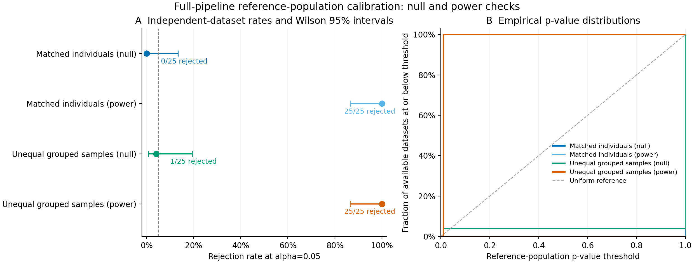

# Full-pipeline reference-population calibration results

The prespecified 100-dataset study completed **all 10,000 full-pipeline fits**:
100 observed fits and 9,900 fresh null fits, with **zero failed or unattempted
fits**. Each test used its own 99 independent raw null draws. All p-values were
available. No main-campaign fit was retried, repaired or replaced, and no
settings were tuned in response to results.

## Rejection rates and uncertainty

| Case | Rejections / available tests | Rate | Pointwise Wilson 95% interval | MCSE |
| --- | ---: | ---: | ---: | ---: |
| Matched individuals: null | 0/25 | 0.0% | 0.0–13.3% | 0.0 pp |
| Matched individuals: complementary alternative | 25/25 | 100.0% | 86.7–100.0% | 0.0 pp |
| Unequal grouped samples: null | 1/25 | 4.0% | 0.7–19.5% | 4.0 pp |
| Unequal grouped samples: complementary alternative | 25/25 | 100.0% | 86.7–100.0% | 0.0 pp |

No matched-null dataset rejected (0/25), while one grouped-null dataset rejected
(1/25, 4%). Both complementary alternatives rejected in all 25 datasets. All
matched-null fits and 24/25 grouped-null fits selected K=1 with T=0 and p=1;
the remaining grouped-null fit selected K=2 with p=0.01. All alternative fits
selected K=4 with p=0.01. This describes the observed searches, not significance
of a selected K or recovery of every generating membership. The large tie mass
explains conservative null p-values here; the small study cannot distinguish
precise nominal size from substantial conservatism across other designs.

Intervals and Monte Carlo standard errors weight independent observed datasets
equally. They are unadjusted across cases. A zero plug-in MCSE at an observed
rate of zero or one does not establish zero uncertainty; the Wilson intervals
show the limited precision of 25 datasets. Null rejection rates describe only
the declared continuous-population law. Alternative rates describe only the
constructed complementary four-group signal and this fixed analysis.



The left panel shows event rates and pointwise Wilson intervals; the dashed
line marks alpha=0.05. The right panel shows discrete p-value empirical CDFs.
Ties at T=0 can produce a large atom at p=1. The uniform diagonal is a reference,
not a requirement that conservative p-values follow it exactly. Both power
curves coincide at p=0.01.
Editable [SVG](figures/pipeline-calibration/pipeline-calibration.svg) and
[PDF](figures/pipeline-calibration/pipeline-calibration.pdf) are included.
Per-dataset statistics, selected K, p-values, seeds and fit counts appear in the
[dataset table](../examples/pipeline-calibration/results/datasets.csv).
The [diagnostic table](../examples/pipeline-calibration/results/diagnostics.csv)
reports p-value/statistic centers and ranges and selected-K counts; these are
descriptive diagnostics, not cluster-specific significance estimates.

## Design and interpretation

The [exact declaration](../examples/pipeline-calibration/results/study.json)
uses 64 targets and 64 diploid loci, all four modalities, two PCs per view,
two joint PCs, equal view weights, K=1..4, minimum component size 5, 10 EM starts,
alpha=0.05, B=99 and fixed analysis seed 71323. Master seed 20261022 derives
independent observed and per-dataset null streams. Matched individuals and
explicitly grouped unequal sampling each contribute 25 null and 25 alternative
datasets. Grouped source counts range from 1 to 4, with ecological locality
measurements used once per target. The same known reference law regenerates
source counts and baseline allele frequencies rather than conditioning on
their observed realizations. The main campaign has no missing cells or views.

Every null draw re-runs raw ingestion through SNPio, preprocessing, fixed-point
GPA, view PCA, profile aggregation, normalization/fusion, joint PCA and the full
GMM search. T is BIC improvement over K=1 across eligible candidates. The
plus-one upper-tail calculation includes ties and cannot yield p=0; minimum
p=0.01. Identical fitting seeds make the analysis function the same for every
dataset. No nested stability bootstrap is run. See the
[method](full-pipeline-calibration.md) for the complete law and failure policy.

These are **reference-law departure tests**, not empirical species-boundary
tests. The known law was not fitted to observed data. Validity under this law
does not establish suitability for real genomic, ecological, morphological or
anatomical data. Departure may reflect model misspecification rather than
discrete taxa. A rejection neither validates selected K nor identifies a
significant cluster; non-rejection does not establish one species. The K ceiling
equals the alternative group count, and these strong alternatives do not
establish sensitivity to weak signals. Spatial dependence, relatedness, LD,
demography, anatomical detector error, arbitrary feature schemas and
outcome-driven analysis selection remain untested. Small validation samples
cannot certify universal type-I error control.

## Provenance and audit

The [manifest](../examples/pipeline-calibration/results/manifest.json) records
public artifact and code hashes, the raw-file inventory hash, frozen runtime
wheel and dependency-wheel hashes, settings and execution metadata. The
read-only audit verified **628,800 archived members**
across **10,000 successful pipelines** and
inventoried **11,824 raw study files**. It regenerated all raw
observed/null inputs from their seeds and checked complete archive inventories,
parameters, block fusion, joint projection, selected GMM likelihood/BIC/membership,
candidate-selection bookkeeping and every p-value/denominator. It did not refit
view preprocessing/GPA/PCA or nonselected mixture likelihoods.

Full raw artifacts, independent output ZIPs, per-draw records, logs, the frozen
Super Deli wheel, exact SNPio wheel, import paths and version records are retained
locally at:

`/Users/btm002/.codex/outputs/super-deli/full-pipeline-calibration-20261020/`

This is local preservation, not a public raw-data deposition. The frozen runtime
uses recorded local scientific libraries; it is not a self-contained environment
image. Public compact tables, settings, hashes and figures are committed here.
All fitting and generator source hashes in the frozen runtime match the reporting
implementation. The reporting auditor additionally checks exported observed
statistics, retained counts, failed-point inference and optional-dependency errors. Re-auditing the complete campaign with
these stricter checks produced identical tables, summary and raw-file inventory;
no model was refitted. Python 3.12.10, SNPio
1.7.7, NumPy
2.2.6, SciPy
1.15.3 and scikit-learn
1.6.1 ran the campaign. Four case
processes each used one numerical thread. Per-case wall times are in the manifest
and describe this host and storage environment, not comparative performance.

A dependency-path preflight failed before any fit because it exposed SNPio
1.6.16. Its logs were preserved separately in
`full-pipeline-calibration-20261020-preflight-runtime-failure/`.
After correcting that path to the tested 1.7.7 install, the four-case preflight
completed 12 fits and a read-only audit before the unchanged main campaign.
Preflight fits and failures are outside the reported validation denominators.

## Reproduce

```bash
python -m pip install '.[dev,genomics,clustering]'
python -m pytest -q
# Run all four case commands from the method into separate new directories.
super-deli analyze-pipeline-calibration /path/to/study --output-dir /path/to/new-analysis
python scripts/plot_score_calibration.py /path/to/new-analysis \
  --reference-pipeline --output-dir /path/to/new-figures
```

Numerical libraries, BLAS, platform and versions can affect PCA/GMM decisions;
byte-identical or numerically identical results are not promised across hosts.
Python 3.11/3.12 remain the supported versions. CI exercises bounded workflows;
it does not rerun this larger campaign.
