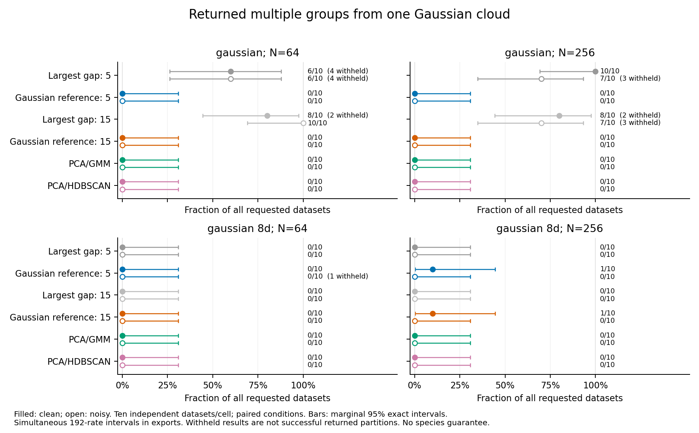
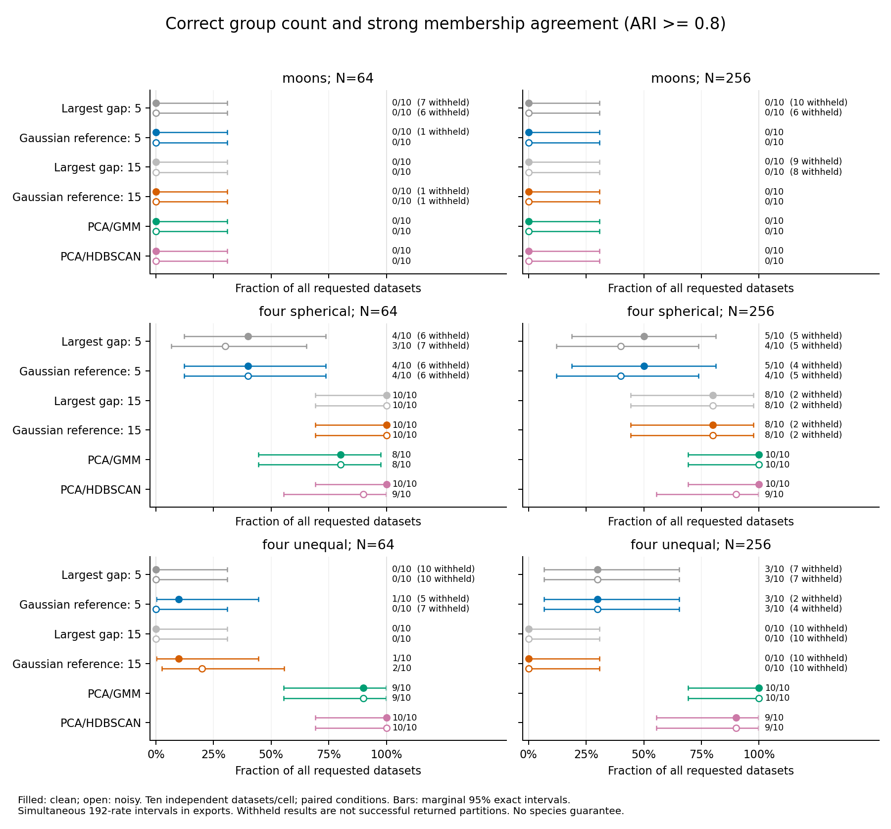

# Gaussian-reference spectral feasibility results

**The reference rule reduced splitting of single Gaussian clouds, but did not
recover the two moons groups. It is not ready for a user-facing delimitation
workflow.** In particular, a result of “no reference-supported split” can miss
real generating groups. The existing spectral CLI and all other production
models, defaults, schemas, historical p-values and empirical gates are unchanged.

This benchmark-only checkpoint followed the [approved frozen protocol](gaussian-reference-spectral-study.md).
It evaluated one rule, without tuning after outcomes, neural training, stability
resampling, empirical fitting or author contact. Negative recovery findings are
retained alongside improved Gaussian-control behavior.

## What was tested

For each complete eight-trait table, the method fitted one raw-feature Gaussian
mean/covariance, retaining genuine numerical rank deficiency without a positive
variance floor. It generated 49 pilot tables to normalize the graph gaps, then
99 independent reference tables to compare their maximum normalized gap with
the observation. Each draw refitted standardization and rebuilt the graph.
Five and fifteen neighbors were separate prespecified arms; neither was chosen
afterward. A reference-compatible result returned a computational K=1; a passed
screen proposed the largest standardized gap, subject to the unchanged assignment,
cluster-size and abstention guards.

The reference quantity concerns departure from this fitted Gaussian model.
It is not evidence that a proposed K is correct, the probability of a species,
or acceptance of one biological population. It is approximate: raw covariance
and effective rank were estimated, and both normalization and reference tails
used finite simulations. Existing significance workflows were not extended.

The fresh study used 160 independent observations: ten per law at N=64/256
for rank-two/full-rank Gaussian controls, four spherical groups, noisy moons,
four unequal groups, heavy tails, a continuous cline and eight groups beyond
the spectral search range. Paired clean/noisy feature maps gave 320 tables.
Existing largest-gap spectral, the reference rule (both graph settings),
two-PC BIC/GMM and two-PC HDBSCAN gave six arms. Generating labels were used
only for evaluation after fitting. Full formulas, seeds and assumptions are
in the protocol; these are synthetic datasets, not empirical species truth.

## Execution and availability

| Item | Completed |
|---|---:|
| Separate preflight graph/baseline evaluations | 10,800 |
| Main graph/baseline evaluations | 97,200 |
| Main independent observations / paired tables | 160 / 320 |
| Point outputs / exact table replay outputs | 1,920 / 24 |
| Available / withheld point outputs | 1,627 / 293 |
| Numerical workflow failures | 0 |

The 97,200 evaluations comprise 95,904 reference graph spectra, 648 observed
graph spectra and 648 unchanged baseline workflows, including the four complete
table replays. Both count rules reused each observed spectrum. Assignment work
is separate: the audit retained 459 nonconstant component/solver steps against
the bound of 1,296 possible observed assignment steps. Four exact table replays
matched all numerical arrays, source/draw hashes and decisions.

| Arm | Available / 320 | Withheld |
|---|---:|---:|
| Largest gap, five neighbors | 165 | 155 |
| Largest gap, fifteen neighbors | 250 | 70 |
| Reference, five neighbors | 278 | 42 |
| Reference, fifteen neighbors | 294 | 26 |
| PCA/GMM | 320 | 0 |
| PCA/HDBSCAN | 320 | 0 |

Including replays, availability was 1,650 and withholding 294. No failed or
withheld result was replaced. Higher availability alone does not imply better
recovery: many new available results are K=1 on generating alternatives.

The audited resource gate projected 1.07 GiB and 1,098 seconds for main execution
plus audit. Main execution took 328.34 seconds and the independent audit 450.73
seconds on the local machine, within the one-hour limit. The separate preflight
and audit took 38.47 and 37.42 seconds. These are not cross-hardware guarantees.
Measured final retained storage and final published CI are recorded in the local
completion receipt; detailed evidence stays under the approved 2 GiB cap.

## Single-Gaussian controls improved in these observations

The table gives **returned K>1 / all ten requests** for the rank-two Gaussian
law, a single two-dimensional Gaussian mapped linearly into eight traits.
Parentheses indicate unavailable requests; every reference result in these
rank-two cells was available.

| N / condition | Largest gap 5 | Reference 5 | Largest gap 15 | Reference 15 |
|---|---:|---:|---:|---:|
| 64 / clean | 6/10 (4) | 0/10 | 8/10 (2) | 0/10 |
| 64 / noisy | 6/10 (4) | 0/10 | 10/10 | 0/10 |
| 256 / clean | 10/10 | 0/10 | 8/10 (2) | 0/10 |
| 256 / noisy | 7/10 (3) | 0/10 | 7/10 (3) | 0/10 |

This addresses the observed oversplitting mechanism for these controls, without
establishing a general false-positive guarantee. A zero out of ten has marginal
95% interval 0–0.308 and simultaneous interval 0–0.591 across 192 frozen rates.
For clean N=64/fifteen neighbors, the paired returned-split difference was -0.80;
its conservative simultaneous interval across 64 paired comparisons was
-0.998 to 0.348. Small-cell uncertainty remains substantial.

The full-eight-dimensional Gaussian controls were not error-free: both reference
arms returned multiple groups in 1/10 clean N=256 observations. Five neighbors
also withheld one noisy N=64 observation at the count-search boundary. Other
full-rank cells had no returned multiple groups. GMM and HDBSCAN returned no
multiple groups in these Gaussian cells, with HDBSCAN retaining its separate
noise/coverage behavior. One assigned group does not imply full coverage.

## Moons recovery did not improve

Both reference arms returned the correct K=2 in **0/10 in every moons
N/condition cell**; joint correct-K and ARI>=0.8 recovery was also zero. With
N=256, both reference arms returned K=1 on all ten clean and all ten noisy
observations: the reference screen passed none. These are missed generating
partitions, not numerical failures or withheld searches.

At clean N=64, fifteen neighbors passed the Gaussian-departure screen in all
ten observations but returned K=4 twice and K=5 seven times, withholding the
remaining proposal. Five neighbors returned K=1 nine times and withheld once.
This provides a concrete distinction: a passed departure screen does not
identify the correct count, and a failed screen does not prove one population.

The finite-pilot, fixed-gap statistic was not adequate for moons count recovery
under these laws. This study does not diagnose a universally valid alternative,
justify tuning the graph or threshold, or establish an optimization repair.
No additional rule was tried after this failure.

## Other recovery and stress results

For spherical four groups, the fifteen-neighbor reference arm achieved joint
correct K and ARI>=0.8 in 10/10 N=64 and 8/10 N=256 observations, separately in
both conditions. This matched the corresponding largest-gap arm. Five neighbors
retained frequent disconnected-graph abstentions. The unchanged GMM achieved
8/10 and 10/10 at those sample sizes in both conditions.

Unequal-group recovery remained weak: the fifteen-neighbor reference arm had
joint recovery 1/10 clean and 2/10 noisy at N=64, and withheld every N=256
observation in both conditions. Five-neighbor joint recovery was 1/10 and 0/10
at N=64, and 3/10 in both N=256 conditions. Unchanged GMM reached 9/10 at N=64
and 10/10 at N=256 in both conditions. There is no universal model winner.

Heavy tails and clines sometimes passed the screen or produced multiple groups.
These laws have no discrete truth partition; the outcomes are model-departure
stress behavior, not species errors or empirical type-I-error estimates.

The eight-group law exposes a particularly important limitation. Five neighbors
returned K=1 in all cells; fifteen neighbors returned K=5 on all N=64 tables
and K=1 on all N=256 tables, separately for clean/noisy conditions. A restricted
search and an apparently compatible reference screen cannot detect every missed
partition. K=1 must not be interpreted as evidence for one species.

## Uncertainty, audit and implementation boundary

The 192 primary rates have marginal and Bonferroni simultaneous exact intervals;
64 paired comparisons use discordance-based interval bounds. All-request and
available-only metrics remain separate, with coverage and availability bounds.
Paired conditions and methods are repeated measurements, not extra independent
datasets. HDBSCAN noise is retained as unresolved singletons for full-unit ARI,
with assigned-only agreement and coverage separate. Gaussian ARI is not a graded
noise-quality measure when truth has only one group.

All 640 reference point scores had complete 49/99 schedules. Their Monte Carlo
intervals concern conditional reference-tail simulation, excluding uncertainty
from fitting the raw Gaussian or choosing numerical rank. No comparisons across
graph settings are automatically selected or multiplicity-corrected for a
hypothetical user choice. Raw spectral versus PCA baselines also change the
representation; the paired old/reference rule comparison holds the graph fixed.

Independent audits checked 323 frozen Python sources, all generating laws and
identities, Gaussian covariance/rank/factorization, every regenerated raw draw,
reference graphs/hashes/spectra, normalization/tails, proposals/guards, embedding
residuals, GMM candidate densities/BIC/memberships, baselines and replays.
Separate post-fit arithmetic checked 1,627 available partitions, all 192 rates
and bounds, 64 paired intervals and 640 Monte Carlo intervals. These checks do
not constitute a second eigensolver or a proof of statistical validity.

Local checks passed 2,323 scientific tests, 1,536 dependency-light tests (119
optional-dependency skips), and 46 final focused/legacy-parity tests after final
failure guards. Python 3.11/3.12, final package/installed-workflow checks and
exact-master CI accompany publication. The completion receipt records those
final checks; the local numerical study used NumPy 2.2.6, SciPy 1.15.3 and
scikit-learn 1.6.1.

The decision is to **retain this rule as benchmark-only**. Improved Gaussian
control behavior does not compensate for missed nonlinear or out-of-range
groups. No new public clustering adapter, default promotion or general species
claim is supported. A later checkpoint needs separate approval; no further
selector search was run here.

Only code/docs, figures, invented fixtures and [small aggregate exports](../examples/gaussian-reference-spectral/results/summary.json)
are published. Detailed inputs, candidate fits and reference ledgers remain local
under `~/.codex/outputs/super-deli/gaussian-reference-spectral-20261101/`.
