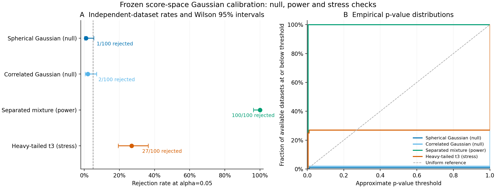

# Gaussian score calibration: validation results

The unchanged [prespecified study](../examples/calibration/study.json) completed
**400 independent score datasets**, with
**79,600 successful null GMM searches** out of
79,600 planned draws. There were
**0 point-search failures**, **0 failed
null searches**, and **0 unattempted draws**. Each search
includes K=1..4; searches are not counts of individual GMM candidate fits.
Preflight datasets, adapter smoke checks and code-parity checks are separate and
excluded from these study denominators. Failed searches were not retried.



[Vector PDF](figures/score-calibration/score-calibration.pdf) · [Editable SVG](figures/score-calibration/score-calibration.svg)

## Rejection rates at prespecified alpha=0.05

| Scenario | Rejected / available | Rate | Pointwise Wilson 95% Monte Carlo interval | MCSE | Unavailable tests |
| --- | ---: | ---: | ---: | ---: | ---: |
| Spherical Gaussian (null) | 1 / 100 | 1.0% | 0.2–5.4% | 1.0 percentage points | 0 |
| Correlated Gaussian (null) | 2 / 100 | 2.0% | 0.6–7.0% | 1.4 percentage points | 0 |
| Separated four-component mixture (power) | 100 / 100 | 100.0% | 96.3–100.0% | 0.0 percentage points | 0 |
| Unimodal Student t3 (stress) | 27 / 100 | 27.0% | 19.3–36.4% | 4.5 percentage points | 0 |

The two Gaussian cases evaluate type-I error only under those specified iid
score generators at N=64 and d=2. The four-component mixture evaluates power
for one strongly separated alternative. The heavy-tailed distribution is
unimodal but not Gaussian: its rejection rate is **Gaussian misspecification
sensitivity**, not a species or general no-clustering false-positive rate.

The statistic includes the complete configured K search and has an atom at zero
when K=1 wins. This can make the test conservative. The finite validation study
does not certify exact nominal error control. With 100 datasets, even 0/100
events has a Wilson upper limit of about 3.7%, and 100/100 has a lower limit of
about 96.3%. MCSE estimates can be zero at these boundaries; the Wilson interval
still records finite-dataset uncertainty. Intervals are pointwise and unadjusted.

Every dataset uses B=199 fresh parametric-null simulations, giving minimum
p=0.005, with ties included and a plus-one tail calculation. Null parameters
are estimated from the observed scores, so the p-values remain approximate.
The plot's uniform line is a reference, not a claim that these discrete p-values
are uniform. Changing B improves numerical resolution rather than resolving
model misspecification.

The observed Gaussian rejection rates (1% and 2%) are below the nominal 5%,
with pointwise intervals extending to approximately 5.4% and 7.0%. This is
consistent with conservative behavior in these limited conditions; it does not
prove a universal upper error bound. The strongly separated mixture was detected
in all 100 datasets. The 27% rejection rate for a unimodal heavy-tailed population
shows that the Gaussian diagnostic cannot be read as a general cluster or
species-significance test.

## Interpretation and scope

This is a global test of a single Gaussian in a **fixed score representation**.
It does not calibrate raw-data preprocessing, missingness, aggregation, view or
joint PCA selection, retained dimensions, view weights, group-sampling precision,
or spatial dependence. Actual learned scores need not obey the iid assumption.
Direct score simulations therefore do not establish calibration of the entire
integrative pipeline or any raw modality. The K ceiling equals the structured
generator's component count and does not assess larger K alternatives.

A rejection does not assign significance to individual clusters, validate the
selected K, or delimit biological species. Original assignments, bootstrap
stability and species-boundary evidence remain unchanged. No thresholds,
dimensions, weights, generators or model settings were tuned in response to
these results. See the [method and assumptions](gaussian-score-calibration.md).

## Execution, audit and reproducibility

Execution used a frozen 0.14.0.dev0 wheel (SHA-256
`aaf1d5735ec36bf6ffe5a4991f9bec9149d23ac28b5d8c4e9b6db49bde6a40c8`), Python 3.12.10,
NumPy 2.2.6, SciPy 1.15.3,
scikit-learn 1.6.1 and threadpoolctl
3.6.0. Four scenario processes each used one
numerical thread. The wheel was frozen before publication, over base revision
`74984d9fa272dbb02bb50eb0409f58a3106958e6`, with exact source hashes recorded; it is
not represented as an unmodified build of that base commit. It uses shared
installed scientific libraries and is not a self-contained environment image.

Final source checks added metadata, validation guards and audit fixes after
execution was frozen. Point statistics and the first three null draws matched
the frozen code exactly in all four scenarios. All 79,600 saved
draws were reconstructed during the final read-only audit. The audit checks
candidate selection/statistics from saved BIC records and does not re-estimate
candidate likelihoods. No campaign attempt was replaced, repaired or retried in the reported
denominators. The initial preflight audit's tuple/list metadata comparison was
repaired by re-analyzing the preserved preflight data; those fitting results
were not rerun.

The full raw study, exact wheel, dependency pins, execution logs, numerical
artifacts, preflight diagnostic, code-parity checks and full 1,612-file
SHA-256 inventory remain locally at
`~/.codex/outputs/super-deli/score-calibration-20261020/`. This is not a public
raw-data deposition. Compact auditable outputs are committed:

- [All dataset seeds and outcomes](../examples/calibration/results/datasets.csv)
- [Rates and Monte Carlo uncertainty](../examples/calibration/results/rates.csv)
- [Audited summary](../examples/calibration/results/summary.json)
- [Exact study declaration](../examples/calibration/results/study.json)
- [Code, runtime and artifact checksums](../examples/calibration/results/manifest.json)

Re-analyze saved results using the final package and matching numerical libraries:

```bash
CALIBRATION_ROOT="$HOME/.codex/outputs/super-deli/score-calibration-20261020"
super-deli analyze-score-calibration "$CALIBRATION_ROOT/study" \
  --output-dir "$CALIBRATION_ROOT/analysis-review"
python scripts/plot_score_calibration.py "$CALIBRATION_ROOT/analysis-review" \
  --output-dir "$CALIBRATION_ROOT/figures-review"
```

Plotting additionally requires Matplotlib. Every command requires a new output
directory. The original checkout, earlier campaign and empirical TPS download
were preserved. No new biological model was added in this checkpoint.
