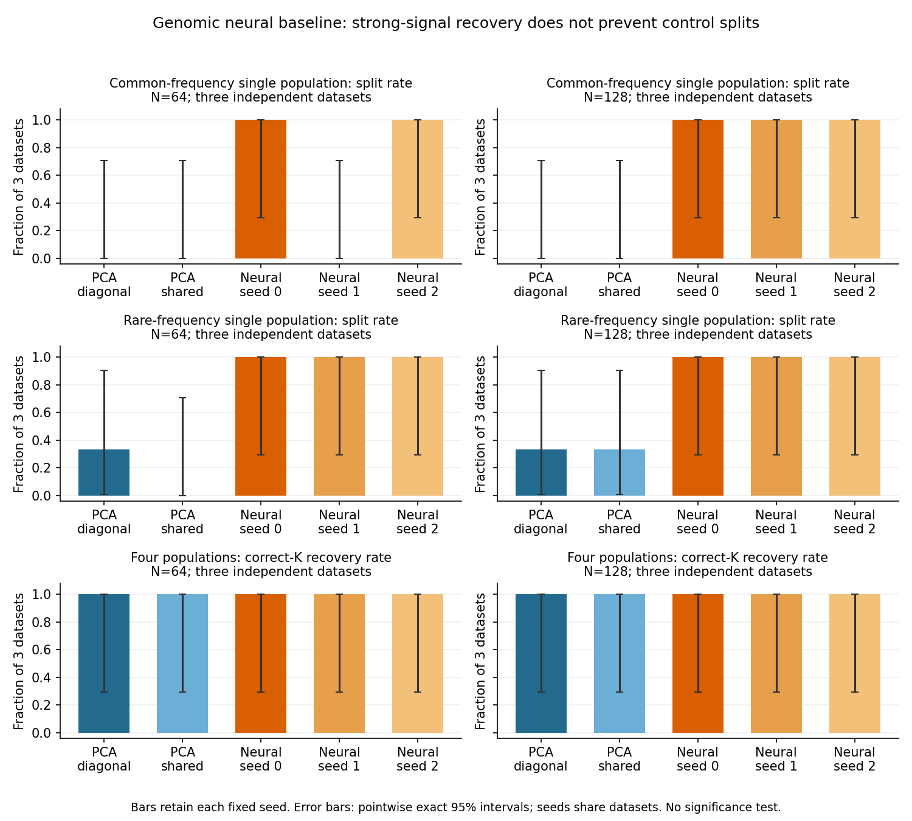

# Genomic neural/PCA bounded validation

This is an initial implementation and operating-range comparison, not an empirical
species-validation study or a general false-split calibration. All observations
are newly generated synthetic diploid genotypes; no downloaded biological dataset
or reference label enters training. All three fixed neural seeds are retained.

## Frozen design and accounting

The separate preflight used one independent dataset per six laws at N=64/128,
with one paired 80% specimen subset: 120 searches, 72 neural trainings and
36,000 independently audited Adam updates. The main used three datasets/cell,
five specimen subsets on the first dataset/cell, and six exact standalone
PCA/diagonal baseline replays: 486 searches, 288 neural trainings and 144,000
audited updates. Total: 606 searches, 360 trainings and 180,000 audited updates.
The measured preflight resource gate passed before main generation.

All datasets begin with 128 SNPs. The shared heads use two standardized
coordinates, K=1..4, minimum size three, ten starts, seed 71323, covariance
regularization 1e-6 and existing convergence/eligibility rules. The original
diagonal baseline retains native seed derivation. Neural seeds are 0, 1 and 2;
500 categorical-training updates are fixed. No labels select settings or seeds.

## What the datasets test

* **Common-frequency HWE:** independent Binomial(2,p) loci, p uniform(.15,.5),
  in one unstructured population; checks unnecessary splitting in a simple control.
* **Rare-frequency complete HWE:** p uniform(.01,.1), no missing calls; tests
  sparse genotype states and training-set monomorphic-locus removal.
* **Four populations:** four balanced groups with two independent generating
  axes; half the loci respond to each axis with a fixed logit-frequency shift
  of ±2.5. Only this law has four discrete generating groups for recovery/ARI.
* **Continuous cline:** a continuous uniform(-1,1) position shifts logit
  frequencies by ±3 times position. K>1 describes subdivision of a gradient,
  not discovery of discrete species.
* **Continuous admixture:** ancestry is Beta(.8,.8), mixing two fixed ancestral
  allele-frequency profiles (±1.5 logit shifts). There are no discrete truth
  labels for the sampled individuals.
* **Perfect-LD stress:** 16 independent HWE genotype blocks copied across eight
  loci each. This tests sensitivity to redundant linked markers in one population.

The generator draws genotypes from the stated law and writes canonical PHYLIP
IUPAC calls. SNPio reads and encodes every observation. Original calls are
checked against encoded calls up to an explicit whole-locus allele reversal;
the actual source calls, coding and source indices remain local.

Seeds are fixed before generation by the first four big-endian bytes of SHA-256
of `genomic-neural-v1|PHASE|N|LAW|REPLICATE`, where PHASE is `preflight` or `main`,
LAW is the machine-readable name below, and REPLICATE is zero-based. Bytes four
through seven fix specimen-subsampling seeds. `run_study.py` runs one case.

## Observed results

All five arms selected K=4 with ARI=1 on all six strongly separated four-group
datasets (three at each N). This is an easy, strong-signal check and establishes
no neural improvement over PCA. In the common-frequency one-population control,
PCA selected K=1 on 6/6 datasets for each PCA arm. Neural seed 0 and seed 2
split 6/6, while seed 1 split 3/6. Across the six rare-frequency controls,
all three neural seeds split every dataset; PCA/diagonal split 2/6 and
PCA/shared split 1/6. These seed-specific paired observations share datasets,
so pooling them as independent trials would exaggerate the evidence.

The neural representation can therefore produce apparent groups in data
generated from one population. Neither good strong-signal recovery nor a stable
partition establishes species validity. The baseline remains opt-in, and these
results provide no reason to replace PCA or promote a neural default. No point
or subsample search failed in either phase.

| Law | N | Arm | K counts (3 datasets) | Mean ARI (four groups only) |
|---|---:|---|---|---:|
| common_hwe | 64 | pca_diagonal | {'1': 3} | — |
| common_hwe | 64 | pca_shared | {'1': 3} | — |
| common_hwe | 64 | neural_seed_0 | {'3': 1, '2': 1, '4': 1} | — |
| common_hwe | 64 | neural_seed_1 | {'1': 3} | — |
| common_hwe | 64 | neural_seed_2 | {'3': 1, '4': 2} | — |
| rare_complete_hwe | 64 | pca_diagonal | {'2': 1, '1': 2} | — |
| rare_complete_hwe | 64 | pca_shared | {'1': 3} | — |
| rare_complete_hwe | 64 | neural_seed_0 | {'4': 1, '3': 2} | — |
| rare_complete_hwe | 64 | neural_seed_1 | {'3': 2, '4': 1} | — |
| rare_complete_hwe | 64 | neural_seed_2 | {'4': 3} | — |
| four_groups | 64 | pca_diagonal | {'4': 3} | 1.000 |
| four_groups | 64 | pca_shared | {'4': 3} | 1.000 |
| four_groups | 64 | neural_seed_0 | {'4': 3} | 1.000 |
| four_groups | 64 | neural_seed_1 | {'4': 3} | 1.000 |
| four_groups | 64 | neural_seed_2 | {'4': 3} | 1.000 |
| cline | 64 | pca_diagonal | {'3': 2, '4': 1} | — |
| cline | 64 | pca_shared | {'4': 3} | — |
| cline | 64 | neural_seed_0 | {'4': 3} | — |
| cline | 64 | neural_seed_1 | {'2': 1, '4': 2} | — |
| cline | 64 | neural_seed_2 | {'3': 3} | — |
| admixture | 64 | pca_diagonal | {'2': 1, '1': 2} | — |
| admixture | 64 | pca_shared | {'2': 2, '1': 1} | — |
| admixture | 64 | neural_seed_0 | {'3': 1, '4': 2} | — |
| admixture | 64 | neural_seed_1 | {'1': 2, '3': 1} | — |
| admixture | 64 | neural_seed_2 | {'1': 2, '4': 1} | — |
| perfect_ld | 64 | pca_diagonal | {'1': 3} | — |
| perfect_ld | 64 | pca_shared | {'1': 3} | — |
| perfect_ld | 64 | neural_seed_0 | {'1': 1, '2': 2} | — |
| perfect_ld | 64 | neural_seed_1 | {'1': 2, '2': 1} | — |
| perfect_ld | 64 | neural_seed_2 | {'1': 1, '4': 1, '2': 1} | — |
| common_hwe | 128 | pca_diagonal | {'1': 3} | — |
| common_hwe | 128 | pca_shared | {'1': 3} | — |
| common_hwe | 128 | neural_seed_0 | {'4': 3} | — |
| common_hwe | 128 | neural_seed_1 | {'2': 2, '4': 1} | — |
| common_hwe | 128 | neural_seed_2 | {'3': 1, '4': 2} | — |
| rare_complete_hwe | 128 | pca_diagonal | {'1': 2, '2': 1} | — |
| rare_complete_hwe | 128 | pca_shared | {'1': 2, '3': 1} | — |
| rare_complete_hwe | 128 | neural_seed_0 | {'3': 1, '4': 2} | — |
| rare_complete_hwe | 128 | neural_seed_1 | {'4': 3} | — |
| rare_complete_hwe | 128 | neural_seed_2 | {'4': 2, '3': 1} | — |
| four_groups | 128 | pca_diagonal | {'4': 3} | 1.000 |
| four_groups | 128 | pca_shared | {'4': 3} | 1.000 |
| four_groups | 128 | neural_seed_0 | {'4': 3} | 1.000 |
| four_groups | 128 | neural_seed_1 | {'4': 3} | 1.000 |
| four_groups | 128 | neural_seed_2 | {'4': 3} | 1.000 |
| cline | 128 | pca_diagonal | {'3': 2, '4': 1} | — |
| cline | 128 | pca_shared | {'4': 3} | — |
| cline | 128 | neural_seed_0 | {'4': 3} | — |
| cline | 128 | neural_seed_1 | {'4': 3} | — |
| cline | 128 | neural_seed_2 | {'3': 2, '4': 1} | — |
| admixture | 128 | pca_diagonal | {'2': 2, '3': 1} | — |
| admixture | 128 | pca_shared | {'2': 3} | — |
| admixture | 128 | neural_seed_0 | {'4': 2, '2': 1} | — |
| admixture | 128 | neural_seed_1 | {'1': 2, '2': 1} | — |
| admixture | 128 | neural_seed_2 | {'3': 2, '2': 1} | — |
| perfect_ld | 128 | pca_diagonal | {'1': 3} | — |
| perfect_ld | 128 | pca_shared | {'1': 3} | — |
| perfect_ld | 128 | neural_seed_0 | {'2': 1, '3': 2} | — |
| perfect_ld | 128 | neural_seed_1 | {'1': 3} | — |
| perfect_ld | 128 | neural_seed_2 | {'2': 1, '4': 2} | — |

See [the small aggregate export](../examples/genomic-neural/results/validation.json)
for successful/withheld denominators, selected-K distributions, ARI ranges,
pointwise exact 95% intervals and conditional specimen-stability summaries.
Only three independent datasets support each row: even 3/3 corresponds to a
pointwise interval of approximately 0.292–1.000. These are not simultaneous
performance guarantees. Neural seeds and five draws do not increase that N.
Stability is measured on one dataset per cell and conditions on its source
panel and optimizer seed; high stability does not establish correct groups.

## Verification and limitations

Independent NumPy categorical gradients and coupled-decay Adam equations checked
each actual optimizer update. Separate equations checked retained loci, Patterson
means/scales, frozen coordinates, PCA subspaces, categorical reconstruction,
selected mixture densities/membership/BIC and candidate ranking. Original
sample IDs and paired subset identities were audited. All four SNPio formats
and optional popmaps have separate engineering tests. Exact native diagonal
replays check that the coordinator preserves existing point behavior.

Candidate clusters remain sensitive to the locus panel, LD, continuous structure,
ascertainment, finite sampling and representation/optimizer settings. The study
does not supply neural genomic p-values, lineage/coalescent inference, biological
species truth, or uncertainty in missing genotypes. Complete data, the bounded
CPU panel and explicitly assumed independent specimens are required. Detailed
inputs, weights, numerical traces and draws stay local. Existing defaults,
schemas, historical p-values and empirical gates are unchanged; nobody was contacted.
