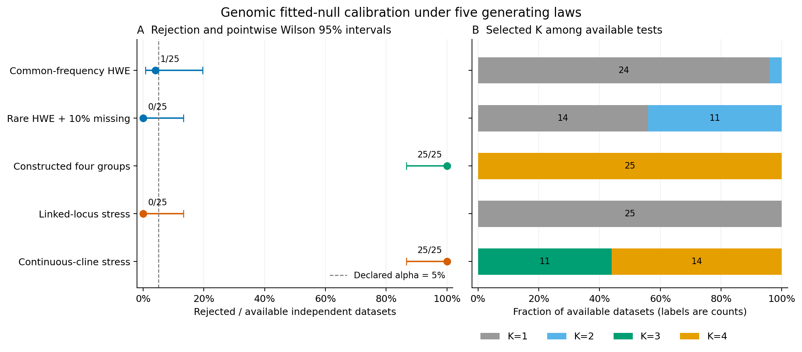

# Genomic empirical fitted-null validation results

The approved unchanged study completed **125 observed datasets**, with
**125/125 available tests**, **12,500 successful full-pipeline
clustering fits**, **0 failed fits** and **0
unattempted fits** out of **12,500 planned**. Settings and seeds were fixed before
execution. No main attempt was retried, repaired or replaced.

## Rejection, availability and uncertainty

| Case | Available / requested | Rejected / available | Rate | Pointwise Wilson 95% interval |
| --- | ---: | ---: | ---: | ---: |
| Common-frequency HWE | 25/25 | 1/25 | 4.0% | 0.7–19.5% |
| Rare/missing HWE | 25/25 | 0/25 | 0.0% | 0.0–13.3% |
| Constructed four-group alternative | 25/25 | 25/25 | 100.0% | 86.7–100.0% |
| Linked-locus stress | 25/25 | 0/25 | 0.0% | 0.0–13.3% |
| Continuous-cline stress | 25/25 | 25/25 | 100.0% | 86.7–100.0% |

The first two cases are checks under their prespecified unlinked pooled-HWE
laws; their finite results do not prove precise or general 5% error control.
The four-group result is power for one strong constructed alternative. Neither
rejection nor the selected K establishes species boundaries, the true biological
number of groups or cluster-specific significance.

The linked and cline cases deliberately violate the fitted null. The cline has
a continuous uniform latent coordinate and no discrete generating groups. Its
rejections measure misspecification sensitivity, not species/clustering type-I
error. Non-rejection for this linked-locus construction does not show that
ignoring LD is safe: LD remains outside the fitted law, and a global mixture
statistic need not detect every departure. Genomic dependence and continuous
structure need their own null models before broader interpretation.

Rates use independent observed datasets, with availability retained. Wilson
intervals are pointwise and unadjusted across five cases. With 25 datasets per
case, even zero observed rejections gives an upper interval near 13.3%.
Conditional Monte Carlo tail intervals for every available test are exported
in [dataset diagnostics](../examples/genomic-calibration/results/dataset-diagnostics.csv);
they exclude frequency-estimation and model uncertainty. P-values are discrete
at resolution 0.01 and approximate because frequencies are fitted. Stability
bootstrap remains separate.

Panel A shows rejection rates and pointwise Wilson intervals. Panel B shows
selected K among available tests; its labels are dataset counts. The 5% line is
the declared alpha, not a reference error rate for the alternative/stress laws.
[PDF](figures/genomic-calibration/genomic-calibration.pdf) and
[SVG](figures/genomic-calibration/genomic-calibration.svg) are included.

## Fixed design and diagnostics

Each case contains 25 independent datasets of 64 specimens and 128 panel loci.
The model uses Patterson scaling, two PCs, diagonal-GMM K=1..4, minimum hard
component size 5, 10 EM starts, max 500 iterations, tolerance 0.001 and covariance
regularization 1e-6. There are 99 raw null draws per observed dataset and
alpha=0.05. The same prespecified analysis seed is used for every pipeline;
observed and null data streams are separate. Ground-truth partitions remain
outside fitted inputs. Full source laws and assumptions are in the
[method](genomic-null-calibration.md).

The [diagnostics](../examples/genomic-calibration/results/diagnostics.csv) retain
selected-K counts, zero point-statistic counts, fitted boundary-frequency loci,
missing-call counts and p-value ranges. Observed monomorphic frequencies remain
at exact boundaries, with no pseudo-count or variance floor. Fixed missing masks
are preserved in every draw. SNPio can reverse a whole locus's coding without
changing PCA geometry; the audit verifies genotype equivalence under those
reversals rather than assuming a fixed minor-allele name.

Selection and significance differ visibly: the rare/missing HWE case selected
K=2 in **11/25** datasets, yet none rejected the fitted null. The continuous
cline selected K=3 in **11/25** and K=4 in **14/25**, with all tests rejecting,
despite having no discrete generating groups. The strong constructed
four-group alternative selected K=4 in all 25 datasets. These contrasts are
specific to this frozen design and cannot convert mixture components into
species hypotheses.

## Audit and reproducibility

The read-only audit verified **252,250 archived members**,
**12,500 successful pipeline results**, and
**15,055 study files**. It regenerated every observed and simulated
raw genotype file, independently checked pooled frequency MLEs and binomial
likelihoods, reconstructed filtering/imputation/Patterson scaling, checked PCA
eigensystems/projections and selected diagonal-mixture likelihood/BIC/membership,
and recomputed seeds, candidate selection, tails, evidence and fit denominators.
No ingestion or clustering was refitted for analysis. Nonselected mixture
likelihoods are retained/checksummed rather than independently re-evaluated from
unexported parameters. Outer failures would retain counts without a complete
numerical re-audit.

Frozen package and reporting package Python sources agree. The full-settings
preflight passed all 15 pipelines and its audit. Runtime: Python 3.12.10,
NumPy 2.2.6, SciPy 1.15.3,
scikit-learn 1.6.1 and SNPio
1.7.7; at most four process-isolated case jobs,
one numerical thread per fit. The final case starts after an earlier case
completes. Python 3.11/3.12 are the supported package/CI versions; this larger
study is a Python 3.12 run, not a claim of identical cross-platform fits.

Compact audited ledgers, intervals, diagnostics, settings, provenance hashes and
figures are committed. Full raw observed/null inputs, staged SNPio diagnostics,
pipeline archives, frozen wheel/runtime, preflight, logs and analysis inventories
are retained at:

`~/.codex/outputs/super-deli/genomic-null-20261021/`

This is local preservation, not public raw-data deposition. The frozen runtime
references existing scientific libraries and is not a self-contained system
image. The manifest records source, wheel, configuration and full-file inventory
hashes. See the [study declaration](../examples/genomic-calibration/results/study.json)
and [audit summary](../examples/genomic-calibration/results/summary.json).
