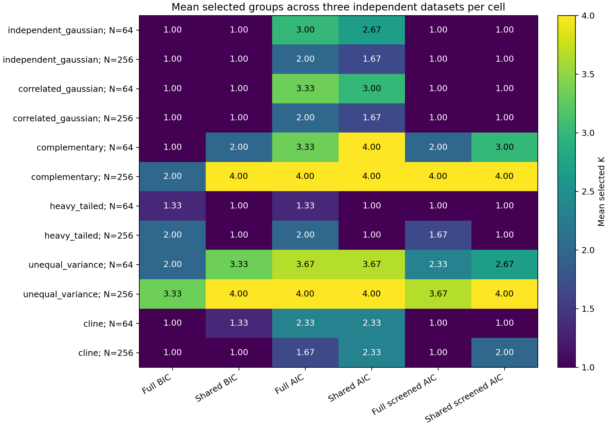

# Unified grouped analysis: checkpoint verification

The unified grouped interface completed all **2,568 planned main candidate
searches** across 36 independently generated observations. All six configured arms
completed, all 540 pairwise comparisons passed the independent audit, and no
scientific fits or draws failed or were replaced. The separate 364-search
preflight also passed its independent numerical audit.

The study used the existing independent/correlated Gaussian, complementary
four-group, heavy-tailed, unequal-variance four-group and continuous-cline
simulators. Each law had three fresh datasets at 64 and 256 localities. Each
locality retained 1–4 morphology specimens and one ecology record, with four
continuous traits/view, two PCs/view, four joint PCs and equal view weights.
Models retained K=1..4, minimum distinct size five and ten optimizer starts.

Cells show mean selected K over three datasets; fractional means are not selected
partitions. The six prespecified arms were full/shared BIC, full/shared AIC and
full/shared predictive-screened AIC, using the same full-data preprocessing and
fixed predictive split seed. These small cells reproduce existing tradeoffs,
including ordinary AIC selecting extra components in Gaussian controls and
screening excluding some four-group solutions at N=64. They do not choose a
winning model or establish general accuracy, power or false-positive control.

## Exact accounting and native parity

- 576 main full-data/fold searches: sixteen per observation across six arms.
- 1,800 bootstrap searches: 25 shared-predictive whole-locality draws on the first
  dataset in each of twelve cells, with six searches per draw (300 retained draws).
- 192 standalone replay searches: all six native point workflows on those twelve
  observations, equivalent to 72 arm invocations.

All main and preflight standalone replays matched assignments, selected parameters,
full retained AIC candidate pools, predictive fold arrays and screen decisions
exactly. Final review extended the replay verifier to cover every retained candidate
and fold array; the existing outputs were checked again without scientific refits.
Ordinary BIC's native contract retains selected parameters and candidate BIC
records, rather than complete nonselected fitted arrays. The adapter preserves
that distinction and makes its native evidence available for inspection.

The no-refit audit independently reconstructed raw values/counts and identity joins,
view/group-mean PCA, standardization, profile normalization, fusion, joint PCA,
Gaussian densities/membership and available information criteria. It recalculated
predictive fold eligibility and pooled validation gains, checked fixed original-ID
folds and draw multiplicities, and reconstructed stability/OOB denominators and
failure bounds. No generating label was used to select settings or fit partitions.
Post-fit synthetic reference agreement is published separately from stability.

## Stability remains conditional and can be weak

The report keeps native support types separate. Shared predictive stability uses
whole-locality resampling with the original folds and optimizer settings held
fixed, retaining every morphology member/count and the single ecology record.
Twenty-five draws are a bounded software-verification budget, not a universal
recommendation; both-OOB point frequencies can remain unavailable under native
minimum-coverage rules. Missing support is not zero or certainty.

For the first N=64 complementary observation, the point screen selected K=3 but
its 25 draws selected K=1 fifteen times and K=2 ten times. For the first N=256
complementary observation, all 25 draws selected K=4. These are examples from one
bootstrapped dataset per cell, not independent replications or a general stability
claim. The wrapper exposes the existing small-sample limitation and does not repair
it or reinterpret a repeated merged partition as preservation of all original groups.

## Resources and preserved inference boundaries

The original 2 GiB gate failed at a measured projection of about 3.51 GiB. A direct
user approval raised only the local cap to 4 GiB. The original gate, settings,
audited probe files, approval and runtime snapshots remain local. After retaining
the lossless test archive, the amended projection was about 3.68 GiB, including the
25% allowance and 128 MiB reserve. No seeds, models, draws or datasets changed, and
no preflight fit was repeated. The detailed main study occupies about 2.37 GiB.

All prior numerical fitting, projection, sampling, selection and significance
modules remain unchanged. Defaults, old schemas and historical p-values retain
their meanings. This interface adds no p-value, automatic family selection,
consensus species partition or empirical species-boundary guarantee. Existing
sampling/reference gates and unsupported stability combinations remain in force.
No empirical fitting, author contact or private catalogue access occurred.

Only code, invented fixtures, figures and [small summaries](../examples/grouped-analysis/results/summary.json)
are published. Detailed raw tables, membership maps, candidate/fold parameters,
bootstrap records, logs and audits remain local. See [usage and output contracts](grouped-analysis.md),
[model summaries](../examples/grouped-analysis/results/models.json),
[conditional stability summaries](../examples/grouped-analysis/results/stability.json)
and [post-fit reference recovery](../examples/grouped-analysis/results/recovery.json).
