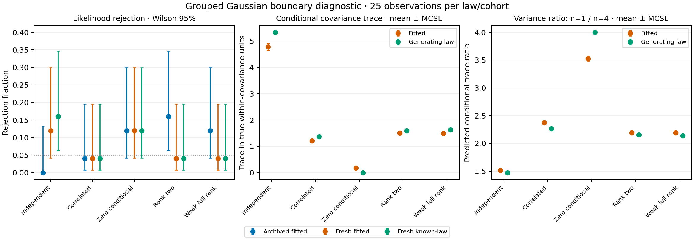

# Grouped boundary-rejection diagnostic results

**The fresh comparison did not isolate a boundary-specific fitted-null error.**
All 75 fresh boundary observations gave the same rejection decision under fitted
and analytically known reference parameters: 3/25 zero-covariance, 1/25 rank-two
and 1/25 weak-covariance observations. The archived rates were 3/25, 4/25 and
3/25, respectively. The earlier elevation did not reproduce consistently.

**Calibration remains unresolved.** Zero covariance still rejected 12% under
both arms; the independent, full-rank Gaussian known-law control rejected 16%.
Twenty-five observations/law give wide intervals. Small-sample variation is a
plausible contributor, but this study does not prove it is the sole explanation,
establish nominal 5% behavior or justify an empirical correction.

All **24,875/24,875 new pipeline fits succeeded**, without failures, unattempted
or replacement fits. Independent audit covered these and 12,500 archived fits:
**37,375 unique pipeline records**, **28,140 new-study files** and
**1,198,875 archive members**. Copies of 125 observed artifact sets in known-law
archives are checked but are not counted as new fits. The separate checker
verified both statistics in all 37,375 retained pipeline records and
**750 historical/fresh tails**, with no
withheld results. Historical p-values and production behavior are preserved.

## Prespecified paired outcomes

| Law | Archived fitted | Fresh fitted (Wilson 95%) | Fresh known-law (Wilson 95%) | Fitted-only / known-only rejection |
| --- | ---: | --- | --- | ---: |
| Independent Gaussian | 0/25 | 3/25 (4.2–30.0%) | 4/25 (6.4–34.7%) | 0 / 1 |
| Correlated Gaussian | 1/25 | 1/25 (0.7–19.5%) | 1/25 (0.7–19.5%) | 0 / 0 |
| Zero conditional covariance | 3/25 | 3/25 (4.2–30.0%) | 3/25 (4.2–30.0%) | 0 / 0 |
| Rank-two conditional covariance | 4/25 | 1/25 (0.7–19.5%) | 1/25 (0.7–19.5%) | 0 / 0 |
| Weak full-rank conditional covariance | 3/25 | 1/25 (0.7–19.5%) | 1/25 (0.7–19.5%) | 0 / 0 |

Every entry has 25 observations; archived and fresh cohorts are unpaired.
Fitted/known comparisons within the fresh cohort are paired by observation,
counts, model settings and draw innovations. They agree on 124/125 decisions
overall and all 75 boundary decisions. The one discordance is an independent-
Gaussian known-law rejection. This is not an equivalence test.

The 12% interval is **4.2–30.0%**, the 4% interval **0.7–19.5%**, and the 16%
interval **6.4–34.7%**. The latter also occurs in a full-rank known-law control,
so high observed rejection is not confined to covariance boundaries.
These are pointwise, unadjusted Wilson intervals across several laws/metrics,
not simultaneous guarantees. The archived concerns are retained rather than
dismissed or relabeled as power.

Mean paired p-value differences (fitted minus known, mean ± MCSE across 25
observations) are:

- Independent Gaussian: -0.0140 ± 0.0141.
- Correlated Gaussian: +0.0080 ± 0.0100.
- Zero conditional covariance: -0.0064 ± 0.0102.
- Rank-two conditional covariance: -0.0084 ± 0.0102.
- Weak full-rank conditional covariance: +0.0180 ± 0.0107.

There is no common directional shift across these five means. Individual
p-values and reference distributions differ even when threshold decisions match.
The comparison changes all nuisance parameters together; it cannot uniquely
attribute differences to conditional covariance, ecology covariance, regression
or within-group variance. BIC remains descriptive: fresh fitted rejection counts
in table order are [0, 0, 0, 0, 0], and known-law counts are [0, 0, 0, 0, 0]; no test is chosen
by its p-value.

## What the covariance and sampling checks show

| Law | True conditional trace | Fitted trace: mean ± MCSE | True n=1/n=4 variance ratio | Fitted ratio: mean ± MCSE | Mean null statistic T: fitted / known |
| --- | ---: | --- | ---: | --- | ---: |
| Independent Gaussian | 5.333 | 4.782 ± 0.133 | 1.474 | 1.514 ± 0.016 | 79.58 / 80.69 |
| Correlated Gaussian | 1.367 | 1.208 ± 0.057 | 2.267 | 2.373 ± 0.038 | 75.93 / 75.20 |
| Zero conditional covariance | 0.000 | 0.175 ± 0.018 | 4.000 | 3.528 ± 0.046 | 76.26 / 76.70 |
| Rank-two conditional covariance | 1.600 | 1.509 ± 0.068 | 2.154 | 2.193 ± 0.035 | 75.56 / 77.12 |
| Weak full-rank conditional covariance | 1.633 | 1.491 ± 0.062 | 2.139 | 2.194 ± 0.031 | 76.80 / 76.76 |

Traces use true within-morphology covariance units. The variance contrast is the
trace ratio for conditional group-mean covariance C + R/n at n=1 versus n=4,
using the same true-within whitening in each arm. Values are evaluated at the
fitted or generating parameters, rather than estimated by pooling null draws.

The zero-covariance fit has mean conditional trace **0.175**, although its true
trace is zero. Its predicted variance contrast decreases from **4.000** to
**3.528**. Only 2/25 zero-covariance fits have diagnostic rank zero; seven have
rank one, 15 rank two and one rank three. Rank-two fits have rank two in 9/25,
rank three in 15/25 and rank four in 1/25; weak full-rank fits have rank two in
13/25, rank three in 11/25 and rank four in 1/25. These are sampling-dependent
estimates, not failed convergence or a new rank-selection rule.

Thus boundary/rank estimation and count-precision distortion are real, but this
experiment does not connect them to excess rejection relative to the known-law
arm. For zero covariance, the mean reference statistic T is **76.26** fitted
versus **76.70** known, with identical three rejection decisions. Other laws show
both directions of reference/p-value shifts. The raw boundary effect alone is
not established as the source of the archived pattern.

Uncertainty for null-pipeline characteristics averages draws within each
observation first, then uses 25 observation-level summaries. Generic pooled
draw descriptors in the external audit are descriptive; their pooled mean_mcse
is excluded from portable summaries and is not used for population inference.
The portable observation summaries retain means, medians, MCSEs and availability.

## Numerical and pipeline checks

Independent dense raw-data likelihoods agree with every stored fitted-null
likelihood. All 250 accepted raw fits improve on the feasible known generating
parameters; the smallest negative-log-likelihood improvement is **12.196**.
The largest stored constrained-optimality residual is **5.57e-7**, and independent
dense scores/cone checks pass. These checks found no obvious raw-fit failure,
but do not certify a global optimum.

All candidate densities, memberships, criteria and eligibility checks pass.
K=4 is eligible in roughly **48–59%** of fresh reference draws, so eligibility
is active in both arms. The largest recorded iteration count across candidates
is **85**. The minimum component-eigenvalue/regularizer ratio across all retained candidates,
including ineligible fits, reaches one within roundoff; regularization can bind; numerical verification does not establish
that regularization is irrelevant.

Mean descriptive count-membership Cramer's V at the likelihood-maximizing
eligible K is approximately **0.21–0.22** in both fresh arms. Cramer's V has a
finite-sample baseline and depends on selected components. These values do not
establish biological clusters, a causal count effect or significance of K.
PCA variance retention differs between fitted/known laws and is retained in
the observation-level evidence. The unchanged ten-start policy screens the
best-likelihood restart after fitting; it does not find the best size-admissible
restart. No restart, solver, regularizer or preprocessing repair is applied.

## Scope, preservation and reproduction

The [method and frozen design](grouped-boundary-diagnostics.md) specify 64 groups,
1–4 morphology specimens/group, one ecology row/group, four traits/view, group-mean
morphology PCA, two PCs/view, four joint PCs, equal weights, full covariance,
K=1..4, minimum size 5, ten starts, model seed 71323, alpha=0.05 and 99 draws/arm.
The 125 fresh observations use master seed 20261116, frozen before generation
and disjoint from all 250 observations in the preceding study. No alternatives,
stability draws, empirical replacement, post-hoc threshold or correction were
added after viewing results.

Runtime **0.32.0.dev0** used Python 3.12.10, NumPy 2.2.6, SciPy 1.15.3,
scikit-learn 1.6.1 and threadpoolctl 3.6.0. All **138 package modules** match the
frozen fit runtime; of 134 previous modules, 132 remain byte-identical and only
version metadata/CLI dispatch change. Four diagnostic modules are added.
BIC/default configuration serialization, historical p-values, the earlier
numerical issue and restart-admissibility behavior remain unchanged.

Six prior checkouts, **188,822 prior-study files**, 1,078 other preceding-study
metadata/runtime files, five original TPS inputs and the cleanup archive match
their before/after fingerprints. Personal filenames/data are excluded from the
published evidence; author credits and scientific citations remain.

[Portable evidence](../examples/grouped-boundary-diagnostics/results/) includes
all tails, covariance diagnostics, complete pipeline metric records compressed
by law, observation-level summaries, raw-likelihood comparisons, frozen seeds,
source/runtime hashes and independent checks. Full raw arrays, every candidate,
draws, logs and frozen wheel remain external as
grouped-boundary-diagnostics-20261023. Local preservation is not public raw-data
deposition or a self-contained runtime image.

Python 3.11/3.12 remain supported. The published commit's Foundation workflow
reports full scientific/foundation tests, lint, formatting, distributions and
installed-command checks. Tests include law/seed/statistic tampering, no-refit
audits, shared-fit accounting, raw-null/reference-failure withholding, portable
tail equations and observation-level uncertainty.

Reproduce figures/tables, additionally installing Matplotlib, with:

    python scripts/report_grouped_boundary_diagnostics.py /path/to/artifact-root \
      --archived-study /path/to/aic-grouped-20261023/study \
      --output-dir /path/to/new-results --figure-dir /path/to/new-figures

This checkpoint stops with an unresolved calibration concern and a clearer
diagnostic boundary. It promotes no default, correction, significant-K claim
or species-boundary guarantee.
