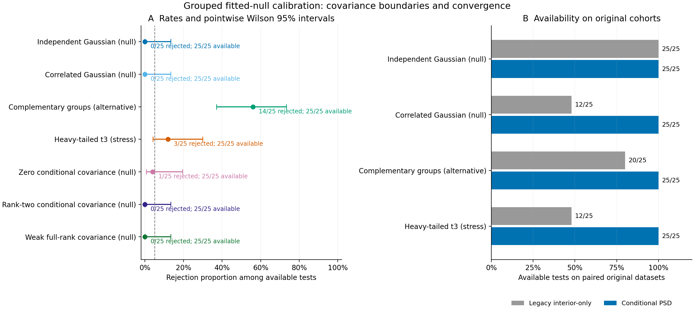

# Grouped covariance-boundary validation results

The approved unchanged study completed **175 observed datasets** and planned
**17,500 full-pipeline clustering fits**. There were **175/175 available
tests**, **17,500 successful fits**, **0 failed
clustering fits** and **0 unattempted fits**. All outcomes
remain in the ledger; no main attempt was repaired, retried or replaced and no
settings were tuned to these results.

For the **100 byte-identical original datasets**, availability changed from
**69/100 to 100/100**:
**31 recovered tests and 0 lost tests**.
This addresses the previous covariance-boundary and iteration-limit failures
for these cohorts. It does not guarantee convergence on arbitrary data or prove
nominal inferential calibration.

## Rejection, availability and uncertainty

| Case | Available / requested | Rejected / available | Rate | Pointwise Wilson 95% interval |
| --- | ---: | ---: | ---: | ---: |
| Independent Gaussian | 25/25 | 0/25 | 0.0% | 0.0–13.3% |
| Correlated Gaussian | 25/25 | 0/25 | 0.0% | 0.0–13.3% |
| Complementary four-group alternative | 25/25 | 14/25 | 56.0% | 37.1–73.3% |
| Heavy-tailed t3 stress | 25/25 | 3/25 | 12.0% | 4.2–30.0% |
| Zero conditional covariance | 25/25 | 1/25 | 4.0% | 0.7–19.5% |
| Rank-two conditional covariance | 25/25 | 0/25 | 0.0% | 0.0–13.3% |
| Weak full-rank conditional covariance | 25/25 | 0/25 | 0.0% | 0.0–13.3% |

Rates weight independent observed datasets equally. Wilson intervals and MCSE
concern available tests; if tests are withheld, their rates are conditional and
all-requested withheld-outcome bounds remain in the compact exports. There are
0 withheld tests in this run. The intervals are pointwise, unadjusted
across seven cases, and not confidence limits for species boundaries. A zero
plug-in MCSE does not imply zero uncertainty. These 25-dataset scenarios cannot
certify precise general 5% error control.

The original Gaussian cases provide checks under their fixed continuous-data
laws. The additional zero/rank-two/weak-component cases specifically exercise
boundary and near-boundary estimation. Their finite results do not establish
uniform validity at or near every covariance boundary. Large point-statistic
mass at T=0 and discrete p-values can produce conservative behavior; the
[diagnostic table](../examples/boundary-calibration/results/diagnostics.csv)
retains selected K and p-value ranges.

The complementary alternative concerns one strong four-group construction with
a K ceiling of four. Rejection is not recovery or significance of generating K
or every membership. The heavy-tail stress population has no generating
clusters and violates the Gaussian law: rejection is misspecification
sensitivity, **not species/clustering type-I error**. Neither rejection nor
non-rejection establishes species number.



Panel A shows available-test rejection rates and Wilson intervals. Panel B
compares availability on the original paired observations; increased availability
is a numerical result, separate from calibration. [PDF](figures/boundary-calibration/grouped-boundaries.pdf)
and [SVG](figures/boundary-calibration/grouped-boundaries.svg) are included.

## Estimated covariance ranks and numerical checks

| Case | Estimated rank 0 | Rank 1 | Rank 2 | Rank 3 | Rank 4 |
| --- | ---: | ---: | ---: | ---: | ---: |
| Independent Gaussian | 0 | 0 | 0 | 0 | 25 |
| Correlated Gaussian | 0 | 0 | 3 | 15 | 7 |
| Complementary four-group alternative | 0 | 0 | 0 | 6 | 19 |
| Heavy-tailed t3 stress | 0 | 0 | 0 | 18 | 7 |
| Zero conditional covariance | 0 | 10 | 13 | 2 | 0 |
| Rank-two conditional covariance | 0 | 0 | 7 | 16 | 2 |
| Weak full-rank conditional covariance | 0 | 0 | 8 | 16 | 1 |

**114 accepted fits were boundary/near-boundary by the declared numerical
rank threshold**. Rank refers to conditional morphology covariance after
accounting for ecology, not to clusters or species. Estimated rank need not
equal the generating rank: finite-sample covariance estimation at a boundary
is nonregular. All accepted fits pass positive-definite within/ecology guards
and covariance-cone stationarity. The largest selected-fit standardized per-group
optimality residual was **2.54e-06**, below 1e-5.

The method fits the natural PSD closure of the same Gaussian hierarchy, using
conditional regression and count-dependent covariance. Four fixed factor
starts, a 1,000-iteration factor-stage budget and up to 2,000 projected steps
per start are prespecified. No positive variance floor, ridge, boundary repair
or outcome-triggered restart is used. Stage termination and iteration counts
remain in every layout; regression tests cover the three previous all-start
iteration-limit datasets. Constrained stationarity and the best accepted
numerical likelihood do not certify a global optimum.

## Paired comparison with #45

All 100 original raw declarations and morphology/ecology CSV inputs were
**byte-identical**, with identical observed-data seeds and point-clustering
settings. Both tests were available in 69 pairs. Their observed
statistics agreed within 0, and every selected point K agreed.
The new-minus-legacy raw null negative-log-likelihood differences among those
pairs ranged from **-7.56e-06 to -9.09e-13**; lower is better. These are
numerical comparisons, not a likelihood-ratio significance test or an ablation
that isolates parameterization from boundary-domain changes.

The [paired table](../examples/boundary-calibration/results/paired.csv) preserves
all availability changes, ranks, point statistics, null likelihoods and p-values.
Schema 2 versions its factor recipe and null seed namespace. The bootstrap
datasets are not a common random bank with schema 1, so p-value differences also
include Monte Carlo variation. Previous artifacts were neither overwritten nor
silently reinterpreted as boundary-capable fits.

## Fixed experiment and inferential limits

The [exact declaration](../examples/boundary-calibration/results/study.json)
fixes 25 datasets per case, 64 groups, independent uniform 1–4 morphology counts,
one ecology vector/group, four features/view, two PCs/view and jointly, equal
weights, K=1..4, minimum hard size 5, 10 GMM starts, B=99 and alpha=0.05.
Model seed 71323 is identical for observed and bootstrap point fits; master
seed 20261024 preserves the old observed streams and separates the three new
case streams. Truth never enters fitting. Stability remains separate.

The [method](grouped-covariance-boundaries.md) specifies all seven raw laws,
conditional likelihood, numerical acceptance rules and version contracts.
Fresh nulls use ecology I4, R=0.75 I4, a fixed cyclic regression and a rotated
conditional covariance with eigenvalues (0,0,0,0), (0.8,0.4,0,0), or
(0.8,0.4,0.02,0.005). The original four raw laws are unchanged.

P-values remain **approximate fitted-Gaussian departure measures**. Boundary
fits are nonregular. Full pipeline refits, constrained numerical optimality and
the plus-one calculation do not provide an exact-rank or general nominal-size
guarantee. Binomial tail intervals exclude fitted-parameter/misspecification
uncertainty. There is no chi-square/Wald approximation, double bootstrap,
uniform size correction or species-boundary claim. Related/spatial groups,
informative counts, missingness, heterogeneous residual covariance, repeated
ecological measurement error, and empirical genomic/count/shape nulls remain
outside this checkpoint.

## Audit, source parity and preservation

The new read-only audit checked **541,975 archived members**,
verified **17,500 successful pipelines** and
inventoried **20,692 study files**. It regenerated raw observations and
draws; independently evaluated dense raw likelihoods and conditional covariance,
regression, ecology and mean scores; verified ranks/factors; and reconstructed
fusion, joint projection, selected GMM likelihood/BIC/membership, K selection,
inference and denominators. No optimizer or clustering fit was rerun for
reporting. View PCAs and nonselected likelihoods are preserved/checksummed,
not independently refitted. Any outer failure retains ledger/error verification
of its partial artifacts.

The same code also successfully re-audited #45's 6,900 historical pipelines and
213,693 archived members. Its complete raw-file inventory checksum is unchanged.
All frozen package Python source hashes match the reporting implementation.
The campaign used Python 3.12.10, NumPy
2.2.6, SciPy 1.15.3,
scikit-learn 1.6.1 and threadpoolctl
3.6.0, with one numerical thread/fit and
at most four process-isolated case jobs. A separate seven-case preflight/audit
preceded the unchanged main study and is excluded from these denominators.

Full raw data, accepted parameters and rejected-stage diagnostics, point/draw
records, ZIP archives, logs, frozen wheel/runtime, legacy re-audit, comparison,
and preflight are preserved locally at:

`/Users/btm002/.codex/outputs/super-deli/grouped-boundaries-20261021/`

This is local preservation, not public raw-data deposition. The runtime refers
to recorded local scientific libraries and is not a self-contained environment
image. Compact evidence and inspected PDF/SVG/PNG figures are committed. The
[manifest](../examples/boundary-calibration/results/manifest.json) records public
hashes, raw inventory hashes, frozen wheel hash and per-case host wall times;
these are not comparative performance claims. Numerical acceptance and PCA/GMM
results can vary across library versions and platforms.

```bash
python -m pip install '.[dev,clustering]'
python -m pytest -q
# Run all seven cases in the method into separate new directories.
super-deli analyze-grouped-calibration /path/to/study --output-dir /path/to/new-audit
super-deli compare-grouped-calibration /path/to/legacy-study \
  --current-study /path/to/study --output-dir /path/to/new-comparison
python scripts/plot_grouped_boundaries.py /path/to/new-audit \
  --comparison /path/to/new-comparison --output-dir /path/to/new-figures
```

Python 3.11/3.12 remain supported. CI uses bounded tests and installed workflow
commands; it does not rerun this larger campaign.
