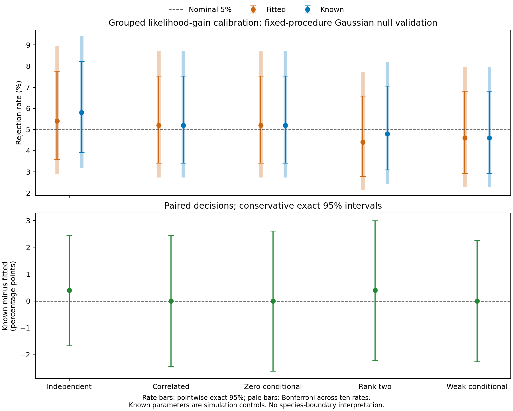

# Larger grouped likelihood-gain false-positive validation results

**The earlier elevated boundary-null rejection did not persist in this larger
prespecified cohort.** Fitted-null rejection rates were **4.4–5.4%**, compared
with **4.6–5.8%** for known-parameter controls. Every pointwise and simultaneous
primary rate interval includes the nominal 5%. These results are compatible
with 5% rejection for the five tested Gaussian laws and fixed analysis design.

**This is bounded validation, not a general size guarantee or an equivalence
result.** The fitted-null test remains approximate, covariance-boundary behavior
can be nonregular, and other parameter values or biological sampling mechanisms
remain unvalidated. No correction, default or historical p-value was changed.

All **2,500 observed datasets**, **497,500/497,500 planned unique pipeline fits**,
and **5,000 fitted/known-reference tests** completed without failed, unattempted,
withheld or replacement outcomes. Independent audit checked **15,985,000 archive
members** and **562,515 study files**. A separate standard-library checker
recomputed both retained statistics and all **10,000 tails**, including the
descriptive BIC comparator. Shared observed archive copies are verified but
counted as one fit per dataset.

## Prespecified rejection rates

| Law | Fitted: rejected / available | Fitted rate (exact 95%) | Known: rejected / available | Known rate (exact 95%) |
| --- | ---: | --- | ---: | --- |
| Independent Gaussian | 27/500 | 5.4% (3.59–7.76%) | 29/500 | 5.8% (3.92–8.22%) |
| Correlated Gaussian | 26/500 | 5.2% (3.42–7.53%) | 26/500 | 5.2% (3.42–7.53%) |
| Zero conditional covariance | 26/500 | 5.2% (3.42–7.53%) | 26/500 | 5.2% (3.42–7.53%) |
| Rank-two conditional covariance | 22/500 | 4.4% (2.78–6.59%) | 24/500 | 4.8% (3.10–7.06%) |
| Weak conditional covariance | 23/500 | 4.6% (2.94–6.82%) | 23/500 | 4.6% (2.94–6.82%) |

Every law has 500 independent observed datasets, with 99 fresh draws per reference
arm and alpha=0.05. Intervals are exact Clopper–Pearson 95% intervals. Monte Carlo
standard errors of these rates range from approximately **0.92 to 1.05 percentage
points**. Reference draws within a dataset are not independent observed-dataset
replicates and do not inflate these denominators.

The following intervals have at least 95% simultaneous coverage across the ten
primary law/arm rates, using Bonferroni-adjusted exact binomial intervals:

| Law | Fitted: familywise interval | Known: familywise interval |
| --- | --- | --- |
| Independent Gaussian | 2.97–8.87% | 3.27–9.36% |
| Correlated Gaussian | 2.82–8.62% | 2.82–8.62% |
| Zero conditional covariance | 2.82–8.62% | 2.82–8.62% |
| Rank-two conditional covariance | 2.24–7.62% | 2.53–8.12% |
| Weak conditional covariance | 2.39–7.87% | 2.39–7.87% |

The adjustment applies to performance-summary uncertainty; it changes no original
p-value or rejection threshold. Intervals still allow modest departures from 5%,
so inclusion of 5% is not proof of exact or uniform calibration. Previous small
cohorts are unpaired historical comparisons and are not pooled into these rates.

## Paired fitted versus known-reference decisions

| Law | Fitted-only / known-only | Known minus fitted (percentage points) | Conservative exact 95% interval |
| --- | ---: | ---: | --- |
| Independent Gaussian | 3 / 5 | 0.4 | -1.66 to 2.44 |
| Correlated Gaussian | 6 / 6 | 0.0 | -2.44 to 2.44 |
| Zero conditional covariance | 7 / 7 | 0.0 | -2.61 to 2.61 |
| Rank-two conditional covariance | 6 / 8 | 0.4 | -2.21 to 3.00 |
| Weak conditional covariance | 5 / 5 | 0.0 | -2.26 to 2.26 |

There were **58 discordant decisions among 2,500 paired datasets**:
**97.68% agreement**. Agreement and similar marginal rates
do not demonstrate equivalence or identical p-values. Conservative difference
intervals use exact marginal bounds for the two discordance probabilities, with
no independence assumption between arms. All include zero. The portable summary
also retains intervals adjusted across the five paired comparisons, separately
from the ten-rate family above.

Known parameters are available because these data were simulated. Their results
are diagnostic controls, not replacements for empirical fitted-null inference.
The comparison changes all nuisance parameters together and cannot attribute
differences uniquely to conditional covariance estimation.

Dots show rates; thin bars are pointwise exact 95% intervals and pale bars are
intervals adjusted across the ten primary rates. The lower panel uses conservative
pointwise paired-difference intervals. Every law has 500 observed datasets.
[PDF](figures/grouped-false-positives/grouped-false-positives.pdf) and
[SVG](figures/grouped-false-positives/grouped-false-positives.svg) are available.

## Descriptive comparator and interpretation

BIC rejection counts in each arm were 0/500 independent, 1/500 correlated,
0/500 zero-conditional, 0/500 rank-two and 1/500 weak-conditional. These are
descriptive comparisons from the same candidates and draws. A test is not chosen
by its resulting p-value; BIC remains the production default.

This study estimates Gaussian-model departure rejection under five fixed laws.
It contains no constructed multi-species alternative, new power/recovery study,
empirical biological species ground truth, spatial dependence, informative counts,
missingness, categorical traits, shape or genomic calibration. Rejection is not
species-boundary evidence or significance of a selected number of clusters.
Stability resampling remains separate and disabled here.

## Reproducibility and preservation

The [frozen method](grouped-false-positive-validation.md) fixes 64 localities,
1–4 morphology specimens/locality, one ecology record/locality, four traits/view,
group-mean morphology PCA, two PCs/view, four joint PCs, equal weights,
full covariance, K=1..4, minimum size 5, ten starts and model seed 71323.
Master seed 20261118 and all observed/reference streams were frozen before
generation and checked for overlap with retained earlier seeds. No fitting
procedure, solver budget, start eligibility, regularization or threshold was
tuned after examining outcomes.

Fits used the exact frozen **0.32.0.dev0** runtime at master
`9c336d137da70f5f2cd772f575daeaead10c3adb`, with Python 3.12.10, NumPy 2.2.6,
SciPy 1.15.3, scikit-learn 1.6.1 and threadpoolctl 3.6.0. Reporting/auditing is
additive in **0.33.0.dev0**. Of the 138 previous package modules, 136 remain
byte-identical; the two changes are version metadata and CLI dispatch. One audit
module is added. Numerical
verification does not certify a global likelihood optimum. The earlier numerical
issue and best-likelihood-start-then-size-screen behavior remain unchanged.

Before/after fingerprints match for **216,962 prior-study files**, **seven prior
checkouts**, 1,078 other preceding-study files and the cleanup archive. The five
original TPS downloads were already absent at checkpoint start; source
availability is recorded explicitly. Existing study artifacts are preserved.
Personal filenames/data are excluded from published evidence; credits remain.

[Published evidence](../examples/grouped-false-positive/results/) includes
aggregate primary/paired summaries, settings, runtime fingerprints, audit counts
and checksums of the published records. The full seed
manifest, per-observation tails/covariances, compressed pipeline tables, raw inputs,
fitted parameters, candidates, draws and logs remain in the local study output
directory. These detailed files are excluded from Git. This is not public
deposition of the raw study or a container image.
