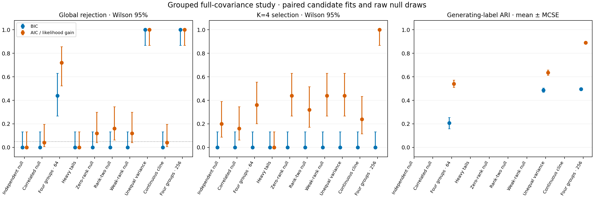

# Experimental grouped AIC and likelihood-gain results

The frozen validation completed **250/250 observations**, **25,000/25,000 unique
full-pipeline fits**, and **25/25 separate archived point replays**, with no failed,
unattempted or replacement fits. All 500 paired policy/test summaries are
available. Two selection policies and two statistics use the same candidate fits
and raw null draws; these are not 50,000 independently fitted pipelines.

**Detection and four-group recovery improved under the constructed alternatives,
but boundary-null calibration remains a concern.** At N=64, likelihood-gain
rejection increased from the paired BIC comparator's 11/25 to 18/25; AIC selected
K=4 in 9/25 versus 0/25, with mean ARI 0.541 versus 0.207. At N=256, AIC selected
K=4 in 25/25 versus 0/25, with mean ARI 0.891 versus 0.496; both tests rejected
25/25. This is an **opt-in experimental research option**, not a new default or
an established nominal-5% test at covariance boundaries.

The zero-, rank-two- and weak-conditional-covariance Gaussian nulls rejected in
3/25, 4/25 and 3/25 observations (12–16%) with the likelihood statistic, versus
0/25 for their paired BIC tests. AIC also often selected multiple components
without global rejection. These findings are material limits of the improvement;
no threshold, solver, seed, dataset, covariance floor or restart policy was tuned
or replaced after seeing them. Historical p-values remain unchanged.

## Paired outcomes

| Scenario | BIC rejection | Likelihood rejection (Wilson 95%) | K=4: BIC → AIC | Mean ARI: BIC → AIC |
| --- | ---: | --- | --- | --- |
| independent_gaussian | 0/25 | 0/25 (0.0%–13.3%) | 0/25 → 5/25 | Not defined |
| correlated_gaussian | 0/25 | 1/25 (0.7%–19.5%) | 0/25 → 4/25 | Not defined |
| complementary | 11/25 | 18/25 (52.4%–85.7%) | 0/25 → 9/25 | 0.207 → 0.541 |
| heavy_tailed | 0/25 | 0/25 (0.0%–13.3%) | 0/25 → 0/25 | Not defined |
| zero_conditional_gaussian | 0/25 | 3/25 (4.2%–30.0%) | 0/25 → 11/25 | Not defined |
| rank_two_gaussian | 0/25 | 4/25 (6.4%–34.7%) | 0/25 → 8/25 | Not defined |
| weak_conditional_gaussian | 0/25 | 3/25 (4.2%–30.0%) | 0/25 → 11/25 | Not defined |
| unequal_variance | 25/25 | 25/25 (86.7%–100.0%) | 0/25 → 11/25 | 0.487 → 0.636 |
| cline | 0/25 | 1/25 (0.7%–19.5%) | 0/25 → 6/25 | Not defined |
| complementary_256 | 25/25 | 25/25 (86.7%–100.0%) | 0/25 → 25/25 | 0.496 → 0.891 |

The five `*_gaussian` scenarios assess the declared hierarchical Gaussian law.
Complementary and unequal-variance four-group scenarios have constructed
partitions; heavy tails and clines have no discrete generating groups and assess
misspecification. The larger complementary scenario has N=256 groups; the others
have N=64. Every scenario has 25 independent observations, with 1–4 morphology
specimens/group, one ecology row/group and four continuous traits/view. Full
covariance, group-mean morphology PCA, two PCs/view, four joint PCs, equal weights,
K=1..4, minimum size 5, 10 starts, model seed 71323, alpha=0.05 and 99 draws were
prespecified under master seed 20261114. No configuration is chosen by truth.

In the N=64 alternative, eight observations rejected only under likelihood gain,
and one rejected only under BIC. The gain is not uniform across paired datasets.
The N=64 alternative's likelihood rejection interval is **52.4–85.7%**, and its
AIC K=4 interval is retained in the portable tables. At N=256, 25/25 K=4 selections
still has a **86.7%** Wilson lower limit. These pointwise descriptive intervals
are unadjusted across scenarios/metrics. Twenty-five observations per scenario
cannot establish broad calibration or reliability. ARI is post-fit agreement with
simulated labels, not empirical species accuracy; mean ARI Monte Carlo standard
errors, medians, K counts and paired changes are retained in the
[portable evidence](../examples/grouped-likelihood/results/).

## Important limits: size and overpartitioning

The rank-two Gaussian null's observed rejection rate is **16%**, with pointwise
Wilson 95% interval **6.4–34.7%**. Zero and weak covariance cases each rejected
**12%** (4.2–30.0%). These are calibration concerns under declared null laws,
not stress-case detections that can be reclassified as successful power. The
small sample, interval approximation and multiple scenarios limit formal
conclusions, but these results do not establish nominal 5% behavior at boundaries.
The prespecified plug-in raw Gaussian bootstrap remains approximate and
nonregular. No retrospective adjustment was applied.

AIC selected more than one component in **21/25** independent-Gaussian datasets,
**13/25** correlated-Gaussian datasets and **16/25** continuous-cline datasets.
The respective likelihood tests rejected 0/25, 1/25 and 1/25. Components can
approximate heterogeneous precision or continuous distributions; component count
is not the number of biological species. Group means with different specimen
counts have different noise even under the same raw Gaussian population.
Point overpartitioning and global model-departure rejection must be assessed
separately. Even combining rejection with selected K does not establish that K
or its memberships are significant.

Heavy-tailed stress rejected 0/25 with both tests; that is limited sensitivity
under this particular stress law, not evidence of general robustness. The cline's
single rejection is a model departure without generating discrete groups.
Unequal-variance four groups rejected 25/25 with both tests, while AIC increased
K=4 selection to 11/25 and mean ARI to 0.636. Thus improvements vary by scenario;
neither selection nor the new test dominates for every inferential purpose.

## What changed and what remains fixed

The [method](grouped-likelihood.md) adds `selection_criterion="aic"` and a separate
`max_eligible_likelihood_gain_v1` full-pipeline test. AIC uses `-2*ell+2*q`;
the likelihood statistic uses `2*(max_eligible ell_K-ell_1)`. The primary
likelihood test and prespecified BIC comparator share every fitted candidate and
raw draw, with no minimum-p selection. Raw nuisance parameters/counts remain fixed
within each test while raw ingestion, preprocessing/PCA and the full K search
refit in every draw. Estimated-null, covariance-boundary and optimization
uncertainty prevent exact p-value or species-boundary claims.

Default BIC selection, source-row/two-joint-PC/full-covariance defaults, legacy
configuration bytes, raw conditional-PSD estimation/simulation, solver budgets,
convergence/size screens and historical p-values are preserved. The optimizer
still screens the best-likelihood restart after fitting; it does not select the
best size-admissible restart. The earlier numerical issue and failures remain
unchanged. Whole-group AIC stability is supported and tested separately; no
stability draws enter this main calibration study.

## Independent verification and reproduction

The independent no-refit audit verified **29,530 study files**,
**799,250 archive members** and **25,000 successful pipelines**.
It regenerated raw observations/draws and checked raw dense likelihood/constrained
optimality, all identities/counts, view-PCA moments/eigen-equations/projections,
fusion and every candidate's Gaussian density, log likelihood, memberships,
AIC/BIC and eligibility. A separate dependency-free checker independently
recomputed all 25,000 observed/null statistics, both component selections and
all 500 exact upper-tail counts/decisions. Successful numerical convergence
does not certify global likelihood optimization.

All 25 archived point replays reproduced the legacy BIC candidate logs, score
arrays, selected K, statistic and selected densities/memberships. Earlier
source-freeze tests now assert the archived source registry, while new tests
check legacy JSON bytes and candidate-fit equivalence; approved feature work
can change current source without changing historical evidence.
Tests cover unsupported workflows, all-candidate density tampering even after
updating hashes, failed-point/draw withholding without replacement, whole-group
AIC resampling, and independent null-statistic tampering detection.

The fit runtime was frozen as **0.31.0.dev0**, Python 3.12.10, NumPy 2.2.6,
SciPy 1.15.3, scikit-learn 1.6.1 and threadpoolctl 3.6.0. Of 129 previous package
modules, 122 are unchanged, seven have declared version/dispatch/criterion/guard/
artifact/audit changes, and five modules are added. The final package has the
same ASTs as all **134 frozen modules**; 132 are byte-identical and two only
normalize source formatting. Frozen files/wheel and parameters were not altered.
Source/runtime hashes, the formatting-equivalence record and reference pins
remain in the portable evidence. Separate seed-20261115 development smoke and
unit-test data supplied no replacements.

Python 3.11/3.12 tests, lint/format, distributions, installed commands and final
published-head CI are verified at publication. Five existing checkouts, original
TPS inputs, the cleanup archive and **159,292 prior-study files** remain preserved.
Full raw arrays, all candidate parameters, draws, logs and the frozen runtime
remain external as `aic-grouped-20261023`; local preservation is not public raw
deposition or a self-contained runtime image.

Reproduce the report with
`python scripts/report_grouped_likelihood.py /path/to/artifact-root --output-dir /path/to/new-results --figure-dir /path/to/new-figures`.
Run the separate no-fit tail check with
`python examples/grouped-likelihood/check_tails.py --study-root /path/to/study --paired-table /path/to/audit/paired.csv --output /path/to/new-tail-check.json`.
The checkpoint stops here; boundary size and point overpartitioning remain
unresolved, and no new default is promoted.
