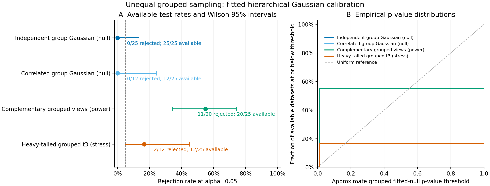

# Grouped empirical fitted-null validation results

The unchanged study evaluated **100 observed datasets** and planned 10,000
full-pipeline clustering fits. **69 null fits were accepted and all 6,900
associated clustering fits succeeded.** The remaining **31 null fits were
unsupported**, withholding their p-values and leaving **3,100 clustering fits
unattempted**. No clustering fit failed. No main attempt was retried, repaired,
replaced or excluded from the ledger, and settings were not tuned to results.

This is a bounded, interior-covariance Gaussian baseline with a substantial
availability limitation. It does not deliver a p-value for every valid grouped
dataset or establish general nominal error control.

## Availability, rejection and uncertainty

| Raw-data case | Available / requested | Rejected / available | Conditional rate | Wilson 95% interval | All-25 withheld-outcome bounds |
| --- | ---: | ---: | ---: | ---: | ---: |
| Independent hierarchical Gaussian | 25/25 | 0/25 | 0.0% | 0.0–13.3% | 0–0% |
| Correlated hierarchical Gaussian | 12/25 | 0/12 | 0.0% | 0.0–24.2% | 0–52% |
| Complementary four-group alternative | 20/25 | 11/20 | 55.0% | 34.2–74.2% | 44–64% |
| Unimodal heavy-tailed stress | 12/25 | 2/12 | 16.7% | 4.7–44.8% | 8–60% |

Wilson intervals describe rejection among available tests. Null-estimation
failures depend on the observed data, so complete-case rates cannot be treated
as unconditional type-I error or power. The final column treats all withheld
tests as non-rejections versus rejections; these ranges are **not confidence
intervals**. Missing outcomes remain unknown rather than being counted as p=1.
Pointwise intervals are unadjusted across cases. A zero plug-in MCSE does not
imply zero uncertainty; MCSE values are in the compact rate table.

All 25 independent-null and 12 available correlated-null point fits selected
K=1, T=0 and p=1. This large atom at zero yields conservative available-test
p-values, but the correlated case's 13 withheld tests prevent an unconditional
error-control claim. Even the complete independent case has a wide 0–13.3%
Wilson interval, insufficient to certify precise nominal 5% calibration.

The alternative rejected in 11/20 available tests (55%, interval 34.2–74.2%).
Those eleven selected K=2 and the other nine selected K=1. **No available point
fit selected K=4**, despite four generating groups. Rejection is a global
Gaussian-model departure signal, not recovery or significance of the true group
count. Unequal sampling, raw covariance, the fixed two-PC reductions and the
fitted null all affect this specific experiment; they were not varied here to
attribute a cause. With five withheld tests, all-25 rejection bounds are 44–64%.

The heavy-tail stress rejected in 2/12 available tests (16.7%, interval
4.7–44.8%); those two selected K=2, while ten selected K=1. The stress population
has no generating groups and violates the Gaussian hypothesis. These are
misspecification responses, **not species/clustering type-I errors**. With 13
withheld tests, the all-25 bounds are 8–60%, so this run gives limited evidence
about stress sensitivity across all datasets.



The left panel shows conditional rates, Wilson intervals and explicit
availability. The right panel shows empirical CDFs among available p-values.
Both null curves coincide at p=1. The uniform diagonal is a reference, not a
requirement for these discrete approximate p-values.
[PDF](figures/grouped-calibration/grouped-calibration.pdf) and
[SVG](figures/grouped-calibration/grouped-calibration.svg) are included.

## Null-estimation failures

There were **25 datasets for which all three starts yielded an unsupported
singular/boundary between-group covariance**: 12 correlated nulls, three
alternatives and ten stress datasets. Another **three datasets had mixed
boundary and iteration-limit outcomes across the three starts**: one alternative
and two stress datasets. The final **three datasets exhausted the fixed
1,000-iteration limit at every start**: one in each of those cases.
Iteration-limit fits remain nonconverged even if a gradient happened to be small.
All independent-null fits were accepted.

No boundary repair, covariance clipping, shrinkage, relaxed acceptance threshold
or extra optimization start was applied. Errors and all start diagnostics are
preserved in each failure record, with zero clustering attempts and 100
unattempted fits per failed null. The failure categories describe the numerical
acceptance checks; they are not biological diagnoses or proofs about population
covariance rank. These results motivate separate future work on boundary-safe
estimation/inference, outside this approved checkpoint.

The [dataset table](../examples/grouped-calibration/results/datasets.csv)
contains all 100 rows, errors, seeds, outcomes and denominators. The
[diagnostics table](../examples/grouped-calibration/results/diagnostics.csv)
reports failure categories, actual morphology sample totals, counts of groups
with 1–4 specimens, p-value summaries and selected-K counts.

## Prespecified model and design

The [exact study declaration](../examples/grouped-calibration/results/study.json)
fixes 64 independent localities, four continuous features/view, one ecology
vector/locality, independently drawn 1–4 morphology specimens/locality, two PCs
per view and jointly, equal weights, K=1..4, minimum hard size 5, 10 GMM starts,
B=99, alpha=0.05 and model seed 71323. Master seed 20261024 separates observed-data
and per-dataset null streams. The same analysis seed is used for every observed
and null pipeline. Counts are held fixed in bootstrap draws, and generating
labels never enter fitting.

The null is a joint Gaussian between-group morphology/ecology distribution
plus independent morphology residuals with shared full covariance. Its profiled
marginal ML fit accounts for the within-group covariance divided by each observed
count. It is fitted to raw features before PCA, using three fixed starts, gradient
tolerance 1e-5 and standardized covariance rank tolerance 1e-8. Null parameters
remain fixed at their observed estimates for simulated draws. The existing
pipeline fits morphology PCA to individuals, averages scores by explicit group,
then fuses normalized group profiles with ecology and fits joint PCA/GMM.

The [method](grouped-null-calibration.md) specifies the likelihood, numerical
guards, all raw generating parameters and assumptions. The correlated construction
has AR(1) between correlation 0.6, SDs 0.5..2, and within-morphology covariance
`1.5 * 0.35**abs(i-j)` in raw units. Those settings can leave a weak between-group
component relative to within-group noise; unsupported estimates are retained.
The alternative adds complementary four-group mean shifts of strength 3; stress
uses independent t3 mixing scales on group effects and residual vectors.

## Interpretation boundaries

This tests departure from a **fitted hierarchical Gaussian law**, conditional on
fixed non-informative counts and independent groups. P-values are approximate
because parameters are estimated. Full raw refits and the plus-one calculation
do not give a known-law exact-rank guarantee. Binomial tail intervals exclude
parameter-estimation and misspecification uncertainty; there is no double
bootstrap or general size guarantee.

Rejecting can reflect heavy tails, gradients, outliers or other non-Gaussian
structure, and non-rejection does not establish one species. Neither rejection
nor selected K establishes species boundaries or cluster-specific significance.
This validation uses simulated truth, not empirical biological species truth.
Stability and membership remain separate evidence. Informative counts,
heterogeneous residual covariance, repeated ecology, missingness, genomic/count/
shape nulls and spatial/related sampling remain outside this checkpoint.

## Audit, reproducibility and preservation

The read-only audit checked **213,693 archived members**, verified
**6,900 successful pipelines**, and inventoried
**8,538 study files**. It regenerated observed and bootstrap raw
inputs, checked all source identities/counts and bytes, independently evaluated
dense individual-observation Gaussian likelihoods and mean/covariance scores at
accepted null parameters, and reconstructed fusion, joint projection, selected
GMM likelihood/BIC/membership, K selection, inference and denominators. It did
not optimize nulls or refit clustering. View PCA and nonselected likelihoods
were preserved/checksummed rather than independently refitted. Failed nulls had
no complete numerical pipeline to re-audit; their errors and ledger counts were
verified.

All frozen Super Deli Python source hashes match the reporting implementation.
The campaign used Python 3.12.10, NumPy
2.2.6, SciPy 1.15.3,
scikit-learn 1.6.1 and threadpoolctl
3.6.0, with one numerical thread per
fit and four process-isolated case jobs. A separate four-case preflight and
audit ran before the unchanged main study; its outcomes are excluded from the
reported denominators.

Full raw inputs, null parameters and initial ingestion, failure diagnostics,
point/draw records, ZIP archives, logs, frozen wheel, runtime/version/source
records and preflight artifacts are preserved locally at:

`/Users/btm002/.codex/outputs/super-deli/grouped-null-20261021/`

This is local preservation, not a public raw-data deposition. The frozen runtime
references recorded local scientific libraries and is not a self-contained
environment image. Compact results, exact settings, hashes and inspected
PDF/SVG/PNG figures are committed. The
[manifest](../examples/grouped-calibration/results/manifest.json) records public
hashes, the raw inventory hash, frozen wheel hash and per-case host wall times;
those are host/storage timings, not comparative performance claims.

Python 3.11/3.12 CI runs foundation and installed scientific workflows, including
bounded grouped calibration/study/audit commands. It does not rerun this larger
campaign. Numerical libraries and platforms can affect covariance acceptance,
PCA and GMM outcomes; exact agreement across hosts is not promised.

```bash
python -m pip install '.[dev,clustering]'
python -m pytest -q
# Run all four study cases from the method into separate new directories.
super-deli analyze-grouped-calibration /path/to/study --output-dir /path/to/new-audit
python scripts/plot_score_calibration.py /path/to/new-audit \
  --grouped-pipeline --output-dir /path/to/new-figures
```
