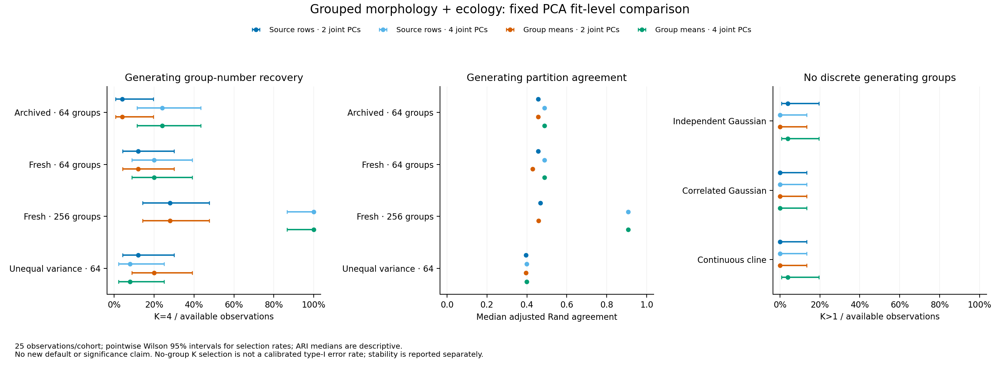

# Grouped PCA: completed recovery comparison

**Retaining four joint PCs produced the recovery gain at N=256.** Fitting morphology
PCA on equally weighted group means added no consistent recovery benefit beyond
that dimension choice under these generating laws. The new policy is an opt-in
capability; no new default or significance claim is promoted. N=64 recovery remains
limited, and shared covariance remains vulnerable to unequal-variance stress.

## Implementation and completion

The new `pca_fit="target_means"` option fits standardization/PCA on one complete
continuous raw morphology mean per population/locality draw. It retains all member
identities/counts and repeated target draws, supports frozen projection and refits
whole-group stability pipelines. Defaults remain source-row PCA, two joint PCs and
full covariance. Default configuration serialization and historical p-values are
preserved; significance adapters reject the new option pending separate calibration.
See the [method and run commands](grouped-pca.md).

The frozen study completed **700/700 point workflows** across **175 datasets**,
**1,000/1,000 stability refits**, and **25/25 archived baseline replays**. There were
zero failed, unattempted or replacement fits and zero significance fits. A no-refit
audit verified **22,123 files**, regenerated inputs/truth/identities and independently
checked PCA moments/eigen-equations, projections/profiles/fusion, selected GMM
likelihood/BIC/membership, bootstrap parameters/multiplicities and support accounting.
Nonselected GMM parameters and source-row bootstrap PCA parameters were not
independently refitted; convergence does not prove a global optimum.

All 120 prior package modules were compared: 109 matched and 11 had the declared
implementation/metadata/CLI changes. The archived source-row baseline reproduced
candidate constraints/BIC, scores and assignments. Previous numerical failures
from the diagnostic remain preserved. No runtime error handling was suppressed.

Frozen runtime: Super Deli 0.27.0.dev0, Python 3.12.10, NumPy 2.2.6, SciPy 1.15.3,
scikit-learn 1.6.1 and threadpoolctl 3.6.0. Fresh master seed 20261106, fixed model
seed 71323, four one-thread workers. All views retain two PCs; arms differ only in
morphology PCA fit level and two/four joint PCs. Full evidence is external under
artifact identifier `grouped-pca-20261023`; compact checksummed evidence is in
[the results directory](../examples/grouped-pca/results/manifest.json).

## Recovery and partition agreement

Cells report **K=4 selections / 25; median adjusted Rand agreement**. Generating
truth evaluates fitted outputs only and does not choose settings or initialize fits.

| Cohort | Source rows, 2 PCs | Source rows, 4 PCs | Group means, 2 PCs | Group means, 4 PCs |
| --- | ---: | ---: | ---: | ---: |
| Archived four groups, N=64 | 1/25; 0.457 | 6/25; 0.488 | 1/25; 0.457 | 6/25; 0.488 |
| Fresh four groups, N=64 | 3/25; 0.457 | 5/25; 0.488 | 3/25; 0.429 | 5/25; 0.488 |
| Fresh four groups, N=256 | 7/25; 0.467 | 25/25; 0.908 | 7/25; 0.459 | 25/25; 0.908 |
| Unequal-variance stress, N=64 | 3/25; 0.396 | 2/25; 0.399 | 5/25; 0.396 | 2/25; 0.399 |

For fresh N=256, K=4 selections increased from **7/25** with the source-row/two-PC
baseline to **25/25** with either four-PC arm. Pointwise Wilson 95% intervals are
14.3–47.6% and 86.7–100%, respectively. Median ARI increased from **0.467 to 0.908**;
partition recovery was still imperfect. Baseline versus group-mean/four-PC ARI
improved in all 25 paired observations, with mean change **0.360**. Comparing
source-row/four-PC with group-mean/four-PC gave three improvements and three
worsenings, median change zero and mean change only **0.000053**.

At fresh N=64, four-PC arms selected K=4 in **5/25** versus baseline **3/25**.
Their pointwise intervals are 8.9–39.1% and 4.2–30.0%. Source-row/four-PC versus
group-mean/four-PC produced no ARI improvements and three worsenings, with median
change zero. At archived N=64, their selected K and partitions agreed in all 25
observations. Equal-group PCA therefore has no demonstrated additional recovery
advantage here. At two joint PCs, the new policy also gave no consistent gain.

The preserved BIC tables compare candidates only within each fitted space. No
absolute BIC comparison across PCA policies or dimensions is used to recommend an
arm. Four PCs preserve the full four-dimensional fused profile geometry; PCA fit
level changes the morphology directions/scales. Both factors were specified before
fresh data generation. Results are conditional on these constructed laws, not a
universal tuning rule or a species-boundary validation.

## Null and stress behavior

Cells below count **K>1 selections / 25** where no discrete partition was generated.
These are descriptive selection frequencies, not calibrated type-I error rates.

| No discrete generating groups | Source rows, 2 PCs | Source rows, 4 PCs | Group means, 2 PCs | Group means, 4 PCs |
| --- | ---: | ---: | ---: | ---: |
| Independent Gaussian | 1/25 | 0/25 | 0/25 | 1/25 |
| Correlated Gaussian | 0/25 | 0/25 | 0/25 | 0/25 |
| Continuous cline | 0/25 | 0/25 | 0/25 | 1/25 |

Zero events in 25 datasets has a pointwise Wilson upper limit of **13.3%**;
one event has interval **0.7–19.5%**. These samples do not establish precise error
control. Continuous clines do not have a known species/cluster partition, so ARI
is withheld. A mixture can approximate continuous variation with several components
without demonstrating discrete species.

Under unequal-variance four-group stress, the group-mean/four-PC arm selected K=4
in only **2/25** observations; it selected K=3 in 17 and K=2 in six. Median ARI
was **0.399**. This deliberately violates shared covariance. Neither PCA fit-level
choice reliably fixes that misspecification; all four arms remain limited.

## Stability and its limits

Only the first five fresh four-group datasets at each sample size received stability:
25 draws per arm, 40 point workflows total, with shared draw streams across arms.
The **five datasets**, rather than 25 draws each, are the independent benchmark
replicates. All 1,000 requested draws completed. OOB denominators remain pair-specific;
only available original target pairs enter reported mean OOB coassignment.

At N=256, median across five datasets of the **mean OOB ARI** was **0.620** for the
source-row/two-PC baseline, **0.896** for source-row/four-PC and **0.896** for
group-mean/four-PC. For the group-mean/four-PC arm, corresponding median OOB
coassignment was **0.913 within** generating groups and **0.028 between** them.
These results are consistent with the dimension-related recovery gain; they do not
show a distinct benefit of fitting PCA on group means.

Exact original-set recovery is much stricter. Median per-dataset mean exact-set
frequency at N=256 was **0.17** for source-row/four-PC and **0.07** for group-mean/
four-PC. A single changed member prevents exact recovery of its original cluster.
These frequencies are not species probabilities and should be read alongside ARI,
pairwise support, K variability and OOB coverage. At N=64, median mean OOB ARI was
0.514 for baseline and 0.670 for group-mean/four-PC, with only five observations.
Bootstrap Monte Carlo resolution is coarse (25 draws), and fixed-member resampling
does not quantify within-group measurement/sampling error.

Pointwise intervals are unadjusted for this fixed four-arm grid. Recovery at modest
sample sizes, heterogeneous covariance, informative counts, related/spatial groups,
missing data and measurement error remain limitations. The equal-group option is
available for its explicit weighting semantics; the evidence supports no automatic
switch from the current defaults and no new calibrated p-values.
