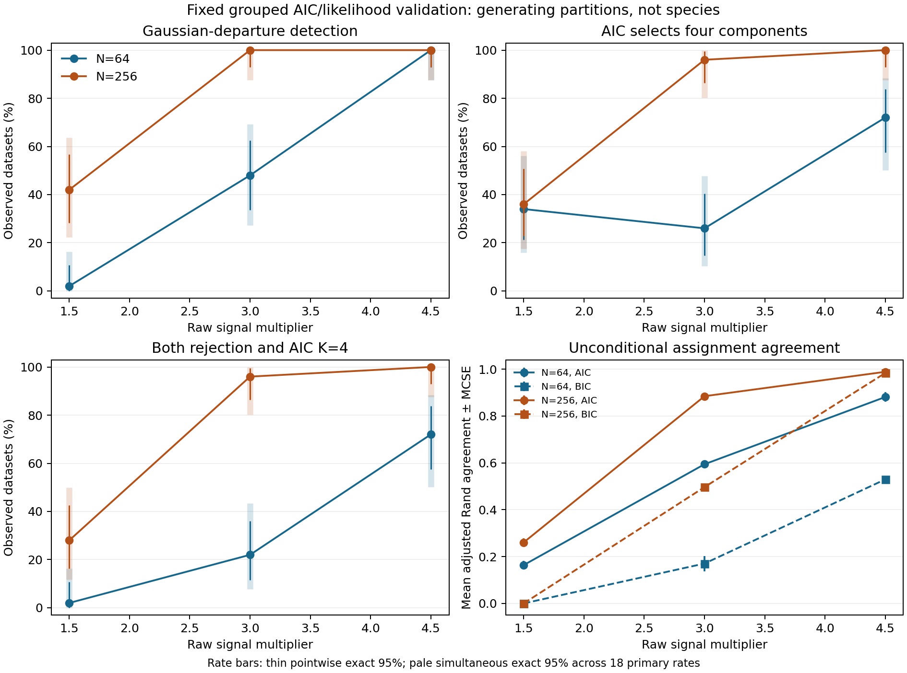

# Bounded grouped AIC/likelihood power and recovery results

**Detection, correct component count and assignment agreement are separate outcomes.**
At the original signal multiplier of 3, **64 localities gave 48% likelihood
detection, 26% AIC selection of K=4 and 22% for both events**. At **256 localities**,
these became **100%, 96% and 96%**; unconditional mean assignment agreement (ARI)
increased from **0.594 to 0.884**. At signal 4.5 and 256 localities, all 50 datasets
were detected and selected K=4, with mean ARI 0.989. Fifty datasets per cell leave
substantial uncertainty even for 50/50 successes, as the intervals below show.

**AIC component count and stability can still be misleading at weak signal.**
At 64 localities, AIC selected multiple components in 18/25 independent-Gaussian
controls while the calibrated likelihood test rejected 1/25. At weak signal,
selecting K=4 did not imply good assignments. These results support keeping AIC
opt-in and retaining the separate global departure test; they do not support a
new default, a generally calibrated selected-K test or species-boundary claims.

The prespecified 400-dataset study is complete. All observations are simulated
from declared laws, rather than empirical biological species ground truth.

## Detection and four-group recovery

| Localities | Signal | Likelihood detection (exact 95%) | AIC K=4 (exact 95%) | Both (exact 95%) |
| ---: | ---: | --- | --- | --- |
| 64 | 1.5 | 1/50: 2.0% (0.1–10.6%) | 17/50: 34.0% (21.2–48.8%) | 1/50: 2.0% (0.1–10.6%) |
| 64 | 3 | 24/50: 48.0% (33.7–62.6%) | 13/50: 26.0% (14.6–40.3%) | 11/50: 22.0% (11.5–36.0%) |
| 64 | 4.5 | 50/50: 100.0% (92.9–100.0%) | 36/50: 72.0% (57.5–83.8%) | 36/50: 72.0% (57.5–83.8%) |
| 256 | 1.5 | 21/50: 42.0% (28.2–56.8%) | 18/50: 36.0% (22.9–50.8%) | 14/50: 28.0% (16.2–42.5%) |
| 256 | 3 | 50/50: 100.0% (92.9–100.0%) | 48/50: 96.0% (86.3–99.5%) | 48/50: 96.0% (86.3–99.5%) |
| 256 | 4.5 | 50/50: 100.0% (92.9–100.0%) | 50/50: 100.0% (92.9–100.0%) | 50/50: 100.0% (92.9–100.0%) |

Each cell has 50 independent datasets, with 99 raw-null draws per test and
alpha=0.05. Parentheses show exact pointwise 95% binomial intervals. The following
Bonferroni exact intervals provide at least 95% simultaneous coverage across all
18 prespecified rates; no p-value or decision threshold is adjusted by these intervals.
Tables are rounded; the portable summary retains unrounded bounds.

| Localities | Signal | Detection, simultaneous 95% | AIC K=4, simultaneous 95% | Both, simultaneous 95% |
| ---: | ---: | --- | --- | --- |
| 64 | 1.5 | 0.0–16.4% | 16.0–56.0% | 0.0–16.4% |
| 64 | 3 | 27.2–69.3% | 10.4–47.7% | 7.8–43.3% |
| 64 | 4.5 | 87.7–100.0% | 50.1–88.3% | 50.1–88.3% |
| 256 | 1.5 | 22.2–63.8% | 17.5–58.0% | 11.7–49.9% |
| 256 | 3 | 87.7–100.0% | 80.2–99.9% | 80.2–99.9% |
| 256 | 4.5 | 87.7–100.0% | 87.7–100.0% | 87.7–100.0% |

Fifty datasets/cell give a worst-case Monte Carlo standard error of about
7.1 percentage points. The portable summary includes every rate MCSE, availability
denominator and withheld-outcome bound. With 99 null draws, individual plus-one
p-values have resolution 0.01. Conditional exact binomial intervals for each fitted
null tail are retained locally; these describe simulation noise conditional on the
observed statistic and estimated law, not model validity or species confidence.

[PDF](figures/grouped-power-recovery/grouped-power-recovery.pdf) and
[SVG](figures/grouped-power-recovery/grouped-power-recovery.svg) are available.

## Component counts and assignments

| Localities | Signal | AIC counts K=1/2/3/4 | BIC counts K=1/2/3/4 | AIC mean ARI ± MCSE | BIC mean ARI ± MCSE | BIC rejections |
| ---: | ---: | --- | --- | --- | --- | ---: |
| 64 | 1.5 | 12/9/12/17 | 50/0/0/0 | 0.164 ± 0.019 | 0.000 ± 0.000 | 0/50 |
| 64 | 3 | 0/11/26/13 | 32/18/0/0 | 0.594 ± 0.018 | 0.170 ± 0.032 | 18/50 |
| 64 | 4.5 | 0/0/14/36 | 0/40/10/0 | 0.881 ± 0.020 | 0.529 ± 0.012 | 50/50 |
| 256 | 1.5 | 7/15/10/18 | 50/0/0/0 | 0.260 ± 0.017 | 0.000 ± 0.000 | 0/50 |
| 256 | 3 | 0/0/2/48 | 0/47/2/1 | 0.884 ± 0.007 | 0.496 ± 0.010 | 50/50 |
| 256 | 4.5 | 0/0/0/50 | 0/0/1/49 | 0.989 ± 0.002 | 0.984 ± 0.006 | 50/50 |

ARI measures agreement with generating labels and is unconditional on test
rejection. The summary also gives medians, quartiles and explicitly secondary
conditional-on-rejection agreement. Paired AIC/BIC differences are descriptive
comparisons from the same candidates and draws, with conservative exact
discordance intervals; no statistic or model is chosen by its resulting p-value.

K is capped at four. Therefore this design cannot measure overpartitioning beyond
the four generating groups; selecting K=4 alone also says nothing about correct
memberships. Multiple-component selection under the Gaussian controls below is a
separate screen. BIC remains the default; AIC remains an opt-in heuristic.

## Gaussian controls and continuous stress

| Law | Localities | Likelihood rejection (exact 95%) | AIC K>1 | BIC K>1 | BIC rejections |
| --- | ---: | --- | ---: | ---: | ---: |
| independent_gaussian | 64 | 1/25: 4.0% (0.1–20.4%) | 18/25 | 0/25 | 0/25 |
| independent_gaussian | 256 | 0/25: 0.0% (0.0–13.7%) | 4/25 | 0/25 | 0/25 |
| heavy_tailed | 64 | 3/25: 12.0% (2.5–31.2%) | 13/25 | 9/25 | 9/25 |
| cline | 64 | 2/25: 8.0% (1.0–26.0%) | 11/25 | 0/25 | 0/25 |

These 25-dataset cells are small descriptive screens, with wide intervals. They
do not replace the [larger false-positive study](grouped-false-positive-validation-results.md).
Heavy tails and the cline contain no discrete generating groups. Rejection there
measures Gaussian-model departure, not a species/type-I error; multiple Gaussian
components can approximate a continuous distribution.

## Separate stability subset

| Localities | Signal | Verified replays | Successful / requested draws | Draw counts K=1/2/3/4 | Mean dataset bootstrap ARI | Mean coassignment truth MSE |
| ---: | ---: | ---: | ---: | --- | ---: | ---: |
| 64 | 1.5 | 5/5 | 125/125 | 5/57/48/15 | 0.143 | 0.243 |
| 64 | 3 | 5/5 | 125/125 | 0/20/64/41 | 0.433 | 0.109 |
| 64 | 4.5 | 5/5 | 125/125 | 0/2/49/74 | 0.773 | 0.023 |
| 256 | 1.5 | 5/5 | 125/125 | 0/0/11/114 | 0.272 | 0.151 |
| 256 | 3 | 5/5 | 125/125 | 0/0/9/116 | 0.785 | 0.035 |
| 256 | 4.5 | 5/5 | 125/125 | 0/0/0/125 | 0.979 | 0.004 |

Only the first five datasets/cell receive 25 whole-locality draws each.
Members, counts and sampling multiplicities are retained. Draw counts are
descriptive: the independent study replicates are the five datasets/cell, not
the 125 draws or the locality pairs. Per-dataset frequency distributions and
across-dataset MCSEs are in the summary. Stability is conditional repeatability
and does not supply significance for K, memberships or species.
For example, the weak-signal N=256 subset selected K=4 in 114/125 stability
draws, yet mean bootstrap ARI was only 0.272. Repeated component counts can coexist
with poor assignment agreement.

## Execution, evidence and limitations

The main study planned **40,780 pipeline fits**. Accounting: **40,780 attempted**,
**40,780 successful**, **0 failed** and
**0 unattempted**. No observations/draws were replaced.
The independent auditor checked **400/400 observations** and
**1,278,800 retained pipeline archive members** without refitting.
The standard-library checker independently reconstructed **40,000 calibration records**
and **800 tails**, with **0 withheld tails**.

Calibration density audits cover every retained candidate. Stability audits cover
all replay-point densities plus resampling seeds, multiplicities, source members,
PCA, criteria, partitions and coassignment. The unchanged production stability
export has no per-resample Gaussian parameter arrays, so their densities cannot
be reconstructed. Numerical audits do not establish a global likelihood optimum.

The [frozen protocol](grouped-power-recovery.md) fixes all settings, seeds,
assumptions and failure rules. Fits used Python 3.12.10, NumPy 2.2.6, SciPy 1.15.3,
scikit-learn 1.6.1, SNPio 1.7.7 and threadpoolctl 3.6.0. Production fitting/sampling,
defaults, earlier numerical failures and historical p-values were preserved.
The fitting snapshot is the implementation commit
`e534f51b71d39fe105615aefc4f3eae9419f6920`; 137 of the preceding master's 139
modules remain byte-identical; the two changes are version metadata and CLI dispatch. The final auditor differs
from the fitting snapshot in two reporting modules only, adding stability K
distributions and generic paired-event labels. Both source maps are retained.
The fitted raw null remains an approximate Gaussian model-departure reference,
with nonregular boundary limitations and no general size or species guarantee.
Missingness, informative counts, spatial dependence, unmatched biological samples,
genomic and shape power are outside this grouped continuous-data study.

[Portable aggregate evidence](../examples/grouped-power-recovery/results/) contains
settings, summary rates, runtime versions and public source fingerprints. Detailed
arrays, candidates, models, draws, logs, seed manifests and private artifact indexes
remain local in verified lossless archives. Only code, documentation, figures and
small aggregates are published. No new default is promoted.

## Verification and preservation

Final local checks passed: **1,350 scientific tests**, **842 foundation tests**
(96 scientific-dependency skips), lint, formatting and diff checks. Preliminary
CI [run 40111228191](https://github.com/btmartin721/super_deli/actions/runs/40111228191)
passed all four Python 3.11/3.12 jobs, including installed-package smoke checks.
The PNG and rendered PDF were inspected. Final master CI is checked separately
after publication.

Before/after fingerprints match for **779,477 prior-study files**, **eight prior
checkouts**, **1,078 other preceding-study files** and the cleanup archive.
The five original TPS downloads were already absent at checkpoint start, so no
preservation claim is made for them. Existing inputs and studies were not replaced.

The full-settings storage gate projected 7.73 GiB including growth/reporting
reserve. Study/audit evidence occupied approximately 6.83 GiB before the small
final package/CI records, below the 8 GiB cap, with more than 8 GiB free. The local
archives retain verified original file bytes; detailed evidence is excluded from
GitHub. The public source distribution includes the small aggregate CSV and figures.
