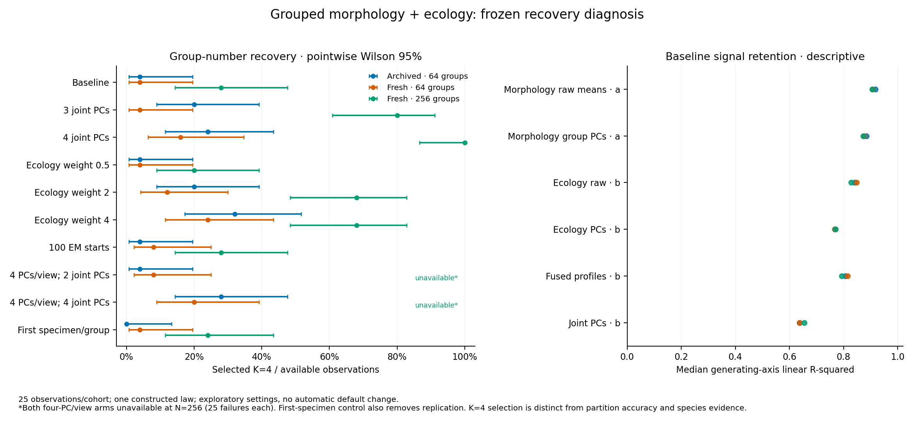

# Grouped four-group recovery: completed diagnosis

**Baseline underselection combines loss of complementary signal and finite-sample
BIC cost.** It is not explained by incorrectly linked identities or baseline K=4
size constraints. More EM starts have little effect in these observations. Keeping
more joint PCs helps at N=256; no production configuration or p-value changes.

## Evidence and completion

The frozen study covers 25 archived N=64 observations and 25 fresh observations
each at N=64 and N=256, with the unchanged grouped complementary generator.
All **25 archived baselines reproduced** selected K, candidate constraints/BIC,
scores and assignments. All **113 archived scientific source modules matched**.

There were **750 point attempts: 700 complete and 50 failed**. All **75 separate
truth-initialized K=4 diagnostics completed**. No fit or observation was replaced;
no stability or significance bootstrap was run. The no-refit audit verified
**22,635 files**, regenerated inputs/identities and checked source PCA moments and
eigen-equations, group profiles, fusion/projection, selected mixture density,
membership/BIC, descriptive metrics, truth initialization, ledgers and replay.
Nonselected GMM likelihoods are inferred from their BIC logs, rather than audited
from independently retained candidate parameters. EM histories/global optimality
are not independently certified.

Frozen runtime: Super Deli 0.26.0.dev0, Python 3.12.10, NumPy 2.2.6, SciPy 1.15.3,
scikit-learn 1.6.1 and threadpoolctl 3.6.0. Master seed 20261104; four single-thread
jobs. See the [method](grouped-recovery-diagnostics.md) and
[portable evidence](../examples/grouped-recovery/results/manifest.json).
The full evidence is retained outside the repository under artifact identifier
`grouped-recovery-20261023`. Historical artifacts remain untouched.

## Recovery across frozen settings

Each available cell reports **K=4 selections / 25; median adjusted Rand agreement**.
ARI evaluates the partition separately from the selected group number.

| Setting | Archived N=64 | Fresh N=64 | Fresh N=256 |
| --- | ---: | ---: | ---: |
| Baseline | 1/25; 0.457 | 1/25; 0.457 | 7/25; 0.466 |
| 3 joint PCs | 5/25; 0.488 | 1/25; 0.457 | 20/25; 0.850 |
| 4 joint PCs | 6/25; 0.488 | 4/25; 0.488 | 25/25; 0.918 |
| Ecology weight 0.5 | 1/25; 0.457 | 1/25; 0.457 | 5/25; 0.466 |
| Ecology weight 2 | 5/25; 0.457 | 3/25; 0.428 | 17/25; 0.701 |
| Ecology weight 4 | 8/25; 0.281 | 6/25; 0.000 | 17/25; 0.680 |
| 100 EM starts | 1/25; 0.457 | 2/25; 0.457 | 7/25; 0.466 |
| 4 PCs/view, 2 joint PCs | 1/25; 0.457 | 2/25; 0.457 | Unavailable: 25/25 failed |
| 4 PCs/view, 4 joint PCs | 7/25; 0.488 | 5/25; 0.488 | Unavailable: 25/25 failed |
| First specimen/group | 0/25; 0.425 | 1/25; 0.397 | 6/25; 0.410 |

Baseline K=4 selection was 1/25 in each N=64 cohort (pointwise Wilson 95%:
0.7–19.5%) and 7/25 at fresh N=256 (14.3–47.6%). Four joint PCs gave 4/25 in fresh
N=64 (6.4–34.7%) and 25/25 at fresh N=256 (86.7–100%). Those intervals describe
independent generating observations, are unadjusted for the diagnostic grid and
provide no general-method or species-boundary guarantee. In particular, the
N=256 four-PC median ARI of 0.918 is high but not perfect partition recovery.

## Where complementary signal is lost

For the archived baseline, median morphology-axis a R-squared was **0.917** in
raw group means and **0.885** in the group profiles after specimen PCA. Median
ecology-axis b R-squared was **0.841** in its four raw features and **0.769** in
its two PCs. Cross-view covariance contributes information: fused profiles gave
axis b R-squared **0.806**, falling to **0.637** after two joint PCs. Fresh N=64
showed the same pattern (fused 0.815 to joint 0.637); N=256 fell from 0.793 to 0.655.
The audits verify arithmetic averaging of exactly the declared morphology members;
ecological observations are not duplicated across specimens.

Preserving all four fused dimensions with four joint PCs retains that fused linear
signal. With N=256, K=4 selection rose from 7 to 25 observations. This is evidence
that truncation matters under this generator, rather than validation of a new
universal dimension rule. At N=64, even four joint PCs usually selected fewer
groups. The four-PC-per-view controls were similar to baseline at N=64 with two
joint PCs, and their N=256 outcomes are unavailable (see numerical failures below).

## Likelihood, constraints and optimization

Baseline K=4 was eligible in **75/75** observations. Comparing K=4 with K=2 within
each baseline score space, median twice-log-likelihood gains were **13.027**
(archived N=64), **9.393** (fresh N=64) and **26.894** (fresh N=256). The extra BIC
penalties were **24.953**, **24.953** and **33.271**, respectively. Most baseline
observations therefore favored K=2 even when K=4 was eligible. These are candidate
comparisons within fixed spaces; absolute BIC is not compared across settings.

Increasing EM starts from 10 to 100 changed selected K in **0/25 archived**, **1/25
fresh N=64**, and **0/25 fresh N=256** observations. Truth initialization improved
K=4 BIC over unsupervised K=4 in some observations, but **no eligible truth-based
fit beat the selected BIC in a baseline that had selected fewer than four groups**.
Three eligible improvements over the selected baseline were all cases where the
baseline already selected K=4. These results argue against optimization alone
explaining the underselection; truth-based fits remain non-deployable diagnostics.

## Unequal sampling and view weighting

Counts were non-informative by construction. Median count-axis R-squared was small
(archived a=0.0123, b=0.0075). This is descriptive, not a test of independence.
The first-specimen control did not improve recovery consistently: K=4 counts were
0, 1 and 6 versus baseline 1, 1 and 7, with lower median ARI in all three cohorts.
Removing replication changes precision as well as weighting, so these results do
not identify a pure effect of unequal counts or establish that weighting is harmless.

Ecology weight 4 increased some K=4 selections but also selected K=1 in **16/25
fresh N=64** observations, with median ARI zero. Weight increases therefore do not
provide a generally reliable correction. The reports retain candidate-size and
convergence records rather than selecting a winning setting after seeing truth.

## Retained numerical failures

Both four-PC-per-view settings failed in all 25 fresh N=256 observations, with
`Numerical integration failure: divide by zero encountered in matmul`.
They contribute **50 failed outcomes**, not zero recovery events. Their outcome
bounds allow anywhere from 0 to 25 K=4 selections per arm; no available-case rate,
ARI or confidence interval is reported for either arm.

A separate post-study **raw-array arithmetic audit**, with no estimator or GMM
fits, checked both views in these 25 observations. All 50 input matrices were
finite and rank four. A direct SVD/basis-product check reproduced the strict
floating-point trap in all 25 morphology matrices; the ecology products completed.
With trapping disabled only for that arithmetic check, all 50 products were finite
and agreed with explicit summation to at most **8.9e-16**. This supports a runtime
arithmetic-flag explanation rather than data rank failure, but the exact backend
cause remains unresolved. The check did not replace failed pipelines, suppress
production error handling, or create clustering results. Its separate evidence is
included as `arithmetic-audit.json`.

The next implementation decision should consider both signal retention and
measurement/sampling structure, with fresh validation and any required
recalibration. This checkpoint makes no model/default change and stops after
publishing the diagnosis and Python 3.11/3.12 verification.
