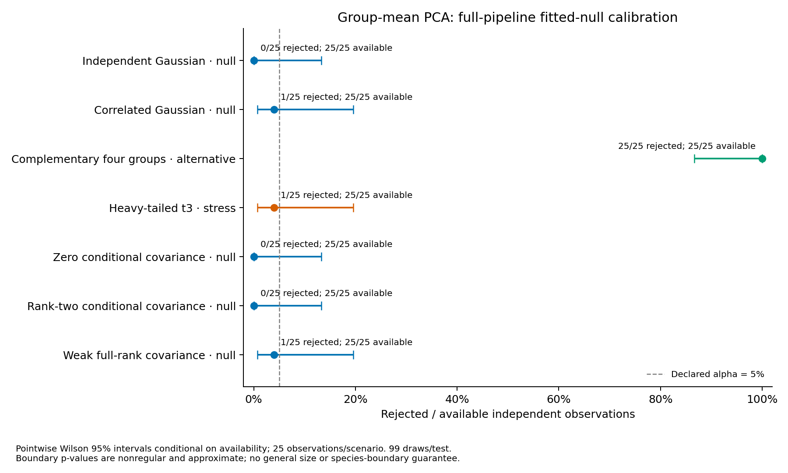

# Completed group-mean PCA significance calibration

The frozen study completed **175/175 observed datasets**,
**175/175 available tests** and
**17,500/17,500 successful point-pipeline fits**.
There were **0 failed** and **0 unattempted** fits.
No observations or draws were replaced, selectively retried or repaired. Settings,
seeds, solver budgets and the runtime wheel were frozen before fresh generation.

This opt-in [workflow](groupmean-calibration.md) uses the unchanged schema-2
conditional-PSD raw Gaussian estimator with equally weighted raw morphology means
for PCA and a prespecified shared-covariance GMM. Every null draw regenerates raw
specimen morphology and group ecology, then refits standardization, view PCA,
explicit aggregation, fusion, four-joint-PC PCA and the complete K search.
The raw null is fitted once per observed dataset and held fixed within its test.
Defaults, historical p-values and all prior evidence remain preserved.

## Availability, departures and component selection

| Generating scenario | Available / requested | Rejected / available | Pointwise Wilson 95% interval | Selected K counts |
| --- | ---: | ---: | --- | --- |
| Independent Gaussian · null | 25/25 | 0/25 | 0.0–13.3% | K=1: 25 |
| Correlated Gaussian · null | 25/25 | 1/25 | 0.7–19.5% | K=1: 24, K=2: 1 |
| Complementary four groups · alternative | 25/25 | 25/25 | 86.7–100.0% | K=2: 22, K=4: 3 |
| Heavy-tailed t3 · stress | 25/25 | 1/25 | 0.7–19.5% | K=1: 24, K=2: 1 |
| Zero conditional covariance · null | 25/25 | 0/25 | 0.0–13.3% | K=1: 25 |
| Rank-two conditional covariance · null | 25/25 | 0/25 | 0.0–13.3% | K=1: 25 |
| Weak full-rank covariance · null | 25/25 | 1/25 | 0.7–19.5% | K=1: 24, K=2: 1 |

Only the five Gaussian scenarios check the declared raw null. Complementary groups
provide constructed power; heavy tails test misspecification without generating
groups. With only 25 independent observations per scenario, these rates give
**no general 5% size guarantee**, including no uniform guarantee at covariance
boundaries. Zero events has an upper Wilson limit of 13.3%. Intervals are pointwise,
unadjusted across scenarios and conditional on availability; all-requested
withheld-outcome bounds remain in the portable evidence and are not confidence
intervals. Dataset/draw failures are retained without replacement.

The alternative's median post-fit adjusted Rand agreement was
**0.488**, with mean **0.524** and mean
Monte Carlo standard error **0.032**, across
25 observed partitions. The [separate recovery table](../examples/groupmean-calibration/results/recovery.csv)
evaluates outputs after fitting; truth never enters fitting, initialization or
configuration selection. Departure detection does not establish four groups,
selected K, membership confidence or biological species boundaries.
Historical studies used different observations, so comparisons are **unpaired**
and cannot isolate the effect of PCA policy or dimension.

## Raw covariance and sampling diagnostics

| Generating scenario | Estimated rank 0 | Rank 1 | Rank 2 | Rank 3 | Rank 4 |
| --- | ---: | ---: | ---: | ---: | ---: |
| Independent Gaussian · null | 0 | 0 | 0 | 0 | 25 |
| Correlated Gaussian · null | 0 | 0 | 3 | 16 | 6 |
| Complementary four groups · alternative | 0 | 0 | 0 | 5 | 20 |
| Heavy-tailed t3 · stress | 0 | 0 | 3 | 16 | 6 |
| Zero conditional covariance · null | 0 | 9 | 15 | 1 | 0 |
| Rank-two conditional covariance · null | 0 | 0 | 11 | 14 | 0 |
| Weak full-rank covariance · null | 0 | 0 | 8 | 16 | 1 |

These ranks describe conditional between-group morphology covariance given ecology,
not cluster/species number. Finite-sample fitted rank need not match generating
rank. All 175 retained raw fits satisfy the unchanged positive-definite
ecology/within-morphology guards and PSD constrained-optimality checks. The largest
selected standardized optimality residual was **1.26e-06**, below 1e-5. Accepted
numerical stationarity does not certify a global likelihood optimum.

Every observation has 64 groups, one ecology row/group and fixed 1–4 morphology
specimens/group; total morphology rows ranged from **139 to 197**.
All counts, source identities, specimen memberships and ordering are preserved in
every raw draw. Ecology is not replicated onto specimens as independent evidence.
PCA weights each group's noisy raw mean equally; it does not turn small-sample
means into error-free latent traits. Informative counts, related/spatial groups,
heterogeneous residual covariance, missingness and a separately identified ecology
measurement-error component remain outside this raw null.

## Inference and uncertainty

The statistic is `T=BIC(K=1)-min_eligible BIC(K=1..4)` within the fixed score space.
Shared covariance is counted once. With B=99 independent draws,
`p=(1+count(T_draw>=T_observed))/100`, including upper-tail ties, and rejection uses
p<=0.05. P-values remain **approximate plug-in model-departure tests**. Fitted raw
nuisance parameters remove exact exchangeable-rank validity; boundary fits are
**nonregular** and carry no general size or species-boundary guarantee. A rejection
can reflect a model departure unrelated to discrete species. Non-rejection does
not validate Gaussianity or establish broad robustness.

Conditional Clopper–Pearson tail intervals quantify draw variation given observed
T, fitted raw parameters and counts. They exclude raw-estimation, optimization and
misspecification uncertainty. They differ from across-observation Wilson intervals
and are not species confidence intervals. At T=0, p=1 is expected; a zero plug-in
Monte Carlo SE does not mean zero uncertainty. Failed points leave draws
unattempted; failed draws withhold the primary p-value, decision and interval,
with retained error/attempt ledgers and identification bounds. Stability is
separate and no stability bootstraps were run here.

The covariance family, PCA fit level/dimensions, weights, features, seeds and K grid
were fixed before generation; selection across these choices is not calibrated.
Source-row PCA, two joint PCs and full covariance remain defaults. Target-mean
significance stays disabled for legacy schema 1, full-covariance grouped models
and other significance workflows. This checkpoint introduces no raw estimator,
variance floor, adaptive solver tuning or automatic default change.

## Reproduction, audit and preservation

- Master seed **20261108**, model seed **71323**, 25 fresh observations/scenario;
  64 groups, four traits/view, two PCs/view and four joint PCs, equal weights,
  shared covariance, K=1..4, minimum size 5, 10 EM starts, 99 draws and alpha=0.05.
  At most four one-thread jobs. Separate seed 20261109 supplied the **21/21-fit
  preflight and its audit**, with no main-study replacements.
- Frozen wheel **0.28.0.dev0**, Python 3.12.10, NumPy 2.2.6, SciPy 1.15.3,
  scikit-learn 1.6.1 and threadpoolctl 3.6.0. All **124 package modules** match
  the frozen runtime. Of 123 previous modules, 117 are unchanged, six have declared
  version/configuration/audit/evidence changes and one shared PCA auditor is new.
  Raw estimators, generators and production PCA/GMM implementations are unchanged.
- The no-refit audit verified **20,671 study files**, **541,975
  archive members** and **17,500 successful pipelines**.
  It regenerated every observed/null raw input and checked dense raw likelihoods,
  constrained convergence, factors/ranks, identities/counts, seeds, configuration,
  fusion, selected GMM likelihood/BIC/membership, K selection, tails and denominators.
  For every successful observed/null point, it also independently reconstructed
  both views' PCA feature selection, means/scales/eigen-equations, group training
  identities/counts, raw projections and aggregated profiles. This is algebraic
  verification without model refits; nonselected GMM likelihoods are retained and
  not independently refitted. Outer failures retain their ledgers without a full
  numerical audit of partial artifacts.
- Tests cover both group levels/view orders, complete per-draw refits, raw-null and
  same-seed draw invariance across PCA policies, unsupported-scope rejection,
  historical configuration bytes, read-only analysis, altered PCA parameters/
  projections/counts, and failed-point/draw withholding without replacements.
  Portable tests independently check seed streams, interval equations, counts,
  rank acceptance, rate denominators, inventories and package evidence.
- Both existing checkouts, original TPS inputs, cleanup archive and **102,261
  prior-study files** remain preserved, including #55's retained numerical failures.
  No repair or suppression of that separate runtime issue was introduced.

Full raw observations, fitted nulls, raw-draw archives, PCA/GMM parameters, ledgers,
solver diagnostics, logs and frozen wheel remain external under artifact identifier
`groupmean-null-20261023`. The [portable evidence](../examples/groupmean-calibration/results/)
contains settings, source/runtime hashes, execution metadata and per-observation
results. Local preservation is not public raw deposition or a self-contained
runtime image. Generating partitions are simulated truth, not empirical species.

Reproduce the portable tables and PDF/SVG/PNG figure using
`python scripts/report_groupmean_calibration.py /path/to/artifact-root --output-dir /path/to/new-results --figure-dir /path/to/new-figures`.
Keep reporting utilities together; existing verified grouped reporting/I/O helpers
are reused unchanged. Python 3.11/3.12 CI is verified on the published master head.
