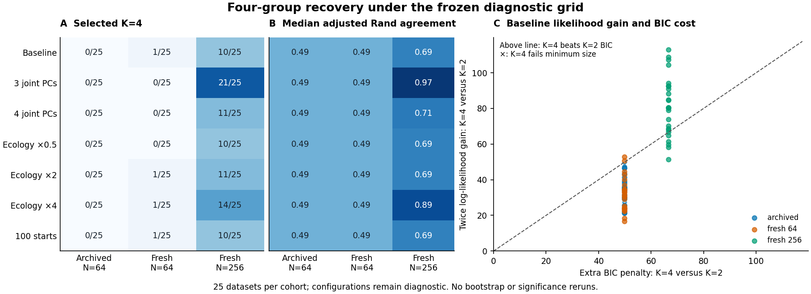

# Integrative four-group recovery: completed diagnostic checkpoint

The archived four-group observations were valid and reproduced exactly within
the declared tolerances. The main observed limitation at N=64 was the BIC cost
of splitting the weaker ecological axis after the strong genomic/morphology
axis was recovered. This diagnostic found additional PCA information loss and
occasional local optimization differences, but neither more PCs nor more EM
starts recovered four groups reliably at N=64. Increasing sample size improved
recovery substantially under this particular generating law.

All **525/525 unsupervised full point pipelines** and **75/75 separate
truth-initialized fits** completed. There were zero failed or replacement fits,
zero unattempted truth-initialized fits, and **no stability or significance
reruns**. All **25/25 archived baselines** reproduced their original candidate
eligibility, component sizes, BIC values, selected K, scores and labels. The
read-only audit verified 24,560 study files and the numerical/accounting checks
described below. Full evidence is retained under artifact identifier
`integrative-recovery-20261021`; compact tables and fingerprints are in
`examples/recovery-diagnostics/results/`. Published CSV line endings are normalized
to LF; immutable local audit outputs retain their original bytes.

Figure: (A) Number selecting K=4 among 25 datasets per cohort and configuration.
(B) Median adjusted Rand agreement with the four generating labels. (C) Baseline
K=4 versus K=2 likelihood gains and parameter penalties in their shared two-PC
score space. Points above the diagonal favor K=4 over K=2 by BIC; K=3 can still
win the complete search. Crosses indicate a K=4 hard-size violation. The fresh
N=64 and N=256 cohorts have independent seeds. Truth-initialized fits are
excluded from this unsupervised figure.

## Recovery grid

Each entry is **number selecting K=4 / 25 (median ARI)**. Settings were frozen
before fresh generation; all other analysis controls were held fixed.

| Configuration | Archived N=64 | Fresh N=64 | Fresh N=256 |
| --- | --- | --- | --- |
| Baseline | 0/25 (0.488) | 1/25 (0.488) | 10/25 (0.685) |
| Three joint PCs | 0/25 (0.488) | 0/25 (0.488) | 21/25 (0.969) |
| Four joint PCs | 0/25 (0.488) | 0/25 (0.488) | 11/25 (0.712) |
| Ecology weight 0.5 | 0/25 (0.488) | 0/25 (0.488) | 10/25 (0.686) |
| Ecology weight 2 | 0/25 (0.488) | 1/25 (0.488) | 11/25 (0.686) |
| Ecology weight 4 | 0/25 (0.488) | 1/25 (0.488) | 14/25 (0.890) |
| 100 EM starts | 0/25 (0.488) | 1/25 (0.488) | 10/25 (0.685) |

Baseline selected K=2/3/4 in **22/3/0**, **19/5/1** and **2/13/10** datasets,
respectively. The archived baseline's 22 two-component partitions recover the
binary A split, rather than the four-label partition: their ARI is 0.487805.
All archived baseline partitions fully explain A; median homogeneity for B is
zero. A significant departure from the fitted joint null in the previous
checkpoint is compatible with selecting only two components. That p-value
neither identifies four groups nor establishes species boundaries.

Pointwise 95% Wilson intervals for baseline K=4 selection are **0–13.3%**,
**0.7–19.5%** and **23.4–59.3%** for the three cohorts. The N=256 three-PC rate
is **84% (65.3–93.6%)**. These quantify binomial simulation uncertainty within
this fixed design; they are unadjusted for the seven-configuration grid and do
not support choosing a generally optimal configuration. Within the N=256
datasets, three PCs improve ARI in 23, worsen it in one and leave one unchanged;
mean paired ARI change is +0.1551. At fresh N=64 the mean change is -0.0317.
The sample-size cohorts are independent, not paired.

## Signal and identities

The audit regenerated all archived raw observations from their frozen seeds,
checked the original raw-file hashes, regenerated labels and source identities,
and reconstructed source-value alignment in the archived and rerun models.
There was no generator or identity mismatch. Genomics and morphology carry
axis A; ecology carries axis B, as intended. For the archived baselines, median
in-sample linear R² values were:

| Score space | Axis A | Axis B |
| --- | --- | --- |
| Genomic view PCs | 0.9990 | 0.0075 |
| Morphology view PCs | 0.9524 | 0.0067 |
| Ecology view PCs | 0.0137 | 0.8492 |
| Six-dimensional fused scores | 0.9991 | 0.8761 |
| Two joint PCs | 0.9778 | 0.7698 |

The leading joint PC's median squared loading mass is 0.521 in genomics and
0.473 in morphology; the second PC's ecology loading mass is 0.988. Thus ecology
survives the two-PC representation, although some recoverable B signal is
discarded. Archived median B R² rises to 0.837 with three joint PCs and 0.874
with four. Neither setting selects four components in the archived or fresh
N=64 cohorts. Preserving a linear generating direction does not by itself
ensure that its mixture split overcomes overlap and model-order penalties.
These are in-sample descriptive measures, not independent predictive accuracy.

## Likelihood gain, BIC penalty and eligibility

In two dimensions, full-covariance K=2 and K=4 models have 11 and 23 parameters.
Their BIC difference is `12*log(N) - 2*(logL4-logL2)`, calculated separately
within each baseline score space. The extra penalty is **49.9066 at N=64** and
**66.5421 at N=256**. Median twice-log-likelihood gains for K=4 over K=2 were:

| Cohort | Median twice-log-likelihood gain | Extra BIC penalty |
| --- | --- | --- |
| Archived N=64 | 34.5571 | 49.9066 |
| Fresh N=64 | 30.8779 | 49.9066 |
| Fresh N=256 | 80.4422 | 66.5421 |

All 25 archived K=4 gains were below the K=2 penalty, including candidates
excluded by size. K=4 was eligible in 21/25 archived baselines, 25/25 fresh
N=64 baselines and 25/25 fresh N=256 baselines. Its median BIC excess over the
selected eligible model was 15.3495, 19.0287 and 2.8051, respectively. Thus the
four archived hard-size exclusions do not explain the general failure to select
K=4. At N=256, beating K=2 is also insufficient when K=3 has still lower BIC.

Retaining more PCs changes both signal and model complexity. K=4 versus K=2
requires 20 extra parameters in three dimensions and 30 in four, compared with
12 in two. At N=64 those penalties are 83.1777 and 124.7665. The fixed grid
shows a sample-size-dependent tradeoff; absolute BIC values from different
dimensions or weighting/projection spaces were never compared.

## Optimization checks

Increasing starts from ten to 100 changes **no selected K in any of the 75
datasets**. It leaves ARI unchanged in all 50 N=64 datasets; one N=256 ARI
decreases slightly. The best-likelihood K=4 fit can change eligibility:
archived eligible counts fall from 21 to 18, and fresh N=64 counts from 25 to
20. This is the existing behavior of selecting the best-likelihood candidate
before checking its hard cluster sizes, preserved without a method change.

All 75 truth-initialized forced K=4 fits converge and meet the size constraint.
Their median ARIs are 0.8760, 0.9180 and 0.9087 for the three cohorts, showing
that the baseline score space can support much better four-label partitions
when truth is supplied. Nevertheless, their BIC never beats the selected
unsupervised model in either N=64 cohort. Their BIC gaps are 0.285–37.231 for
archived N=64 and 0.006–33.634 for fresh N=64.

At N=256, truth initialization yields a lower BIC than the selected baseline in
nine datasets, including eight where the baseline already selected K=4. Only
one previously underselected dataset would change to K=4 if this truth-based
fit were inserted into the search. These fits demonstrate some local-optimum
effects, without establishing a global maximum or an unbiased performance
estimate. They cannot be deployed as an unsupervised solution.

## Audit, preservation and limitations

The immutable run used the frozen 0.22.0.dev0 wheel, Python 3.12.10, NumPy 2.2.6,
SciPy 1.15.3, scikit-learn 1.6.1, SNPio 1.7.7 and one numerical thread per worker.
All 104 historical scientific source modules match #49; version metadata and
CLI dispatch differ. The independent audit regenerated inputs and identifiers,
checked the complete file inventory, reconstructed fusion/joint projection and
selected full-GMM likelihood/BIC/membership, independently computed contingency
ARI and pseudoinverse axis recovery, and verified truth-initialization parameters
and fitted dense likelihoods. It performed no model refits. View PCA fits and
nonselected likelihoods were **not independently refitted**; nonselected
likelihoods are algebraically derived from preserved BIC logs. Convergence is
checked from retained fit diagnostics, without a general optimality guarantee.

One initial setup was rejected before any fresh generation or pipeline fits:
the archived parent JSON omits defaults that its shard writes explicitly.
The comparison was corrected to use parsed, default-expanded configurations,
regression tested and frozen again before the study. That rejected setup is
retained separately. It contributes no replacement dataset or fit.

The original checkout, downloaded TPS data, #49 raw artifacts and p-values were
preserved. Software checks cover Python 3.11 and 3.12; the complete simulation
study was run once on the frozen Python 3.12 numerical runtime. Installed smoke
studies in CI validate code portability rather than repeating this study.

The findings support **finite-sample model-order penalties with weaker
ecological separation as the main observed N=64 limitation**, plus partial PCA
signal loss and occasional local optima. This is an empirical diagnosis under
one constructed generating law, not proof of a universal cause or general
species-delimitation performance. No model, default, significance calculation
or winning configuration is promoted in this checkpoint. A clustering-method
change and its validation remain a later checkpoint.
