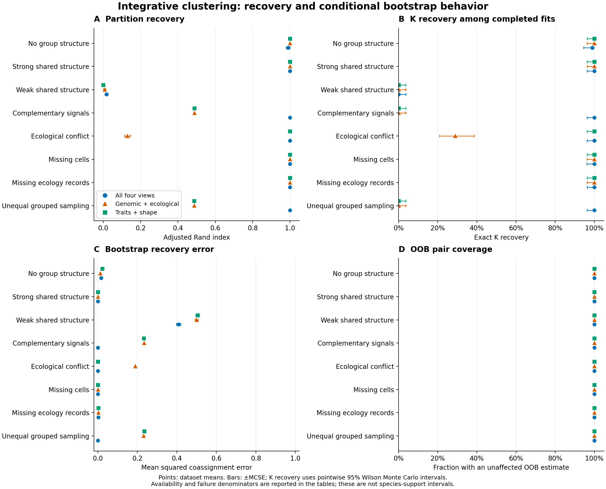

# Larger integrative simulation study

All **800 independent simulated datasets** were generated using the unchanged
`examples/benchmarking/study.json` declaration: eight scenarios × 100 datasets,
with three paired view-subset arms, 64 target units, 64 loci and 100 target
bootstrap draws per fit. Full integration and subset arms use the same estimator.

Of **2,400 point-fit attempts, 2,398 completed and two failed**. All **239,800
attempted bootstrap refits completed**; 200 planned draws were not attempted
after the point failures. No failed case was repaired, retried or removed from
requested denominators. The study contains 800 independent datasets, not 2,400
independent method-comparison replicates.



[Vector PDF](figures/integrative-study/integrative-study.pdf) · [Editable SVG](figures/integrative-study/integrative-study.svg)

## Recovery and failure results

| Scenario | Arm | Completed / requested | Selected K (count) | Mean ARI ± MCSE | Fit and correct K / requested |
| --- | --- | ---: | --- | ---: | ---: |
| null_matched | full | 100 / 100 | 1 (99), 2 (1) | 0.990 ± 0.010 | 99 / 100 |
| null_matched | genome_environment | 100 / 100 | 1 (100) | 1.000 ± 0.000 | 100 / 100 |
| null_matched | traits_shape | 100 / 100 | 1 (100) | 1.000 ± 0.000 | 100 / 100 |
| strong_matched | full | 100 / 100 | 4 (100) | 1.000 ± 0.000 | 100 / 100 |
| strong_matched | genome_environment | 100 / 100 | 4 (100) | 1.000 ± 0.000 | 100 / 100 |
| strong_matched | traits_shape | 100 / 100 | 4 (100) | 1.000 ± 0.000 | 100 / 100 |
| weak_matched | full | 100 / 100 | 1 (95), 2 (5) | 0.017 ± 0.008 | 0 / 100 |
| weak_matched | genome_environment | 100 / 100 | 1 (98), 2 (2) | 0.008 ± 0.005 | 0 / 100 |
| weak_matched | traits_shape | 100 / 100 | 1 (100) | 0.000 ± 0.000 | 0 / 100 |
| complementary_matched | full | 100 / 100 | 4 (100) | 1.000 ± 0.000 | 100 / 100 |
| complementary_matched | genome_environment | 100 / 100 | 2 (100) | 0.488 ± 0.000 | 0 / 100 |
| complementary_matched | traits_shape | 100 / 100 | 2 (100) | 0.488 ± 0.000 | 0 / 100 |
| conflicting_matched | full | 100 / 100 | 4 (100) | 1.000 ± 0.000 | 100 / 100 |
| conflicting_matched | genome_environment | 100 / 100 | 1 (47), 2 (15), 3 (9), 4 (29) | 0.129 ± 0.016 | 29 / 100 |
| conflicting_matched | traits_shape | 100 / 100 | 4 (100) | 1.000 ± 0.000 | 100 / 100 |
| missing_cells | full | 99 / 100 | 4 (99) | 1.000 ± 0.000 | 99 / 100 |
| missing_cells | genome_environment | 99 / 100 | 4 (99) | 1.000 ± 0.000 | 99 / 100 |
| missing_cells | traits_shape | 100 / 100 | 4 (100) | 1.000 ± 0.000 | 100 / 100 |
| missing_views | full | 100 / 100 | 4 (100) | 1.000 ± 0.000 | 100 / 100 |
| missing_views | genome_environment | 100 / 100 | 4 (100) | 1.000 ± 0.000 | 100 / 100 |
| missing_views | traits_shape | 100 / 100 | 4 (100) | 1.000 ± 0.000 | 100 / 100 |
| unequal_grouped | full | 100 / 100 | 4 (100) | 1.000 ± 0.000 | 100 / 100 |
| unequal_grouped | genome_environment | 100 / 100 | 2 (99), 3 (1) | 0.487 ± 0.000 | 0 / 100 |
| unequal_grouped | traits_shape | 100 / 100 | 2 (98), 3 (2) | 0.487 ± 0.001 | 0 / 100 |

- **Complementary evidence:** Full integration recovered all four groups with ARI=1 in 100/100 matched and 100/100 grouped datasets. The two-view arms generally recovered two groups, with ARI about 0.488. Their mean paired ARI deficit was about 0.512–0.513. Each subset lacks one generating axis, so exact four-group recovery is not identifiable from those subset signals. This construction demonstrates the value of complementary evidence, not universal superiority of integration.
- **Weak separation:** No arm recovered all four generating groups. Full integration selected K=1 in 95 datasets and K=2 in five, with mean ARI 0.017 (MCSE 0.008). Its coassignment squared error was 0.409 and OOB error 0.448. Increasing simulation or bootstrap counts does not resolve weak biological signal.
- **Null structure:** Full integration selected K=2 in 1/100 datasets; both subsets selected K=1 in all 100. The full-arm false-split rate was 1%, with a pointwise 95% Wilson Monte Carlo interval of approximately 0.18–5.45%. This is a density-clustering diagnostic under this generator, not a species-test type-I error estimate.
- **Ecological conflict:** Full integration and traits/shape recovered the primary partition in all 100 datasets. Genomic/ecological integration recovered its K in 29/100 and had mean ARI 0.129 (MCSE 0.016). Three views favor the primary partition in this design. These results do not establish robustness when equally informative views disagree or weights are unknown.
- **Cell missingness:** Dataset repetition 48 contains an ecological record (`ecological_0017_0`) with all four numeric features missing. The unchanged policy rejects an entirely unobserved row, causing the full and genomic/ecological attempts to fail. Traits/shape completed. Available-fit K recovery was 99/99 for the affected arms; end-to-end fit-and-K recovery was 99/100. Two failures represent one shared simulated dataset, not two independent data failures.
- **Whole ecological records missing:** The common cohort retained 41–56 of 64 targets (mean 47.75, or 74.6%). All arms used the same cohort and recovered K=4 and ARI=1 in all datasets. Full-arm coassignment error increased to 0.00249 and OOB error to 0.00825. Only 238/400 full-arm clusters reached the prespecified 0.9 exact-recovery threshold, compared with 400/400 under strong complete coverage. Evaluation concerns the retained cohort; no assignment accuracy is asserted for excluded units.

Zero estimated ARI MCSE in repeated perfect or identical outcomes does not prove
zero simulation uncertainty. For example, 100/100 successful K recoveries have
a pointwise 95% Wilson Monte Carlo interval of approximately 96.3–100%.

## Stability can disagree with the generating partition

“Stable” means exact bootstrap set-recovery frequency ≥0.9. “Wrong” means the
point cluster does not equal any complete group in the primary generating
partition; a pure fragment or merged pair of groups does not count as correct.
The event below is **at least one stable wrong cluster in a dataset**. Cluster
counts are descriptive; datasets provide the uncertainty denominator.

| Scenario | Arm | Datasets with event / available | Rate, 95% Wilson Monte Carlo interval | Wrong / stable clusters |
| --- | --- | ---: | ---: | ---: |
| complementary_matched | full | 0 / 100 | 0% (0.0–3.7%) | 0 / 394 |
| complementary_matched | genome_environment | 82 / 100 | 82% (73.3–88.3%) | 122 / 122 |
| complementary_matched | traits_shape | 83 / 100 | 83% (74.5–89.1%) | 118 / 118 |
| unequal_grouped | full | 0 / 100 | 0% (0.0–3.7%) | 0 / 394 |
| unequal_grouped | genome_environment | 84 / 100 | 84% (75.6–89.9%) | 120 / 120 |
| unequal_grouped | traits_shape | 78 / 100 | 78% (68.9–85.0%) | 124 / 124 |

The high two-view event rates reflect stable coarser partitions when one latent
axis is absent. They illustrate why stability cannot be substituted for
generating-partition recovery or species support. Full integration had no
observed stable-wrong event in these datasets; 0/100 still has a Wilson upper
limit of about 3.7%. Weak-signal arms also had no such event, because none of
their point clusters met the stability threshold. Absence of the event therefore
does not establish successful recovery.

## OOB support and uncertainty

With 100 draws, mean finite OOB pair coverage was at least 99.9995% in each
scenario/arm. However, the typical pair was OOB in only about **13 draws**, not
100. Near-complete coverage does not imply a precise pair frequency. The audited
summary records per-dataset minimum/median/maximum requested OOB counts, and
`support-bins.csv` reports contributing-dataset counts for each descriptive bin.
OOB errors condition on finite, unaffected pairs; they do not turn the bootstrap
into a calibrated species-probability estimator.

Means and paired differences weight independent datasets equally. MCSE is sample
SD divided by the square root of the available dataset count, with availability
and failure counts retained. Paired differences are full minus comparator on
repetitions where both metrics are available. Wilson intervals apply to
Bernoulli benchmark events and are pointwise, unadjusted Monte Carlo intervals,
following the [NIST formula](https://www.itl.nist.gov/div898/handbook/prc/section2/prc241.htm).
They are not species confidence intervals or simultaneous method-comparison
claims. The design and Monte Carlo reporting follow
[Morris, White and Crowther (2019)](https://doi.org/10.1002/sim.8086).

## Audit, artifacts and reproduction

Execution used the frozen `0.12.0.dev0` wheel from commit
`6483dfdbd4bb8a1443789045cb94ab2a2aad81bf`, Python 3.12.10, SNPio 1.7.7,
NumPy 2.2.6, SciPy 1.15.3 and scikit-learn 1.6.1. Four scenario processes each
used one numerical thread. The frozen package imported recorded scientific
libraries from the existing validated environment; the runtime directory is
not a self-contained distribution of those libraries. Critical dependency pins
and the original wheel are preserved with the raw output. Model, generator,
weights, dimensions, seed keys and thresholds were unchanged.

The independent audit reconstructed all 239,800 draws and their seeds, source
member multiplicities, coassignment/OOB sufficient statistics, failed-outcome
bounds and exact-set recovery counts. It checked cohort identity, model settings,
input/truth hashes and point/view numerical hashes, and independently re-scored
every completed fit without refitting. The raw inventory hashes **103,226 files
(4,215,427,290 bytes)**, excluding library caches.

Full raw outputs, logs, frozen wheel/runtime, audit inventory and complete
analysis remain at `~/.codex/outputs/super-deli/integrative-study-20261020/`.
They are outside the worktree and Git and are not a deposited public raw-data
release. Compact tables and checksums are committed:

- [Dataset results and seeds](../examples/benchmarking/study-results/datasets.csv)
- [Scenario/arm means and MCSE](../examples/benchmarking/study-results/metrics.csv)
- [Paired comparisons](../examples/benchmarking/study-results/paired.csv)
- [Event rates and intervals](../examples/benchmarking/study-results/rates.csv)
- [Descriptive support bins](../examples/benchmarking/study-results/support-bins.csv)
- [Study configuration](../examples/benchmarking/study-results/study.json)
- [Run, code and artifact manifest](../examples/benchmarking/study-results/manifest.json)

Analysis and plotting do not repeat model fitting:

```bash
STUDY_ROOT="$HOME/.codex/outputs/super-deli/integrative-study-20261020"
super-deli analyze-integrative-study "$STUDY_ROOT/study" \
  --output-dir "$STUDY_ROOT/analysis-new"
python scripts/plot_integrative_study.py "$STUDY_ROOT/analysis-new/summary.json" \
  --output-dir "$STUDY_ROOT/figures-new"
```

Plotting additionally requires Matplotlib. The separate
`scripts/run_integrative_study.py` accepts the study configuration, a chosen
`--python` runtime, `--workers 4`, and an exclusive output directory. It partitions
only scenario lists; repetition indices and all seed keys are preserved. There
is no retry or resume. Timings include ingestion and I/O on one host with
concurrent jobs and development checks; no isolated algorithm-speed claim is made.

The study validates behavior under eight constructed numerical mechanisms.
It does not cover evolutionary histories, LD/spatial dependence, missingness
not at random, empirical species labels, anatomical landmark detection or
biological support calibration. Target bootstraps hold observed source members
and source genomic eligibility fixed. No model changes were made in response
to these results.
