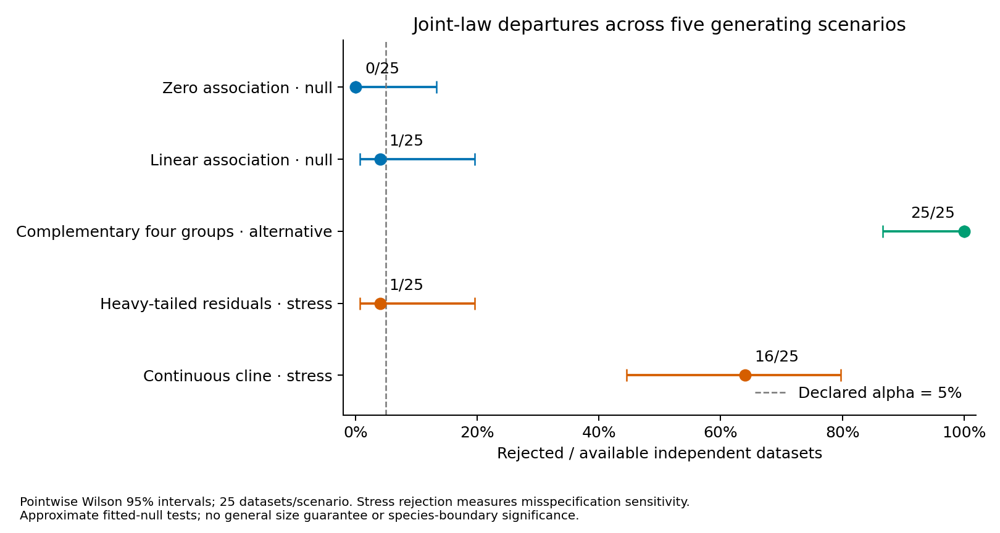

# Completed joint genomic–phenotypic fitted-null study

The approved frozen study completed **125/125 observed datasets**,
with **12,500/12,500 successful full-pipeline fits**,
**0 failed** and **0 unattempted fits**.
All cases used their unchanged declarations and independent fitted nulls. No
observed dataset or draw was retried, repaired, replaced or selected after results.

The [method](joint-genomic-phenotypic-calibration.md) defines a specific fitted
joint law: independent empirical genotype blocks, with continuous phenotypes
conditionally Gaussian on four prespecified raw block-mean predictors. It retains
fitted linear genomic–phenotypic association and full morphology/ecology residual
covariance. It is neither a causal model nor a general model of all biological
structure. Marginal phenotypes need not be Gaussian or unimodal under this null.

## Rejection and selected mixture sizes

| Generating scenario | Rejected / available | Pointwise Wilson 95% interval | Selected K counts |
| --- | ---: | ---: | --- |
| Zero association (joint-law null) | 0/25 | 0.0–13.3% | K=1: 25 |
| Linear association (joint-law null) | 1/25 | 0.7–19.5% | K=1: 24, K=2: 1 |
| Complementary four groups | 25/25 | 86.7–100.0% | K=2: 22, K=3: 3 |
| Heavy-tailed residual stress | 1/25 | 0.7–19.5% | K=1: 24, K=2: 1 |
| Continuous-cline stress | 16/25 | 44.5–79.8% | K=1: 9, K=2: 16 |

Only the first two rows are model-law null checks. Their small numbers and broad
intervals do not establish general 5% size control. The complementary alternative
is intentionally strong; the configured K ceiling equals its four generating
groups. Heavy-tailed and clinal scenarios are misspecification checks, not
species-boundary or discrete-cluster type-I error experiments. The stress cases
have no discrete generating groups. A low heavy-tail rejection rate does not
validate Gaussian residuals or establish broad robustness: this clustering
statistic need not detect every departure from its fitted law.

The departure test rejected all constructed alternatives, but the point clustering
selected K=2 in 22 datasets and K=3 in 3; it **never selected K=4**. Thus this
fixed two-PC integrative baseline did not recover the four-group generating
partition. The 25/25 rejection result concerns global departure detection,
not correct group-number recovery or successful species delimitation. No
settings were changed to improve these observed results.

Reported p-values are approximate fitted-model bootstrap tails. With 99 draws,
the minimum is 0.01 and decisions use p<=0.05. Conditional tail intervals quantify
Monte Carlo variation given the observed statistic and fitted parameters; exceedance
counts and conditional interval bounds are exported in the diagnostics. These intervals
exclude profile-support, regression, covariance, block-map and model uncertainty.
An atom at T=0 and corresponding p=1 is expected when K=1 has the smallest BIC.
No selected-K, cluster-specific or species-boundary significance is supplied.

## Prespecified execution and checks

- 25 independent datasets in each of five scenarios; N=64, 128 loci in 16
  eight-SNP blocks, four predictor blocks and four traits per morphology/ecology
  view. Independent moderate-LD blocks underlie both model-law null scenarios.
- Two PCs per view and jointly, equal view weights, full-covariance GMM K=1..4,
  minimum hard cluster size 5, 10 EM starts, B=99 and alpha=0.05. Master seed
  20261028 and model seed 71323 were fixed. Each observation fits its own raw null;
  fitted nuisance parameters remain fixed within its draw bank. Stability is off.
- Four concurrent one-thread case processes at most. A separate full-settings
  preflight used a distinct observed-data master seed and passed all 15 fits and
  its independent audit. It supplied no replacement main observations.
- Frozen wheel execution used Python 3.12.10, NumPy
  2.2.6, SciPy 1.15.3,
  scikit-learn 1.6.1 and SNPio
  1.7.7. Final Python 3.11/3.12 CI is recorded
  on the draft PR. All 106 package Python source files match the frozen wheel.
- The read-only audit verified **624,000 archived members**,
  **12,500 successful pipelines** and
  **16,140 study files**. It regenerated raw observations, every
  genotype/phenotype draw and donor matrix, independently checked categorical
  profile MLEs and ordered likelihoods, and used QR regression/dense Gaussian
  densities to verify SVD coefficients, residual covariance and joint likelihood.
- Source identities, archived hashes, fusion/projection, selected full-GMM
  likelihood/BIC/membership, full K-selection bookkeeping, seeds, tail calculations
  and denominators were checked without clustering refits. View PCA and nonselected
  likelihoods were retained/checksummed, not independently refitted.

## Diagnostics and evidence limits

All fitted designs have five columns and 59 residual degrees of freedom. Raw null
fits apply no covariance floor, ridge, support smoothing or predictor selection.
The public [dataset diagnostics](../examples/joint-calibration/results/diagnostics.csv)
retain design singular-value ratios, residual correlation eigenvalues, descriptive
mean trait R-squared and block support. R-squared is an in-sample descriptive
quantity, including estimation noise under zero association, not an association
significance test. Empirical profile support remains sparse; unseen profiles have
zero fitted probability. Block definitions and four raw summary predictors are
assumptions, not inferred genomic architecture.

The full raw data, donor provenance, per-draw pipeline parameters, logs, failure
ledgers, immutable inventory and frozen runtime remain local under artifact
identifier `joint-null-20261021`. The [compact public evidence](../examples/joint-calibration/results/)
contains study settings, rates, per-dataset outcomes, diagnostics, versions and
verification hashes. This is local preservation rather than public raw deposition
or a self-contained environment image. Simulated generating partitions do not
supply empirical biological species ground truth.

Reproduce the figure from the audited analysis directory with
`python scripts/plot_joint_calibration.py /path/to/study-analysis --output-dir /path/to/new-figures`.
The plotted intervals are pointwise across scenarios and are not multiplicity-adjusted.
