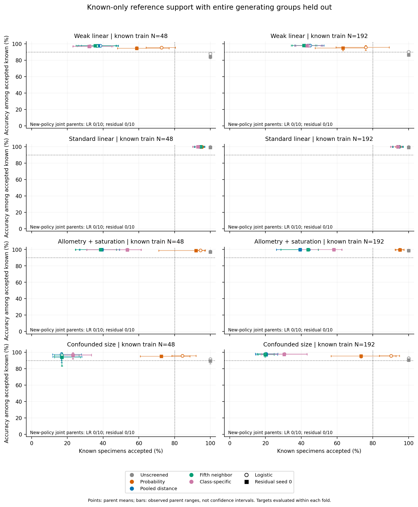
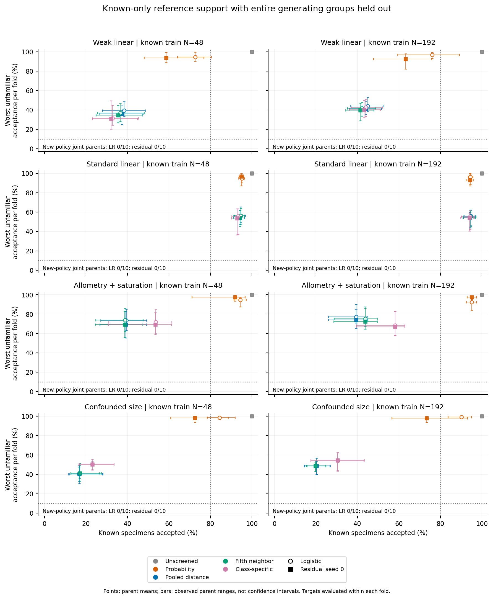

# Known-only support with held-out generating groups: completed validation

The new class-specific support policy did **not** meet the prespecified joint
operating target. All 64 primary parent-success rates were 0/10, across both
logistic and residual classifiers and all four screened policies. The focal
allometry+saturation, original-panel N=256, residual-seed-0 flag failed: zero
successful parents, zero new-only successes versus fifth-neighbor support and
zero reverse successes. All results were numerically available; this is a
performance result, not a numerical rejection or missing-output substitution.

This checkpoint adds an opt-in known-reference support interface and an explicitly
held-out-group validation workflow. No unfamiliar examples entered fitting or
calibration. No default, old schema, historical p-value, classifier architecture
or empirical evidence gate changed. The prespecified decision is to close the
present reference-support tuning cycle and stop, without promoting a policy or
claiming that every possible method must fail.

## What the experiment tested

Eighty fresh independent parent datasets covered four measurement laws at original
four-group training-panel N=64/256, ten parents per cell. Each parent was evaluated
four times, excluding a different entire generating group. Every preprocessing
step, classifier, support estimate and cutoff was refitted using the remaining
three groups. Known training sizes were therefore **48/192**, with a separate
known-only calibration cohort of 120 specimens, forty per retained reference.
The panel N does not include this additional calibration data.

The unchanged logistic classifier and residual network at fixed seed 0 received
identical retained training and calibration specimens. The new support rule used
separate regularized Gaussian covariance matrices for each known reference;
predecessor rules used classifier probabilities, a pooled covariance or fifth
neighbors in the pooled metric. The one fixed .05 rank level was calibrated
using known references only. No test labels selected cutoffs, seeds or models.

A held-out fold succeeded only with at least 80% known coverage, at least 90%
accuracy among accepted known specimens, and at most 10% acceptance **separately**
for the excluded group and nearby/distant unfamiliar cohorts. A parent succeeded
only if at least three of its four exclusions met all those criteria. The four
folds are repeated measurements of one parent, not extra independent datasets.

## Operating results

These are parent-weighted means for the new policy with residual seed 0. They
summarize the available folds within each parent; accepted accuracy excludes empty
accepted sets and retains its availability denominator in the exported data.
Neither a mean nor one successful exclusion establishes joint parent success.

| Generating law | Original panel N | Known training N | Known accepted | Accepted-known accuracy | Held-out accepted | Nearby accepted | Distant accepted | Joint parents |
|---|---:|---:|---:|---:|---:|---:|---:|---:|
| Weak linear | 64 | 48 | 32.2% | 96.9% | 28.7% | 20.3% | 0.2% | 0/10 |
| Weak linear | 256 | 192 | 43.3% | 97.8% | 35.5% | 31.8% | 0.1% | 0/10 |
| Standard linear | 64 | 48 | 92.9% | 99.9% | 3.3% | 53.4% | 15.0% | 0/10 |
| Standard linear | 256 | 192 | 94.0% | 99.9% | 0.7% | 54.0% | 8.7% | 0/10 |
| Allometry + saturation | 64 | 48 | 53.5% | 99.6% | 48.5% | 49.9% | 31.9% | 0/10 |
| Allometry + saturation | 256 | 192 | 58.2% | 99.7% | 47.6% | 50.8% | 39.7% | 0/10 |
| Confounded size | 64 | 48 | 23.1% | 96.3% | 37.4% | 42.7% | 4.0% | 0/10 |
| Confounded size | 256 | 192 | 30.4% | 97.3% | 40.2% | 45.2% | 3.5% | 0/10 |

The standard-linear N=256 result illustrates a useful distinction: only 0.7% of
held-out-group specimens were accepted on average, while 94.0% of known specimens
were accepted. Nevertheless, nearby unfamiliar acceptance was 54.0%, so good
performance on the excluded reference did not provide reliable rejection of
other unfamiliar distributions. Some individual folds succeeded; no parent
satisfied the three-of-four requirement.

For the focal nonlinear cell, the new policy accepted 58.2% of known specimens
with 99.7% accuracy among accepted specimens. It accepted 47.6% of the excluded
group, 50.8% of nearby unfamiliar specimens and 39.7% of distant unfamiliar
specimens. Fifth-neighbor support on the **same** folds accepted 43.7% of known
specimens and 61.4% of excluded-group specimens, but had 47.4% nearby and 35.0%
distant acceptance. The new policy therefore improved some descriptive components
and worsened others; it established no joint operating advantage.

The focal logistic result was similar: 58.2% known coverage, 99.7% accepted
accuracy and 48.6%/53.3%/39.5% excluded/nearby/distant acceptance. Both heads had
zero primary successes in every cell. This establishes no neural advantage and
is not a proof that the classifiers are equivalent in every setting. Only one
prespecified neural seed was assessed.

Every 0/10 primary rate has an exact marginal 95% interval of **0–30.9%** and a
separate Bonferroni-64 simultaneous interval of **0–54.4%**. The small ten-parent
cells support bounded pilot conclusions. The 48 paired policy comparisons and
eight paired classifier comparisons retain discordances and conservative
intervals in their separate 56-comparison family. Secondary excluded-group and
unscreened rates retain marginal intervals only. No rows, folds, policies or
heads were treated as additional independent parent datasets.

## Inclusion, assignment and unfamiliar detection differ

In the focal cell, the true known reference was compatible for 94.9% of specimens,
but only 58.2% received an accepted unique assignment. About 36.8% had multiple
compatible references, 4.1% had none, and 0.9% had a single compatible reference
that conflicted with the classifier's original prediction. Original predictions
and probabilities were retained throughout.

The rank setting concerns true-known-reference **set inclusion**, under independent
classwise exchangeability. It does not ensure unique assignment, high coverage
at a chosen accuracy, unfamiliar rejection, or coverage after a sampling shift.
A realized dataset's coverage also fluctuates around a nominal repeated-sampling
level. High accuracy among selected known specimens does not resolve these
other requirements.

The independent exact-overlap control shares the measurements of the lowest
remaining known reference in each fold. In the focal residual cell, its acceptance
was 27.5%, versus 27.6% coverage of that matching known reference. Comparing it
with overall known coverage of 58.2% would be misleading. This control and the
shifted-known stress cohorts never entered fitting or calibration and were
excluded from the primary joint target. Identical observed distributions cannot
identify distinct labels from these features alone.

This is supervised support for supplied generating/reference groups. Species
truth and arbitrary future unfamiliar distributions remain unvalidated. The
synthetic three-reference experiment is not a paired comparison with the prior
four-reference diagnostic, which had extra explicitly labelled unfamiliar data.
No empirical cohort was fitted and nobody was contacted.

## Figures and evidence

Points are means of independent parent summaries; bars show observed parent
minima/maxima, **not confidence intervals**. Accuracy and its coverage use the
same nonempty accepted-known folds. The unfamiliar plot averages the worst
excluded/nearby/distant acceptance within each fold, then averages those folds
within each parent. Dotted lines show individual target components; primary
success requires three of four folds to satisfy all criteria. Model points may
overlap. The axes cover the full percentage range, and all values/availability
counts are retained in the figure data and small aggregates.

The main phase completed 648 classifier fits, including four exact fold replays;
the separate full-settings preflight completed 68, including two replays. Across
both phases, all **179,000 actual residual optimizer updates** were independently
checked. Independent audits reconstructed raw measurement laws, joins, whole-group
exclusions, covariance/Gaussian likelihoods, calibration ranks and frozen
predictions/decisions. An external report audit recomputed 3,200 ordinary
head/fold/policy targets, all 64 exact interval pairs, 56 paired contrasts and
59,600 summary values. There were no failed scientific workflows or replacement
fits. All 495 pre-existing package modules other than CLI/version remained
byte-identical; all 510 package modules and 2,750 innovation paths were frozen
before scientific generation.

Main execution elapsed 254.08 seconds with at most two single-thread workers;
its independent audit elapsed 55.81 seconds and report generation 3.26 seconds.
The separately measured gate charged serial worker time without parallel-speed
credit and passed the ninety-minute ceiling and six-GiB local-evidence cap.
Regression tests, packaging, publication/CI and evidence preservation are recorded
separately. Only code/docs/invented fixtures/figures/small aggregates are public;
full data, class labels, numeric models, update audits and CI logs remain local.

[API and CLI](reference-density.md),
[frozen protocol](known-reference-validation.md),
[study declaration](../examples/known-reference/study.json),
[summary](../examples/known-reference/results/summary.json),
[stopping assessment](../examples/known-reference/results/stopping-assessment.json),
[matched-overlap summary](../examples/known-reference/results/overlap-summary.json).

The checkpoint ends with a documented operating limitation and the prespecified
closure of this reference-support tuning cycle. It promotes no method or default
and makes no species-boundary or general unfamiliar-detection guarantee.
