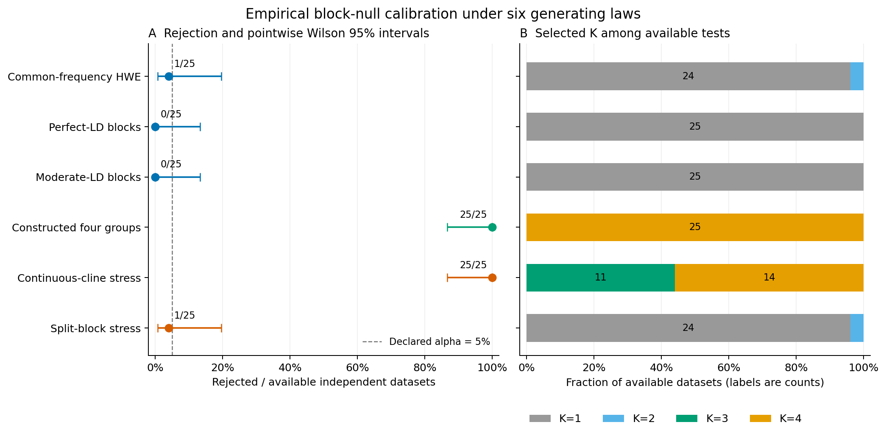

# Linkage-aware empirical genomic validation results

The approved unchanged study completed **150 observed datasets** with
**150/150 available tests**, **15,000 successful full-pipeline
clustering fits**, **0 failed fits** and **0
unattempted fits** out of **15,000 planned**. Settings/seeds were fixed before
execution. No main attempt was retried, repaired or replaced.

## Rejection and uncertainty

| Generating law | Available / requested | Rejected / available | Rate | Pointwise Wilson 95% interval |
| --- | ---: | ---: | ---: | ---: |
| Common-frequency HWE | 25/25 | 1/25 | 4.0% | 0.7–19.5% |
| Perfect-LD blocks | 25/25 | 0/25 | 0.0% | 0.0–13.3% |
| Moderate-LD blocks | 25/25 | 0/25 | 0.0% | 0.0–13.3% |
| Constructed four groups | 25/25 | 25/25 | 100.0% | 86.7–100.0% |
| Continuous-cline stress | 25/25 | 25/25 | 100.0% | 86.7–100.0% |
| Split-block stress | 25/25 | 1/25 | 4.0% | 0.7–19.5% |

The common, perfect-LD and moderate-LD cases satisfy their declared block law.
Their finite results are checks under these constructions, not a general or
exact 5% error guarantee. The alternative is one strong four-group construction.
Continuous clines and incorrectly split blocks violate the fitted law without
having discrete generating groups. Their rejection rates measure sensitivity
to misspecification, not species/clustering type-I error. Non-rejection in a
stress case cannot establish robustness to that violation.

Rates use independent observed datasets with availability retained. Wilson
intervals are pointwise and unadjusted across six cases. Twenty-five datasets
per case give limited precision; a zero-event interval still reaches about
13.3%. Conditional Monte Carlo tail intervals for every available test are in
[dataset diagnostics](../examples/linked-calibration/results/dataset-diagnostics.csv).
They exclude empirical-support, block-map and model uncertainty. P-values are
approximate, discrete at resolution 0.01, and remain separate from stability.

Panel A shows rejection rates and pointwise Wilson intervals. The 5% line is
the declared alpha, not a target rejection rate for the alternative/stress laws.
Panel B shows selected K with dataset-count labels; mixture components do not
establish species boundaries. [PDF](figures/linked-calibration/linked-calibration.pdf)
and [SVG](figures/linked-calibration/linked-calibration.svg) are included.

## Byte-paired comparison with the pooled-HWE checkpoint

All **100 shared complete observations** have verified identical PHYLIP and
dataset bytes, saved values hashes, data seeds and point settings. Availability
was **100/100** for #47 and **100/100**
for this checkpoint: **0 recovered and 0 lost**.
Maximum absolute observed-statistic difference was **0**;
selected K agrees for every pair with successful observed fits.

| Shared observed law | #47 pooled-HWE rejections | Empirical block-null rejections |
| --- | ---: | ---: |
| Common-frequency HWE | 1/25 | 1/25 |
| Constructed four groups | 25/25 | 25/25 |
| Perfect-LD blocks | 0/25 | 0/25 |
| Continuous-cline stress | 25/25 | 25/25 |

These workflows test **different hypotheses**. The new law preserves empirical
whole-block genotype distributions without imposing HWE; #47 fits independent
Binomial(2,p) loci. Null seed namespaces also differ. Changes in p-values are not
a common-random-bank comparison or proof of improved inferential validity.
The original rare/missing case is excluded from the complete-data comparison.
[Paired outcomes](../examples/linked-calibration/results/paired.csv) and
[comparison scope](../examples/linked-calibration/results/paired-summary.json)
retain every shared dataset.

The 100 reported p-values also agree at resolution 0.01 for these prespecified
streams. Agreement here cannot establish equivalence of the different null laws.
The sole split-block rejection had p=0.05, with four exceedances in 99 draws;
its conditional fitted-tail 95% interval is approximately 1.1–10.0%, illustrating
Monte Carlo uncertainty at the decision threshold. No draw count was increased
after inspecting this outcome.

## Empirical support and fixed settings

| Law | Profiles per block: min / median / max | Mean fraction of specimens in singleton profiles |
| --- | ---: | ---: |
| Common-frequency HWE | 56 / 62 / 64 | 92.5% |
| Perfect-LD blocks | 2 / 3 / 3 | 0.1% |
| Moderate-LD blocks | 29 / 42 / 53 | 50.8% |
| Constructed four groups | 27 / 38 / 45 | 46.2% |
| Continuous-cline stress | 44 / 55 / 62 | 77.3% |
| Split-block stress | 2 / 3 / 3 | 0.1% |

Each block contains eight original loci and each observed dataset contains 64
specimens. The table pools the 400 observed block fits per case. A singleton
profile has probability 1/64; unseen profiles have fitted probability zero.
These are support diagnostics, not confidence intervals or a certification of
adequate learning. No smoothing, frequency floor, data-driven map choice or
post-result correction was used. Full [block diagnostics](../examples/linked-calibration/results/block-diagnostics.csv)
and [selected-K/zero-statistic diagnostics](../examples/linked-calibration/results/diagnostics.csv)
are exported. Sparse/high-diversity block support can limit the fitted law.

The design fixes 25 datasets/case, 128 loci in 16 declared blocks, two PCs,
diagonal-GMM K=1..4, minimum hard component size 5, 10 EM starts, max 500
iterations, tolerance 0.001, regularization 1e-6, B=99 and alpha=0.05. The same
prespecified analysis seed is used for all fits. Ground truth remains separate.
Source laws and raw-data assumptions are in the [method](linked-genomic-calibration.md).

The common-frequency case has a median **62 distinct profiles among 64
specimens per block**, with **92.5%** of specimen-block observations belonging
to singleton profiles. The moderate-LD case has a median **42 profiles** and
**50.8%** singleton observations. This high sparsity is an explicit limitation
on empirical support estimation, even though the constructed null cases show
few rejections in this finite study.

## Independent audit and preservation

The audit verified **329,400 archived members**, **15,000
successful pipeline results** and **18,036 study files**. It regenerated
all raw inputs/draws and donor-index files, independently checked categorical
profile counts/probabilities and ordered-row likelihoods, verified block maps
and sparse support, reconstructed Patterson filtering/scaling and PCA
eigensystems/projections, evaluated selected diagonal-GMM likelihood/BIC/membership,
and recomputed seeds, selection, tails, evidence and fit counts. No ingestion or
clustering was refitted for analysis. Nonselected likelihoods are retained and
checksummed rather than independently re-evaluated from unexported parameters.
Outer failures would retain counts without a complete numerical re-audit.

The same code re-audited all **12,500 pipelines / 252,250 archived members** of
#47, and its complete raw-file inventory hash is unchanged. Frozen and reporting
package Python sources agree. Full-settings preflight passed all 18 pipelines
and its audit. The campaign used Python 3.12.10, NumPy
2.2.6, SciPy 1.15.3,
scikit-learn 1.6.1 and SNPio
1.7.7, with at most four process-isolated case
jobs and one numerical thread per fit. Python 3.11/3.12 are supported; the larger
campaign is a Python 3.12 run, not a cross-platform equality claim.

Compact ledgers, conditional intervals, support diagnostics, paired outcomes,
settings, hashes and figures are committed. Full raw data, donor provenance,
SNPio diagnostics, pipeline archives, frozen wheel/runtime, preflight, legacy
re-audit and final packages are preserved locally at:

`linked-null-20261021` (local artifact identifier)

Public runtime metadata includes package versions only. Full machine-local
paths remain in the local artifact bundle. This is local preservation, not
public raw-data deposition. The frozen runtime
references existing scientific libraries and is not a self-contained system
image. The manifest records code, wheel and full-file inventory hashes.
