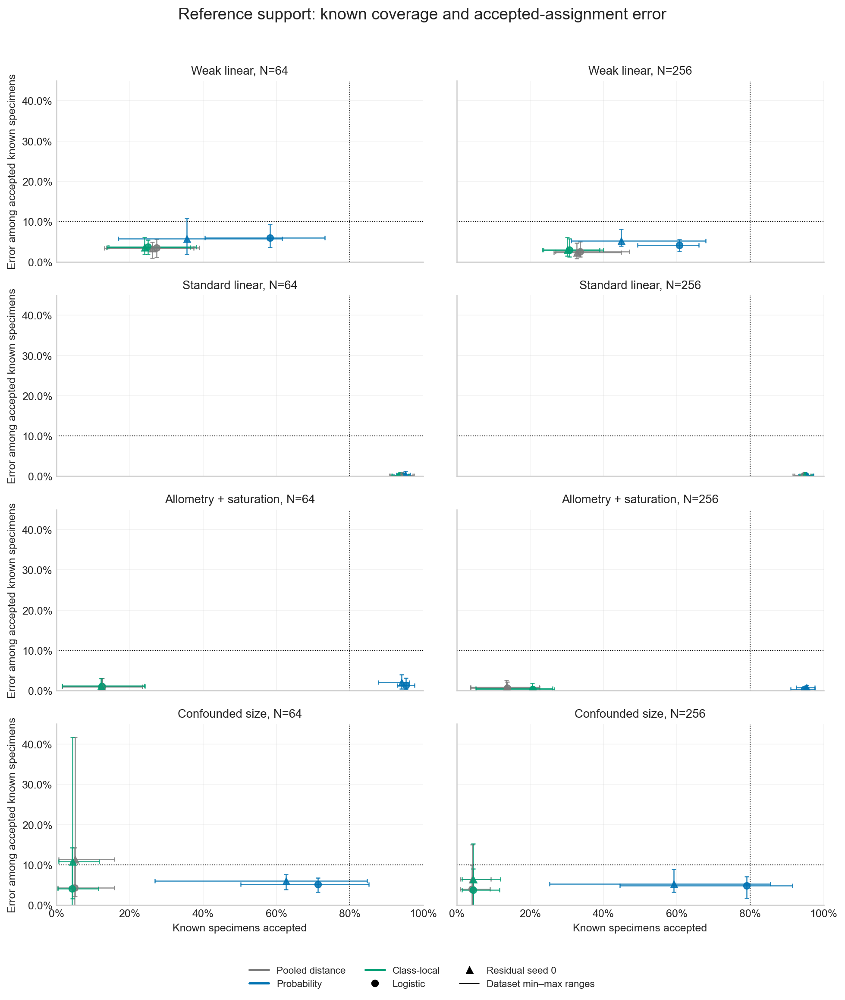
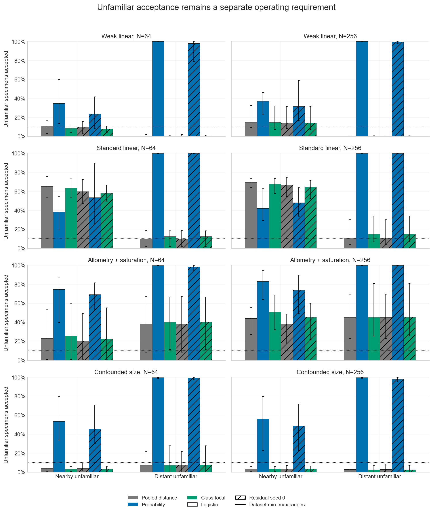
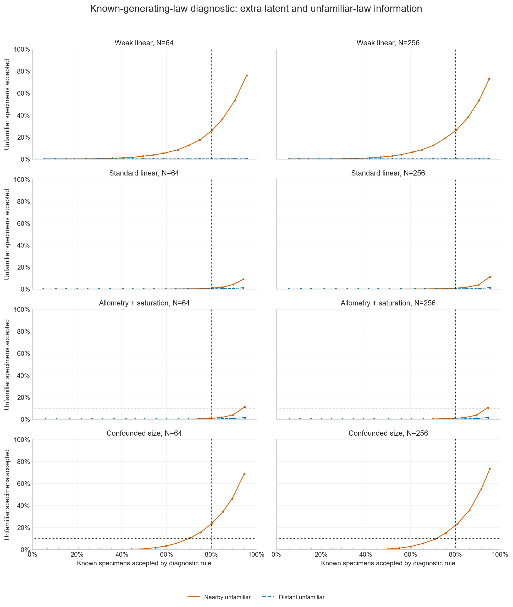

# Class-local reference support: validation results

The fifth-nearest-reference rule is implemented as a separate, opt-in workflow.
It did **not** solve the coverage–error tradeoff in this pilot. None of the
48 primary joint-target rates or 16 bounded-benefit rates had a successful dataset:
each was 0/10, with no unavailable results. The original distance/probability
policies, classifier predictions, defaults and historical p-values are unchanged.
This is supervised reference assignment, not discovery of new species.

## What was tested

The [frozen protocol](local-reference-validation.md) assessed 80 archived datasets
without retraining their classifiers and 80 fresh independent training datasets:
ten per weak-linear, standard-linear, allometry+saturation or confounded-size law
at N=64/256. These are synthetic matched morphology/ecology measurements, with
four morphology and eight ecology traits. Independent known-reference calibration
has 160 specimens; known IID evaluation has 2,048. Nearby, distant and exactly
feature-overlapping unfamiliar cohorts each have 512 specimens. Confounded-size
cases also have 2,048 shifted known specimens. Evaluation labels never fit support.

Unchanged logistic regression and three residual-network initializations are
retained. Seed zero and logistic regression are the primary classifiers; other
neural seeds are sensitivity checks. Every prediction receives the original
probability/distance policies and the fixed new local rule. The neighbor count,
metric and calibration setting were frozen before fresh generation. Calibration
specimens set classwise thresholds; only original training specimens are neighbors.

The original joint target requires at least 80% known acceptance, at least 90%
accuracy among accepted known specimens, and at most 10% acceptance of **both**
nearby and distant unfamiliar groups. A separate benefit indicator requires a
10-percentage-point coverage gain over distance screening, at least 90% accepted
accuracy, no more than one point of accuracy loss, and no more than two points
of additional unfamiliar acceptance. This indicator is descriptive; it is neither
a noninferiority test nor adequate unfamiliar detection when the baseline is poor.

## Fresh operating results

The following are dataset means for residual seed zero, in percent. Coverage is
the fraction of known IID specimens receiving an assignment. Accuracy is measured
only among accepted specimens; unfamiliar acceptance should be low.

| Synthetic law | N | Old distance coverage | Local coverage | Local accepted accuracy | Local nearby acceptance | Local distant acceptance |
| --- | ---: | ---: | ---: | ---: | ---: | ---: |
| Weak linear | 64 | 26.2 | 24.1 | 96.4 | 7.9 | 0.4 |
| Weak linear | 256 | 32.8 | 30.1 | 97.0 | 14.3 | 0.1 |
| Standard linear | 64 | 93.9 | 93.2 | 99.9 | 58.2 | 12.3 |
| Standard linear | 256 | 94.4 | 94.8 | 99.9 | 64.6 | 15.0 |
| Allometry+saturation | 64 | 12.4 | 12.2 | 98.8 | 22.3 | 40.0 |
| Allometry+saturation | 256 | 13.6 | 20.6 | 99.4 | 45.3 | 45.3 |
| Confounded size | 64 | 5.2 | 4.4 | 89.2 | 3.3 | 7.7 |
| Confounded size | 256 | 4.3 | 4.6 | 93.5 | 3.6 | 2.7 |

The local rule sometimes traded one problem for another. In the N=256
allometry+saturation cell it gained seven coverage points, but nearby unfamiliar
acceptance also increased by about seven points. Standard-linear coverage stayed
high while unfamiliar acceptance remained excessive. Weak and confounded cases
continued withholding most known specimens. Logistic results were similar, and
none of the other neural seeds met the joint target. Archived assessments also
had no joint-target successes. No seed, threshold or policy is promoted.

Ten independent datasets per cell provide limited precision: every 0/10 primary
rate has an exact marginal 95% upper bound of 30.85%; the separate Bonferroni-64
simultaneous upper bound is 54.38%. These wide bounds prevent a general performance
claim. Seeds, policies, cohorts and thresholds are repeated measurements, not
additional independent datasets. The 32 paired contrasts retain discordant
outcomes and descriptive continuous differences; all failures and denominators
remain explicit.

Figure ranges show observed dataset minima/maxima, **not confidence intervals**.
Coverage/error points use common datasets with defined accepted accuracy. Undefined
accuracies and zero coverage are retained in the aggregates and figure metadata.

## Why assignment is still difficult

True-known-reference inclusion was approximately 94.3–96.4% across primary neural
cells. This concerns whether the correct reference appears in a compatible set,
not whether the specimen receives a unique, correct assignment. Ambiguity among
several compatible classes remained high: about 74% in N=256 allometry+saturation
and 92% in N=256 confounded size. Local support therefore cannot translate nominal
inclusion into high assignment coverage.

The overlapping-unfamiliar cohort has exactly the measured-feature law of known
class three. For N=256 allometry+saturation, its local acceptance was 46.6%, close
to the corresponding known-class-three acceptance of 46.1%. Overall known coverage
is the wrong comparator here. Identical measurement laws cannot establish a new
biological identity from those measurements alone.

Nuisance shifts remain outside the known-class exchangeability assumption. Local
coverage on shifted confounded-size specimens was only 2.7%/2.5% at N=64/256,
with accepted accuracy 54.9%/67.1%. Withholding does not guarantee safer assignment
under changed conditions.

## Known-generating-law diagnostic

A separately labelled reference uses the true five-dimensional latent/size laws
and the true nearby/distant unfamiliar distributions. Its likelihood-ratio curves
retain all nineteen fixed calibration levels. It has extra information unavailable
in applications and is neither a deployable policy nor a formal attainable bound.
No threshold is chosen from the evaluation results.

The curves suggest more useful separation for standard-linear and
allometry+saturation cases than for weak/confounded cases. For example, at the
illustrative fixed nominal withholding level of 20%, standard-linear and
allometry+saturation known coverage was about 79–81%, with unfamiliar acceptance
below 1%; weak/confounded nearby acceptance remained about 23–26%. This comparison
helps distinguish limitations of the present support geometry from overlapping
input laws. It does not validate a replacement rule or prove impossibility.

## Completion and checks

Main execution trained 320 classifiers and assessed 72 archived observations;
the separate preflight trained 32 and assessed the remaining eight. Across both
phases there were 264 neural and 88 logistic trainings, 320 fixed archived model
assessments and eight exact frozen replay workflows. All 132,000 neural optimizer
updates were independently checked. All 11,424 model/policy/cohort records, 13,566
known-law evaluations and forty replay cohort predictions passed the numerical
and reporting audits. There were no failed workflows or replacement fits.

Independent checks recomputed the support metric, fifth-neighbor order/ties,
classwise ranks, decisions, classwise metrics, analytical reference densities,
all sixty-four exact interval pairs and thirty-two paired comparisons. Source
seals preserve all 486 frozen package modules; 471 pre-existing numerical/source
modules remain byte-for-byte unchanged. Public JSON and all 1,184 plotted numbers
were independently checked; the three figures were visually inspected.

Local checks passed 1,736 dependency-free foundation tests, 2,396 scientific tests,
462 broad neural regression tests and 34 final targeted provenance checks. Python
3.11/3.12 compatibility, installed-package checks and the new installed opt-in
workflow are also exercised by the six-job CI matrix. The final commit's CI is
verified before checkpoint closure; its receipt remains with the local evidence.

The measured preflight and main study completed within the approved resource
gates: three GiB of retained new evidence, eight GiB free reserve, at most two
single-thread workers and separate twenty-/ninety-minute serial limits. The
commute pause is excluded from execution time. Source seals, previous checkouts
and archived studies are preserved. Full observations, labels, scores, weights,
trajectories, logs and receipts remain local; only code, documentation, invented
fixtures, figures and small aggregate JSON are published. No empirical fitting,
new p-values, species claims or author contact occurred.

See the [interface](local-reference-support.md), [protocol](local-reference-validation.md)
and [public aggregates](../examples/local-reference-support/results/).
