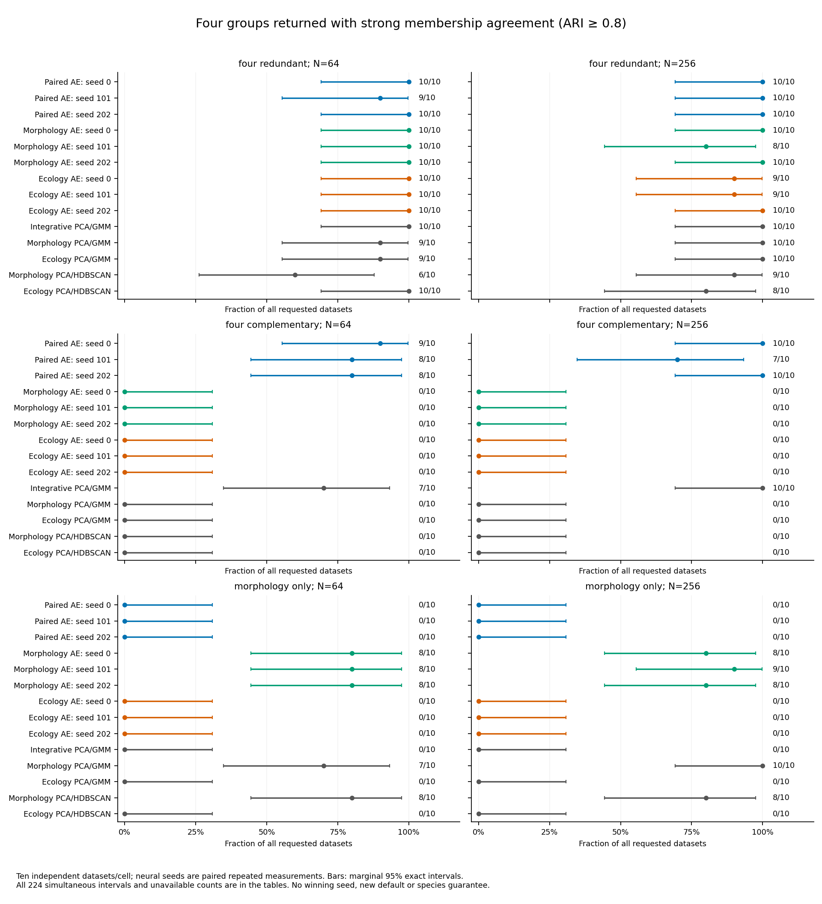
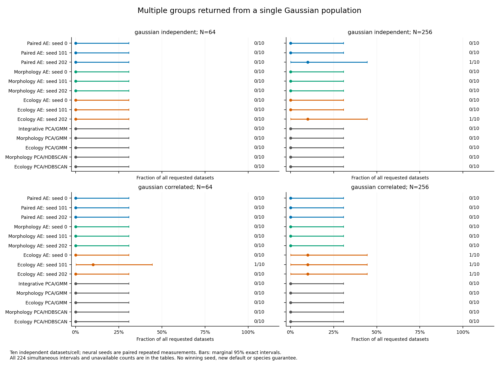

# Matched morphology–ecology neural results

**The new opt-in workflow can combine complementary individual measurements,
but adding an uninformative view can erase recovery. It is a research baseline,
not a general improvement or a validated species decision.** All three neural
initializations are retained; no seed, model family or default is promoted.
Existing defaults, schemas, historical p-values and empirical gates are unchanged.

The [CLI/API](matched-neural.md) strictly matches the same individuals across
complete continuous morphology and individually measured ecology. One network
learns a shared two-dimensional summary of both views, with equal reconstruction
loss weight after standardization. Existing HDBSCAN proposes groups and retains
noise. Loss balance does not guarantee equal biological influence or retention
of every useful signal. Frozen models encode/reconstruct paired new measurements;
they do not assign species or HDBSCAN membership to new individuals.

## What was tested

The [approved protocol](matched-neural-study.md) froze 160 independent synthetic
datasets: ten per cell across eight laws at N=64/256. Each has four morphology
and eight ecology traits. Both Gaussian controls represent one generating
population. Three four-group laws place the signal in both views, split it
across views, or put it only in morphology. Discordant views have different
four-way references; heavy tails have no discrete reference. Paired moons are
a secondary nonlinear stress case. These are generated measurements, not
empirical species truth. Exact formulas, independent streams and software/source
locks are in the protocol and local evidence.

Fourteen fixed arms comprise three initializations of the paired model, the
same three for each single-view neural model, integrative PCA/GMM, and single-view
PCA/GMM and PCA/HDBSCAN. Classical settings, density rules, two PCs and all model
seeds remain unchanged. Raw ecology rows were independently shuffled; verified
canonical copies give every baseline the same biological order and native
subsampling identities. Reference labels were used only after fitting.

## Execution and numerical verification

| Item | Completed |
|---|---:|
| Original separate preflight workflows | 472 |
| Main independent datasets / point outputs | 160 / 2,240 |
| Main workflows, including native draws and exact replays | 2,708 |
| Available point outputs / numerical workflow failures | 2,240 / 0 |
| Native subsampling refits / failed draws | 440 / 0 |
| Exact all-arm point replays | 28 |
| Additional numerical-audit preflight training replays | 24 |
| Additional verification training replays | 2,160 |

The 2,708 main workflows comprise 1,818 neural and 890 classical fits. The 486
GMM searches contain 1,944 K-specific candidates; 2,222 HDBSCAN fits accompany
the other workflows. These component counts are not extra independent datasets.
No failed fit, method, seed or draw was replaced.

A numerical-audit problem was retained and explicitly resolved through the
[user-approved amendment](matched-neural-audit-amendment.md), approved after the
original scientific runs. First, the independent serial NumPy reconstruction
missed a loss-only guard in two heavy-tail preflight fits. The auditor retained
that failure, used the independently verified fitted preprocessing parameters
for exact input replay, and changed loss absolute tolerance from 1e-10 to 1e-8;
final-weight guards stayed unchanged. The main serial audit subsequently stopped
at `heavy_tail_n64_0001 / paired_202`: maximum final-weight difference was
1.43e-7 and standardized-coordinate difference 2.19e-7. That failed guard was
preserved and was not widened.

The amendment checks the actual training path one update at a time: independent
NumPy derivatives, coupled-decay Adam moment recurrences and parameter updates
are checked against each actual update using tolerances frozen before the new
24-replay preflight. Every original neural fit is then rerun solely for numerical
verification, requiring **exact initial/final weights and all 501 training
losses**. All 2,160 replays passed, covering 1,080,000 update checks, plus 12,000
preflight checks. Maximum absolute residuals across the full verification were
2.07e-15 for gradients, 2.07e-16 and 2.98e-19 for the two moments, and 8.62e-15
for parameter updates. This supports accumulated floating-point trajectory drift
as the serial mismatch mechanism; it is not evidence of better biological
recovery or cross-platform bitwise identity.

All scientific inputs, original fitted outputs and decisions remained unchanged.
The initial audit failures, source freezes, amendment approval and exact replay
bindings remain local. Verification runs are neither new statistical observations
nor additional candidate/seed searches, and run no new clustering or subsampling.
The observer belongs to benchmarking; normal user fitting uses the unchanged
trainer without these audit hooks.

The final audits also passed source-law regeneration, joins and row permutations,
loss weights, frozen encoders/decoders, PCA/fusion, GMM densities/BIC/memberships,
density geometry/invariants, all native support denominators and exact point
replays. Density checks are not a second HDBSCAN implementation. A separate
arithmetic audit checked all 2,240 partitions, 224 primary rates and intervals,
144 paired comparisons, coverage/failure bounds and 88 native stability summaries.

## Four-group recovery depends on where the signal is

The table gives **correct K=4 and full-unit ARI >=0.8 / all ten requests**.
ARI measures agreement with the known simulated groups: one means perfect
agreement; near zero means little agreement. Noise is retained as unresolved
singletons, with assigned-only agreement and coverage available separately.

| Arm | Redundant 64 | Redundant 256 | Complementary 64 | Complementary 256 | Morphology-only 64 | Morphology-only 256 |
|---|---:|---:|---:|---:|---:|---:|
| Paired AE, seed 0 | 10/10 | 10/10 | 9/10 | 10/10 | 0/10 | 0/10 |
| Paired AE, seed 101 | 9/10 | 10/10 | 8/10 | 7/10 | 0/10 | 0/10 |
| Paired AE, seed 202 | 10/10 | 10/10 | 8/10 | 10/10 | 0/10 | 0/10 |
| Morphology AE, seed 0 | 10/10 | 10/10 | 0/10 | 0/10 | 8/10 | 8/10 |
| Morphology AE, seed 101 | 10/10 | 8/10 | 0/10 | 0/10 | 8/10 | 9/10 |
| Morphology AE, seed 202 | 10/10 | 10/10 | 0/10 | 0/10 | 8/10 | 8/10 |
| Ecology AE, seed 0 | 10/10 | 9/10 | 0/10 | 0/10 | 0/10 | 0/10 |
| Ecology AE, seed 101 | 10/10 | 9/10 | 0/10 | 0/10 | 0/10 | 0/10 |
| Ecology AE, seed 202 | 10/10 | 10/10 | 0/10 | 0/10 | 0/10 | 0/10 |
| Integrative PCA/GMM | 10/10 | 10/10 | 7/10 | 10/10 | 0/10 | 0/10 |
| Morphology PCA/GMM | 9/10 | 10/10 | 0/10 | 0/10 | 7/10 | 10/10 |
| Ecology PCA/GMM | 9/10 | 10/10 | 0/10 | 0/10 | 0/10 | 0/10 |
| Morphology PCA/HDBSCAN | 6/10 | 9/10 | 0/10 | 0/10 | 8/10 | 8/10 |
| Ecology PCA/HDBSCAN | 10/10 | 8/10 | 0/10 | 0/10 | 0/10 | 0/10 |

With complementary signals, paired neural recovery was 9/10, 8/10 and 8/10 at
N=64, compared with 7/10 for integrative PCA/GMM. At N=256 it was 10/10, 7/10
and 10/10, compared with 10/10. The single-view arms had zero joint successes
in these cells: each view deliberately contains only one binary part of the
four-way reference. Ecology AE seed 202 happened to return K=4 once at N=256,
but its membership agreement failed the joint endpoint. Correct K alone is
not sufficient.

Redundant-signal recovery was strong, including for many single-view arms; that
case does not establish a unique benefit from integration. When ecology had no
morphology-group information, every paired neural fit returned K=1 at both sample
sizes. Morphology-only neural fits achieved 8/10 at N=64 and 8–9/10 at N=256;
morphology PCA/GMM achieved 7/10 and 10/10. Integrative PCA/GMM also had zero
joint successes, returning K=1 nine times and K=2 once at N=64, and K=1 ten
times at N=256. More modalities are not automatically more useful. These
whole-workflow comparisons do not isolate which transformation or selection
stage caused the loss, and no repair was tried after seeing these outcomes.

## Gaussian controls and coverage

This table gives **returned K>1 / all ten Gaussian-control requests**. It is a
returned-partition diagnostic, not a calibrated species false-positive rate.

| Arm | Independent 64 | Independent 256 | Correlated 64 | Correlated 256 |
|---|---:|---:|---:|---:|
| Paired AE, seed 0 | 0/10 | 0/10 | 0/10 | 0/10 |
| Paired AE, seed 101 | 0/10 | 0/10 | 0/10 | 0/10 |
| Paired AE, seed 202 | 0/10 | 1/10 | 0/10 | 0/10 |
| Morphology AE, seed 0 | 0/10 | 0/10 | 0/10 | 0/10 |
| Morphology AE, seed 101 | 0/10 | 0/10 | 0/10 | 0/10 |
| Morphology AE, seed 202 | 0/10 | 0/10 | 0/10 | 0/10 |
| Ecology AE, seed 0 | 0/10 | 0/10 | 0/10 | 1/10 |
| Ecology AE, seed 101 | 0/10 | 0/10 | 1/10 | 1/10 |
| Ecology AE, seed 202 | 0/10 | 1/10 | 0/10 | 1/10 |
| Integrative PCA/GMM | 0/10 | 0/10 | 0/10 | 0/10 |
| Morphology PCA/GMM | 0/10 | 0/10 | 0/10 | 0/10 |
| Ecology PCA/GMM | 0/10 | 0/10 | 0/10 | 0/10 |
| Morphology PCA/HDBSCAN | 0/10 | 0/10 | 0/10 | 0/10 |
| Ecology PCA/HDBSCAN | 0/10 | 0/10 | 0/10 | 0/10 |

The paired model's only multiple-group Gaussian return was seed 202 in one
independent N=256 observation. Its other paired cells returned K=1 throughout.
This does not establish one population: average assigned fractions were only
42.7–53.4% for the paired N=64 controls and 73.6–81.8% at N=256. Noise/unassigned
individuals are not a shared species group. Coverage and available-only results
must accompany group counts; computational availability is not biological success.

## Stress cases and native subsampling

All paired moons fits returned K=1 at both sample sizes and all three seeds:
zero correct two-group returns and zero joint count/agreement successes.
Average assigned fractions were about 90% at N=64 and 97% at N=256, so this is
mostly merging, not a withheld computation. Integrative GMM returned K=2 twice
at N=64 but mostly three/four components, and always four at N=256. No moons
setting was selected or tuned.

Discordant views have no declared joint species partition. Paired seed 0
sometimes returned five/seven groups at N=64 and eight/ten at N=256, while
seeds 101/202 usually returned one. Agreement with each separate reference was
low. Heavy-tail paired fits mostly returned one group, with only 24–35% assigned
at N=64; at N=256 seed 101 split once and seed 202 twice. Neither stress law
supports a species-error interpretation or a generally valid significance claim.

Native stability used five matched 80% subsamples on only the first dataset in
eight selected law/sample-size cells. All 440 refits completed. For the two
selected redundant-signal datasets, every paired seed retained four groups in
all five draws, with perfect included-unit truth agreement. This is conditional
sensitivity on two datasets, not thirty independent validations.

The selected complementary N=64 dataset was fragile: point seeds 0/101 returned
four groups, seed 202 one; every seed returned one group in three of five draws.
Seed 0 returned K=4 once and K=3 once; seeds 101/202 returned K=4 twice. At
N=256 the selected complementary dataset retained K=4 in all five seed-0 draws
and four of five draws for seeds 101/202; the remaining draws returned five.
Pair-inclusion coverage was about 99.2–99.9% across the paired native examples,
but high pair coverage is not strong group stability. Five repeated subsamples
provide coarse conditional frequencies, not precise confidence, species
probabilities, absent-unit predictions or significance tests.

## Uncertainty, resources and scope

Every primary cell has only ten independent datasets. A zero out of ten has
marginal 95% exact interval 0–0.3085 and simultaneous interval 0–0.5975 across
224 prespecified rates. The 144 paired intervals account conservatively for the
frozen comparison family; **none excludes zero simultaneously**. Neural seeds,
methods and subsamples are repeated measurements, not extra biological datasets.
Point patterns therefore support bounded descriptive conclusions, not a universal
advantage, winning seed or automatic model/view choice.

The original resource gate projected 1.83 GiB and 1,577 seconds. The separately
audited amendment gate projected 1.67 GiB and 4,700 seconds of cumulative
execution/audit work under the unchanged 2 GiB/two-hour limits. Original main
execution took 380.54 seconds; training verification took 285.35 seconds for
preflight and 1,595.66 seconds for main, and final source/selection/support audits
20.48 and 135.93 seconds. These are local timings, not hardware guarantees.
Measured final retained bytes and cumulative verification accounting accompany
the local completion receipt. At most two single-thread workers were used.

Local checks passed 2,362 scientific regression tests before the final audit
amendment, 47 final focused/legacy/step-audit tests and 1,554 dependency-light
tests (122 optional-dependency skips). Python 3.11/3.12 compatibility, final
packages, outside-checkout CLI/saved-model use and exact-master CI accompany
publication. Required neural checks run in both dedicated neural CI jobs;
optional skips in other jobs do not replace them. The numerical study used
NumPy 2.2.6, SciPy 1.15.3, scikit-learn 1.6.1 and PyTorch 2.15.0.

The implementation remains opt-in and experimental. Complete individually
measured views and justified independent sampling are analyst assumptions.
Empirical validation, grouped/unmatched or missing views, genomic/shape neural
inputs and calibrated neural significance remain separate work. No empirical
cohort was fitted or approved and nobody was contacted. No default, existing
serialization or historical p-value changed.

Only code/docs, invented fixtures, figures and [small aggregate exports](../examples/matched-neural/results/summary.json)
are published. Full raw inputs, fitted weights, native draws, numerical failures
and verification evidence remain local under
`~/.codex/outputs/super-deli/matched-neural-20261102/`. The checkpoint stops here;
poor recovery is retained without another parameter search.
