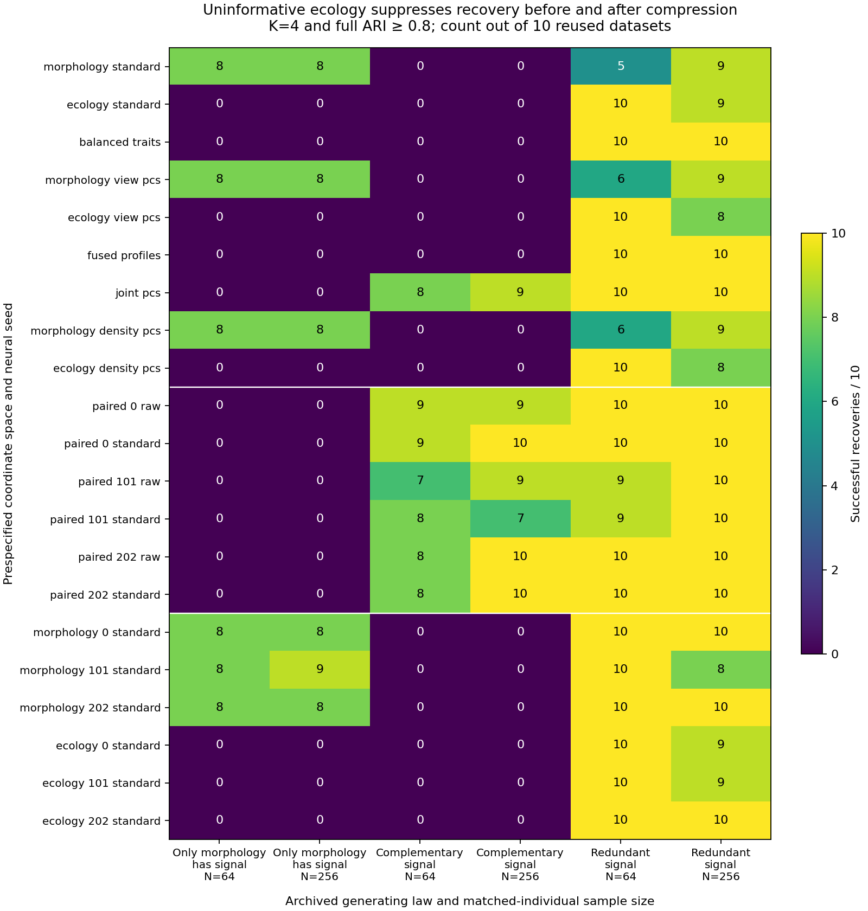

# Matched morphology–ecology signal diagnosis

**The main problem begins before neural compression: equal-weight distance
integration lets uninformative ecology obscure otherwise recoverable morphology
groups. Compression adds further distortion. Latent scaling or changing only
the final tree choice is not supported as a sufficient repair.** This is an
archival diagnosis of synthetic data, not fresh validation or species evidence.

The [separate diagnostic CLI/API](matched-view-signal-study.md) reuses 60 archived
datasets from the completed [matched neural study](matched-neural-results.md):
ten per cell for morphology-only, complementary and redundant group signal at
N=64/256. Each individual has four morphology and eight ecology measurements.
Every setting and all three neural seeds were retained. No neural training,
GMM fitting, new scientific datasets, significance tests or resampling draws
were performed. Production numerical modules, defaults and historical p-values
are unchanged; empirical evidence gates remain closed.

## Complete execution

| Item | Completed |
|---|---:|
| Separate archived preflight observations / density fits | 6 / 126 |
| Main archived observations / coordinate spaces each | 60 / 21 |
| Main density fits / failed fits | 1,260 / 0 |
| Unavailable main hierarchies | 0 |
| Exact native point replays, preflight / main | 66 / 660 |
| Existing GMM searches / candidates audited, preflight + main | 198 / 792 |
| Earlier unchanged archive compatibility density probe | 1 |

Independent checks verified raw/canonical specimen joins, saved preprocessing,
PCA and fusion, network encoding/decoding, distance/core/MST arithmetic,
Python tree condensation, native selection, memberships, class metrics and
GMM candidate likelihood/BIC. There were no refit replacements or repaired
hierarchies. These checks are not a second complete HDBSCAN implementation.
The measured preflight projected 261 MiB retained evidence under a 512 MiB cap
and 83 seconds for main execution plus audit, with 25% allowance and no parallel
speed credit. Main per-job times summed to 24.4 seconds; its independent audit
took 37.2 seconds. Full evidence remains local.

The first development regression run crossed concurrent source edits and its
source-freeze guards correctly stopped four tests. Those logs and fixtures were
preserved. The stationary-source rerun passed all 99 relevant scientific tests;
the lightweight foundation suite passed 1,565 tests with 123 optional skips.
The original matched-study numerical-audit failures also remain preserved.

Final CI exposed a separate, pre-existing archive-size traversal race in the
older Gaussian AIC installed smoke on Python 3.11, after all 2,328 scientific
tests and the new diagnostic smoke had passed. The shared archive counter
filtered `.working` and `.scratch` only after recursive descent, allowing a
parallel worker's cleanup to remove a directory during that traversal. The
publication follow-up reuses the existing race-safe predictive-workflow counter
as one shared implementation: prune transient trees before descent, tolerate
atomic archive renames, and propagate retained-evidence permission errors.
Deterministic regression tests cover those boundaries. Model fitting, sampling,
thresholds, defaults and p-values are unchanged; the failed CI log is retained.
The storage-focused regression suite passed 67 tests, the expanded foundation
suite passed 1,568 with 123 optional skips, and the formerly failing installed
AIC smoke passed all 20 engineering searches. Regression and installed smoke
fits are separate from the no-refit archival scientific experiment.

The scientific execution source remains frozen at commit
`0695159dcf7f239bdf90df11989ba7c49afa0010` in its separate clean worktree and
source bundle. The storage-only publication fix is recorded separately; it does
not rewrite that freeze or rerun the scientific observations. Reproduction of
the completed freeze requires that pinned source/runtime. Fresh diagnostic
studies freeze their own sources normally.

## Where morphology-only recovery disappears

Here, morphology contains all four generating groups; ecology is an independent
Gaussian nuisance view. A successful recovery means exactly four non-noise
clusters and full adjusted Rand agreement (ARI) at least 0.8. In that full ARI,
each noise observation is treated as a separate singleton; assigned-only ARI
and assigned coverage are reported separately. Recovery and branch thresholds
are different diagnostics and need not agree case by case.

| Fixed coordinates | Successful / 10, N=64 | Successful / 10, N=256 |
|---|---:|---:|
| Standardized morphology, four traits | 8 | 8 |
| Saved morphology view PCs | 8 | 8 |
| Balanced raw morphology + ecology, 12 dimensions | 0 | 0 |
| Fused view PCs, four dimensions | 0 | 0 |
| Joint PCs, two dimensions | 0 | 0 |
| Paired neural raw coordinates, each of three seeds | 0 / 0 / 0 | 0 / 0 / 0 |
| Paired neural standardized coordinates, each seed | 0 / 0 / 0 | 0 / 0 / 0 |
| Morphology-only neural standardized coordinates, each seed | 8 / 8 / 8 | 8 / 9 / 8 |

The balanced concatenation still permits almost complete **linear recovery of
both morphology-generating axes** (median R² about 0.999). It has not deleted
those measurements. Nevertheless, HDBSCAN returns one cluster for all 20 such
observations. None of those 20 density trees contains four disjoint non-root
branches each reaching Jaccard 0.8 against a generating group. Fusion behaves
similarly. This supports a distance/density-geometry problem before the
two-dimensional neural bottleneck, rather than literal information loss from
invertible standardization or balancing.

Five-neighbor class purity falls from median 98.6% to 90.2% at N=64 and from
99.5% to 97.8% at N=256 after balancing. The fraction of morphology's original
five neighbors retained is only 37.0% and 14.1%, respectively. Thus high local
purity alone does not ensure that the complete density hierarchy separates four
groups. Unequal distances and connecting observations still matter.

## Compression adds a second limitation

Joint PCA reduces median morphology-axis R² to 0.662/0.579 at N=64 and
0.381/0.536 at N=256. The paired neural models also mix morphology and nuisance
ecology: across seeds, axiswise median morphology R² ranges from 0.604–0.768
at N=64 and 0.476–0.811 at N=256. Morphology-only neural values remain about
0.992–0.996. These are in-sample linear summaries, not proof that a nonlinear
embedding contains no other usable information.

Decoder checks provide additional evidence: paired morphology standardized MSE
has seed-specific medians 0.244–0.282 at N=64 and 0.338–0.383 at N=256, compared
with 0.011–0.014 for the separate morphology networks. Paired morphology
group-centroid reconstruction also worsens. This is consistent with competing
reconstruction demands; it does not identify a unique causal training repair.

Raw versus standardized paired latent coordinates retain identical linear
spans, as expected for positive affine scaling. Neither recovers four groups
in any of the 60 morphology-only seed/dataset combinations. Standardized paired
trees have four strong disjoint reference branches in only one of those 60
cases; even that case selects the root. Final selection can matter in individual
cases, but hidden strong branches are absent in most failing cases.

The unchanged integrative PCA/GMM also selects no K=4 in these 20 observations.
K=4 is eligible in 8/10 at N=64 and 10/10 at N=256. Within that same score space,
median K=4 BIC improvement over K=1 is negative (−34.5 and −74.2), so neither
simple candidate exclusion nor an HDBSCAN-only issue explains the whole loss.
No absolute BIC was compared across representations; no optimizer was rerun.

## Why simply discarding ecology is not a general solution

In the complementary law, each view carries one of two binary group axes.
Separate raw views recover none of the four-group partitions. Paired neural
success counts remain 9/8/8 at N=64 and 10/7/10 at N=256; joint-PC HDBSCAN gets
8/10 and 9/10. In the redundant law, paired neural counts are 10/9/10 and
10/10/10. Integration can therefore help when the second view contributes
relevant signal. Compression can remove nuisance variation in that setting,
even though it loses useful signal in the morphology-only law.

The [complete cell summaries](../examples/matched-view-signal/results/all-spaces.json),
[decoder summaries](../examples/matched-view-signal/results/decoder-summary.json),
[archived GMM summaries](../examples/matched-view-signal/results/archived-gmm-summary.json)
and [independent audit](../examples/matched-view-signal/results/independent-audit.json)
retain every space and seed. Ten reused observations per cell support
descriptive diagnosis. For context, 8/10 has an unadjusted exact 95% interval
of approximately 0.444–0.975; 0/10 has an upper limit about 0.308. Neural seeds
and representations are repeated measurements, not extra independent datasets.
No multiplicity-adjusted superiority claim, general recovery guarantee or
species-boundary conclusion follows from this study.

## One proposed follow-up

Test **explicit, prespecified view weights** in an opt-in matched neural
workflow, keeping existing single-view results beside each integrated result.
A frozen sensitivity study should compare morphology-dominant and equal weights
on fresh nuisance-view, complementary, redundant and Gaussian-control laws,
retaining every seed and selecting no weight from generating labels. The
proposal targets the observed early geometry change and competing reconstruction
demands. This study has not identified a reliable weight or shown that weighting
will repair the bottleneck; it must be tested before any recommendation.

No repair or default is implemented in this diagnostic checkpoint. The existing
separate-view workflows remain available while the symmetric integrative baseline
retains its documented limitations. There was no empirical fitting or contact
with study authors.
