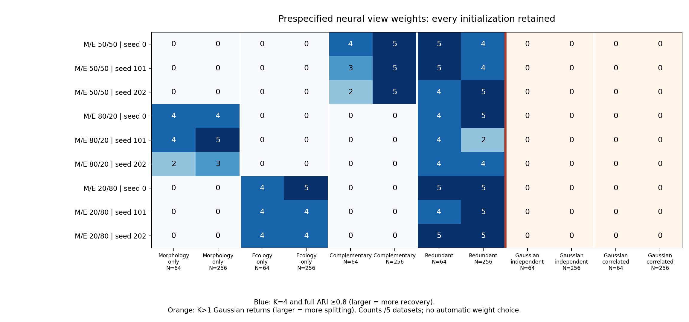

# Prespecified matched neural view-weight results

The bounded study completed 60 fresh datasets, 960 point workflows, 108 matched
native subsampling refits and twelve exact schema-2/legacy numerical replays:
1,080 main workflows, including 1,020 neural fits and sixty PCA/GMM searches.
The separate preflight completed 300 workflows. All fits and independent audits
passed, including 654,000 actual optimizer updates across both phases. No failed
fits were replaced. The implementation preserves all defaults and historical
p-values and adds no empirical analysis or new significance test.

The weight tradeoff is substantial in these simulations. Giving more emphasis
to the view containing four-group signal improved recovery when the other view
contained Gaussian nuisance variation. The same unequal fractions lost all
four-group recovery when both views supplied complementary information. This
supports exposing weights as a prespecified sensitivity option, not selecting a
universal weight or changing the equal-weight default.

## All three neural initializations

Each entry below lists counts for seeds **0 / 101 / 202**, each out of the same
five independent datasets. The seeds are repeated analyses, not fifteen
independent datasets. Recovery requires K=4 and full adjusted Rand agreement
at least 0.8; noise units receive distinct singleton labels for full agreement.
Fractions are morphology/ecology. Gaussian rows instead count K>1 returns;
these are uncalibrated splitting summaries, not species or type-I error tests.

| Generating law | N | 50/50 | 80/20 | 20/80 |
|---|---:|---:|---:|---:|
| Morphology signal only | 64 | 0 / 0 / 0 | 4 / 4 / 2 | 0 / 0 / 0 |
| Morphology signal only | 256 | 0 / 0 / 0 | 4 / 5 / 3 | 0 / 0 / 0 |
| Ecology signal only | 64 | 0 / 0 / 0 | 0 / 0 / 0 | 4 / 4 / 4 |
| Ecology signal only | 256 | 0 / 0 / 0 | 0 / 0 / 0 | 5 / 4 / 4 |
| Complementary four groups | 64 | 4 / 3 / 2 | 0 / 0 / 0 | 0 / 0 / 0 |
| Complementary four groups | 256 | 5 / 5 / 5 | 0 / 0 / 0 | 0 / 0 / 0 |
| Redundant four groups | 64 | 5 / 5 / 4 | 4 / 4 / 4 | 5 / 4 / 5 |
| Redundant four groups | 256 | 4 / 4 / 5 | 5 / 2 / 4 | 5 / 5 / 5 |
| Independent Gaussian | 64 | 0 / 0 / 0 | 0 / 0 / 0 | 0 / 0 / 0 |
| Independent Gaussian | 256 | 0 / 0 / 0 | 0 / 0 / 0 | 0 / 0 / 0 |
| Correlated Gaussian | 64 | 0 / 0 / 0 | 0 / 0 / 0 | 0 / 0 / 0 |
| Correlated Gaussian | 256 | 0 / 0 / 0 | 0 / 0 / 0 | 0 / 0 / 0 |

The unchanged integrative PCA/GMM baseline recovered complementary groups in
3/5 N=64 and 5/5 N=256 observations and redundant groups in 5/5 at both sizes.
It recovered neither signal-only law and returned no Gaussian-control splits.
Single-view neural references confirm useful signal: morphology alone recovered
4/4/4 of five morphology-only N=64 datasets and 3/4/5 at N=256; ecology alone
recovered 4/5/4 ecology-only N=64 datasets and 5/5/5 at N=256. The partner
nuisance-only references recovered none. Unequal weighting does not remove all
initialization dependence or establish superiority over these references.

## Evidence and limits

The [108 primary rates](../examples/matched-view-weights/results/primary-rates.json)
and [72 paired contrasts](../examples/matched-view-weights/results/paired-comparisons.json)
retain marginal and multiplicity-adjusted exact uncertainty and failure bounds.
Five independent observations per cell yield wide intervals; zero splits out of
five does not establish a general low error rate. No weight was selected using
truth, losses or these outcomes. Different weighted losses optimize different
objectives and are not ranked against one another. Other positive fractions
accepted by the API were not benchmarked here.

[All 192 groups](../examples/matched-view-weights/results/all-groups.json) retain
the six single-view neural references, unchanged integrative PCA/GMM baseline,
selected-K distributions, noise coverage, full/assigned agreement, per-view
standardized reconstruction error and in-sample linear generating-axis recovery.
The [36 native stability summaries](../examples/matched-view-weights/results/native-stability.json)
describe only three repeated subsamples on four observations per joint arm.
They retain selected-K frequencies, noise-aware own-point agreement, successful
unit/pair coverage and coassignment; they are not general stability estimates or
species probabilities. Absent units receive no inferred cluster labels.

The [independent audits](../examples/matched-view-weights/results/independent-audit.json)
verified raw laws and ID joins, declared/effective weights, seeded initialization,
every actual gradient/moment/Adam step, losses, frozen transforms, density graph
hierarchies, GMM densities/BIC/membership and native denominators. The twelve
equal-weight replays exactly matched original initial/final weights, all losses,
scores, labels and strengths; metadata intentionally records the new schema.
This checks calculations, not global neural optimality or biological validity.

The main run took 701.1 seconds with two single-thread workers plus 22.5 seconds
for its independent audit, below the frozen one-hour gate. The conservative
preflight projection used no parallel speed credit and included a 25% allowance.
The measured storage projection was 1.13 GiB under a 2 GiB local cap, including
verification staging. Detailed data, fitted models, traces and engineering
evidence remain local; public files contain code, protocol, figures and small
aggregates. Previous evidence, empirical gates and p-values remain unchanged.

See the [CLI/API and frozen protocol](matched-view-weights.md) for the supported
matched-individual scope, formulas, resource guards and reproduction actions.
