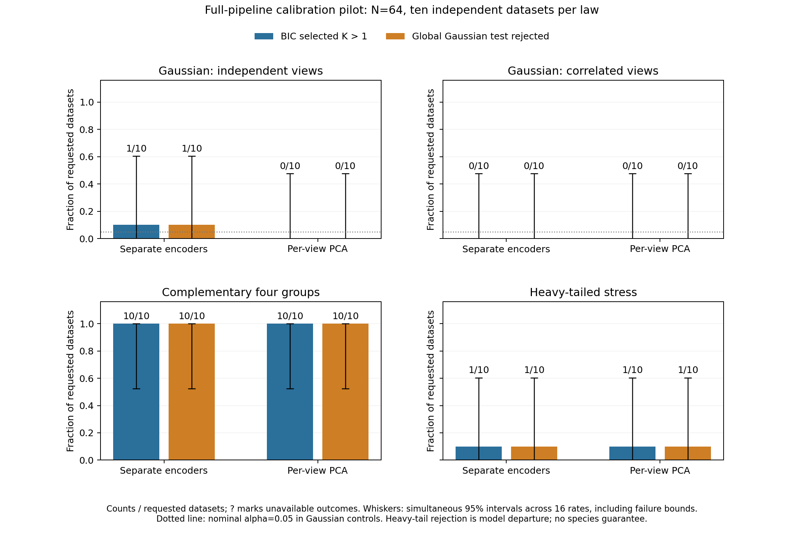

# Full-pipeline neural calibration: initial pilot

The opt-in [calibration command](neural-calibration.md) now regenerates raw matched
morphology/ecology and retrains both encoders in every null draw. It tests
departure from one fitted joint raw Gaussian, with the full shared-GMM search
included. It does not establish that the selected groups are species or that
their count is correct. Existing models, defaults, serialization and historical
p-values remain unchanged.

## Completed frozen study

The [prespecified protocol](neural-calibration-study.md) used forty fresh datasets:
ten per law, each with 64 independent matched individuals, four morphology and
eight ecology traits. Each dataset received 99 independent draws from its fitted
raw null. A paired benchmark-only reference used two PCs per view and the same
raw draws and shared-GMM settings. Neural seed 0 and mixture seed 71323 were fixed
before generation; no seed, representation or threshold was selected afterward.

All 8,008 main candidate searches, 8,008 branch trainings and 4,004,000 optimizer
updates completed. This includes four exact paired historical point replays.
The separate full-settings preflight completed 800 searches, 800 branch trainings
and 400,000 updates. There were no failed fits, replacements or withheld main
p-values. Eighty main global p-values were obtained across forty paired datasets;
the two arms are repeated measurements of each dataset.

Independent checks covered the actual optimizer updates, raw Gaussian estimates
and draws, specimen identities and table order, transforms, dense mixture
likelihoods/memberships/BIC, eligibility, seeds, configurations and exact tails.
A separate final reporting audit reconstructed all eighty observed partitions,
sixteen primary rates, eight paired comparisons and the figure. Total main
execution took 4,739.5 seconds with two one-thread workers; summed serial job
time plus the independent main audit was 9,505.5 seconds, below the frozen
four-hour limit. No resampling stability or empirical analysis was performed.

## Results

Each cell below has ten independent datasets. A split means ordinary BIC selected
K greater than one; rejection means the global approximate p-value was at most
0.05. These are distinct decisions, even though their counts coincide here.

| Generating law | Neural splits | Neural rejections | PCA splits | PCA rejections |
| --- | ---: | ---: | ---: | ---: |
| Gaussian, independent views | 1/10 | 1/10 | 0/10 | 0/10 |
| Gaussian, correlated views | 0/10 | 0/10 | 0/10 | 0/10 |
| Complementary four groups | 10/10 | 10/10 | 10/10 | 10/10 |
| Heavy-tailed stress | 1/10 | 1/10 | 1/10 | 1/10 |

Whiskers are exact simultaneous 95% binomial intervals across the sixteen primary
rates, including unknown-outcome bounds; there were no unknown outcomes here.
For 0/10, 1/10 and 10/10 events, those intervals are respectively 0–47.59%,
0.016–60.34% and 52.41–100%. Corresponding marginal 95% intervals are 0–30.85%,
0.253–44.50% and 69.15–100%. The wide bounds are consequential: this is an initial
pilot, not evidence of general false-positive control at 5%.

The neural Gaussian split selected K=2 and had p=0.05. The raw-null test therefore
did not remove that false split. Both arms selected K=1 for all correlated-view
controls. There is no support for claiming that neural calibration eliminates
spurious groups or outperforms the PCA reference.

On complementary signal, the neural workflow selected K=4 on all ten datasets,
with median adjusted Rand agreement (ARI) 1.0 and minimum 0.918. The PCA reference
selected K=4 on nine and K=2 on one; median ARI was also 1.0, with minimum 0.488.
Defining recovery in advance as K=4 and ARI at least 0.8, recovery and the joint
rejection/recovery event occurred in 10/10 neural and 9/10 PCA datasets. Their
marginal exact 95% intervals are 69.15–100% and 55.50–99.75%. These paired pilot
counts do not establish a neural advantage. All signal p-values were 0.01, the
minimum resolution with 99 draws; they cannot rank stronger evidence below that.

Both arms split and rejected one heavy-tailed dataset. Heavy tails violate the
Gaussian reference law, so rejection is model departure rather than a species
discovery or a false-positive estimate under the assumed Gaussian null. A
non-rejection likewise does not prove one population or one species.

## Scope, evidence and remaining limits

The fitted raw mean/covariance are held fixed within each test; the entire learned
analysis is refitted. P-values remain approximate because null parameters are
estimated. The Monte Carlo interval describes uncertainty in the conditional
simulation tail, not null-estimation error, biological uncertainty or confidence
in a particular species partition. Ninety-nine draws give coarse resolution.

This pilot covers one small sample size, one fixed neural initialization, complete
continuous individual data and the four declared laws. It does not validate
related/locality sampling, missingness, genomic or shape inputs, nonlinear
dependence outside the null, architecture selection, or seed/model searching.
Empirical sampling/reference gates remain closed. Ten observations per law are
too few to settle whether the observed Gaussian rejection is nominal variation
or systematic miscalibration; a larger prespecified false-split study is the
logical follow-up, separately authorized.

Only [cell aggregates](../examples/neural-calibration/results/summary.json), the
frozen design, small audit summaries and figures are public. Full raw inputs,
weights, draws, partitions and update checks are retained locally. Reproduce the
aggregate export with `examples/neural-calibration/report.py --study STUDY_DIR`
after the study's independent audit passes. No author contact occurred.
