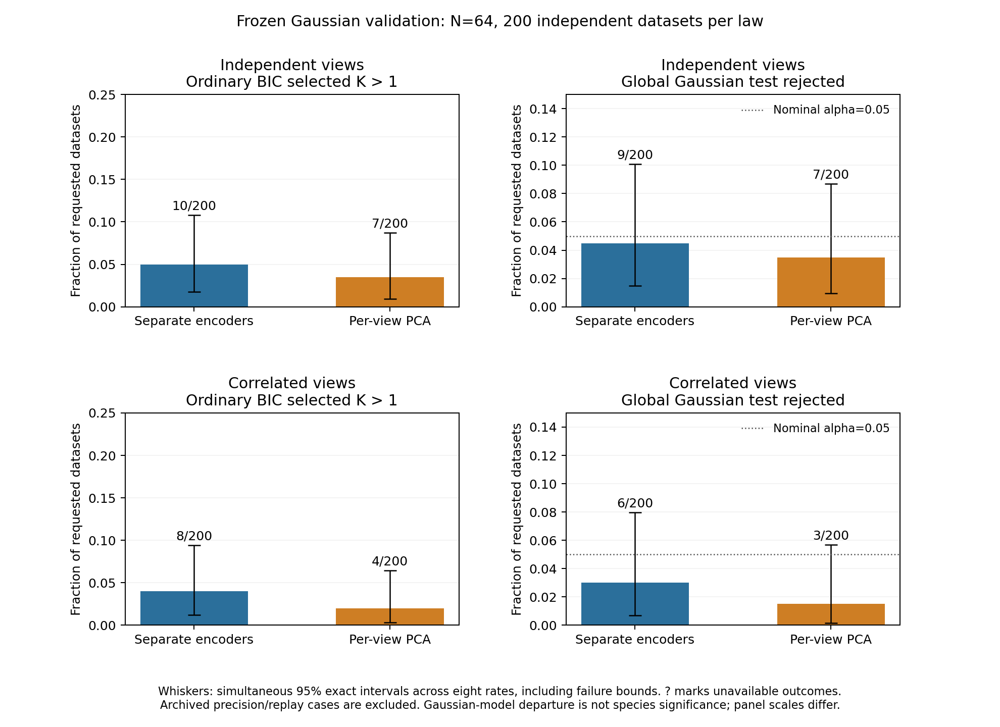

# Larger Gaussian false-split validation

The unchanged separate-encoder/shared-GMM test rejected 9/200 independent-view
Gaussian datasets (4.5%) and 6/200 correlated-view datasets (3.0%) at alpha=0.05.
These estimates show no excess over 5% in the two tested laws, but the intervals
remain broad: this does not establish general error control. All 400 fresh
observations, 800 paired calibration results and 82,400 main searches completed
without failed pipeline fits. Defaults and historical p-values are unchanged.

## Frozen design and scope

This follow-up to the [initial pilot](neural-calibration-results.md) used 200 new
independent datasets per Gaussian law. Each contained 64 matched independent
individuals with four continuous morphology traits, eight individually measured
ecology traits and independent feature noise SD 0.15. Both views were complete.
The correlated law included dependence across the views. No empirical specimens,
genomic data, landmarks, new alternatives or sampling groups were analyzed.

Every observation paired the unchanged two-coordinate encoder for each view
with a benchmark-only two-PC-per-view reference. Each representation supplied
four standardized coordinates to the same shared-covariance GMM, BIC K=1..4,
minimum hard size five and ten starts. Neural initialization 0 and mixture seed
71323 were fixed before generation; no favorable seed or model was selected.

Each global test fitted one joint mean and full ML covariance to the raw traits
before learning. Its parameters remained fixed for 99 fresh raw Gaussian draws.
Every draw refitted ingestion, scaling, both encoders or PCAs, fusion and the
complete GMM search. The statistic was BIC(K=1) minus the lowest eligible BIC,
including K=1. Plus-one upper-tail p-values included ties. The raw null had no
added covariance ridge. See the [protocol and batch API](neural-false-splits.md)
and [frozen public design](../examples/neural-false-splits/results/study-design.json).

The 400 observations ran in eight fixed balanced batches. The separate 2,800-search
preflight, two full archived calibration replays and one selected-case precision
diagnostic were excluded from fresh rates. No resampling-stability or empirical
species test was added.

## Fresh Gaussian outcomes

All requested outcomes were available. Intervals below are exact 95% simultaneous
intervals across the eight primary rates, using a Bonferroni adjustment. The
[machine-readable rates](../examples/neural-false-splits/results/primary-rates.json)
also retain marginal intervals, study Monte Carlo standard errors and explicit
failure bounds. Ordinary BIC component selection has no nominal 5% guarantee;
global rejection concerns departure from the fitted raw Gaussian model.

| Gaussian law | Representation | Endpoint | Count and rate | Simultaneous interval |
| --- | --- | --- | --- | --- |
| Independent views | Separate encoders + shared GMM | Ordinary BIC split | 10/200 (5.0%) | 1.76–10.77% |
| Independent views | Separate encoders + shared GMM | Global Gaussian rejection | 9/200 (4.5%) | 1.47–10.09% |
| Independent views | Per-view PCA + shared GMM | Ordinary BIC split | 7/200 (3.5%) | 0.94–8.70% |
| Independent views | Per-view PCA + shared GMM | Global Gaussian rejection | 7/200 (3.5%) | 0.94–8.70% |
| Correlated views | Separate encoders + shared GMM | Ordinary BIC split | 8/200 (4.0%) | 1.20–9.40% |
| Correlated views | Separate encoders + shared GMM | Global Gaussian rejection | 6/200 (3.0%) | 0.70–7.98% |
| Correlated views | Per-view PCA + shared GMM | Ordinary BIC split | 4/200 (2.0%) | 0.30–6.47% |
| Correlated views | Per-view PCA + shared GMM | Global Gaussian rejection | 3/200 (1.5%) | 0.14–5.68% |

Neural global-rejection Monte Carlo standard errors were 1.47 and 1.21 percentage
points for the independent and correlated laws. Their simultaneous upper limits
were 10.09% and 7.98%, respectively. The study therefore cannot exclude materially
higher population rates even though the observed rates were below 5%. A confidence
interval containing 5% is not proof of calibration or equivalence.

Ordinary neural BIC selection split 10/200 and 8/200 Gaussian observations.
There were ten K=2 returns in the independent law; the correlated law had seven
K=2 and one K=3. PCA split 7/200 and 4/200, respectively. A split proposes mixture
components; it is neither a species assertion nor itself a significance result.

The four prespecified paired neural-minus-PCA differences were +1.5 and +2.0
percentage points for ordinary splits, and +1.0 and +1.5 points for global
rejection, for independent and correlated laws respectively. All four simultaneous
paired intervals included zero. The
[paired summaries](../examples/neural-false-splits/results/paired-comparisons.json)
retain discordant counts and missing-pair bounds. These data do not establish a
neural advantage or equality of the methods. Raw null draws are repeated
conditional simulations, not independent study observations.

## Archived precision check

This diagnostic used the selected case `main/gaussian_independent_0009` from the
**earlier** `neural-calibration-20261107` study published at commit `54dd00c`.
It is not the fresh dataset with the same relative identifier in this study.
Its observed neural statistic remained exactly 0.5630402636310237.

| Arm and draw set | Exceedances | Plus-one p-value | Conditional 95% null-tail interval |
| --- | --- | --- | --- |
| Neural, original 99 draws | 4/99 | 0.050 | 0.0111–0.1002 |
| Neural, fresh 999 draws | 46/999 | 0.047 | 0.0339–0.0609 |
| PCA, original 99 draws | 99/99 | 1.000 | 0.9634–1.0000 |
| PCA, fresh 999 draws | 999/999 | 1.000 | 0.9963–1.0000 |

The historical 0.050 result remains intact. The independent 999-draw diagnostic
improves conditional Monte Carlo precision, but its interval still spans 0.05.
It does not settle the status of this selected borderline case with certainty,
replace the old result, validate species boundaries or enter fresh rejection
rates. Two complete archived 99-draw calibrations reproduced their original
scientific arrays, seeds, candidates, statistics and inference exactly; timing
and version metadata were excluded from numerical parity targets.

## Verification and limits

The independent audits checked all 82,400 main searches and 41,200,000 actual
neural optimizer updates. The independent preflight added 2,800 searches and
1,400,000 checked updates. No pipeline failures, interrupted work units or unknown
counters occurred. A separate report audit reconstructed all 816 arm configurations,
observed partitions and tails, the 800 fresh endpoints, eight rates, four paired
comparisons and both archived diagnostic arms. Public figure values were checked
against those retained results. Raw likelihoods, transformations, densities,
memberships, eligibility, BIC, identities, seeds and training updates were retained
and audited locally.

Local regression checks passed 326 neural, 1,669 dependency-free foundation and
2,383 available scientific tests; optional image-related coverage is also exercised
by the Python 3.11/3.12 CI matrix. Installed-wheel smoke checks use invented data.
The public package allowlist excludes fitted weights and detailed scientific
artifacts. Only code, documentation, figures and small aggregates are published.
The [public summary](../examples/neural-false-splits/results/summary.json) binds the
independent audit receipts and records the unchanged defaults and historical
p-values.

The supported claim remains narrow: approximate fitted-Gaussian departure testing
for complete matched continuous traits at N=64, under two declared Gaussian laws
and one frozen optimizer initialization. These results do not validate different
seeds, selected architectures, missingness, non-Gaussian biology, related sampling,
other sample sizes or species truth. Power, curved-group recovery and empirical
evidence gates remain separate questions. No correction or new default is promoted.
