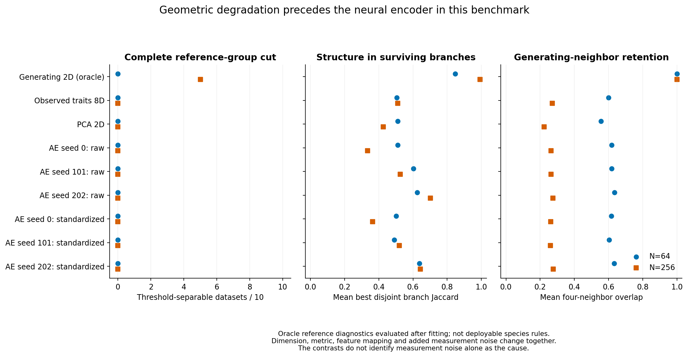
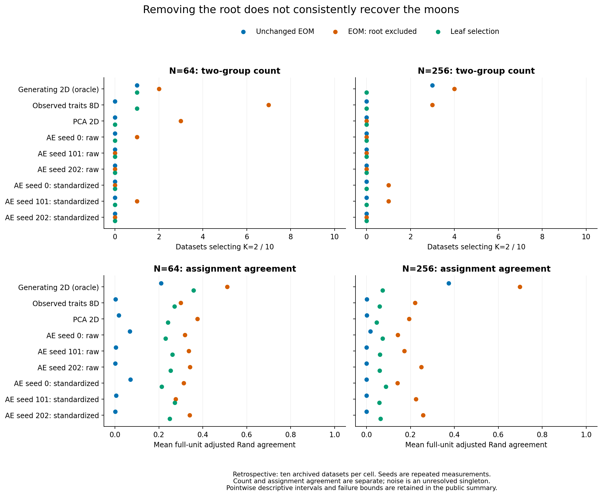

# Curved-moons neural diagnostic findings

Version 0.57.0.dev0; completed 2026-11-01. This [frozen diagnostic](neural-moons.md)
preserves production fitting/training, defaults, historical p-values and empirical
evidence gates. It uses only existing simulated observations and saved weights.

## Completed evidence

The read-only archive audit bound all 80 main observations and 1,210 recorded
workflows, plus the separate 120-workflow preflight, including 800 main and 80
preflight saved subsample refits. No original failures or identity/hash conflicts
were found. The source's frozen code bundle and numerical runtime were checked
without modifying its original execution gate or artifacts.

All **56 preflight** and **548 main density fits** completed with zero failures
or unavailable hierarchies. The independent main audit passed all **1,628
selection evaluations** and **248 exact archived point/draw replays**. No network
was trained or continued, no fresh scientific dataset was generated, and no
significance or stability bootstrap was run. Main fitting took 7.96 seconds with
two single-thread workers. The measured resource gate projected 436,441,777
bytes including staging/copy allowance, below the 1 GiB cap. Full evidence is local.

## Diagnosis: multiple stages contribute

**The encoder is not the sole source of the problem.** At N=256, the standardized
two-dimensional generating coordinates admitted a complete reference-group
mutual-reachability cut in 5/10 observations. None of the standardized eight-trait
inputs admitted that cut. Their mean best disjoint reference-branch Jaccard fell
from 0.991 in generating space to 0.511 in eight-trait space; mean four-neighbor
overlap with generating space was 0.271. This change occurs before neural
encoding. These diagnostics concern the specified Euclidean metrics, not a proof
that the observed measurements contain no recoverable group information.

**Mapping, noise and metric effects remain entangled.** The eight traits introduce
nonlinear transformations, extra independent measurement noise, additional
dimensions and different variance scaling. This checkpoint does not separately
identify measurement noise, redundant features or scaling as the causal driver.
Generating coordinates are oracle references that an empirical user would lack.

**The tested encoder does not consistently restore density separation.** At
N=256, all raw and standardized neural representations lacked a complete
reference-group cut. Standardized neural branch correspondence varied by seed:
mean best disjoint Jaccard was 0.364, 0.519 and 0.643 for seeds 0, 101 and 202.
The encoder is therefore not uniformly worse than the eight-trait space either.
Generating-neighbor overlap remained about 0.26–0.28, close to the eight-trait
value. These are seed-specific repeated measurements, not extra independent trials.

**Latent scaling is not a sufficient repair in this archive.** Unchanged EOM
selected two moons groups in 0/10 observations at each N for every neural seed,
both before and after latent standardization. Scaling affected some alternative
partitions, coverage and four-group outcomes, but produced no consistent recovery
of the generating moons. Raw latent units are parameterization-dependent, so this
does not establish a generally preferable unscaled neural metric.

## Selection changes help some assignments but are not a safe default fix

The unchanged standardized neural workflow usually selected the root: 9/10 or
10/10 observations per seed at N=64, and 10/10 per seed at N=256. Excluding that
root improved mean assignment agreement in these moons cells, but did not
reliably identify the two groups. Leaf selection selected K=2 in 0/10 neural
observations per seed at both sample sizes and often fragmented the data.

Table entries are selections of K=2 / ten archived observations, followed by
mean full-unit ARI. Each unassigned observation is a distinct unresolved singleton.
Correct count and correct membership are separate outcomes.

| N | Coordinates | EOM K=2 | Root excluded K=2 | EOM ARI | Root excluded ARI |
|---:|---|---:|---:|---:|---:|
| 64 | Generating 2D, standardized | 1/10 | 2/10 | 0.209 | 0.511 |
| 64 | Observed 8D, standardized | 0/10 | 7/10 | 0.003 | 0.300 |
| 64 | Native PCA 2D | 0/10 | 3/10 | 0.018 | 0.376 |
| 64 | AE 0, raw | 0/10 | 1/10 | 0.068 | 0.318 |
| 64 | AE 101, raw | 0/10 | 0/10 | 0.004 | 0.336 |
| 64 | AE 202, raw | 0/10 | 0/10 | 0.001 | 0.342 |
| 64 | AE 0, standardized | 0/10 | 0/10 | 0.071 | 0.313 |
| 64 | AE 101, standardized | 0/10 | 1/10 | 0.005 | 0.276 |
| 64 | AE 202, standardized | 0/10 | 0/10 | 0.000 | 0.340 |
| 256 | Generating 2D, standardized | 3/10 | 4/10 | 0.373 | 0.699 |
| 256 | Observed 8D, standardized | 0/10 | 3/10 | 0.001 | 0.221 |
| 256 | Native PCA 2D | 0/10 | 0/10 | 0.001 | 0.193 |
| 256 | AE 0, raw | 0/10 | 0/10 | 0.018 | 0.142 |
| 256 | AE 101, raw | 0/10 | 0/10 | approximately 0 | 0.172 |
| 256 | AE 202, raw | 0/10 | 0/10 | 0.000 | 0.250 |
| 256 | AE 0, standardized | 0/10 | 1/10 | 0.000 | 0.141 |
| 256 | AE 101, standardized | 0/10 | 1/10 | approximately 0 | 0.225 |
| 256 | AE 202, standardized | 0/10 | 0/10 | 0.000 | 0.258 |

The N=64 eight-trait root-excluded arm illustrates the count/membership issue:
it selected K=2 in 7/10 datasets, but its mean full-unit ARI was only 0.300.
At the parent study's prespecified neural seed zero, root exclusion selected K=2
in 0/10 and 1/10 at N=64/256. Its mean ARI improved from 0.071 to 0.313 and from
approximately zero to 0.141; those are partial assignment changes, not reliable
two-group recovery.

The same policy was harmful in one-group controls. For standardized neural seed
zero, root exclusion selected multiple groups in 8/10 N=64 Gaussian datasets
(the other two were all noise) and all 10 N=256 datasets. Mean assigned coverage
fell from 43.0% to 39.4% and from 75.7% to 66.3%. These are descriptive Gaussian
overpartitioning outcomes, not calibrated species-significance false-positive
rates. The unchanged method's K=1 selections also require reading its noise
coverage; they do not mean all Gaussian observations were recovered as one group.
Four-group controls and all three seeds remain in the public summary.

## Boundaries and one proposed follow-up

This is a retrospective diagnosis using 60 already-observed datasets: twenty
moons, twenty Gaussian and twenty four-group observations. Ten observations per
law/N cell, initialization seeds, probe repeats and old subsamples do not provide
a general performance guarantee. Descriptive pointwise intervals, dataset SDs,
requested/successful counts and failure bounds are explicit. There is no
simultaneous/post-selection guarantee and no winning-seed or configuration rule.

The evidence supports mixed upstream metric/connectivity and hierarchy-selection
effects. It does not isolate a single training failure, prove information was
irreversibly lost, or establish a generally valid correction. Existing
[two-dimensional HDBSCAN findings](noisy-moons-results.md) remain relevant and
were not rerun or replaced. No p-values, defaults or empirical gates changed.

The one candidate follow-up is a separately approved **opt-in denoising-
autoencoder comparison with matched feature-map/noise controls**. It would test
noise robustness while separating mapping and noise effects and retaining
Gaussian/four-group controls. It is a hypothesis to validate, not an established
fix; current evidence does not justify its adoption. No such model or follow-up
study is implemented in this checkpoint.

See the [small selection summaries](../examples/neural-moons/results/summary.json),
[geometry summaries](../examples/neural-moons/results/geometry.json),
[independent audit](../examples/neural-moons/results/independent-audit.json) and
[protocol/CLI](neural-moons.md). Complete inputs, weights, graphs, tree traces,
hash inventories and verification logs remain local. Nobody was contacted and
no SPARUS or other empirical data were fitted.
