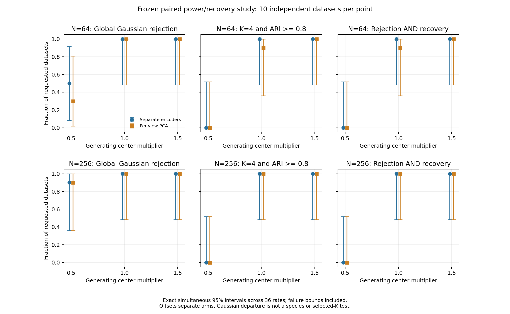

# Calibrated neural power and group recovery: results

The unchanged separate-encoder/shared-GMM workflow recovered the standard and
stronger simulated four-group partitions, including N=64. Weak signals remained
unresolved: a global departure from one Gaussian cloud often occurred without
recovering all four generating groups. The matched PCA/shared-GMM control was
similarly effective. This small study establishes no neural superiority,
precise operating threshold or species-delimitation guarantee.

## Frozen comparison

The [protocol](neural-power.md) fixed 100 independent synthetic observations:
sixty complementary four-group datasets across N=64/256 and center multipliers
0.5/1/1.5, twenty independent-view Gaussian controls, ten unequal-spread
four-group datasets, five heavy-tail datasets and five continuous gradients.
Each primary signal cell has ten observations. Four morphology and eight ecology
traits come from matched invented individuals; no empirical inputs were fitted.

Both representations retain two coordinates per view. The neural seed is zero;
the tied-covariance GMM retains BIC K=1..4, minimum hard cluster size five,
ten starts and mixture seed 71323. Each global test uses 99 independent raw draws
from the fitted joint Gaussian, with complete preprocessing, representation
refitting and GMM search. Neither truth labels nor held-out outcomes choose a
model, seed or setting. The paired arms share raw observations and null draws.

## Primary results

Every entry is a count out of ten requested independent observations. Recovery
requires **both K=4 and adjusted Rand agreement of at least 0.8** with the
simulation labels. Global rejection instead concerns departure from the fitted
raw Gaussian reference; it does not test the selected number of groups.

| N | Center multiplier | Global rejection: neural | PCA | Recovery: neural | PCA | Both events: neural | PCA |
|---:|---:|---:|---:|---:|---:|---:|---:|
| 64 | 0.5 | 5/10 | 3/10 | 0/10 | 0/10 | 0/10 | 0/10 |
| 64 | 1 | 10/10 | 10/10 | 10/10 | 9/10 | 10/10 | 9/10 |
| 64 | 1.5 | 10/10 | 10/10 | 10/10 | 10/10 | 10/10 | 10/10 |
| 256 | 0.5 | 9/10 | 9/10 | 0/10 | 0/10 | 0/10 | 0/10 |
| 256 | 1 | 10/10 | 10/10 | 10/10 | 10/10 | 10/10 | 10/10 |
| 256 | 1.5 | 10/10 | 10/10 | 10/10 | 10/10 | 10/10 | 10/10 |

At the weakest signal neither arm recovered four groups at either sample size.
At N=256 both arms rejected the Gaussian reference in nine of ten observations,
while mostly selecting two groups. More detection therefore did not imply
correct partition recovery. At the standard N=64 signal, neural recovery was
10/10 versus PCA 9/10; all other standard/strong recovery cells were 10/10 for
both arms. All eighteen simultaneous paired-comparison intervals include zero.
The one-observation difference does not establish a neural advantage.

The 36 primary rates have exact simultaneous 95% intervals; the eighteen paired
contrasts have separately adjusted uncertainty. For a 10/10 rate the marginal
interval is 69.2–100%, but its simultaneous interval is 48.3–100%. For 0/10,
the corresponding upper bounds are 30.8% and 51.7%. These broad limits are
intentional: this is descriptive operating-range evidence, not a precise power
curve. Requested denominators, unavailable bounds and conditional Monte Carlo
tail intervals are retained in the reports.

The six panels show global Gaussian departure, generating-partition recovery and
their joint event. Each plotted point represents ten independent datasets;
intervals cover all 36 primary rates simultaneously. Horizontal offsets only
separate the two methods visually. Both tests still use 99 null draws, whose
minimum attainable plus-one p-value is 0.01.

## Controls and stress limits

Both arms split and rejected one of ten N=64 Gaussian controls; neither split
nor rejected any of ten N=256 controls. Their marginal exact 95% rejection
intervals are 0.25–44.5% and 0–30.8%, respectively. These small cells cannot
establish a reliable false-positive rate or supersede the
[larger Gaussian validation](neural-false-splits-results.md).

Unequal-spread four-group stress illustrates the difference between component
count and membership recovery. The neural arm selected K=4 in 5/10 observations
but met the strict recovery criterion in only 3/10; PCA selected K=4 in 4/10
and recovered in 1/10. Both rejected the Gaussian reference in 10/10. Shared
covariance remains a restrictive assumption when generating groups have
different spreads, and these small counts do not establish a method ranking.

Neither arm split or rejected any of the five heavy-tail or five continuous-gradient
observations. These are departures from the reference model, not additional
Gaussian-null controls or species truths. The zero counts do not establish
robustness or absence of structure: their marginal 95% upper rate bound is 52.2%.
The gradient has no discrete generating partition, so no four-group recovery
rate is defined for it. The fixed K<=4 search cannot assess overpartitioning
beyond four, and no stability bootstrap is part of this checkpoint.

## Integrity, runtime repair and reproducibility

All 20,400 planned main searches completed, including two complete archived
99-draw calibration replays, with zero failed pipeline points or unknown work
units. A separate 2,200-search full-settings preflight passed. Independent audits
verified 10,200,000 main optimizer updates and 1,100,000 preflight updates,
raw laws/identities, exact paired inputs, initial/final weights, transformations,
component densities, eligibility, BIC and tails. Each full archived replay checked
600 scientific array sets. An additional report audit independently verified all
226 calibration tails, 200 fresh endpoints, 36 primary rates and eighteen paired
contrasts using separate contingency and binomial calculations.

The original run stopped after 66 completed units when its temporary Torch
installation lost package metadata/files. The cause is unknown. The original
STOP, declaration difference and all completed evidence were retained. An
explicitly approved repair restored the same official Torch 2.15.0 build in an
owned persistent environment: the wheel checksum, all 12,836 installed Torch
files and eight surviving native libraries matched. The original scientific
freeze matched again without a new freeze or changed settings.

All eleven preflight and 66 retained main units passed a read-only numerical
re-audit. Four additional point searches reproduced both arms on the first weak
N=64 and N=256 observations exactly: 236 scientific array checks and 2,000
optimizer updates. The 358-test neural regression and separate installed-wheel
fixture passed again, with all 431 Python sources identical. Only then was the
original STOP archived and the untouched 7,200 remaining planned searches
resumed. No observation/null draw was replaced. The four repair searches are
excluded from performance estimates; total research execution is 22,604 searches
and 11,302,000 verified optimizer updates including preflight and repair.

Repair/audit time is charged to the original budgets. The frozen gate required
an eight-GiB retained-evidence cap, eight-GiB free reserve, two single-thread
workers maximum, ten serial main/audit hours and two separate preflight hours.
The approved repair acceptance projected 6.12 GiB and 9.34 serial main/audit
hours including its checks, without raising any ceiling. A missing-field lookup
bug in the separate report-checking helper was corrected with its failed log
retained; no scientific code or result changed.

Local validation passed 358 neural, 1,681 foundation and 2,395 available scientific
tests; optional-codec coverage is additionally exercised by the Python 3.11/3.12
CI matrix. The installed-package fixture runs outside the checkout. Final package
checks require every frozen Python source to match the tested and installed
wheel. Source, numerical, preservation and exact-head CI receipts remain local.

[Public aggregates](../examples/neural-power/results/) contain cell-level results,
intervals and provenance only. Full raw tables, neural weights, optimizer traces,
null draws, specimen assignments and detailed failure evidence remain local.
See [study settings](../examples/neural-power/study.json),
[export script](../examples/neural-power/report.py) and
[installed fixture](../examples/neural-power/smoke.py).

This checkpoint preserves all production models, defaults, historical p-values
and empirical evidence gates. Results apply to the specified synthetic laws,
complete matched continuous traits and fixed model settings. They do not address
genomic/shape neural integration, dependence, missingness, adaptive seed/model
selection, empirical species boundaries or independent species probabilities.
No author contact occurred.
