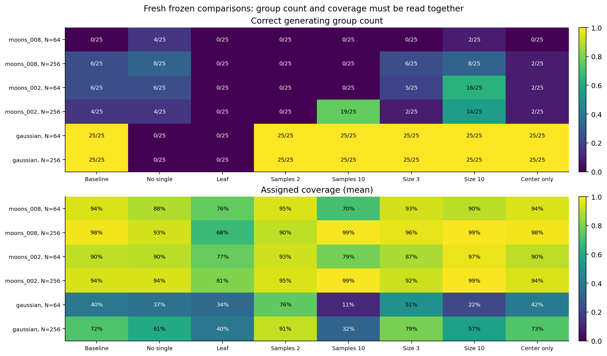
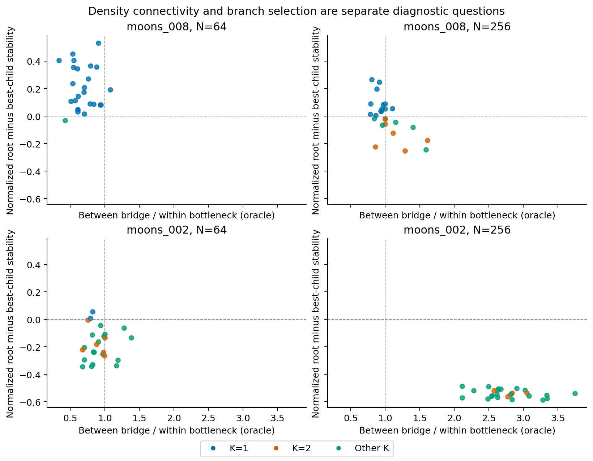
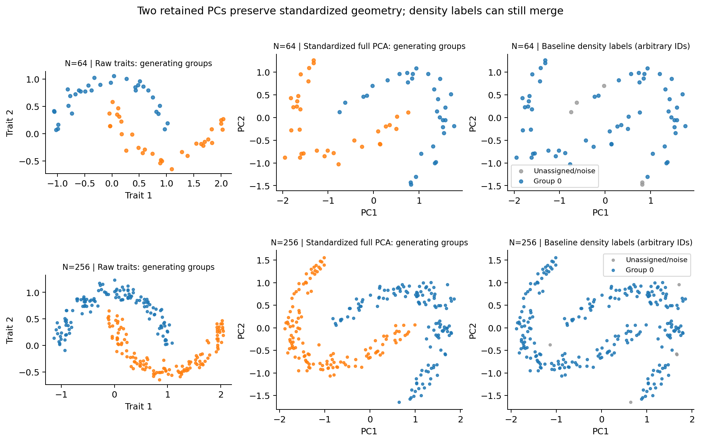

# Noisy-moons diagnostic findings

Version 0.49.0.dev0; completed 2026-10-26. The [frozen protocol](noisy-moons-diagnostics.md)
preserves production fitting/sampling code, defaults, historical p-values and
empirical gates. All **1,610/1,610 main** and **50/50 preflight** fits succeeded,
with no missing hierarchies or unattempted fits. All 60 main archived point/draw
replays matched; the fit-free source audit checked 50 observations, 250 existing
subsamples and 3,850 source files. No new GMM, calibration or stability study ran.

## Diagnosis

**PCA truncation does not explain this benchmark.** Both input dimensions were
retained. Audits verified standardization, full-PCA projections and all Euclidean
distances to numerical tolerance. Removing variance scaling did not consistently
recover two groups; in fresh original-noise N=256 data it reduced correct-K
recovery from 6/25 to 2/25. The centering control changes the metric and is not
an argument for adopting raw units generally.

**At original noise and small N, merging dominates.** The baseline selected the
root in 24/25 fresh N=64 observations (22/25 archived), and a clean two-group
mutual-reachability cut existed in only 1/25 fresh observations. Thus finite
sampling/noise and the density graph limit separation; EOM's root eligibility
then allows a persistent parent to absorb surviving branches. Excluding the
root improved membership agreement but recovered two groups in only 4/25 fresh
N=64 observations, versus 0/25 under baseline.

**When the groups are present in the hierarchy, selection can still fragment
them.** At N=256 with SD 0.02, all 25 fresh observations were threshold-separable
and had perfect generating-group branches (best disjoint minimum Jaccard=1).
The baseline never selected the root, yet recovered exactly two groups in only
4/25; the remaining 21 selected more than two. This localizes that failure to
the finer selected frontier, rather than missing shape information or root
merging. Leaf selection recovered two groups in 0/25 in every fresh moons cell
and often left more observations unassigned.

**There is no universal parameter repair in this grid.** Increasing min_samples
to ten improved low-noise N=256 correct-K recovery to 19/25 (mean ARI 0.942), but
gave 0/25 in both original-noise cells and selected the root in 25/25 and 24/25,
respectively. This is consistent with a smoothing-versus-merging tradeoff under
the specified laws. It is not a validated prescription for empirical species.
Increasing minimum cluster size helped some low-noise cells but did not resolve
original-noise recovery uniformly. No arm is promoted to a default.

## Fresh paired results

Each table entry is correct K out of 25 independent datasets. Read it with
assigned coverage and membership agreement; correct count alone is insufficient.
The two moons noise levels used independent input datasets.

| Arm | SD .08, N=64 | SD .08, N=256 | SD .02, N=64 | SD .02, N=256 | Gaussian N=64 | Gaussian N=256 |
|---|---:|---:|---:|---:|---:|---:|
| baseline | 0/25 | 6/25 | 6/25 | 4/25 | 25/25 | 25/25 |
| no_single | 4/25 | 8/25 | 6/25 | 4/25 | 0/25 | 0/25 |
| leaf | 0/25 | 0/25 | 0/25 | 0/25 | 0/25 | 0/25 |
| samples_2 | 0/25 | 0/25 | 0/25 | 0/25 | 25/25 | 25/25 |
| samples_10 | 0/25 | 0/25 | 0/25 | 19/25 | 25/25 | 25/25 |
| cluster_3 | 0/25 | 6/25 | 5/25 | 2/25 | 25/25 | 25/25 |
| cluster_10 | 2/25 | 8/25 | 16/25 | 14/25 | 25/25 | 25/25 |
| center_only | 0/25 | 2/25 | 2/25 | 2/25 | 25/25 | 25/25 |

The baseline's original-noise mean ARI was 0.015/0.374 at N=64/256. Excluding
the root raised it to 0.520/0.662, while correct K rose only to 4/25 and 8/25.
Partial improvement in labels does not imply reliable group-count recovery.
Both root exclusion and leaf selection selected additional groups or all noise
in Gaussian controls; neither recovered K=1 in any of the 50 controls. The
baseline selected K=1 in all controls but assigned only 39.8%/72.3% on average.
Increasing min_samples to ten reduced Gaussian coverage to 10.9%/32.4% despite
retaining K=1. Noise handling and count agreement are distinct quantities.

## Mechanism evidence and interpretation

For original noise at N=256 the baseline selected the root in 13/25 fresh
observations, and the oracle threshold-separation condition held in 7/25.
Across the same cell, best disjoint branch agreement averaged 0.987, showing
that useful reference structure can remain in branches even when the selected
partition performs poorly. In contrast, low-noise N=256 retained two perfect
branches in every observation but usually selected a finer frontier. The
controlled changes diagnose connectivity, pruning and selection separately.

The dashed vertical line marks the oracle within/between connectivity condition;
the horizontal line marks equality of root and best-child stability under the
baseline. These are explanations using generating labels and retained hierarchy,
not deployable species decision boundaries. Stability values are algorithmic
branch integrals, separate from resampling stability and species probability.

These examples are the prespecified archived observation index zero at each N,
not observations selected for an interesting outcome. PCA truth/prediction
panels share coordinate limits. Native cluster IDs are arbitrary; grey is noise.

## Statistical and engineering boundaries

There are 150 fresh independent datasets and 50 archived observations. Replays
and the 250 old subsamples do not increase the independent sample size. The 48
fresh correct-K rates carry simultaneous exact 95% intervals (Bonferroni), with
failure bounds retained even though no failures occurred. With 25 datasets/cell
the intervals are broad. Paired secondary means/SEs are descriptive, without a
claimed confidence guarantee. All archived-arm comparisons are exploratory.

The independent auditor checked dense core/MST/linkage calculations, Python
leaf-set condensation, branch stability sums, EOM selection inequalities,
reconstructed labels/strengths, parameter application, source/latent identities,
replay parity, hashes, the ledger and outcome accounting. Tree-to-label library
replay is an additional consistency check, not an independent complete HDBSCAN
implementation. No fit was rerun by the auditor.

The frozen numerical runtime used Python 3.12.10, NumPy 2.2.6, SciPy 1.15.3 and
scikit-learn 1.6.1. Source and configuration hashes were frozen before fresh
generation. The measured storage preflight projected 101,415,670 bytes, below
the 256 MiB cap; detailed inputs, fitted arrays, hierarchies, graph traces and
all audit evidence remain local. Only small aggregates and figures are public.
Final package, preservation, retained-size and Python 3.11/3.12 CI records are
kept with local verification evidence.

These results identify mechanisms within fixed two-dimensional synthetic laws.
They do not establish the true species count in empirical data, a corrected
algorithm, general performance or significance. Production models/defaults and
historical p-values remain unchanged. Any candidate improvement requires a
separate checkpoint and validation beyond the favorable cells here.

Public [summary](../examples/noisy-moons/results/summary.json),
[all 48 exact intervals](../examples/noisy-moons/results/primary-rates.csv),
[paired differences](../examples/noisy-moons/results/paired-differences.json) and
[mechanism summaries](../examples/noisy-moons/results/mechanisms.json) accompany
the complete [descriptive metrics](../examples/noisy-moons/results/descriptive-metrics.json).
The reproducible exporter is `examples/noisy-moons/report.py`.
