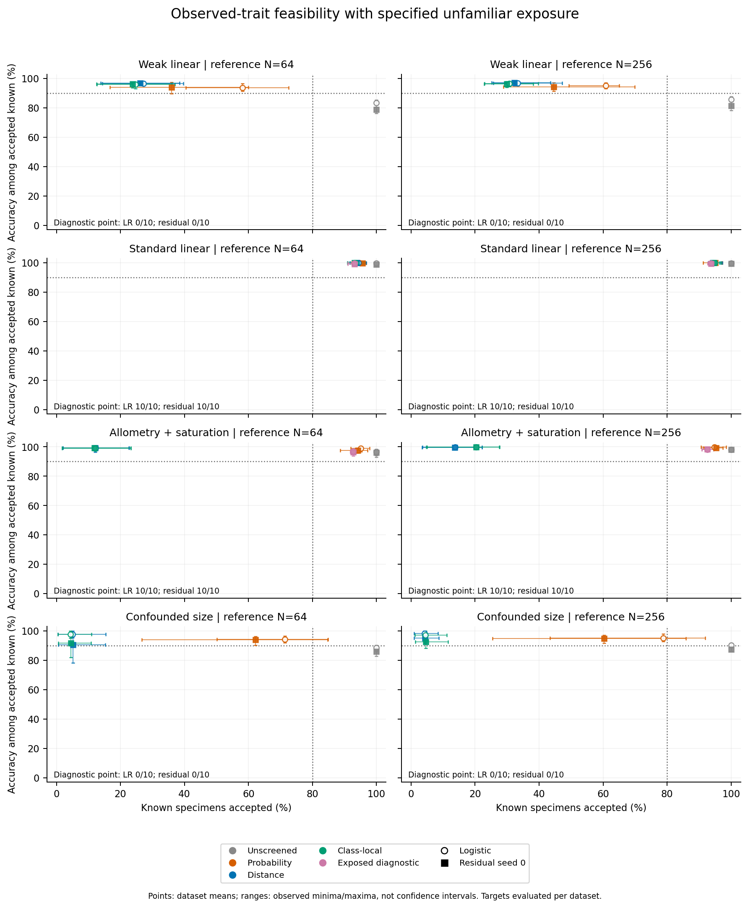
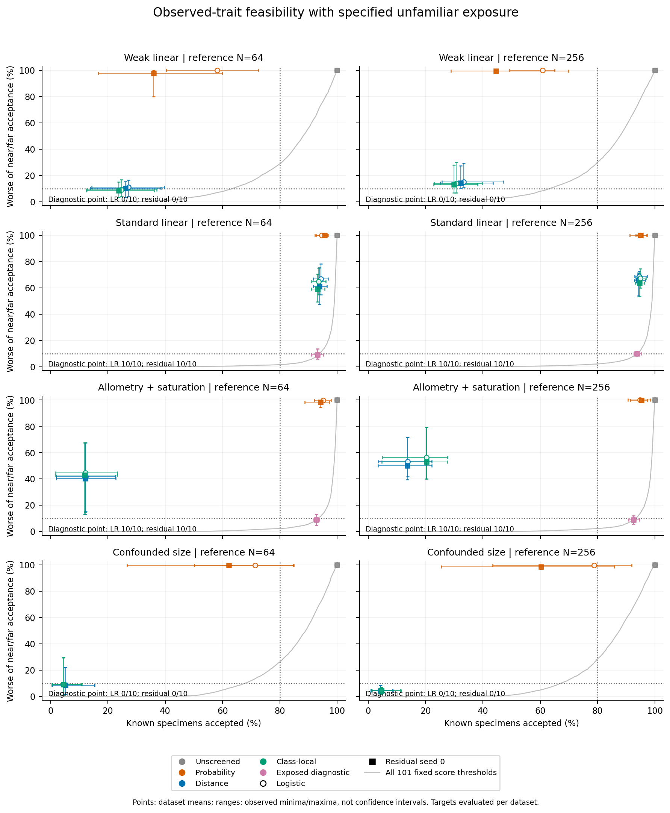

# Observed-feature feasibility: completed diagnostic

A deliberately advantaged detector showed that the measured traits contain useful
known-versus-specified-unfamiliar information in some scenarios. In the frozen
focal cell (allometry plus saturation, original reference N=256, residual seed 0),
10/10 datasets qualified on independent calibration and 7/10 met the joint target
on fresh evaluation, versus 0/10 for the unchanged class-local policy. There were
seven diagnostic-only successes and no reverse successes. The prespecified
research-allocation flag passed. This is a favourable diagnostic result, not a
new deployable unknown-group detector or species-delimitation guarantee.

The detector received explicitly labelled nearby and distant unfamiliar examples,
2,048 additional training specimens and 2,048 independent calibration specimens
per dataset. Existing known-only policies did not receive this information. Any
gain therefore cannot be attributed solely to architecture. Logistic regression
and the frozen residual head had the same joint-success counts in every cell;
these results establish no neural advantage. No production workflow, default,
historical p-value or empirical evidence gate changed.

## Design and interpretation

Eighty archived classifier observations (ten per cell) were paired with new,
independent diagnostic cohorts. The reference heads were never retrained. N=64
or 256 denotes their original training size; the diagnostic detector always had
2,048 training specimens. All three archived neural seeds were retained, with
logistic and residual seed 0 primary. The prior study's additional eighty
archival assessments were not extra independent observations.

A fixed binary gradient-boosting classifier used only the four measured morphology
and eight ecology traits: 100 depth-three trees, learning rate .1, minimum leaf
ten, all features/rows and seed 75101. No latent coordinates, true parameters,
size, identities or reference-model probabilities entered its predictors.
The unchanged original classifier supplied every assigned reference label.

For each frozen head, a threshold from a fixed 101-point grid qualified only when
calibration known coverage was at least 80%, accepted-known accuracy at least 90%,
and nearby **and** distant unfamiliar acceptance each at most 10%. Selection
maximized qualifying calibration coverage, breaking ties toward the larger
threshold. External data never selected a threshold. No qualifying point is a
valid negative outcome with its own status, not a failed fit or an invented
all-withheld solution. All test curves remain descriptive.

## Fresh evaluation

The table reports the residual seed-0 diagnostic. Coverage and accuracy are
means across datasets with a qualifying point; successes use all ten requested
datasets per cell. A cell mean does not establish that each dataset met all
four criteria. Logistic regression had the same qualification and joint-success
counts. Full results retain every seed, policy and availability denominator.

| Generating law | Original reference N | Calibration qualified | External joint success | Known coverage | Accepted-known accuracy | Nearby accepted | Distant accepted |
|---|---:|---:|---:|---:|---:|---:|---:|
| Weak linear | 64 | 0/10 | 0/10 | — | — | — | — |
| Weak linear | 256 | 0/10 | 0/10 | — | — | — | — |
| Standard linear | 64 | 10/10 | 7/10 | 93.1% | 99.1% | 9.0% | 1.3% |
| Standard linear | 256 | 10/10 | 5/10 | 93.7% | 99.4% | 9.9% | 1.2% |
| Allometry + saturation | 64 | 10/10 | 7/10 | 92.8% | 96.5% | 9.0% | 2.6% |
| Allometry + saturation | 256 | 10/10 | 7/10 | 92.6% | 98.4% | 9.0% | 2.1% |
| Confounded size | 64 | 0/10 | 0/10 | — | — | — | — |
| Confounded size | 256 | 0/10 | 0/10 | — | — | — | — |

The focal 7/10 rate has an exact marginal 95% interval of **34.8–93.3%** and a
separate Bonferroni-64 simultaneous interval of **17.7–98.5%**. Ten archived heads
per cell support only a small, conditional pilot. Fresh specimens reduce cohort
Monte Carlo noise; they do not create more independent training datasets.
All 64 primary rates and 48 paired comparisons retain requested denominators,
exact intervals, discordances and failure bounds in the public aggregates.
There were no numerical failures or replacement datasets/draws.

Weak-signal and confounded-size cells had no qualifying operating points. This
does not prove impossibility for every method. Shifted-known confounded cohorts
were retained but cannot be assigned diagnostic chosen-point performance when
calibration supplied no point. Existing-policy shifted results remain available.

The unfamiliar exact-overlap cohort deliberately shares its measured distribution
with known reference class 3. In the focal cell, diagnostic acceptance was 82.6%
for that unfamiliar cohort versus **82.2% coverage of the matching known class**.
The overall known coverage of 92.6% is not the appropriate comparison. Features
alone cannot distinguish two identities with identical observed distributions.
Neither these overlap cohorts nor shifted-known cohorts entered detector training
or calibration. Generalization to arbitrary unfamiliar biological groups remains
untested.

For context, the original class-local screen on the same focal evaluation cohorts
had 20.3% known coverage and 99.7% accuracy among accepted known specimens, while
accepting 45.0% of nearby and 45.3% of distant unfamiliar specimens. The advantaged
diagnostic retained about 92.6% of known specimens with 98.4% accepted accuracy,
and accepted 9.0% nearby and 2.1% distant unfamiliar specimens. These are means,
not guarantees or an information-matched model comparison.

## Figures and reproducibility

Points are dataset means; bars are observed dataset minima/maxima, **not confidence
intervals**. Accuracy points use common datasets with defined accepted accuracy.
Unavailable diagnostic operating points are omitted and counted on each panel.
The second plot uses the worse nearby/distant acceptance within each dataset;
the gray curve shows all 101 fixed thresholds, without test-set selection.
Dotted lines show individual target components; joint success is evaluated per
dataset. All plotted quantities and counts are in `figure-data.json`.

The separate preflight completed twelve work units (ten binary detector fits);
the main phase completed 92 units (84 binary fits). Across both phases, all
9,400 trees and 76,902,400 staged values passed independent native-float32
path/leaf/logit/loss checks. Role/identity boundaries, frozen heads and policies,
threshold/tie selection, 257,752 threshold/head/cohort records, exact replay
predictions, intervals and the stopping flag were audited independently. A
separate public-export check recomputed 5,712 plotted summary values. All 484
pre-existing numerical modules stayed byte-identical; 497 package Python modules
were frozen before scientific generation. There was no neural/logistic retraining,
GMM fitting, calibration-null sampling, stability resampling or empirical fitting.

The measured preflight gate passed the three-GiB local-evidence cap, eight-GiB
free-space reserve and thirty-serial-minute main/audit/report limit. Scientific
main execution took 44.04 seconds, its independent phase audit 56.55 seconds and
report generation 5.95 seconds; binding and external QA are separately retained.
Engineering regression tests, packaging and CI are recorded separately from
scientific fit time. Detailed observations, numeric trees, scores, failed
engineering attempts and full CI logs remain local; only small aggregate
results and figures are published. Nobody was contacted.

[Interface](observed-feature-feasibility.md),
[frozen protocol](observed-feature-feasibility-validation.md),
[study declaration](../examples/observed-feasibility/study.json),
[aggregate results](../examples/observed-feasibility/results/summary.json),
[stopping assessment](../examples/observed-feasibility/results/stopping-assessment.json).

The checkpoint ends here. The positive focal flag identifies a measured-feature
gap under explicit unfamiliar exposure and extra labelled data; it does not
approve a production detector, new default, species claim or further tuning.
