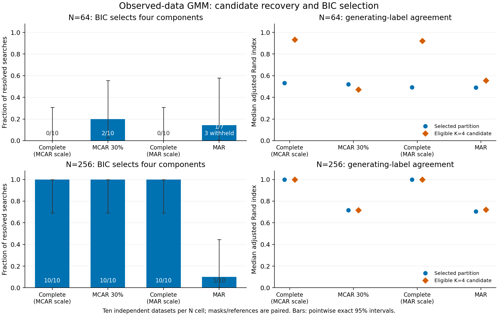

# Observed-data GMM: recovery and convergence diagnosis

This checkpoint separates component-selection cost, optimizer exhaustion,
initialization sensitivity and measured-information limits. It changes no
production model, default, configuration schema or historical p-value. Extended
budgets and known-generating-parameter starts are diagnostic evidence only.

The larger iteration budget resolved all three archived searches diagnostically,
but selected K=2, K=3 and K=1. The four-complete-case input remains rejected.
In fresh complete-data N=64 references, BIC selected four in 0/10 datasets despite
eligible K=4 candidates with median ARI 0.922–0.934. Incomplete N=64 fits also
showed covariance-bound and prediction problems. Extra optimization alone does
not remove the recovery limit or justify forcing K=4.

## Design, preservation and correctness

The independent archival audit passed all 1,200 original point searches and 24
exact replays, checking 47,330 retained starts. It preserved the three exhausted
K=4 searches and the separate rejection with four complete cases. Original
artifacts are content-checksum bound and remain unchanged.

The separate preflight passed 30 baseline/replay searches, 1,200 starts,
41 continuation attempts and eight known-parameter starts. Its measured gate,
including a conservative worst-case trace budget and independently accounted
staging evidence, projected 1.37 GiB against the approved 2 GiB cap. No scientific
setting, generator, numerical objective or seed changed after freezing.
An archived-job filter error was caught by the independent audit: 24 additional
K=2/K=3 paths were inadvertently continued. The failed audit and all original
evidence were retained. A scope-only repair reconstructed the approved K=4-only
results from saved trajectories, restoring original K=1..3 states without
refitting. The 24 extra paths remain local and excluded from conclusions. The
original freeze, separate execution freeze and regression proof are preserved.

The main study uses 60 fresh independent four-feature datasets: ten per
spherical/correlated/four-group law and N=64/256 cell. Observed-coordinate EM and
complete references share training-observed scaling under paired MCAR30/MAR
masks. It has 240 fresh baseline searches, 12 exact archived replays, original
versus extended-budget comparisons, 30 archived continuations and 160 separate
known-parameter K=4 starts. Independent external evaluation uses 2,048 units per
dataset; it does not select or tune models. See the [full design](observed-recovery.md).

The independent audit checks source/mask identities, marginal likelihoods,
conditional-moment updates, covariance bounds, exact continuation anchors,
iteration caps, membership, size eligibility, BIC and replay equality. Known
parameters never enter unsupervised selection. Failed feasible candidates still
withhold the corresponding search; there are no replacement fits or K=1 fallbacks.

## Fresh four-group recovery

Entries are K=4 selections / resolved searches, with unresolved searches stated
separately. K=4 eligibility and ARI refer to the original 2,000-update budget.
Selected ARI is the median over resolved searches; candidate ARI is the median
over eligible K=4 fits, whose denominator is shown. They are separate outcomes.
The BIC gap is K=4 minus the selected candidate, within the same score space.
Complete references for the two masks share the raw dataset and are paired.

| N | Mask | Arm | Original K=4 | Extended K=4 | Eligible K=4 | Selected ARI | Eligible K=4 ARI | Median K=4 BIC gap |
|---:|---|---|---|---|---|---:|---:|---:|
| 64 | mcar30 | reference | 0/10 | 0/10 | 10/10 | 0.531 | 0.934 | 12.577 |
| 64 | mcar30 | observed | 2/10 | 2/10 | 10/10 | 0.521 | 0.472 | 10.203 |
| 64 | mar | reference | 0/10 | 0/10 | 10/10 | 0.493 | 0.922 | 16.061 |
| 64 | mar | observed | 1/7; 3 withheld | 2/10 | 7/10 | 0.490 | 0.556 | 13.444 |
| 256 | mcar30 | reference | 10/10 | 10/10 | 10/10 | 1.000 | 1.000 | 0.000 |
| 256 | mcar30 | observed | 10/10 | 10/10 | 10/10 | 0.716 | 0.716 | 0.000 |
| 256 | mar | reference | 10/10 | 10/10 | 10/10 | 1.000 | 1.000 | 0.000 |
| 256 | mar | observed | 1/10 | 2/10 | 10/10 | 0.704 | 0.722 | 21.685 |

The figure shows original-budget selections. Error bars are exact pointwise 95%
intervals conditional on a resolved result; the small summary also gives requested
counts and unresolved-outcome bounds. ARI markers summarize different availability
sets when searches/candidates fail. Ten datasets per cell give wide uncertainty.

## Original withheld searches

All three original selections remain withheld in the archived study. The table
describes separate extended-budget reconstructions, not corrections to those
historical results. Each original K=4 path received at most 8,000 more updates.

| Archived observation | Mask | Extended status | Extended K | Converged K=4 starts | K=4 status | Maximum cumulative updates |
|---|---|---|---:|---|---|---:|
| four_groups_n64_05 | mar | complete | 2 | 9/10 | eligible | 10000 |
| four_groups_n64_08 | mar | complete | 3 | 8/10 | eligible | 10000 |
| spherical_n64_04 | pattern | complete | 1 | 6/10 | eligible | 10000 |

The fourth withheld search, spherical N=64 replicate 8 under structured missingness
and complete-case selection, still has only four independent complete cases. It
remains rejected by the unchanged six-row minimum for four features; extra EM
iterations cannot repair this information rejection.

Across fresh and selected archived paths, 564 starts were continued;
442 converged within the larger cap and 122 remained unresolved.
These are repeated optimization paths, not independent datasets or performance
trials. Full endpoint residuals, likelihood gains and original trace prefixes are
retained locally. New and original failures remain separate.

## Gaussian controls

Entries are K>1 selections / resolved searches in the observed-coordinate arm.
This is descriptive overpartitioning under a known single Gaussian, not a
significance-test false-positive rate. Complete-reference results and exact
intervals are also retained in the small summary.

| Law | N | Mask | Original K>1 | Extended K>1 |
|---|---:|---|---|---|
| spherical | 64 | mcar30 | 3/10 | 3/10 |
| spherical | 64 | mar | 2/10 | 2/10 |
| spherical | 256 | mcar30 | 0/10 | 0/10 |
| spherical | 256 | mar | 0/10 | 0/10 |
| correlated | 64 | mcar30 | 0/10 | 0/10 |
| correlated | 64 | mar | 0/10 | 0/10 |
| correlated | 256 | mcar30 | 0/10 | 0/10 |
| correlated | 256 | mar | 0/10 | 0/10 |

## Known-parameter initialization diagnostics

Each row contains 40 separate K=4 starts across ten datasets and both mask/arm
pairs. The likelihood comparison is against that observation's original best
converged K=4 candidate, when one exists; counts refer to these comparable fits.
An improvement greater than 1e-6 is descriptive, not a significance threshold.
Neither a good fit nor a larger likelihood certifies a global optimum.

| Source | N | Converged | Size eligible | LL improvements / comparable | Median LL gain |
|---|---:|---|---|---|---:|
| archived | 64 | 39/40 | 39/40 | 13/37 | 0.000 |
| archived | 256 | 39/40 | 39/40 | 2/39 | 0.000 |
| fresh | 64 | 37/40 | 37/40 | 11/36 | -0.084 |
| fresh | 256 | 40/40 | 40/40 | 5/40 | 0.000 |

## Frozen external prediction

The comparison uses the same independent measured coordinates per model and
includes the observed-coordinate Jacobian in raw feature units. It compares
eligible K=4 against the original BIC selection; a K=4 selection has zero gain.
Positive values favor K=4 predictive density. These outcomes never determine
selection or a winning configuration. No absolute BIC/likelihood is compared
across masks, cohorts or transformations.

| N | Mask | Arm | Comparable datasets | Median external log-density gain | Positive gains |
|---:|---|---|---:|---:|---:|
| 64 | mcar30 | reference | 10 | -0.030 | 3 |
| 64 | mcar30 | observed | 10 | -3.660 | 1 |
| 64 | mar | reference | 10 | -0.131 | 3 |
| 64 | mar | observed | 7 | -3.977 | 0 |
| 256 | mcar30 | reference | 10 | 0.000 | 0 |
| 256 | mcar30 | observed | 10 | 0.000 | 0 |
| 256 | mar | reference | 10 | 0.000 | 0 |
| 256 | mar | observed | 10 | -0.066 | 4 |

### Selection cost and covariance behavior

With four features, full-covariance GMM parameter counts are 29, 44 and 59 for
K=2, 3 and 4. At N=64, choosing K=4 over K=2 incurs an additional BIC penalty
of 30 log(64) = 124.77; over K=3 it is 15 log(64) = 62.38. These costs must be
offset by twice the within-space likelihood gain. The complete-data N=64 fits
show that good generating-label recovery can lose this comparison.

Incomplete-data recovery has another limitation: all 17 available original-budget
N=64 K=4 candidates touched the fixed covariance constraint. Their covariance
condition numbers were large, and their median external predictive gains were
negative. Selecting K=4 more often would not by itself establish a better model.

| N | Mask | K=4 fits with an active bound / available | Median maximum component condition number |
|---:|---|---|---:|
| 64 | mcar30 | 10/10 | 14504.6 |
| 64 | mar | 7/7 | 21230.2 |
| 256 | mcar30 | 0/10 | 11.2 |
| 256 | mar | 3/10 | 82.2 |

These are descriptive diagnostics, not proofs that an active bound causes every
failure. Missing coordinates, covariance estimation, EM basins and component
selection interact. Known-parameter starts sometimes improved likelihood but
did not consistently dominate the unsupervised starts and certify no optimum.

## Interpretation limits and next boundary

The reasons for weak recovery can coexist: BIC parameter cost, different EM
basins, slow convergence, active covariance bounds and unmeasured information.
The analysis preserves the best-converged-start-then-size-check rule. More
optimization is not guaranteed to improve component selection or label agreement.

Datasets are independent; masks, complete references, budgets and starts are
repeated measurements. Pointwise intervals are not simultaneous performance
guarantees. The known-parameter fits are unavailable for empirical data and
remain excluded from production selection. Missing-data assumptions are not
validated by these simulations; MAR/MCAR Gaussian laws do not establish safety
under value-dependent missingness, mixed traits or dependence among specimens.

No bootstrap, new p-value or empirical clustering was run. Existing empirical
sampling/reference gates stay closed. An opt-in shared-covariance observed-data model is a logical next candidate,
with prespecified unequal-variance stress checks. It would test whether fewer
covariance parameters improve stability and prediction. Further covariance
families, optimizer changes, uncertainty workflows or default changes require
separate checkpoints; none is promoted here.

Local Python 3.12 verification passed 2,172 scientific tests and 1,482 foundation
tests (110 optional skips); Python 3.11/3.12 are the supported CI matrix. Package
checks compare all 270 package source modules to the corrected execution snapshot;
the original numerical updates and generators are unchanged and both freezes remain local.
Detailed data, masks, starts, parameters, trajectories, predictions and failed
outcomes remain local; only code, invented fixtures, figures and
[small aggregates](../examples/observed-recovery/results/summary.json) are public.
