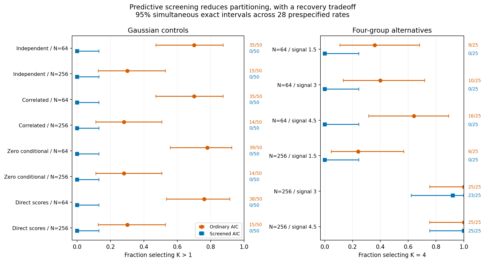

# Predictive-screened AIC: completed validation

The opt-in screen substantially reduced Gaussian-control partitioning, with a
large recovery cost at 64 localities. It selected K=1 in all 400 Gaussian controls,
compared with ordinary AIC selecting K>1 in 205/400. It recovered no K=4 solutions
in the 75 N=64 alternatives, including the strongest signal. At N=256, recovery
was 23/25 and 25/25 for signals 3 and 4.5, compared with 25/25 for ordinary AIC.
The screen remains an optional predictive heuristic. Defaults and historical
p-values are preserved; these outcomes do not establish species boundaries.

## Completion and independent checks

All **625 fresh observations and 3,750 searches** completed successfully, with no
withheld screened results, failed fits or replacement observations. All **25
archived baseline replays** matched their original candidate, PCA and score arrays:
**3,775 main searches**. A separate full-settings preflight completed and audited
102 searches before the main run. The installed workflow smoke also exercises
all 17 cells and independently replays the public CLI.

Independent numerical audits checked every raw generating law, identity/count,
whole-locality fold, training PCA/fusion map, validation/external projection,
mixture density/membership/criterion, eligibility decision and selected export.
A separate standard-library checker verified archive/member hashes, decoded
saved validation arrays and reconstructed pooled gains and all primary totals.
Neither audit refitted models. No calibration or stability bootstraps ran.

The initial runner stopped after 502 registered observations because its storage
counter raced with an atomic archive rename. Three additional completed archives
were verified and registered; the remaining 120 untouched observations used the
same frozen settings and seeds. Only the new runner's storage accounting changed.
All original failure logs and before/after source hashes remain local. There were
no repeated or substituted study fits and no changes informed by outcomes.

## Gaussian-control partitioning

Each row contains 50 independent training datasets; ordinary and screened AIC
share the same full-data candidate fits. Direct score controls are a distinct
Gaussian law, not an isolated causal test of PCA.

| Generating law | Localities/units | Ordinary K>1 | Screened K>1 |
| --- | ---: | ---: | ---: |
| Independent Gaussian | 64 | 35/50 | 0/50 |
| Independent Gaussian | 256 | 15/50 | 0/50 |
| Correlated Gaussian | 64 | 35/50 | 0/50 |
| Correlated Gaussian | 256 | 14/50 | 0/50 |
| Zero conditional Gaussian | 64 | 39/50 | 0/50 |
| Zero conditional Gaussian | 256 | 14/50 | 0/50 |
| Direct Gaussian scores | 64 | 38/50 | 0/50 |
| Direct Gaussian scores | 256 | 15/50 | 0/50 |

Zero selections do not imply zero population probability. For **each** screened
0/50 cell, the exact pointwise 95% interval is **0–7.11%**; the simultaneous 95%
upper bound across the 28 prespecified rates is **13.10%**. The descriptive
205/400 total combines different laws/sample sizes and is not a single common-rate
estimate. All 205 ordinary multicomponent control selections had negative observed
external mean log-density gain over K=1; screened K=1 has zero gain by definition.

## Four-group recovery and its cost

Signal multipliers match the preceding power study. Each cell contains 25 fresh
datasets. Generating labels are used only after fitting. K=4 recovery is distinct
from a significance test and does not necessarily imply correct assignments.

| Localities | Signal | Ordinary K=4 | Screened K=4 | Mean ARI, ordinary | Mean ARI, screened |
| --- | ---: | ---: | ---: | ---: | ---: |
| 64 | 1.5 | 9/25 | 0/25 | 0.192 | 0.000 |
| 64 | 3 | 10/25 | 0/25 | 0.556 | 0.277 |
| 64 | 4.5 | 16/25 | 0/25 | 0.845 | 0.515 |
| 256 | 1.5 | 6/25 | 0/25 | 0.307 | 0.070 |
| 256 | 3 | 25/25 | 23/25 | 0.869 | 0.855 |
| 256 | 4.5 | 25/25 | 25/25 | 0.987 | 0.987 |

At N=64/signal 3, screening chose K=2 in 15/25 datasets and K=1 otherwise.
At N=64/signal 4.5 it chose K=2 in 15/25, K=3 in 8/25 and K=1 in 2/25.
Its mean external predictive gain nevertheless improved from -0.363 to 0.046
and from 0.198 to 0.328, respectively. Predictive performance and recovery of the
four generating groups therefore target different outcomes. Screening can favor
simpler predictions while losing biologically interesting structure.

At N=256/signal 3, screened recovery fell by two datasets (25/25 to 23/25), and
mean ARI fell from 0.869 to 0.855. At signal 4.5 both selected K=4 in 25/25 and
mean ARI was 0.987. These small cells were not designed to establish equivalence
or noninferiority. Weak-signal recovery also declined at N=256 (6/25 to 0/25).

## Why candidates were screened out

The screen combines two safeguards: eligibility in every training fold and
strictly positive pooled validation gain. It is not a pure log-density ablation.
For N=64 Gaussian controls, 112 ordinary winners were blocked by fold eligibility
and 35 by nonpositive gain; at N=256 the corresponding totals were 2 and 56.
Every ordinary multicomponent control winner failed the screen.

Among the N=64/signal 3 alternatives, 11 ordinary winners failed eligibility and
10 failed gain; among signal 4.5 alternatives, these counts were 8 and 16.
The two blocked winners at N=256/signal 3 failed fold eligibility. These are
retained best-start/minimum-size decisions, not newly repaired optimization.
Smaller training folds, estimation error and the conservative all-fold rule can
all contribute. This checkpoint does not isolate their causal effects or tune
a more permissive rule after observing the results.

## Stress outcomes

Stress laws are descriptive model departures, not null type-I errors or species
truth. Only the unequal-variance scenario supplies four-group labels.

| Stress law, N=64 | Ordinary K>1 | Screened K>1 | Ordinary K=4 | Screened K=4 |
| --- | ---: | ---: | ---: | ---: |
| Heavy tails | 10/25 | 0/25 | 0/25 | 0/25 |
| Continuous cline | 20/25 | 0/25 | 4/25 | 0/25 |
| Unequal-variance four groups | 25/25 | 24/25 | 12/25 | 0/25 |

Unequal-variance mean ARI fell from 0.656 to 0.479 while external mean predictive
gain rose from 0.214 to 0.435. Heavy-tail/cline simplicity should not be interpreted
as proof of species absence. External evaluation used 2,048 independent units per
dataset and never affected settings, selection, folds or thresholds.

## Uncertainty, evidence and limits

The [small aggregate tables](../examples/predictive-aic/results/summary.json)
and [CSV](../examples/predictive-aic/results/primary-rates.csv) contain all 28
primary rates, exact pointwise and Bonferroni simultaneous 95% intervals,
dataset-level Monte Carlo SEs, denominators and failure bounds. The 14 paired
comparisons use adjusted exact discordance bounds without assuming independent
arms. A zero plug-in MCSE at zero events does not replace its positive interval
upper bound. Stress, BIC, ARI and external prediction summaries are descriptive;
no fold is counted as an independent observation. Prediction summaries compare
candidates within the same training map, not absolute densities across maps.

See the [frozen method and commands](predictive-aic.md) and
[mechanism aggregates](../examples/predictive-aic/results/mechanisms.json).
Complete lossless evidence remains in the local checkpoint directory
`~/.codex/outputs/super-deli/predictive-aic-20261024/` under the approved 2 GiB cap.
Raw inputs, fold parameters, individual predictions and private indexes are not
published. Earlier checkouts, studies and historical p-values are preserved.
Python 3.11/3.12 tests, installed package workflows and final master CI are the
release gates recorded with the local publication evidence.

The bounded validation supports offering this safeguard for users who prefer
predictive restraint. It does not support a new default, a generally valid
false-positive correction, a new p-value or a species-count claim. Diagnosing
small-sample recovery losses would require a separately approved checkpoint.
