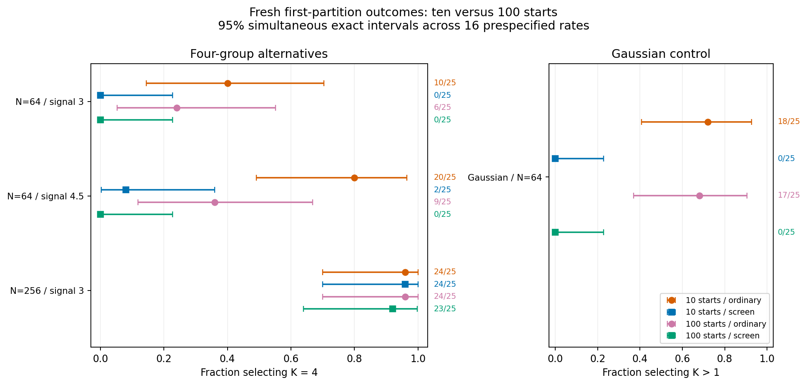
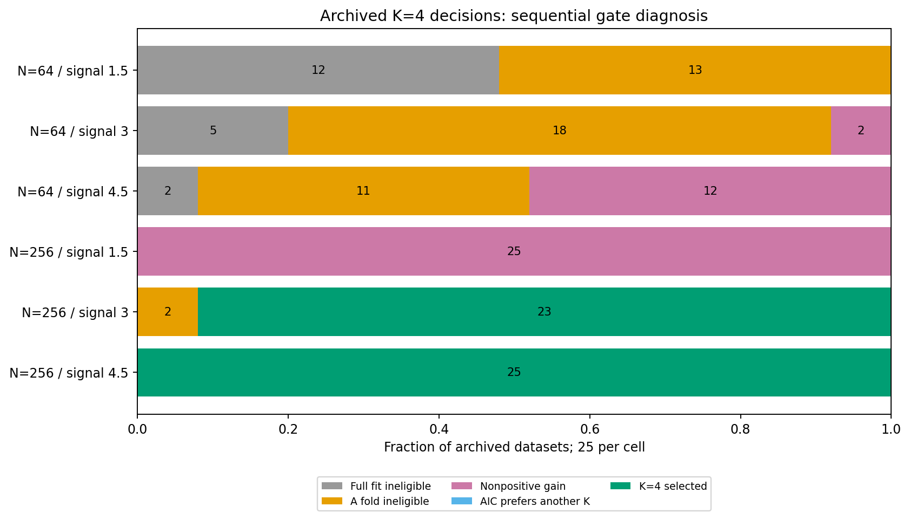

# Predictive-screen recovery diagnosis: completed results

The unchanged predictive screen frequently loses four-group recovery at 64 localities. Both training-fold admissibility and predictive density matter. More EM starts do not solve the problem: they often raise training likelihood while losing admissibility or external predictive performance. This checkpoint diagnoses those effects; it introduces no selector, fitting, default or p-value change.

## Completed evidence

- Independently audited all 625 archived observations and 3,750 retained searches without refitting.
- Completed 100 fresh observations, 3,200 unique full/fold candidate searches and 450 separate truth-initialized K=4 diagnostics.
- Verified 25 exact archived six-search replays: 150 additional searches. Main total: **3,350 searches plus 450 single-K fits**.
- All planned main fits completed; no failures, replacements, withheld selections or unattempted fits. Numerical and separate standard-library audits passed.
- The separate full-settings preflight used 128 searches and 18 oracle fits. Development, unit-test and installed-smoke work is separate from main-study accounting. Re-auditing performed no fits.

Each fresh cell contains 25 independent datasets, with five prespecified five-fold locality partitions. The first partition is primary. Independent external samples contain 2,048 localities per observation and never influence selection. See the [frozen design and commands](predictive-recovery.md) and [configurations](../examples/predictive-recovery/).

## First-partition selection

Alternative events are K=4 recovery; the Gaussian-control event is K>1 selection. Ordinary AIC and the predictive screen use the same candidates within an arm.

| Cell | Ordinary, 10 starts | Screen, 10 starts | Ordinary, 100 starts | Screen, 100 starts |
| --- | ---: | ---: | ---: | ---: |
| N=64 Gaussian control (K>1) | 18/25 | 0/25 | 17/25 | 0/25 |
| N=64, signal 3 | 10/25 | 0/25 | 6/25 | 0/25 |
| N=64, signal 4.5 | 20/25 | 2/25 | 9/25 | 0/25 |
| N=256, signal 3 | 24/25 | 24/25 | 24/25 | 23/25 |

All 16 primary rates include exact pointwise and Bonferroni simultaneous 95% intervals, dataset-level MCSE, denominators and missing-outcome bounds in [primary-rates.csv](../examples/predictive-recovery/results/primary-rates.csv). With only 25 datasets/cell, intervals are wide: zero events has a simultaneous upper bound of 22.8%. It is not evidence of zero population risk. MCSE of zero at a boundary is not the confidence interval.

Eight prespecified paired comparisons are retained with simultaneous conservative exact discordance bounds. Differences below are **reference minus comparison**; they do not assume independence between arms.

| Cell | Reference | Comparison | Difference | Simultaneous interval |
| --- | --- | --- | ---: | --- |
| independent_gaussian_n64 | baseline_ordinary | baseline_screened | 72.0% | [18.0%, 92.8%] |
| independent_gaussian_n64 | baseline_screened | extended_screened | 0.0% | [-22.8%, 22.8%] |
| four_n64_s3_0 | baseline_ordinary | baseline_screened | 40.0% | [-8.4%, 70.3%] |
| four_n64_s3_0 | baseline_screened | extended_screened | 0.0% | [-22.8%, 22.8%] |
| four_n64_s4_5 | baseline_ordinary | baseline_screened | 72.0% | [18.0%, 92.8%] |
| four_n64_s4_5 | baseline_screened | extended_screened | 8.0% | [-22.5%, 36.0%] |
| four_n256_s3_0 | baseline_ordinary | baseline_screened | 0.0% | [-22.8%, 22.8%] |
| four_n256_s3_0 | baseline_screened | extended_screened | 4.0% | [-22.8%, 30.0%] |

## Gate diagnosis

The archived K=4 audit evaluates every K=4 candidate, including ones that ordinary AIC did not select. Sequential reasons below allocate each observation to the first failing gate; they are descriptive, order-dependent counts rather than separate causal effects.

| Archived cell | Full fit ineligible | A fold ineligible | Nonpositive gain | AIC prefers another K | K=4 selected |
| --- | ---: | ---: | ---: | ---: | ---: |
| four_n64_s1_5 | 12 | 13 | 0 | 0 | 0 |
| four_n64_s3_0 | 5 | 18 | 2 | 0 | 0 |
| four_n64_s4_5 | 2 | 11 | 12 | 0 | 0 |
| four_n256_s1_5 | 0 | 0 | 25 | 0 | 0 |
| four_n256_s3_0 | 0 | 2 | 0 | 0 | 23 |
| four_n256_s4_5 | 0 | 0 | 0 | 0 | 25 |

At archived N=64 signal 4.5, removing only the fold-size requirement while retaining positive predictive gain would select K=4 in only 1/25 observations. Removing the gain requirement while retaining all size gates would select K=4 in 8/25. Both gate-removal calculations are diagnostic counterfactuals on retained fits, never deployable selectors. Full-data eligibility remains required. All 625 observations, additional controls and stress cells are summarized in [archived-mechanisms.json](../examples/predictive-recovery/results/archived-mechanisms.json).

Fresh first-partition K=4 outcomes provide a separate check. Detailed outcomes for all five partitions and the 100-start arm are in [fresh-gates.json](../examples/predictive-recovery/results/fresh-gates.json).

| Fresh cell / starts | Full ineligible | Fold ineligible | Nonpositive gain | AIC prefers another K | K=4 selected |
| --- | ---: | ---: | ---: | ---: | ---: |
| independent_gaussian_n64 / 10 | 10 | 14 | 1 | 0 | 0 |
| independent_gaussian_n64 / 100 | 21 | 4 | 0 | 0 | 0 |
| four_n64_s3_0 / 10 | 3 | 19 | 3 | 0 | 0 |
| four_n64_s3_0 / 100 | 17 | 8 | 0 | 0 | 0 |
| four_n64_s4_5 / 10 | 3 | 12 | 8 | 0 | 2 |
| four_n64_s4_5 / 100 | 16 | 9 | 0 | 0 | 0 |
| four_n256_s3_0 / 10 | 0 | 0 | 0 | 1 | 24 |
| four_n256_s3_0 / 100 | 0 | 1 | 0 | 1 | 23 |

## Optimization and prediction

Every ten/100-start comparison uses byte-identical PCA, profile, fusion and score arrays; the numerical audit and reporter independently verified this. Training likelihood changes and external density gains are compared only within the same frozen map.

| Fresh cell | Full K=4 mean likelihood increase | Full eligibility lost / gained | Fold K=4 mean likelihood increase | Fold eligibility lost / gained | Mean change in fold external gain |
| --- | ---: | ---: | ---: | ---: | ---: |
| independent_gaussian_n64 | 12.698 | 11 / 0 | 12.884 | 30 / 3 | 0.005 |
| four_n64_s3_0 | 13.206 | 14 / 0 | 9.516 | 60 / 1 | 0.035 |
| four_n64_s4_5 | 5.572 | 13 / 0 | 8.179 | 73 / 0 | -0.389 |
| four_n256_s3_0 | 0.047 | 0 / 0 | 0.360 | 1 / 0 | -0.009 |

The existing procedure selects its best-likelihood EM start before applying the hard minimum-size gate. Additional starts can therefore produce a higher-likelihood but inadmissible candidate; this behavior was preserved. More training likelihood also need not yield better independent prediction. Each full-covariance K=4 model has 59 free mixture parameters, while N=64 fold fits train on only 51 or 52 localities, compared with 204 or 205 at N=256. This complexity contrast is a diagnostic observation, not a general sample-size rule.

Truth-initialized fits are separate optimization diagnostics and never enter selection. Their parameters, initialization, densities, membership and eligibility were independently audited.

| Alternative cell | Full oracle eligible | Full oracle mean ARI | Full mean likelihood gain over unsupervised K=4 | Fold oracle eligible | Fold mean external gain over K=1 |
| --- | ---: | ---: | ---: | ---: | ---: |
| four_n64_s3_0 | 25/25 | 0.900 | -2.734 | 125/125 | -0.695 |
| four_n64_s4_5 | 25/25 | 0.995 | -0.381 | 125/125 | -0.166 |
| four_n256_s3_0 | 25/25 | 0.908 | 0.231 | 125/125 | 0.337 |

At N=64 signal 4.5, full oracle ARI averaged 0.995 and every oracle fold met the size gate, yet mean fold external gain remained -0.166 relative to K=1. Thus near-correct generating-label recovery does not ensure better estimated predictive density at this sample size. This does not isolate a unique cause.

Oracle outcomes cannot establish a practical recovery method: they use unavailable generating labels. Full/fold ARI, likelihood changes, external gains and signal traces are descriptive, with distributions and denominators in [optimization.json](../examples/predictive-recovery/results/optimization.json). Pooled fold summaries have no independent-fold standard errors.

## Signal retention and partition sensitivity

The archived strong N=64 cell retained median fold score-space R² of 0.937 and 0.900 for the two generating axes. Nevertheless, its median fold K=4 external log-density gain over K=1 was -0.369. At N=64 signal 3, the corresponding R² values were 0.874 and 0.799, with median external gain -0.906. Signal retention alone therefore does not explain selection. Four joint PCs retain all four fused scores here; view-PCA changes and estimation of component covariances remain relevant. Raw means, source-row scores, group profiles, fused/joint axes, generating counts, covariance spectra and fold/full map angles are retained and independently checked.

| Fresh cell | Same screened K across all five partitions | K=4 on at least one partition |
| --- | ---: | ---: |
| independent_gaussian_n64 | 25/25 | 0/25 |
| four_n64_s3_0 | 13/25 | 0/25 |
| four_n64_s4_5 | 5/25 | 6/25 |
| four_n256_s3_0 | 25/25 | 24/25 |

These are repeated measurements on the same 25 observations/cell, not 125 independent observations or a biological stability bootstrap. No best partition was chosen. The primary first partition and all five repeated outcomes remain retained.

## Numerical audit, storage and limitations

The original audit stopped on one external density discrepancy of 1.29e-8. A separate 70-digit decimal calculation placed the retained density within 1.22e-10 and the eigenvalue audit within 1.28e-8 of the high-precision result. Only the new external-density auditor was changed to Cholesky triangular solves, retaining its original tolerances; a pinned regression also rejects deliberate corruption. The complete independent audit then passed all 100 unchanged observations. No scientific fits were replaced or regenerated. The original runtime, failed audit and high-precision evidence remain local.

The original measured 2 GiB storage gate failed. An explicitly approved budget-only amendment raised it to 3 GiB, reusing the identical 146 probe fits; replacement projection was 2.80 GiB including growth and reserve. Original configs, seed plan, failed gate and probe evidence remain preserved. Detailed lossless archives stay local. GitHub receives only code, frozen public settings, documentation, figures and small aggregates with [checksums](../examples/predictive-recovery/results/checksums.json). Previous checkouts and studies remain unchanged.

This bounded study does not isolate one unique cause, estimate general sample-size requirements, validate a new correction, or establish species boundaries. The fresh design covers two N=64 alternative strengths, one N=256 alternative and one Gaussian-control law; omitted scenarios receive archival diagnosis only. No significance or biological-stability bootstrap was run. Existing defaults, production fitting/sampling/selection and historical p-values are preserved. A subsequent checkpoint may compare a prespecified lower-variance covariance model under the same predictive screen, with independent controls and alternatives; this study does not select or promote one.
