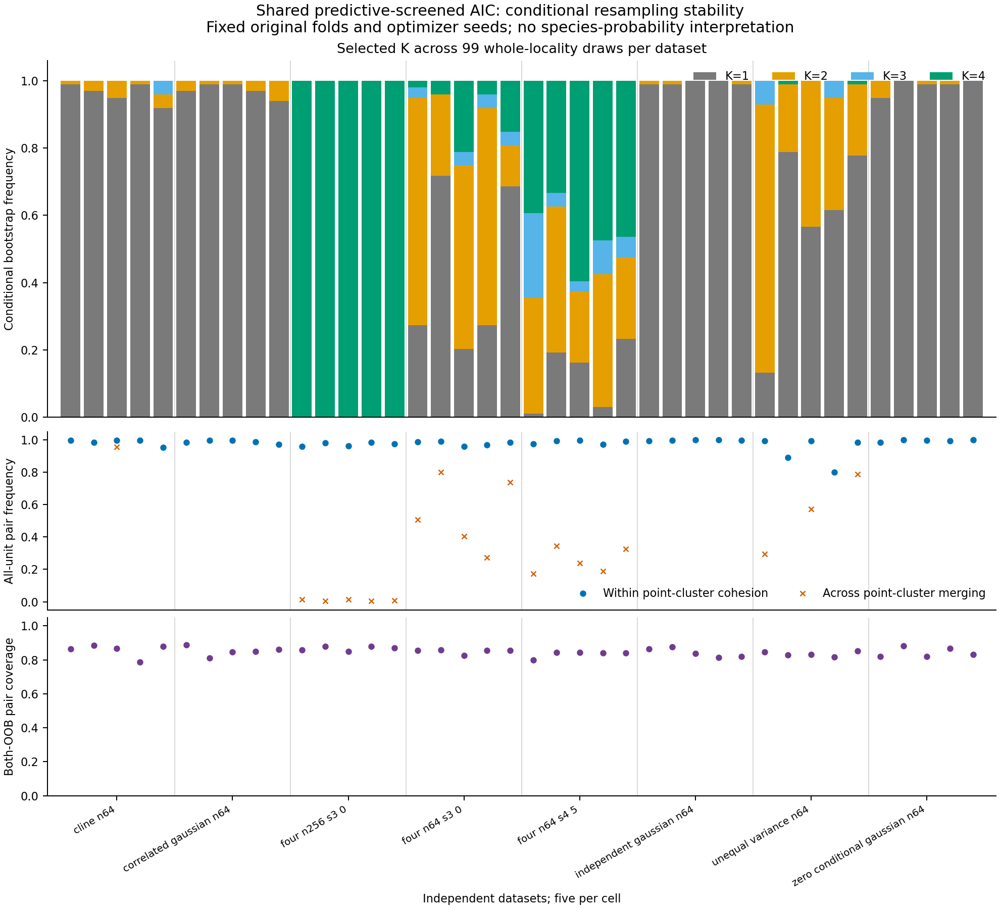

# Whole-locality stability: bounded validation results

The opt-in shared-covariance predictive screen now has complete-pipeline locality
bootstrap stability. The implementation passed 24,000 main searches, 4,800
separate full-settings probe searches, both independent auditors, and 15 exact
six-search archived point replays (90 searches). All 3,960 main bootstrap draws
and 792 probe draws completed, with no failed or unattempted searches/draws.
Original point results, defaults, numerical engines and historical p-values are
unchanged. Detailed inputs, models, predictions, draw/fold identities and private
archive indexes remain local.

The bounded study used **five independent datasets per cell**. Frequencies below
are descriptive averages of each dataset's 99 draws, not estimates based on
495 independent biological datasets. No stability-probability calibration,
species probability, new significance test or precise population performance
claim follows from these small cells. The original fold partition and optimizer
seeds were fixed within each analysis; alternative partitions were not assessed.

## Four-group recovery and resampling stability

| Localities | Signal | Point fits selecting K=4 | Mean point ARI | Mean bootstrap K=4 frequency | Mean exact point-cluster recovery |
| ---: | ---: | ---: | ---: | ---: | ---: |
| 64 | 3 | 4/5 | 0.822 | 9.3% | 16.7% |
| 64 | 4.5 | 5/5 | 0.992 | 45.3% | 38.8% |
| 256 | 3 | 5/5 | 0.931 | 100.0% | 23.2% |

N=64 point recovery does not imply that four groups persist under whole-locality
resampling. At the stronger signal, all five point fits selected four groups and
mean label agreement was 0.992, yet mean bootstrap K=4 frequency was 45.3%.
At signal 3 it was 9.3%. This checkpoint measures that instability; it does not
isolate the contributions of distinct-size constraints, fold eligibility,
predictive gain, optimization and AIC ranking, or alter those rules.

At N=256 all five observations selected K=4 in the point fit and every resample.
However, exact recovery of a point cluster's entire original-unit set averaged
23.2%, because assignments near boundaries still varied. Stable K and stable
individual assignments are different outcomes. Pairwise cohesion/merging and
strict exact-set recovery should be read together.

## Controls, stress and coverage

All 15 Gaussian-control point analyses selected K=1. Mean bootstrap K=1 frequencies
were 99.4% under independent, 97.2% under correlated and 98.6% under zero-conditional
Gaussian laws. These five-per-law observations are descriptive checks, not a
false-positive calibration or general guarantee.

Unequal-variance four-group stress produced no K=4 point selections in five
observations, mean point ARI 0.271 and mean bootstrap K=4 frequency 0.4%.
Continuous-cline stress selected K=1 in four observations and K=2 in one;
its average bootstrap K=1 frequency was 96.4%. Stable underpartitioning or a
stable description of a continuum cannot establish biological species boundaries.

With 99 draws, pairwise out-of-bag evidence was limited. Only 78.7–88.8% of
nonself pairs in an observation met the prespecified minimum of ten successful
both-OOB draws. Unsupported pairs keep counts and failure bounds but no displayed
point frequency. Coverage varies by pair; covered-pair averages do not describe
uncovered pairs. All-unit frequencies include resubstitution and can be optimistic.
Exact binomial intervals describe conditional Monte Carlo precision for individual
events only, without simultaneous pairwise or biological coverage.

Each bar is one independent dataset's 99 resamples; five bars belong to each cell.
The second panel shows within-point-cluster cohesion and cross-cluster merging.
K=1 point fits have no cross-cluster pairs, so that marker is absent. The third
panel shows the fraction of nonself pairs with sufficient both-OOB coverage.
These are fixed-partition conditional summaries, not species-support probabilities.

## Verification and reproducibility

The frozen benchmark retained 64/256 localities, 1–4 morphology specimens/locality,
one ecology row/locality, four features/view, two PCs/view, four joint PCs,
equal weights, shared covariance, K=1..4, minimum five distinct localities,
ten starts and model seed 71323. Complete ingestion/preprocessing/PCA/fusion,
full-draw search and five training-fold searches were refitted per draw; duplicate
original localities never crossed folds. Raw generators and selection rules were
unchanged. Generating labels entered evaluation only after fitting.

The numerical auditor independently checked raw laws, identities/counts, weighted
PCA/fusion, held-out exclusion, original-ID size rules, likelihood/membership,
AIC/BIC, pooled validation gates, selected-model reloads and stability/precision
calculations. A separate standard-library auditor checked immutable archive/member
bytes, folds, gates and counters. Archived replays exactly matched all candidate
and transformation/mixture arrays in the prespecified prior full/shared workflows.

Local verification passed 1,482 scientific tests and 941 foundation tests with
101 optional-dependency skips. The installed-wheel eight-cell smoke passed
144 smaller searches and both auditors. Python 3.11/3.12 remain the supported
versions, with four required foundation/scientific CI jobs. The preflight's
measured projection was 2.75 GiB against the approved 4 GiB new-artifact cap,
including growth/reserve; no detailed study artifacts are published.

See [the method and CLI](predictive-stability.md), the frozen
[study configuration](../examples/predictive-stability/study.json),
[small aggregate results](../examples/predictive-stability/results/summary.json),
[per-dataset summaries](../examples/predictive-stability/results/datasets.csv),
and `scripts/report_predictive_stability.py` for regeneration. The preceding
[shared-family comparison](shared-predictive-results.md) used different fresh
observations and has a different validation purpose; comparisons are unpaired.

## CI portability correction

The initial Python 3.11 installed-smoke run failed after its scientific tests
passed; its captured child-process diagnostics were not printed. The original
CI logs remain preserved locally. Regression checks exposed a storage-accounting
race: the size scan descended into excluded temporary trees while workers could
remove them, a case the [Python 3.11 pathlib implementation](https://github.com/python/cpython/blob/3.11/Lib/pathlib.py#L350-L385)
can propagate as a missing-directory error. Accounting now prunes these trees
before traversal and fails closed on permission errors. The smoke wrapper retains
and prints subprocess diagnostics before checking status, and runs earlier in CI.

Only filesystem accounting and diagnostics changed after the frozen study.
Numerical fitting and sampling functions, all study inputs/outputs, defaults and
p-values remain unchanged. The original runtime is retained with the study;
the final package has a separately fingerprinted runtime and amendment record.
