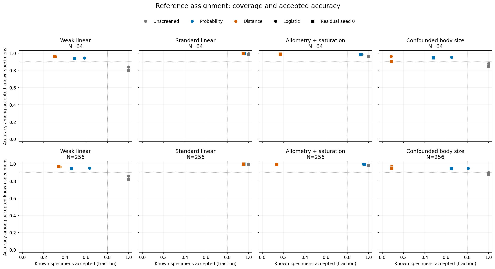
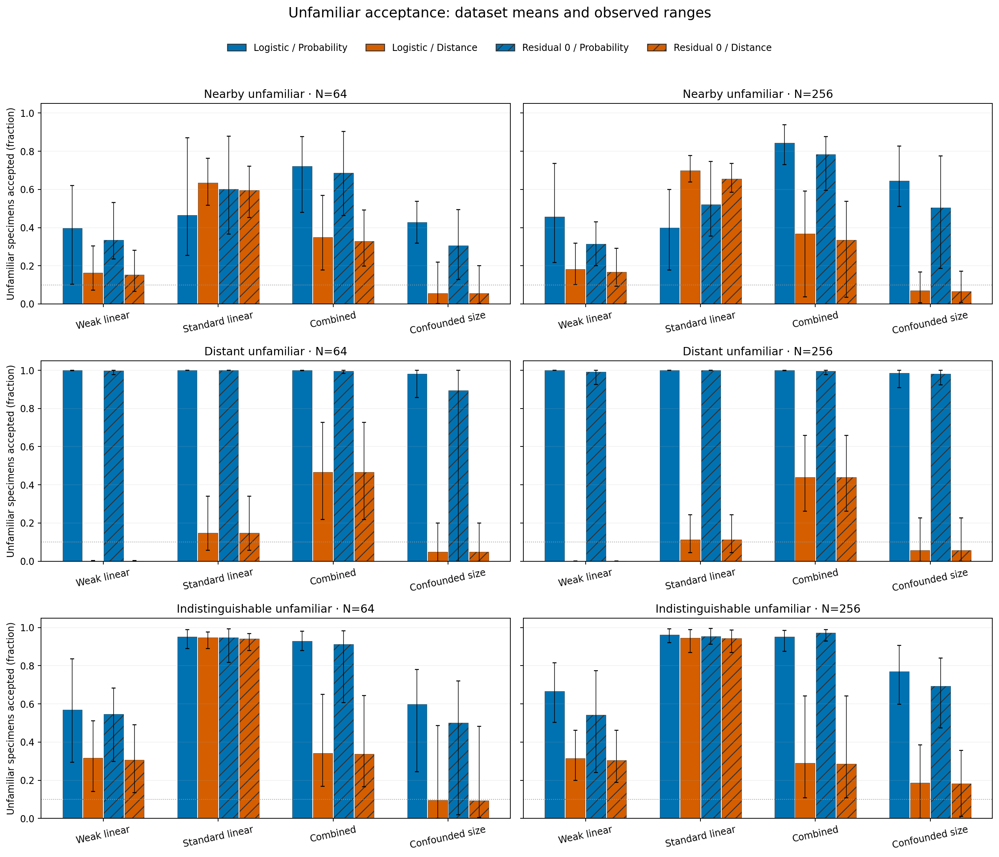

# Reference-assignment abstention: results

The new opt-in layer preserves original residual predictions and separately accepts or withholds a reference assignment. The bounded validation found useful reductions in distant-unfamiliar acceptance, but neither fixed policy met the prespecified joint coverage/error target. Distance support often withheld most known specimens, and probability support continued accepting distant unfamiliar groups. No default or historical p-value changed.

This is reference-assignment support, not species discovery. The [interface](reference-abstention.md) and [frozen protocol](reference-abstention-validation.md) define the assumptions, independent calibration cohort, compatible sets and failure states. Unfamiliar rejection and accuracy among accepted assignments have no .05/.95 guarantee.

## What was evaluated

Eighty fresh independent training datasets span four laws at N=64/256, ten per cell. Each received unchanged logistic regression and residual seeds 0/101/202, with 160 independent known-class calibration specimens, 2,048 known-class evaluation specimens, 512 nearby/distant/indistinguishable unfamiliar specimens each, and an additional 2,048 changed-nuisance specimens for confounded-size laws. All identities and innovations were separated by role; labels never entered analytical features. The measurement laws are illustrative simulations, not fitted empirical biology.

The 320 main classifier fits and eight read-only archived prediction replays all completed. A separate 32-fit preflight was excluded from performance estimates. Together the phases used 264 neural trainings and independently checked all 132,000 optimizer updates. No new GMM fits, significance draws, stability resamples, empirical analysis or author contact occurred.

## No tested policy met the joint operating target

The target required >=80% known IID acceptance, >=90% accuracy among accepted known specimens, and <=10% acceptance for both nearby and distant unfamiliar groups. Every primary model/policy/law/N cell had 0/10 successes; none of the retained sensitivity seeds met the target either. Withholding everything cannot satisfy this target.

Thirty-two primary rates have exact marginal and separate Bonferroni simultaneous 95% intervals. For 0/10 the upper bounds are 30.85% marginal and 51.10% simultaneous. These are not evidence of a generally zero success probability. Ten independent datasets/cell support a descriptive pilot. Policies, seeds and thousands of evaluation rows repeat training datasets; they are not additional independent replicates. All sixteen paired policy comparisons had zero successes for both arms, so neither distance-only nor probability-only successes occurred.

## Distance support: reduced distant acceptance with substantial coverage costs

Entries below are percentages averaged across ten datasets; residual seed zero is the prespecified primary. Higher accepted accuracy is conditional on the specimens retained and must be read alongside coverage.

| Law | N | Known accepted | Accuracy among accepted | Nearby unfamiliar accepted | Distant unfamiliar accepted |
|---|---:|---:|---:|---:|---:|
| Weak linear | 64 | 30.1 | 96.5 | 15.3 | 0.1 |
| Weak linear | 256 | 34.1 | 96.7 | 16.8 | 0.1 |
| Standard linear | 64 | 94.8 | 99.8 | 59.5 | 14.8 |
| Standard linear | 256 | 95.1 | 99.9 | 65.5 | 11.3 |
| Allometry + saturation | 64 | 16.8 | 99.0 | 32.8 | 46.6 |
| Allometry + saturation | 256 | 13.5 | 99.5 | 33.5 | 43.9 |
| Confounded size | 64 | 8.4 | 90.3 | 5.5 | 4.8 |
| Confounded size | 256 | 8.9 | 95.3 | 6.7 | 5.6 |

The raw support rule included the true known reference in mean 94.6–95.8% of IID compatible sets across cells, while actual accepted coverage ranged from 8.4% to 95.1%. These are different quantities: several references can be compatible even when the true one is included. For the primary distance rule, ambiguous sets accounted for mean 61–65% withholding in weak linear cells, 78–82% in combined nonlinear cells and 87–88% in confounded-size cells. Outside-support and classifier-conflict decisions are separately retained. Observed inclusion near .95 is descriptive, not a high-precision coverage validation.

Logistic regression showed the same broad tradeoff. Distance known acceptance was 31.1/35.4% for weak N=64/256, 95.3/95.2% for standard, 16.8/13.6% for combined and 8.4/9.0% for confounded size. Distant acceptance was nearly identical to the residual model. Shared raw support geometry does not establish an additional neural advantage; all three seeds remain available in the public summaries.

Points are means of available dataset-level metrics. Shape identifies classifier, color identifies policy. Dotted lines show the separate known-coverage/accuracy target components, not a success region for the full unknown-group target. Undefined conditional accuracies are not imputed.

## Probability support retains known specimens but does not solve unfamiliar acceptance

For the primary residual model, the same calibration cohort and rank construction give:

| Law | N | Known accepted | Accuracy among accepted | Nearby unfamiliar accepted | Distant unfamiliar accepted |
|---|---:|---:|---:|---:|---:|
| Weak linear | 64 | 49.2 | 93.9 | 33.4 | 99.8 |
| Weak linear | 256 | 46.0 | 94.3 | 31.5 | 99.2 |
| Standard linear | 64 | 95.9 | 99.6 | 60.2 | 100.0 |
| Standard linear | 256 | 95.4 | 99.9 | 52.1 | 100.0 |
| Allometry + saturation | 64 | 92.3 | 98.3 | 68.6 | 99.6 |
| Allometry + saturation | 256 | 96.1 | 99.3 | 78.3 | 99.6 |
| Confounded size | 64 | 47.8 | 94.7 | 30.6 | 89.6 |
| Confounded size | 256 | 64.8 | 94.4 | 50.5 | 98.2 |

Logistic probability support accepted mean 98.2–100% of distant unfamiliar specimens across these cells. Residual seed zero accepted 89.5–100%. Thus calibrating class-probability scores did not make high-confidence distant predictions reliable unknown-group decisions. Nearby unfamiliar acceptance also remained substantial. The unscreened comparison assigned every specimen, including all unfamiliar specimens, to a supplied class.

Bars show dataset means; whiskers span observed minima–maxima across ten datasets, not confidence intervals. Hatched bars are residual seed zero, solid bars logistic. The .1 line marks one benchmark target, with no unfamiliar-error guarantee.

## Observational overlap and changed conditions remain limitations

The overlapping unfamiliar control exactly duplicates known reference 3's conditional measurement law, with a different evaluation-only identity. Its acceptance tracks coverage of that known reference, not overall coverage across all four classes. For distance/residual N=256, standard-law reference-3 coverage was 94.8% and overlapping-unfamiliar acceptance 94.4%; in combined measurements they were 29.5% and 28.6%; in confounded size, 18.4% and 18.2%. Lower unknown acceptance here also means withholding comparable known specimens. These measurements alone provide no basis for reliably separating identical conditional laws.

The classwise export includes all four supplied references, all seeds/policies, per-class coverage and inclusion, and known-class confusion counts. Summed confusion matrices are descriptive counts; uncertainty is not computed by treating pooled evaluation rows as independent training datasets.

Removing the training size/class association also undermined the retained assignments. The table concerns known shifted specimens, so all accepted labels refer to existing classes:

| N | Classifier | Shifted unscreened accuracy | Shifted distance acceptance | Accuracy among shifted distance-accepted |
|---|---|---:|---:|---:|
| 64 | Logistic | 61.0 | 3.1 | 53.7 |
| 64 | Residual seed 0 | 60.7 | 3.5 | 52.6 |
| 256 | Logistic | 65.1 | 4.3 | 64.2 |
| 256 | Residual seed 0 | 64.9 | 4.6 | 63.2 |

Distance support retained only about 3–5% of shifted known specimens, and accepted accuracy could be worse than the unscreened classifier. True-reference set inclusion fell to about 90%. Probability support retained more shifted specimens but did not restore a same-distribution guarantee. Abstention is not universally safer under changed conditions; the calibration assumptions matter.

## Verification, resources and preservation

Independent audits reconstructed the raw laws, joins, role separation, preprocessing, class means/covariance/shrinkage, quadratic scores, calibration ranks/ties, decisions, original probabilities, metrics and all live optimizer updates. A separate report checker recomputed all 4,080 main model/policy/cohort evaluations, all 32 primary interval pairs via independent binomial inversion, sixteen paired contrasts, 120 classwise cohort summaries and 480 per-reference summaries. There were zero failed or unknown work units. Eight archived model predictions matched their retained arrays exactly without retraining.

All 456 preserved source modules remain byte-identical to the preceding checkpoint; old CLI/version registration is the only old package code changed. The frozen 473-file scientific source matched the tested installed wheel before data generation. All 2,750 data-generator paths were materialized before generation. No score, threshold, seed, tolerance or model rule changed after scientific outcomes.

Local checks passed 1,722 dependency-free tests, 2,369 available scientific tests, 428 broad neural regression tests and 36 final targeted tests. The final targeted/installed checks covered the subsequent memory envelope, full archive inventory adapter, required configuration, copied-label integrity and completion-marker corrections. Tests included explicit failures; no scientific fit failed. Before freezing, one zero-variation unit test and one incomplete-inventory integration attempt were corrected with original evidence retained. The common source validator and scientific tolerances were not relaxed. Final closure requires all six exact-head Python 3.11/3.12 CI jobs and before/after preservation receipts.

The measured gate projected 582.18 serial main/audit seconds and 1,785,201,086 bytes within ninety minutes/two GiB, with eight GiB free and at most two single-thread workers. Actual main execution took 350.29 serial worker seconds (189.22 complete CLI wall seconds); the independent audit took 21.21 complete CLI seconds and report generation 2.21 seconds. The separate preflight passed its twenty-minute limit. Full resource closure additionally charges report/verification work and retained staging copies.

The [public aggregates](../examples/reference-abstention/results/) and [exporter](../examples/reference-abstention/report.py) contain no individual scientific records or fitted weights. Detailed tables, labels, probabilities, optimizer evidence and complete CI logs remain local. Existing defaults, p-values, empirical gates and checkouts are preserved; no model/policy was promoted, no empirical cohort was fitted, and nobody was contacted.
