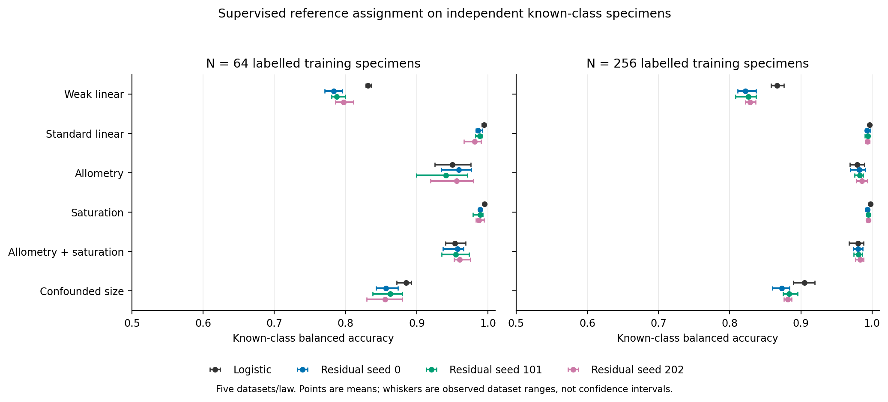
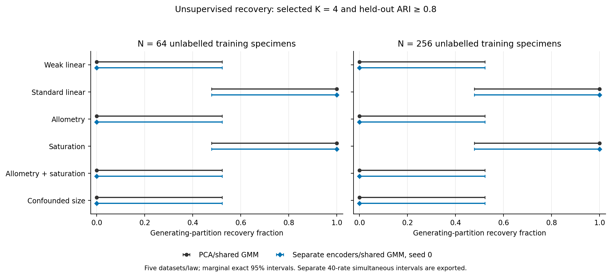

# Nonlinear benchmark and supervised residual classifier: results

The new residual network provides an opt-in supervised reference-assignment
workflow. This pilot found no consistent advantage over the fixed logistic
reference. It also exposed a useful distinction: allometric measurements remained
predictable when reference labels were supplied, while the existing unsupervised
PCA/shared-GMM and separate-encoder/shared-GMM pipelines did not recover the four
generating groups to the specified criterion. These are different learning tasks;
the classifier is not an automatic species-discovery method.

The [model interface](residual-reference.md) and
[frozen protocol](residual-nonlinear.md) preserve old models, defaults, p-values
and empirical evidence gates. No empirical specimens were fitted or authors
contacted. The measurement laws are illustrative, not empirically fitted biology.

## Independent known-class prediction

Each cell contains five independent training datasets. Each trained model predicts
2,048 additional balanced known-class specimens using frozen preprocessing and
parameters. Entries are mean balanced accuracy percentages across those five
datasets. The three residual seeds use the same observations; they are sensitivity
measurements, not independent dataset replicates.

| Measurement law | Training N | Logistic | Residual seeds 0 / 101 / 202 |
|---|---:|---:|---:|
| Weak linear | 64 | 83.2 | 78.3 / 78.7 / 79.7 |
| Weak linear | 256 | 86.6 | 82.2 / 82.6 / 82.9 |
| Standard linear | 64 | 99.4 | 98.6 / 98.9 / 98.1 |
| Standard linear | 256 | 99.6 | 99.3 / 99.4 / 99.4 |
| Allometry | 64 | 95.0 | 95.9 / 94.1 / 95.6 |
| Allometry | 256 | 97.9 | 98.2 / 98.2 / 98.6 |
| Saturation | 64 | 99.5 | 98.9 / 98.9 / 98.8 |
| Saturation | 256 | 99.7 | 99.4 / 99.5 / 99.4 |
| Allometry and saturation | 64 | 95.4 | 95.8 / 95.5 / 96.0 |
| Allometry and saturation | 256 | 98.0 | 98.0 / 98.1 / 98.3 |
| Confounded size | 64 | 88.5 | 85.7 / 86.3 / 85.5 |
| Confounded size | 256 | 90.5 | 87.3 / 88.4 / 88.1 |

None of the primary seed-zero fits achieved the prespecified gain of at least
five accuracy percentage points over logistic regression: each of the twelve
law/N cells has 0/5 such gains. This does not establish equivalence or a general
absence of neural benefit. For 0/5, the marginal exact 95% interval is 0–52.2%;
the interval adjusted across all forty primary rates is approximately 0–77.1%.
Continuous paired differences, ranges, log loss and Brier summaries are retained.

Points are dataset means; whiskers are observed dataset ranges, not confidence
intervals. Network objectives, labels used, capacity and compute differ: the
residual classifier has 4,772 trainable parameters, while the unchanged two
autoencoders together have 1,072. Logistic regression and the residual classifier
receive identical labels/raw features; the discovery arms receive no labels.
These comparisons do not isolate architecture from regularization/optimization.

## Discovery remains a separate problem

Recovery requires both selected K=4 and ARI>=0.8 on independent frozen-evaluation
specimens. The following counts are out of five requested datasets. Neural seed
zero is the prespecified primary; all three seeds remain in the public sensitivity
summaries, without selecting a winning seed.

| Measurement law | N=64: PCA / neural | N=256: PCA / neural |
|---|---:|---:|
| Weak linear | 0 / 0 | 0 / 0 |
| Standard linear | 5 / 5 | 5 / 5 |
| Allometry | 0 / 0 | 0 / 0 |
| Saturation | 5 / 5 | 5 / 5 |
| Allometry and saturation | 0 / 0 | 0 / 0 |
| Confounded size | 0 / 0 | 0 / 0 |

Allometry/combined cases sometimes selected four components, especially at N=256,
without adequate membership agreement. Zero strict recovery is therefore not
equivalent to never selecting K=4. No neural seed achieved strict recovery in
those allometry/combined cells. Strong supervised prediction shows reference-label
signal remains observable; it does not prove an unsupervised algorithm must find
the same partition. It also does not isolate representation loss from the shared
Gaussian head's assumptions or the absence of label information.

Whiskers are marginal exact 95% intervals across five independent datasets. The
separate forty-rate simultaneous intervals are in the exported data; a 5/5 rate
has simultaneous lower bound approximately 22.9%. No absolute BIC values are
compared across representation spaces.

## Nuisance shifts and unfamiliar classes

Removing the training association between body size and reference class reduced
known-class accuracy for both supervised methods:

| Training N | Logistic IID → shifted | Residual seed 0 IID → shifted |
|---|---:|---:|
| 64 | 88.5% → 61.6% | 85.7% → 60.5% |
| 256 | 90.5% → 65.7% | 87.3% → 64.6% |

The classifier is not automatically invariant to changed nuisance relationships.
This is one prespecified shift law; it does not establish general domain robustness
or identify a biologically appropriate correction for real measurements.

The held-out fifth-class stress puts underlying group-axis means at (+6,+6).
Neither classifier was trained to recognize an unknown class. Across the twelve
law/N cells, the primary residual network gave a maximum reference-class
probability above .9 to a mean 99.2–100% of unfamiliar individuals; logistic
regression gave 97.9–100%. These are cell-mean confidence fractions under this
specific stress, not novelty-detection rates. High softmax confidence does not
establish reference membership or species status. Prediction outputs explicitly
retain reference-only scope with novelty unassessed.

The fixed training-label-permutation controls produced residual known-class
accuracies of 25.0/28.8/28.2% at N=64 and 23.5/22.9/23.5% at N=256; logistic
accuracies were 10.2% and 10.9%. There are only two such observations. These are
descriptive negative controls, not tests establishing a chance error rate or
reference-label validity. Identity/label-access audits are separate evidence.

## Population controls and uncertainty

The primary PCA and neural seed-zero arms each selected one component in all
five Gaussian controls at each N. Neural seed 101 split one N=64 Gaussian
observation; the other sensitivity Gaussian cells had no splits. These point
selection diagnostics do not supersede the larger earlier Gaussian calibration
study and add no significance claim.

For the continuous gradient, PCA selected K=2 in one of five N=256 observations;
neural seed zero selected K=2 in one N=64 and two N=256 observations. Other
seeds differ and are retained. The gradient has no discrete generating partition;
its components are not species truths or Gaussian-null type-I errors.

Forty primary rates use exact marginal and separate Bonferroni simultaneous
95% intervals, requested denominators and unavailable-outcome bounds. Five
datasets/cell give broad uncertainty. Thousands of evaluation specimens make
conditional prediction estimates less noisy; they do not replace independent
training-dataset replication. No seed, architecture or default was promoted.

## Verification, preservation and scope

All 580 main workflows completed, including twelve exact archived point replays,
with zero failed fits or unknown work units. The separate 120-workflow preflight
also passed. Independent live NumPy checks verified all 408,000 actual optimizer
updates across 816 neural trainings. Audits checked all 1,584 GMM candidate
densities, raw laws, specimen joins, preprocessing, frozen projections, reference
labels, BIC/eligibility, probabilities and metrics. A separate checker recomputed
1,136 main external-cohort evaluations and all forty rates/intervals from retained
predictions using independent binomial inversion and contingency-table ARI.

All 439 preserved old source modules remain byte-identical to the preceding
checkpoint; only old CLI/version registration changed. The 458-file source and installed wheel
match, with Python 3.11 syntax and explicit package-allowlist checks. Local suites
passed 395 neural, 2,341 available scientific and 1,710 dependency-free tests; the
isolated installed-package fixture passed. Final closure requires all six exact-head
Python 3.11/3.12 CI jobs and before/after preservation/resource receipts.

The measured gate projected 1,234.66 serial main/audit seconds and 1,863,510,158
bytes, within ninety minutes and two GiB, with eight GiB free and at most two
single-thread workers. Engineering artifacts were retained in a checksum-verified
lossless archive. All random paths were predetermined by the source/settings
freeze; a subsequent audit materialized and verified 1,384 distinct paths. The
original pre-freeze invented N=16 fixture exposed the existing K-search size cap;
its failure was preserved and the engineering fixture corrected to N=32 before
scientific freezing. No scientific guard failed or settings changed after data.

The [public exports](../examples/residual-network/results/) contain cell aggregates,
all-seed sensitivities, primary rates and audit counts. Raw measurements, labels,
predictions, weights, individual results, complete CI logs and detailed evidence
remain local. The [export script](../examples/residual-network/report.py) and
[invented installation fixture](../examples/residual-network/smoke.py) are public.
No empirical fitting, new significance/stability draw or author contact occurred.
