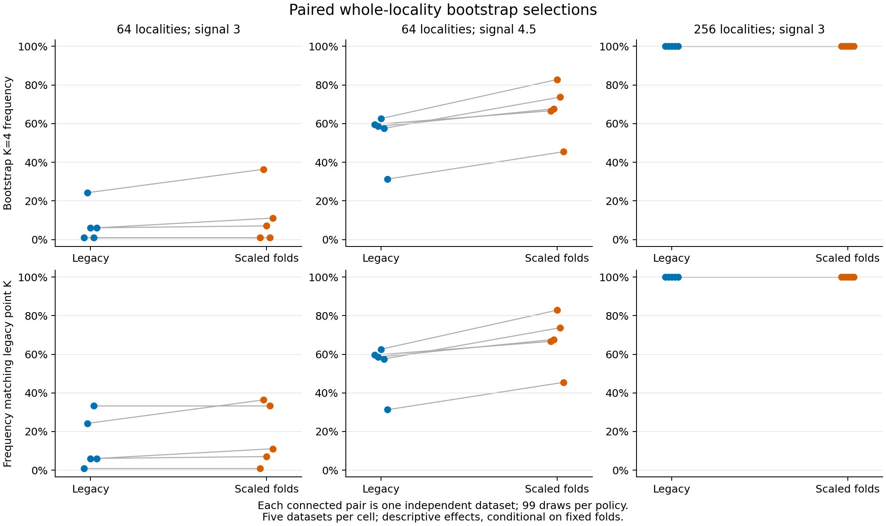

# Scaled fold-size stability: bounded paired validation

The opt-in scaled policy increased mean bootstrap K=4 selection at N=64 from 7.7% to 11.3% at signal 3, and from 53.9% to 67.3% at signal 4.5. Recovery at signal 3 remains weak. N=256 K=4 selection stayed at 100% under both policies, while assignment disagreement remained. Gaussian controls changed by one extra-component draw among 1,485 repeated draws; both policies selected extra components in 2/15 Gaussian point analyses. These are descriptive results from five independent datasets/cell, without a general performance or species guarantee.

## Design and evidence

The frozen study generated five independent raw datasets in each of eight cells. It compared the unchanged legacy rule with the explicitly prespecified `proportional_distinct` policy on the same raw inputs, original-ID folds and 99 whole-locality draws. It completed 48,000 candidate searches and 7,920 draw outcomes without failed or unattempted searches/draws. Ten archived point/first-two-draw observations added 180 exact legacy replay searches. A separate one-per-cell preflight completed 9,600 searches before the measured storage gate. No truth-initialized, extra-start, unique-support, significance or post-hoc tuning fits entered this checkpoint.

Each dataset has 1–4 morphology specimens/locality, one ecology row/locality, four continuous traits/view, group-mean morphology PCA, two PCs/view, four joint PCs and equal weights. The shared-covariance GMM retains K=1..4, full-data minimum five distinct original localities, ten starts, optimizer seed 71323 and all previous numerical settings. Only the optional fold threshold changes: `max(2, ceil(5*T/U))`, using distinct training/full sampling identities before fitting. The [protocol](scaled-fold-stability.md) defines the scope and API.

## Four-group recovery

Frequencies below average the five dataset-specific bootstrap frequencies equally. Parentheses give the range across those five datasets. The paired effect is scaled minus legacy, in percentage points. These ranges describe the observed datasets; they are not population confidence intervals.

| Localities; signal | Point K=4, legacy/scaled | Legacy bootstrap K=4, mean (range) | Scaled bootstrap K=4, mean (range) | Paired effect, mean (range), pp |
|---|---:|---:|---:|---:|
| 64; signal 3 | 4/5; 4/5 | 7.7% (1.0%–24.2%) | 11.3% (1.0%–36.4%) | +3.6 (+0.0 to +12.1) |
| 64; signal 4.5 | 5/5; 5/5 | 53.9% (31.3%–62.6%) | 67.3% (45.5%–82.8%) | +13.3 (+7.1 to +20.2) |
| 256; signal 3 | 5/5; 5/5 | 100.0% (100.0%–100.0%) | 100.0% (100.0%–100.0%) | +0.0 (+0.0 to +0.0) |

Each connected pair is one independently generated dataset; each endpoint uses 99 repeated draws. The upper row measures K=4 recovery. The lower row instead measures agreement with that dataset’s unchanged legacy point K. Matching a legacy point with K<4 is not recovery of four groups. No error bars imply independent bootstrap datasets.

## Assignments, reference choice and out-of-bag coverage

Own-point stability compares each policy’s draws with its own point partition. Common-reference stability compares both policies with the unchanged legacy point. The raw coassignment matrices, per-cluster exact recovery/cohesion/merging and failure bounds are independently audited; compact per-cluster summaries remain in the [public JSON](../examples/scaled-fold-stability/results/summary.json).

| Cell | Mean common-reference assignment changes, legacy/scaled | Mean own-point assignment changes, legacy/scaled | Mean all-original truth ARI, legacy/scaled | Mean OOB truth ARI, legacy/scaled | OOB pair coverage, legacy/scaled |
|---|---:|---:|---:|---:|---:|
| 64; signal 3 | 30.802; 29.582 | 30.802; 29.582 | 0.349; 0.368 | 0.348; 0.365 | 85.0%; 85.0% |
| 64; signal 4.5 | 14.564; 10.695 | 14.564; 10.695 | 0.750; 0.814 | 0.750; 0.814 | 84.1%; 84.1% |
| 256; signal 3 | 3.051; 3.051 | 3.051; 3.051 | 0.875; 0.875 | 0.873; 0.873 | 87.1%; 87.1% |
| Unequal-variance four-group stress | 14.349; 14.465 | 14.349; 18.174 | 0.204; 0.210 | 0.197; 0.202 | 83.6%; 83.6% |
| Continuous-cline stress | 4.028; 4.057 | 4.028; 4.057 | unavailable; unavailable | unavailable; unavailable | 86.4%; 86.4% |

Assignment changes use optimal label matching, with unmatched clusters counted as changes. All-original predictions include resubstitution; OOB truth ARI uses only unsampled localities and is an outcome diagnostic, not species support. OOB pair coverage is the fraction of original unordered pairs with at least ten successful both-OOB draws. Cohesion/merging use their declared covered-pair denominators; unsupported pairs are not set to zero.

Under unequal-variance stress, the scaled point selected K=4 in one dataset where the legacy point did not. Its mean own-point assignment changes increased from 14.349 to 18.174, while common-reference changes were 14.349 versus 14.465. This distinguishes a changed reference partition from improved stability and limits extrapolation beyond the declared shared-covariance setting. Continuous-cline data provide no discrete generating partition; their truth ARI remains unavailable.

## Gaussian controls and stress

| Gaussian control, N=64 | Point K>1, legacy/scaled | Mean bootstrap K>1, legacy/scaled |
|---|---:|---:|
| Independent Gaussian | 0/5; 0/5 | 1.2%; 1.2% |
| Correlated Gaussian | 1/5; 1/5 | 5.5%; 5.7% |
| Zero conditional covariance | 1/5; 1/5 | 2.4%; 2.4% |

Extra components in these controls describe overpartitioning of the declared simulated Gaussian populations. They are not significance rejections or species false-positive rates. Unequal-variance and continuous-cline cells assess misspecification, not discrete-species discovery; truth agreement under those laws must be read separately from conditional stability.

## Gate and numerical audits

| Cell | Legacy/scaled K=4 draws failing any fold eligibility | Legacy/scaled K=4 draws with nonpositive pooled gain | Legacy/scaled passing K=4 draws |
|---|---:|---:|---:|
| 64; signal 3 | 361; 290 | 96; 149 | 38; 56 |
| 64; signal 4.5 | 198; 123 | 30; 39 | 267; 333 |
| 256; signal 3 | 0; 0 | 0; 0 | 495; 495 |
| Unequal-variance four-group stress | 472; 450 | 20; 35 | 1; 5 |
| Continuous-cline stress | 495; 491 | 0; 3 | 0; 0 |

Each arm/cell has 495 draw outcomes. Gate counts overlap and do not form an additive causal decomposition. A candidate can pass every gate but lose the AIC ranking. The permitted candidate set cannot shrink when both workflows are available, but selection of K=4 need not increase.

The independent numerical audit verified every raw simulation, identity/count/draw, PCA transformation/projection, candidate density and covariance, size/eligibility rule, validation gain, selection, membership and stability denominator. All 24,000 paired full/fold searches had bitwise-identical scores and matching parameters for common candidates. The separate standard-library checker streamed and verified every archive/member byte and reconstructed identities, thresholds and gates. All 180 archived legacy searches reproduced their candidates, parameter arrays, held-out densities and memberships exactly. A separate export audit reconstructed all 80 dataset summaries, 16 cell summaries and 40 paired effects from retained evidence, including OOB masks/failure bounds and binomial tail equations.

## Scope, uncertainty and reproducibility

Five independent datasets/cell support descriptive paired effects only. The individual-dataset exact binomial intervals in the public JSON describe unadjusted conditional Monte Carlo precision for 99 draws given original folds and optimizer settings. They do not measure biological sampling uncertainty, simultaneous coverage or species probabilities. Point selection, own/common-reference stability, assignment recovery and OOB coverage answer different questions. No new p-values or generally valid correction is claimed.

The measured gate projected 4.93 GiB of retained evidence under the approved 6 GiB cap, with an 8 GiB free-space floor, 25% growth allowance and replay reserve. At most four one-thread workers ran. Detailed raw data, fitted arrays, fold predictions, draw identities and immutable archive manifests stay local. GitHub receives code, fixed settings, these compact aggregates and figures.

The fixed [study](../examples/scaled-fold-stability/study.json), [preflight](../examples/scaled-fold-stability/preflight.json), [policy](../examples/scaled-fold-stability/policy.json), [provenance](../examples/scaled-fold-stability/results/provenance.json), [cell summaries](../examples/scaled-fold-stability/results/cells.csv), [dataset-level paired effects](../examples/scaled-fold-stability/results/paired.csv), [paired cell ranges](../examples/scaled-fold-stability/results/paired_cells.csv) and checksums make the published analysis traceable. The reporting/plot scripts are under `scripts/`. Local verification passed 1,531 scientific tests and 983 foundation tests (103 optional skips), package/source integrity and an installed eight-cell smoke outside the checkout. The CI matrix retains Python 3.11 and 3.12.

The legacy policy remains the default. Full-data validation, historical p-values, earlier numerical-failure artifacts, inputs and prior checkouts are preserved. Choosing between policies after examining recovery would require a separate selection/calibration study; this checkpoint promotes no new default.
