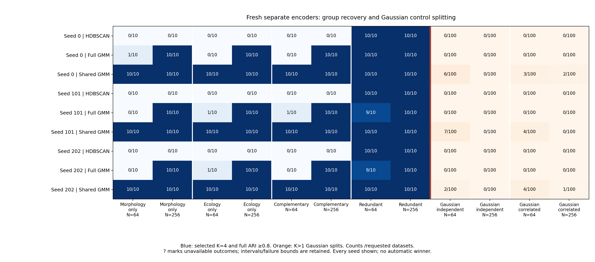

# Fresh separate-encoder/shared-GMM validation

The opt-in [model](separate-gmm.md) substantially improved recovery of the tested
standard four-group signals relative to HDBSCAN on the same learned coordinates.
This is a bounded simulation result, not a demonstrated neural advantage or a
species-boundary test. The [protocol](separate-gmm-study.md) fixed settings and
seeds before generating any fresh data. Existing defaults and p-values remain
unchanged, and no empirical data were fitted or researchers contacted.

## Standard signal recovery

Success requires selecting K=4 and adjusted Rand agreement (ARI) at least 0.8
with all generating labels. Unassigned HDBSCAN units count as distinct singleton
groups in this full-data agreement, with assignment coverage also reported.
Each entry below gives successes out of ten independent datasets. Seed order
is 0 / 101 / 202; these seeds reuse the same datasets and are not independent
replicates.

| Signal | N | Shared GMM | Full GMM | HDBSCAN |
|---|---:|---|---|---|
| Morphology only | 64 | 10 / 10 / 10 | 1 / 0 / 0 | 0 / 0 / 0 |
| Ecology only | 64 | 10 / 10 / 10 | 0 / 1 / 1 | 0 / 0 / 0 |
| Complementary views | 64 | 10 / 10 / 10 | 0 / 1 / 0 | 0 / 0 / 0 |
| Redundant views | 64 | 10 / 10 / 10 | 10 / 9 / 9 | 10 / 10 / 10 |
| Morphology only | 256 | 10 / 10 / 10 | 10 / 10 / 10 | 0 / 0 / 0 |
| Ecology only | 256 | 10 / 10 / 10 | 10 / 10 / 10 | 0 / 0 / 0 |
| Complementary views | 256 | 10 / 10 / 10 | 10 / 10 / 10 | 0 / 0 / 0 |
| Redundant views | 256 | 10 / 10 / 10 | 10 / 10 / 10 | 10 / 10 / 10 |

Ten successes out of ten still have a marginal exact 95% interval of 69.2–100%;
the interval adjusted across 108 primary rates is 43.3–100%. Every primary rate,
paired contrast and failure bound is retained in the public aggregates.

The per-view PCA/shared-GMM control also succeeded on all ten standard signal
datasets in each cell. Raw-trait shared GMM missed several signal configurations,
especially at N=64. These comparisons support the usefulness of the reduced
representation and clustering head under these laws; they do not establish
that neural training is required. BIC differences are compared only within
the same coordinate space and covariance family.

## Single-population controls

A K>1 selection here is a spurious-split diagnostic under a simulated Gaussian
law, not a significance rejection. There is no new p-value or calibrated species
test in this workflow. Each cell contains 100 independent datasets.

| Gaussian law | N | Shared-GMM splits, seeds 0 / 101 / 202 | Full-GMM splits | HDBSCAN splits |
|---|---:|---|---|---|
| Independent | 64 | 6 / 7 / 2 | 0 / 0 / 0 | 0 / 0 / 0 |
| Correlated | 64 | 3 / 4 / 4 | 0 / 0 / 0 | 0 / 0 / 0 |
| Independent | 256 | 0 / 0 / 0 | 0 / 0 / 0 | 0 / 0 / 0 |
| Correlated | 256 | 2 / 0 / 1 | 0 / 0 / 0 | 0 / 0 / 0 |

For example, 7/100 has a marginal exact 95% interval of 2.9–13.9% and a
108-rate simultaneous interval of 1.2–20.2%. The PCA/shared-GMM control split
5/100 independent and 2/100 correlated N=64 controls; the raw shared-GMM
reference split none in the four Gaussian cells. This does not isolate a single
cause of the learned-coordinate splits, nor justify selecting a seed after
seeing outcomes.

Blue cells show successful four-group recovery; orange cells show Gaussian
K>1 selections. Counts and denominators are printed separately because signal
and control cells have different sizes.

## Stress cases and resampling

Unequal-spread complementary groups remained difficult at N=64: shared-GMM
successes were 2/10, 1/10 and 1/10 across seeds. At N=256 they were 10/10, 9/10
and 9/10. Full GMM had no successful recoveries in either unequal-spread cell.
No neural head recovered the two generating curved-moons groups with ARI≥0.8
in either sample size. Shared covariance therefore addresses the standard
small-sample signal problem without resolving general geometry or variance
misspecification.

Ten matched 80% subsamples were fitted on one dataset per selected cell. For
complementary N=64 data, shared GMM selected K=4 in 10/10, 9/10 and 10/10 draws;
all N=256 complementary draws selected K=4. Morphology-only N=64 draws selected
K=4 in 7/10, 8/10 and 10/10; all N=256 draws selected K=4. Unequal-spread N=64
draws varied substantially. Gaussian independent-control draws all selected
K=1. These are conditional sensitivity checks on eight datasets, not independent
performance estimates or species support. Coassignment, inclusion coverage,
point-agreement and failed-draw bounds are exported separately.

## Verification and evidence

All 7,516 main and 568 preflight evaluations completed, with no failed fits.
The 520 fresh main datasets exclude the sixteen preflight datasets and twelve
exact archived point replays. All replay comparisons matched. Independent
audits checked all 3,960 branch trainings, 1,980,000 actual optimizer updates,
22,272 candidate densities, identity joins, frozen transforms and matched
subsample denominators. A separate report audit recomputed partitions, intervals,
paired contrasts and support matrices.

The measured gate projected 2.22 GiB of retained evidence and 112 minutes of
serial main execution plus audit, including its 25% allowance; both passed the
4 GiB/two-hour bounds without parallel speed credit. Actual summed main worker
execution plus independent main audit was approximately 78 minutes.

The [public cell summaries](../examples/separate-gmm/results/summary.json),
[primary rates](../examples/separate-gmm/results/primary-rates.json),
[paired contrasts](../examples/separate-gmm/results/paired-comparisons.json),
[candidate summaries](../examples/separate-gmm/results/candidate-groups.json)
and [stability summaries](../examples/separate-gmm/results/stability-groups.json)
contain no individual datasets, assignments or network weights. Full numerical
evidence is retained locally under `separate-gmm-20261106`. Python 3.11/3.12
tests, installed-package checks and exact published-head CI are required to
close the checkpoint.

This workflow supports complete continuous morphology and individually measured
ecology from the same individuals. Genomics, shape, grouped sampling, missing
views, missing traits and significance calibration are outside this adapter.
Membership probabilities condition on the fitted mixture; they are neither
species probabilities nor resampling stability.
