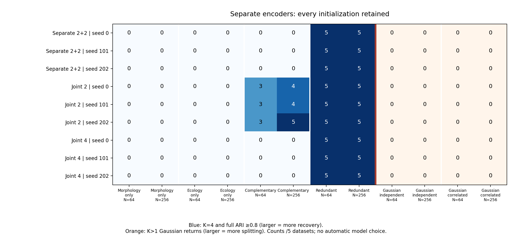

# Separate-encoder matched morphology/ecology comparison

This bounded synthetic pilot adds an opt-in pair of ordinary autoencoders, one per view,
followed by HDBSCAN on four concatenated standardized coordinates. It preserves the
existing joint encoders, default settings, schemas and p-values. No empirical data or
species labels were fitted, and nobody was contacted.

The separate encoders recovered the redundant four-group signal in all tested
initializations but did not recover complementary four groups, one-view signal with an
uninformative partner, or moons under the frozen density settings. The joint-four and
per-view PCA controls also missed complementary groups; the unchanged joint-two model
met the recovery endpoint in 3/5 datasets per seed at N=64 and 4/5, 4/5 and 5/5 at
N=256. Retaining four coordinates therefore did not improve recovery in this pilot.
These outcomes do not support a new default. The nine integrative neural arms returned no K>1 Gaussian splits in these small control
cells. The single-view morphology reference at seed 202 split 1/5 correlated Gaussian
datasets at N=256. These descriptive counts do not establish a calibrated false-positive
guarantee.

## Completed execution and audits

The 80 fresh main datasets produced 1,480 requested workflows, including 108 matched 80%
subsampling refits and twelve archived joint-two point replays. The separate preflight
completed 380 workflows. Main point failures: 0; requested native-refit failures: 0. No
scientific numerical or resource guard failed. The two phases comprised 2,028 neural
trainings, with 1,014,000 actual optimizer updates independently checked. All 480 main
and 96 preflight branch/standalone comparisons passed exactly. All twelve legacy
initial/final weights, losses, scores, labels and strengths replayed exactly.

The frozen resource projection was 1.33 GiB and 46.5 serial minutes including a 25%
allowance, below the approved 2 GiB/one-hour gates without parallel speed credit. Main
execution used two one-thread workers and took 18.6 wall minutes; the independent post-
run audit took 35.2 seconds. Detailed evidence remains local.

The comparison freezes seventeen arms: separate, joint-two and benchmark-only joint-four
encoders at seeds 0/101/202; six single-view neural references; a four-coordinate per-
view PCA/HDBSCAN control; and the unchanged integrative PCA/GMM baseline. Inputs contain
four morphology and eight ecology traits from matched individuals, at N=64 or 256.
Labels enter evaluation after fitting.

## All-seed primary outcomes

Each entry gives counts out of **five independent datasets**, in seed order
**0/101/202**. The first four laws count K=4 with full adjusted Rand agreement at least
0.8. The Gaussian laws instead count K>1 returns, where larger counts mean more
splitting. Noise units enter full agreement as distinct unresolved singletons. The two
types of endpoint should not be combined into one score.

| Law | N | Separate 2+2 | Joint 2 | Joint 4 |
|---|---:|---:|---:|---:|
| morphology only | 64 | 0/0/0 | 0/0/0 | 0/0/0 |
| morphology only | 256 | 0/0/0 | 0/0/0 | 0/0/0 |
| ecology only | 64 | 0/0/0 | 0/0/0 | 0/0/0 |
| ecology only | 256 | 0/0/0 | 0/0/0 | 0/0/0 |
| four complementary | 64 | 0/0/0 | 3/3/3 | 0/0/0 |
| four complementary | 256 | 0/0/0 | 4/4/5 | 0/0/0 |
| four redundant | 64 | 5/5/5 | 5/5/5 | 5/5/5 |
| four redundant | 256 | 5/5/5 | 5/5/5 | 5/5/5 |
| gaussian independent | 64 | 0/0/0 | 0/0/0 | 0/0/0 |
| gaussian independent | 256 | 0/0/0 | 0/0/0 | 0/0/0 |
| gaussian correlated | 64 | 0/0/0 | 0/0/0 | 0/0/0 |
| gaussian correlated | 256 | 0/0/0 | 0/0/0 | 0/0/0 |

The aggregate exports retain all 272 cell/arm groups, 108 primary rates and 72 within-
seed paired contrasts. Marginal and Bonferroni simultaneous intervals, all-request
failure bounds, coverage, selected K, full/assigned agreement, reconstruction, axis
retention, rank, parameter counts and workflow times remain available. Five independent
observations per cell make this a descriptive pilot; seeds are repeated measurements,
not additional datasets.

## Dimension, capacity and reference controls

Counts below are again out of five. These controls are prespecified comparisons,
not alternate settings selected after seeing outcomes.

| Law | N | Per-view PCA 2+2 | Integrative GMM |
|---|---:|---:|---:|
| morphology only | 64 | 0 | 0 |
| morphology only | 256 | 0 | 0 |
| ecology only | 64 | 0 | 0 |
| ecology only | 256 | 0 | 0 |
| four complementary | 64 | 0 | 3 |
| four complementary | 256 | 0 | 5 |
| four redundant | 64 | 5 | 5 |
| four redundant | 256 | 5 | 5 |
| gaussian independent | 64 | 0 | 0 |
| gaussian independent | 256 | 0 | 0 |
| gaussian correlated | 64 | 0 | 1 |
| gaussian correlated | 256 | 0 | 0 |

For the declared 4/8-feature inputs, parameter counts are separate: 1,072, joint2: 734,
joint4: 768. Separate encoders perform two 500-update trainings; each joint encoder
performs one. Four-coordinate controls address dimension retention but do not equalize
parameters, optimization effort or all geometric effects. The comparisons cannot
attribute every difference solely to architecture. No absolute BIC is compared across
different score spaces.

## Stress and native sensitivity

Discordant view partitions have no imposed common truth. Their exports report
agreement with each view separately. Moons are two curved generating groups,
used as a secondary geometric stress test rather than a tuning target.

| N | Moons separate 2+2 | Moons joint 2 | Moons joint 4 |
|---:|---:|---:|---:|
| 64 | 0/0/0 | 0/0/0 | 0/0/0 |
| 256 | 0/0/0 | 0/0/0 | 0/0/0 |

The 36 native-sensitivity summaries retain three matched subsamples for each neural arm
on four designated observations. Both branches refit all preprocessing on the same
whole-unit subsets. Inclusion counts, noise, failures, own-point agreement, truth
agreement and coassignment retain their separate denominators. Three repeated subsamples
on four observations are illustrative sensitivity, not population-level performance
estimates or species probabilities.

## Interpretation boundary

No seed, family, dimension or default is promoted. Gaussian splitting is an uncalibrated
clustering behavior, not a formal false-positive probability. Recovery against simulated
labels does not establish empirical species boundaries. Missing, grouped, unmatched,
genomic and shape neural adapters remain outside this checkpoint. Existing empirical
sampling/reference-evidence gates remain closed.

The [prespecified design](separate-neural-study.md), [API/input contract](separate-
neural.md) and [small aggregate exports](../examples/separate-
neural/results/summary.json) provide the configuration and audit context. Full inputs,
weights, optimizer traces and individual assignments were kept local and were not sent
to GitHub.
