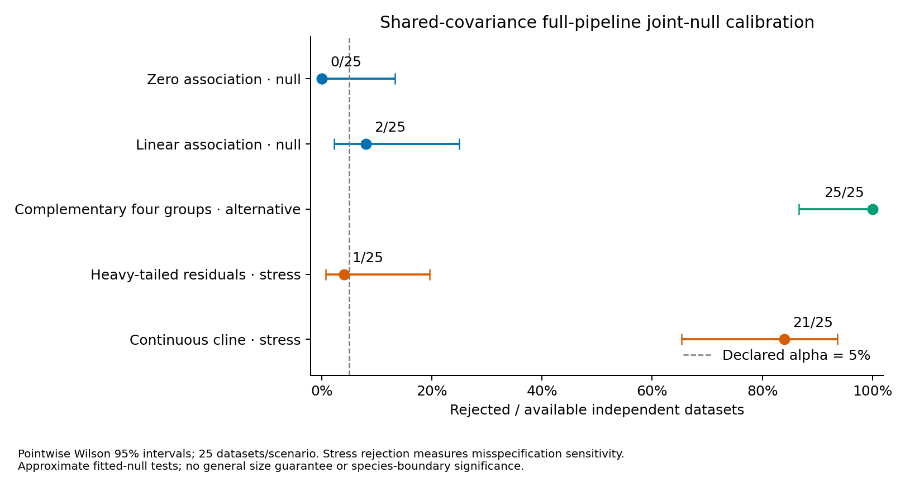

# Completed shared-covariance full-pipeline calibration

The frozen study completed **125/125 fresh observed datasets** and
**12,500/12,500 successful pipeline fits**, with **0 failed**, **0 unattempted**
and no replacement observations or draws. Settings and seeds were frozen before
fresh generation; the covariance family, PCs, weights, predictors and K search
were never tuned against results. Existing full-family results are preserved.

The [method](shared-covariance-calibration.md) enables a prespecified shared
covariance statistic within the existing matched genomic–phenotypic empirical
null. Each observation fits independent empirical genotype-block distributions
and Gaussian phenotype regression on four declared raw block means, before PCA.
Each of its 99 draws regenerates raw PHYLIP/CSV inputs and refits SNPio ingestion,
filtering/scaling, all view PCAs, fusion, joint PCA and the entire shared-GMM
K=1..4 search. Raw fitted parameters remain fixed within the draw bank;
preprocessing and score parameters are re-estimated for every draw.

## Departures and selected component counts

| Generating scenario | Rejected / available | Pointwise Wilson 95% interval | Selected K counts |
| --- | ---: | ---: | --- |
| Zero association (joint-law null) | 0/25 | 0.0–13.3% | K=1: 25 |
| Linear association (joint-law null) | 2/25 | 2.2–25.0% | K=1: 23, K=2: 1, K=3: 1 |
| Complementary four groups | 25/25 | 86.7–100.0% | K=2: 12, K=4: 13 |
| Heavy-tailed residual stress | 1/25 | 0.7–19.5% | K=1: 24, K=3: 1 |
| Continuous-cline stress | 21/25 | 65.3–93.6% | K=1: 4, K=2: 13, K=3: 6, K=4: 2 |

Only the first two rows check the declared joint null. Zero rejections out of
25 still allows a rate as high as 13.3% within its pointwise interval; the
linear-association interval spans 2.2–25.0%. These results provide **no general
5% size guarantee**. No simultaneous or multiplicity-adjusted intervals are
claimed. The constructed alternative is strong and its four generating groups
coincide with the fixed K ceiling.

All alternatives rejected, while the selected mixture had K=4 in 13/25 cases
and K=2 in 12/25. Departure detection does not establish correct group-number
or partition recovery. Selecting four components alone does not verify the
four-group generating partition. Earlier full-family and shared-recovery studies
use different observations: those historical comparisons are **unpaired** and
cannot isolate a covariance-family effect in this fresh significance study.

The continuous cline rejected in 21/25 observations despite having no discrete
generating groups. These are joint-law misspecification detections, not species
boundaries. Heavy tails rejected in 1/25; low sensitivity of this statistic does
not validate Gaussian residuals or establish robustness to other departures.
The full-covariance default remains unchanged. Shared-family shape, grouped,
continuous-only and known-reference significance workflows remain disabled.

## Uncertainty and interpretation

P-values are **approximate fitted-model bootstrap tails**, not exact
exchangeable-rank tests: unknown profile probabilities, regression coefficients
and residual covariance are estimated from each observation. T is the BIC gain
over K=1 across the entire fixed shared-family search. Ties enter the upper tail;
B=99 gives p=(1+exceedances)/100, minimum 0.01, with rejection at p<=0.05.
An atom at T=0/p=1 is expected when K=1 wins.

The public [per-test diagnostics](../examples/shared-calibration/results/diagnostics.csv)
retain exceedances and conditional Clopper–Pearson 95% tail intervals. These
measure Monte Carlo variation conditional on the fitted law and observed T,
excluding profile-support, regression, covariance, block-map and model uncertainty.
They are distinct from rejection-rate intervals across independent observations.
Sparse empirical block support, residual Gaussianity, unrelated specimens,
independent blocks and individually measured ecological traits are substantive
assumptions. This validation does not infer their truth in empirical data.

Any requested failed draw would withhold the primary p-value, decision and
interval. Failure-outcome bounds and attempt ledgers remain available; they are
not confidence intervals. Injected observed/draw failures test this behavior
for both families without replacements. Stability stays separate and was not
rerun here. There is no selected-K, per-cluster or species-boundary significance.
Choosing a covariance family/configuration after inspecting results is outside
this calibration.

## Reproducibility and independent audit

- Fresh master seed 20261031; model seed 71323; N=64, 128 loci in 16 eight-SNP
  blocks, first four predictor blocks, four traits per phenotype view, two PCs
  per view/jointly, equal weights, minimum cluster size 5 and 10 EM starts.
  All 125 observed seeds and 12,375 null-data seeds are distinct with no overlap.
- At most four concurrent one-thread case jobs. An independent full-settings
  preflight used seed 20261101, five observations and two draws/test; all 15
  fits and its audit passed, supplying no replacement main observations.
- Frozen wheel version 0.24.0.dev0, Python 3.12.10, NumPy 2.2.6, SciPy 1.15.3,
  scikit-learn 1.6.1 and SNPio 1.7.7. Python 3.11/3.12 CI is recorded on the PR.
  All 115 package source modules match the frozen runtime.
- The read-only audit verified **624,000 archive members**,
  **16,140 study files** and **12,500 selected pipeline results**.
  It regenerated observations, every raw draw and block donor matrix, checked
  profile MLE counts/ordered likelihoods and independently verified regression
  coefficients/residual covariance by QR and dense Gaussian likelihoods.
- Raw identities, hashes, fusion/projection, selected mixture likelihood/BIC,
  shared-matrix equality, membership, K-selection bookkeeping, seeds, tails,
  intervals and denominators were checked without clustering refits. View PCA
  and nonselected candidate likelihoods were retained/checksummed,
  not independently refitted.
- The supplied checkout, five downloaded TPS files, previous 16,140 joint-study
  files and 15,352 recovery-study files, plus the original external cleanup
  archive, were verified and preserved. No personal datasets/filenames are added.

Full raw data, donor provenance, fitted parameters, per-draw archives, failure
ledgers, inventories and immutable wheel remain local under artifact identifier
`shared-null-20261022`. This is local preservation, not public raw deposition or
a self-contained environment image. [Portable evidence](../examples/shared-calibration/results/)
contains settings, source/version hashes, execution metadata and per-observation
results. Simulated generating labels are not empirical species ground truth.

Reproduce the portable tables and PDF/SVG/PNG figure with
`python scripts/report_shared_calibration.py /path/to/artifact-root --output-dir /path/to/new-results --figure-dir /path/to/new-figures`.
The figure displays pointwise uncertainty; it supplies no general size guarantee
or species-boundary significance.
