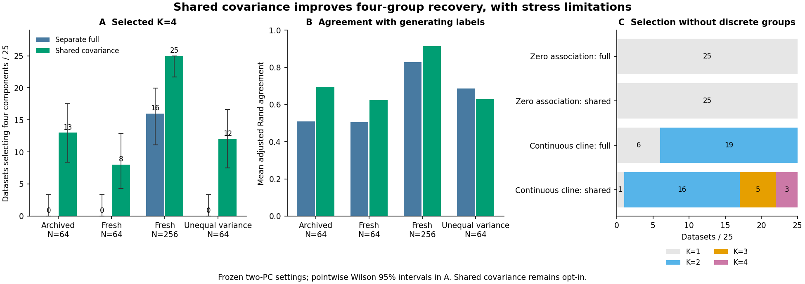

# Shared-covariance integrative clustering: completed validation

The opt-in shared-covariance model improved four-group recovery in the
prespecified complementary simulations. In fresh N=64 observations it selected
K=4 in **8/25 datasets versus 0/25** for the original full-covariance model; at
N=256 the comparison was **25/25 versus 16/25**. The N=64 median ARI remained
0.488, so this is a partial improvement rather than reliable recovery of every
small dataset. Unequal-variance and continuous-cline stress results justify
retaining the original full-covariance default.

All **300/300 point workflows** and **500/500 unit-bootstrap refits** succeeded,
with zero failed, unattempted or replacement fits. The **25/25 archived
full-covariance baselines reproduced** their previous scores, labels, candidate
constraints, BIC values and selected K. The independent audit verified **15,352
study files**, including raw identities, numerical point fits and reconstructed
stability accounting. No significance tests were rerun. Full evidence remains
under artifact identifier `shared-covariance-20261022`; portable tables and
fingerprints are in `examples/shared-covariance/results/`.

Figure: (A) Selection of four components, with pointwise 95% Wilson intervals.
(B) Mean ARI against the four generating groups. (C) Selected component counts
under zero association and a continuous cline. No discrete generating partition
is assigned to the cline. All comparisons retain the same two-PC representation,
weights, seeds and GMM search controls; only the covariance family changes.

## Frozen design and provenance

Six cohorts each contain 25 observations: archived four-group N=64, fresh
four-group N=64, fresh four-group N=256, zero-association N=64, unequal-variance
four-group N=64 and continuous-cline N=64. Both families fit each observation.
Fresh data use master seed 20261030 and separate cohort streams. Thus fresh
observations differ from the earlier diagnostic's fresh cohorts; the valid
comparisons here are paired within the current study, not comparisons with
the earlier fresh-data recovery counts.

The unequal-variance stress multiplies phenotype residual SDs by the frozen
factors 0.5, 0.8, 1.2 and 1.8 across generating groups. All other generation
follows the existing raw genomic–phenotypic law. Each workflow reruns SNPio
ingestion, preprocessing, two PCs per view, equal-weight fusion, two joint PCs,
and K=1..4 GMM selection with minimum size five, ten starts, seed 71323,
500 maximum EM iterations, tolerance 0.001 and regularization 1e-6. Paired
families' joint score arrays match exactly. Truth remains an evaluation input.

Only the first five fresh four-group observations at each sample size receive
25 stability draws per family. These ten observations and paired bootstrap
streams were prescribed before fresh generation. The complete main study ran
once from a frozen 0.23.0.dev0 wheel on Python 3.12.10, NumPy 2.2.6, SciPy 1.15.3,
scikit-learn 1.6.1 and SNPio 1.7.7, with four single-thread worker processes.
Python 3.11/3.12 software checks use separate small smoke studies, rather than
rerunning the main scientific campaign.

## Group recovery

| Four-group cohort | Full: K=4 / 25 | Shared: K=4 / 25 | Full mean / median ARI | Shared mean / median ARI |
| --- | --- | --- | --- | --- |
| Archived N=64 | 0 | 13 | 0.509 / 0.488 | 0.694 / 0.800 |
| Fresh N=64 | 0 | 8 | 0.505 / 0.488 | 0.624 / 0.488 |
| Fresh N=256 | 16 | 25 | 0.828 / 0.891 | 0.913 / 0.919 |
| Unequal-variance N=64 | 0 | 12 | 0.687 / 0.704 | 0.628 / 0.529 |

For the shared model, pointwise 95% Wilson intervals for K=4 selection are
**33.5–70.0%** archived N=64, **17.2–51.6%** fresh N=64, **86.7–100%** fresh
N=256 and **30.0–66.5%** unequal-variance N=64. The full model's fresh N=256
interval is 44.5–79.8%; its three zero-event intervals extend to 13.3%.
These are descriptive binomial simulation intervals, unadjusted across the
prespecified cases. They are not bootstrap support, species significance or
guarantees about empirical populations.

The paired mean ARI changes were +0.1856 archived N=64, +0.1190 fresh N=64,
+0.0853 fresh N=256 and -0.0587 unequal-variance N=64. For fresh N=64, ARI
improved in eight observations, worsened in one and was unchanged in 16.
For fresh N=256, it improved in 18 and worsened in seven. Thus selecting K=4
more often does not imply improving every partition, even in the complementary
cohort. Under unequal variances, 12 improve and 12 worsen; larger losses produce
a lower mean despite a zero median paired change.

Full/shared K=1/2/3/4 counts are **0/22/3/0 versus 0/12/0/13** for the archived
cohort, **0/23/2/0 versus 0/17/0/8** for fresh N=64, **0/0/9/16 versus 0/0/0/25**
for fresh N=256, and **0/2/23/0 versus 0/6/7/12** under unequal variances.

## Mechanism and scope of the improvement

The shared model estimates one correlated within-component covariance matrix
instead of one per component. In two score dimensions, K=2/4 require 8/14
parameters, compared with 11/23 for separate full covariances. The extra BIC
penalty for four versus two components at N=64 therefore falls from **49.9066
to 24.9533**. In the archived observations, median twice-log-likelihood gain
for K=4 over K=2 is **34.5571** with full covariance and **25.4314** with shared
covariance. The restricted family gains less likelihood but pays a smaller
model-order penalty. PCA information retention is unchanged in each pair.

These calculations compare models within the same fixed score space. There
is no weighting adjustment, change in PC counts, forced K, truth initialization
or automatic cross-family selection. The result supports this particular
complexity restriction for some small-sample observations, without establishing
it as the best general model.

## Stress behavior

Both families select K=1 in all 25 zero-association observations. This limited
check gives a 0–13.3% Wilson interval for selecting more than one component;
it is not a significance-calibration or universal false-positive guarantee.

For the continuous cline, full covariance selects K=1/2/3/4 in **6/19/0/0**
observations; shared covariance selects **1/16/5/3**. Consequently, more-than-one
component selection rises from 19/25 to 24/25, even though the generating law
contains continuous structure without discrete groups. Those counts describe
mixture approximation behavior, not species discovery or a formal rejection
rate. ARI is deliberately undefined for this cohort.

Unequal-variance stress is a direct warning about the new assumption. Although
shared covariance selects four components more often, its median ARI falls
from 0.704 to 0.529 and mean ARI from 0.687 to 0.628. Correct component count
alone is inadequate validation. The model remains opt-in; neither the default
nor any empirical species-boundary claim changes.

## Bootstrap stability

All 500 requested draws completed. Per observation, exact-set recovery frequency
is averaged over its selected point clusters, then summarized across the five
observations per sample size. These frequencies concern each model's selected
partition, rather than the generating groups, so their targets can differ.

| Cohort / family | Mean frequency across observations | Median | Range |
| --- | --- | --- | --- |
| Fresh N=64, full | 0.641 | 0.667 | 0.540–0.760 |
| Fresh N=64, shared | 0.508 | 0.440 | 0.160–0.940 |
| Fresh N=256, full | 0.237 | 0.300 | 0.020–0.427 |
| Fresh N=256, shared | 0.444 | 0.600 | 0.120–0.600 |

Improved mean partition agreement did not produce uniformly higher stability.
Exact recovery of a complete unit set is stringent, especially for large
clusters, and only five observations per sample size were evaluated. In-bag
coassignment and pair-specific OOB matrices are retained, with their original
requested/successful denominators. Their audit reconstructed every sampled
index, seed, partition count and exact-set frequency. Failure-withholding and
identification bounds were also tested with injected failures; no failed main
draw was replaced. These supports are not p-values or confidence intervals.

## Audit and repository checkpoint

The read-only audit regenerated raw inputs, identities and labels; verified
file inventories, settings, seeds, paired scores and archived baseline replay;
reconstructed fusion and PCA projection; evaluated selected mixtures' dense
likelihoods/BIC/memberships with independent parameter counts; checked shared
covariance equality; independently computed ARI/axis recovery; and rebuilt
bootstrap K-selection, distinct-unit constraints, partitions, coassignment,
exact-set counts, OOB denominators and failure bounds. It performed no model
refits. View PCA fits and nonselected/bootstrap component likelihoods were
**not independently refitted**; preserved candidate diagnostics remain the
evidence for those fits. Convergence does not establish a global optimum.

Before cleanup, a private external archive verified **5,353 files/symlinks**,
including the original Git index/stashes and untracked/ignored data. Its archive
size is 418,556,994 bytes. **83 obsolete tracked files** were removed from the
active tree, along with local personal datasets and generated caches; authorship,
copyright credits, citations and published scientific evidence remain. Git
history was retained. No private archive paths or personal dataset inventories
are published. See [repository layout](repository-layout.md).

The draft targets GitHub `master`, which contained only the foundation when
this checkpoint began, and therefore also brings the complete implementation
through the preceding diagnostic into the default-branch review. The supplied
directory is synchronized to the published draft head after verification.

Full covariance remains the default. Existing p-values remain unchanged, and
current significance workflows reject the unvalidated shared family explicitly.
This checkpoint provides a tested optional improvement with observed stress
limitations. Shared-family significance calibration, broader biological
benchmarks and any future default change remain separate work.
