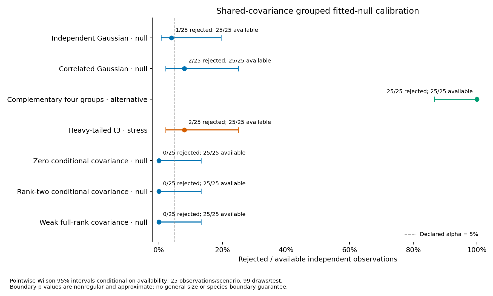

# Completed shared-covariance grouped calibration

The frozen fresh study generated **175 observations** and completed
**175/175 available tests** with **17,500/17,500 successful pipeline fits**,
**0 failed fits** and **0 unattempted fits**.
No observation or draw was replaced, retried, repaired or selected after results;
no settings or solver budgets were tuned. Existing full-family results remain intact.

The [method](shared-grouped-calibration.md) reuses the unchanged schema-2
conditional-PSD raw Gaussian estimator with a **prespecified shared-covariance
GMM statistic**. Raw between-group and within-specimen covariances remain distinct
from the score-space mixture covariance. Each observed test fits its own raw null,
holds fitted parameters/counts fixed, regenerates raw morphology/ecology for 99
draws and refits the complete point pipeline. Stability stays separate.

## Departures, availability and selected component counts

| Generating scenario | Available / requested | Rejected / available | Pointwise Wilson 95% interval | Selected K counts |
| --- | ---: | ---: | --- | --- |
| Independent Gaussian · null | 25/25 | 1/25 | 0.7–19.5% | K=1: 24, K=2: 1 |
| Correlated Gaussian · null | 25/25 | 2/25 | 2.2–25.0% | K=1: 23, K=2: 2 |
| Complementary four groups · alternative | 25/25 | 25/25 | 86.7–100.0% | K=2: 24, K=4: 1 |
| Heavy-tailed t3 · stress | 25/25 | 2/25 | 2.2–25.0% | K=1: 23, K=2: 2 |
| Zero conditional covariance · null | 25/25 | 0/25 | 0.0–13.3% | K=1: 25 |
| Rank-two conditional covariance · null | 25/25 | 0/25 | 0.0–13.3% | K=1: 25 |
| Weak full-rank covariance · null | 25/25 | 0/25 | 0.0–13.3% | K=1: 24, K=2: 1 |

Only the five Gaussian null scenarios check the declared raw law; the
complementary scenario is a constructed alternative and heavy tails are a
misspecification stress without generating groups. These 25-observation case
sizes provide **no general 5% size guarantee**, including no uniform validity
at or near covariance boundaries. Zero observed rejections would still have a
pointwise upper bound of 13.3%. Intervals are unadjusted across seven scenarios.

All rates weight independent observations equally. They are conditional on test
availability; all-requested withheld-outcome bounds remain in the public summary
and are not confidence intervals. Conditional per-test Monte Carlo intervals
are a different quantity. A zero plug-in MCSE does not imply zero uncertainty.
An atom at T=0/p=1 is expected when K=1 wins. No configuration was chosen to
improve these rates or component counts.

Departure detection is not recovery of the generating number or partition.
The strong alternative's K ceiling equals its four generating groups; the
selected-K counts above are descriptive and supply no selected-K significance.
Heavy-tail rejection does not identify species boundaries; low rejection would
not validate Gaussianity or establish broad robustness. Neither rejection nor
non-rejection establishes species number or individual membership confidence.
Historical full-family studies use different observations, so comparisons are
**unpaired** and do not isolate a covariance-family effect.

## Raw covariance and unequal-sampling diagnostics

| Scenario | Estimated rank 0 | Rank 1 | Rank 2 | Rank 3 | Rank 4 |
| --- | ---: | ---: | ---: | ---: | ---: |
| Independent Gaussian · null | 0 | 0 | 0 | 0 | 25 |
| Correlated Gaussian · null | 0 | 0 | 2 | 10 | 13 |
| Complementary four groups · alternative | 0 | 0 | 0 | 9 | 16 |
| Heavy-tailed t3 · stress | 0 | 0 | 0 | 16 | 9 |
| Zero conditional covariance · null | 0 | 7 | 15 | 3 | 0 |
| Rank-two conditional covariance · null | 0 | 0 | 12 | 12 | 1 |
| Weak full-rank covariance · null | 0 | 0 | 9 | 16 | 0 |

Rank concerns conditional between-group morphology covariance after accounting
for ecology, not clusters/species. The table includes accepted raw fits, even
if a later point/draw failed. Finite-sample estimated rank need not equal the
generating rank. **175 accepted raw fits** retain diagnostics; the largest
selected standardized optimality residual was **1.506e-06**, below 1e-5.
All accepted fits pass positive-definite ecology/within-morphology guards and
PSD covariance-cone stationarity. Best accepted numerical likelihood and
stationarity do not certify a global optimum.

Each observation has 64 groups and one ecology vector/group, with 1–4 morphology
specimens per group. Total observed morphology rows ranged from **134 to
189**. Counts, specimen/group links and source identities are preserved in
every draw; ecology is never replicated onto specimens as independent evidence.
The [per-observation diagnostics](../examples/shared-grouped-calibration/results/diagnostics.csv)
retain counts by sample size, specimen/ecology totals, fitted rank, accepted
starts, selected start, likelihood, optimality, exceedances, conditional tail
intervals and failed-outcome bounds.

The raw null assumes independent Gaussian groups, non-informative fixed counts,
and iid Gaussian morphology residuals with one shared within-group covariance.
It does not handle informative sampling, related/spatial groups, heterogeneous
residual covariance, missingness, counts, shapes or genomic inputs. One ecology
measurement per group does not identify a separate ecology measurement-error
component. Empirical assumptions are declarations, not conclusions of this study.

## Uncertainty, failures and scope

P-values are **approximate fitted-model departures**. Boundary fits are
**nonregular**: fitting nuisance parameters and using plus-one tails provide
neither exact exchangeable-rank inference nor a uniform size guarantee. The
global statistic includes the entire fixed shared-GMM K search:
`T=BIC(K=1)-min_eligible BIC(K=1..4)`. With B=99,
`p=(1+count(T_draw >= T_observed))/100`; ties enter the upper tail, minimum p is
0.01 and alpha=0.05 uses p<=alpha. Shared covariance is counted once in BIC.

Conditional Clopper–Pearson intervals quantify draw variation given observed T,
fitted parameters and fixed counts. They exclude null-estimation, numerical
solution and model/sampling-assumption uncertainty; they are not confidence
intervals for species. Requested failed draws withhold the primary p-value,
decision and interval; failed points leave draws unattempted. Failure bounds and
attempt/error ledgers remain retained without replacement draws. Injected
point/draw, unresolved-null and archive failures test this behavior.

The full-covariance default and legacy schema-1 scope remain unchanged. Shared
covariance must be chosen before analysis; selection across families, PCs,
weights or features is outside calibration. No new raw estimator, variance
floor, ridge, adaptive restart, sampling law or default is introduced. Stability,
cluster-specific support and species-boundary tests remain separate.

## Reproducibility, audit and preservation

- Fresh master seed 20261102 and model seed 71323; 25 observations/case, 64 groups,
  four traits/view, two PCs/view and jointly, equal weights, K=1..4, minimum size
  5, 10 EM starts, 99 draws and alpha=0.05. All generating laws and bounded
  schema-2 solver settings match the existing boundary workflow.
- At most four one-thread case jobs. A separate full-settings preflight with
  master seed 20261103 completed **21/21 fits and its independent audit**; it
  supplied no replacement main observations.
- Frozen wheel 0.25.0.dev0 used Python 3.12.10, NumPy 2.2.6, SciPy 1.15.3,
  scikit-learn 1.6.1 and threadpoolctl 3.6.0. All 115 package source modules match
  the frozen runtime. Python 3.11/3.12 final CI is recorded on the draft PR.
- The no-refit audit verified **541,975 archive members**,
  **20,671 study files** and **17,500 successful pipelines**.
  It regenerated observations/raw draws; independently checked dense raw
  likelihoods, constrained covariance scores, ranks and factors; and verified
  counts/identities, fusion/projection, selected mixture likelihood/BIC/membership,
  shared-matrix equality, K selection, seeds, tails, intervals and denominators.
  View PCA and nonselected likelihoods were retained/checksummed,
  not independently refitted. Outer failures retain attempt/error accounting
  rather than a complete numerical audit of their partial artifacts.
- Both clustering families produce identical fitted raw laws and same-seed raw
  draws in regression tests. Tests also cover population/locality targets,
  preserved counts/inputs, wrong-family audit rejection, no-refit analysis,
  corrupted inputs and failure withholding.
- The supplied checkout, five TPS inputs, 20,692 prior boundary-study files,
  16,140 preceding shared-study files and original external cleanup archive
  were verified and preserved. Personal data/filenames are not added to Git.

Full raw observations, fitted parameters, draw/attempt ledgers, pipeline ZIPs,
solver diagnostics, immutable inventory, logs and frozen wheel remain local under
artifact identifier `shared-grouped-null-20261022`. This is local preservation,
not public raw deposition or a self-contained environment image. The
[portable evidence](../examples/shared-grouped-calibration/results/) contains
settings, versions/source hashes, execution metadata and per-observation results.
Simulated generating labels do not provide empirical biological species truth.

Reproduce the portable tables and PDF/SVG/PNG figure with
`python scripts/report_shared_grouped_calibration.py /path/to/artifact-root --output-dir /path/to/new-results --figure-dir /path/to/new-figures`.
Keep the reporting scripts together; the new utility reuses the existing portable
I/O helpers. The figure displays pointwise uncertainty, with no general size or
species-boundary guarantee.
