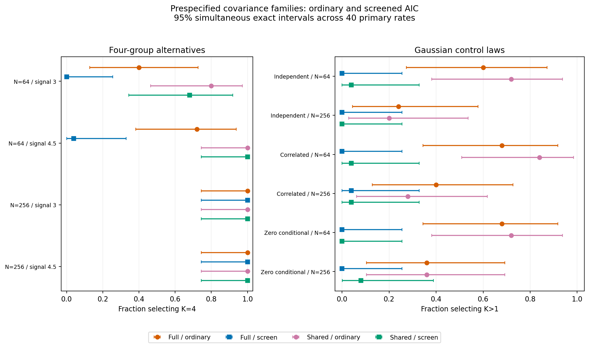

# Shared-covariance predictive-screened AIC: completed validation

This checkpoint adds an explicit shared-covariance option to grouped ordinary AIC and its predictive screen. It compares prespecified full and shared covariance on the same fresh raw data, folds and seeds. It introduces no family-selection procedure, default change, new significance test or species-boundary claim.

At N=64, the shared screen recovered K=4 in **17/25** datasets at signal 3 and
**25/25** at signal 4.5, compared with **0/25** and **1/25** under the paired full
screen. The simultaneous conservative paired difference intervals were positive
in both cells. At N=256 both screens recovered K=4 in 25/25 datasets at both signals.

Across the six Gaussian-control cells, the descriptive pooled K>1 counts were
5/150 with the shared screen and 1/150 with the full screen. Ordinary AIC selected
K>1 in 78/150 and 74/150 respectively; shared covariance alone did not suppress
extra components. Cell-specific simultaneous intervals remain the primary evidence.

Shared covariance has material stress limitations. Under unequal variance at
N=256, shared screening selected K=4 in 23/25 datasets versus 22/25 for full
covariance, yet mean ARI was lower (0.675 versus 0.827) and mean selected-model
external gain was lower (0.365 versus 0.985). Correct component count alone is not
correct group assignment or better prediction. At N=64 unequal variance, mean
ARI was also lower (0.385 versus 0.436). These are descriptive stress comparisons;
no new default or universal family recommendation follows.

## Completed design and verification

Completed 350 paired observations with 4200 successful searches, 0 failed and 0 unattempted searches. Screened results were withheld for 0 arms; external-fold prediction failures totaled 0. All outcomes remain retained without replacement.

The 25 exact archived full-family six-search replays add 150 searches, giving **4,350 planned main searches**. Independent numerical and standard-library audits passed, including covariance-specific likelihood/AIC/BIC, whole-locality isolation, all frozen maps, memberships and selected-model reloads. The separate 168-search full-settings preflight passed both audits and its storage gate. Unit/development/installed-smoke fits are separate from main accounting. No oracle, calibration or stability fits were added.

Each of 14 cells has 25 independent datasets. All retain unequal fixed counts of 1–4 morphology specimens/locality, one ecology row/locality and four continuous traits/view. Both families refit two PCs/view and four joint PCs inside each of five whole-locality folds, using the unchanged ten-start K=1..4 search. Complete transformations and score arrays agree between paired families. Independent external sets contain 2,048 localities/observation and never influence selection. See the [frozen method and commands](shared-predictive.md).

## Prespecified primary outcomes

Control events are K>1 selections under the declared Gaussian laws; alternative events are K=4 recovery. These are component-selection outcomes, not species/type-I error tests. Each rate below has 25 requested observations.

| Cell | Full ordinary | Full screen | Shared ordinary | Shared screen |
| --- | ---: | ---: | ---: | ---: |
| independent_gaussian_n64 | 15/25 | 0/25 | 18/25 | 1/25 |
| independent_gaussian_n256 | 6/25 | 0/25 | 5/25 | 0/25 |
| correlated_gaussian_n64 | 17/25 | 0/25 | 21/25 | 1/25 |
| correlated_gaussian_n256 | 10/25 | 1/25 | 7/25 | 1/25 |
| zero_conditional_gaussian_n64 | 17/25 | 0/25 | 18/25 | 0/25 |
| zero_conditional_gaussian_n256 | 9/25 | 0/25 | 9/25 | 2/25 |
| four_n64_s3_0 | 10/25 | 0/25 | 20/25 | 17/25 |
| four_n64_s4_5 | 18/25 | 1/25 | 25/25 | 25/25 |
| four_n256_s3_0 | 25/25 | 25/25 | 25/25 | 25/25 |
| four_n256_s4_5 | 25/25 | 25/25 | 25/25 | 25/25 |

All 40 primary rates carry exact pointwise and Bonferroni simultaneous 95% intervals, dataset-level MCSE, explicit availability and withheld-outcome bounds in [primary-rates.csv](../examples/shared-predictive/results/primary-rates.csv). These small cell sizes leave wide intervals. For 0/25, the simultaneous upper bound is 25.6%. Zero observed selections does not establish zero risk; boundary MCSE=0 is not the confidence interval.

Thirty prespecified paired comparisons cover screening within each family and shared-screen versus full-screen in each primary cell. Conservative exact discordance bounds give simultaneous uncertainty without treating arms as independent. The table below shows **shared minus full** screened event rates; positive values favor four-group recovery in alternatives but indicate more K>1 selections in controls. All 30 comparisons and denominators are retained in [summary.json](../examples/shared-predictive/results/summary.json).

| Cell | Shared minus full screen | Simultaneous difference interval |
| --- | ---: | --- |
| independent_gaussian_n64 | 4.0% | [-26.8%, 34.1%] |
| independent_gaussian_n256 | -0.0% | [-26.8%, 26.8%] |
| correlated_gaussian_n64 | 4.0% | [-26.8%, 34.1%] |
| correlated_gaussian_n256 | -0.0% | [-34.1%, 34.1%] |
| zero_conditional_gaussian_n64 | -0.0% | [-26.8%, 26.8%] |
| zero_conditional_gaussian_n256 | 8.0% | [-26.6%, 40.1%] |
| four_n64_s3_0 | 68.0% | [6.6%, 92.3%] |
| four_n64_s4_5 | 96.0% | [39.2%, 100.0%] |
| four_n256_s3_0 | -0.0% | [-26.8%, 26.8%] |
| four_n256_s4_5 | -0.0% | [-26.8%, 26.8%] |

## Gate and predictive diagnosis

The fixed screen requires K=4 eligibility on full data and every fold, then positive pooled validation gain against K=1, followed by full-data AIC ranking. Counts below assign each alternative observation to its first failing gate. They are sequential descriptions, not independent causal effects.

| Alternative cell / family | Full ineligible | Fold ineligible | Nonpositive gain | AIC prefers another K | K=4 selected |
| --- | ---: | ---: | ---: | ---: | ---: |
| four_n64_s3_0 / full | 2 | 20 | 3 | 0 | 0 |
| four_n64_s3_0 / tied | 2 | 3 | 3 | 0 | 17 |
| four_n64_s4_5 / full | 3 | 15 | 5 | 1 | 1 |
| four_n64_s4_5 / tied | 0 | 0 | 0 | 0 | 25 |
| four_n256_s3_0 / full | 0 | 0 | 0 | 0 | 25 |
| four_n256_s3_0 / tied | 0 | 0 | 0 | 0 | 25 |
| four_n256_s4_5 / full | 0 | 0 | 0 | 0 | 25 |
| four_n256_s4_5 / tied | 0 | 0 | 0 | 0 | 25 |

Four-dimensional K=4 models have 59 free parameters with full covariance and 29 with shared covariance. Shared covariance pools within-component variation; it cannot represent independently varying component shapes. The existing best-likelihood-start-before-size-screen policy, regularization and size threshold were preserved.

| Alternative cell / family | Eligible K=4 fold fits | Mean fold external gain over K=1 | Median smallest eigenvalue | Median largest condition number |
| --- | ---: | ---: | ---: | ---: |
| four_n64_s3_0 / full | 72/125 | -1.032 | 0.000 | 930.327 |
| four_n64_s3_0 / tied | 118/125 | 0.146 | 0.021 | 8.702 |
| four_n64_s4_5 / full | 98/125 | -0.430 | 0.003 | 36.876 |
| four_n64_s4_5 / tied | 125/125 | 0.802 | 0.014 | 8.289 |
| four_n256_s3_0 / full | 125/125 | 0.319 | 0.020 | 9.822 |
| four_n256_s3_0 / tied | 125/125 | 0.447 | 0.032 | 5.861 |
| four_n256_s4_5 / full | 125/125 | 0.915 | 0.012 | 11.808 |
| four_n256_s4_5 / tied | 125/125 | 1.021 | 0.017 | 7.643 |

These pooled fold summaries are descriptive. Five overlapping training folds do not supply five independent datasets or a biological stability estimate. Density gains are relative to K=1 within the same learned map; no absolute likelihood/AIC comparisons across independently learned maps are used. Fixed-map external prediction and generating-label recovery measure different properties. Detailed gate summaries and descriptive geometry/prediction distributions are in [gate-mechanisms.json](../examples/shared-predictive/results/gate-mechanisms.json) and [geometry-prediction.json](../examples/shared-predictive/results/geometry-prediction.json).

## Stress behavior

Unequal-variance four groups deliberately challenge the shared-covariance assumption. Heavy tails and continuous clines challenge Gaussian/discrete structure. These cells are descriptive and excluded from the 40-rate primary family and 30 paired-comparison family. K distributions and ARI have distinct interpretations; cline/heavy-tail data do not supply discrete species truth.

| Stress cell / family | Ordinary K counts (1/2/3/4) | Screen K counts (1/2/3/4) | Mean screened ARI, if discrete truth | Mean screened external gain |
| --- | --- | --- | ---: | ---: |
| heavy_tailed_n64 / full | 15/10/0/0 | 25/0/0/0 | unavailable | 0.000 |
| heavy_tailed_n64 / tied | 21/3/1/0 | 25/0/0/0 | unavailable | 0.000 |
| cline_n64 / full | 8/3/10/4 | 25/0/0/0 | unavailable | 0.000 |
| cline_n64 / tied | 3/5/10/7 | 23/2/0/0 | unavailable | -0.006 |
| unequal_variance_n64 / full | 0/0/16/9 | 5/12/8/0 | 0.436 | 0.388 |
| unequal_variance_n64 / tied | 0/0/10/15 | 3/13/7/2 | 0.385 | 0.160 |
| unequal_variance_n256 / full | 0/0/2/23 | 0/0/3/22 | 0.827 | 0.985 |
| unequal_variance_n256 / tied | 0/0/1/24 | 0/1/1/23 | 0.675 | 0.365 |

## Scope, preservation and reproduction

The measured storage projection was 2.29 GiB including 25% growth and reserve, within the approved 3 GiB new-artifact cap. Runtime guards require at least 8 GiB free and at most four single-thread workers. Full inputs/models/predictions and private archive indexes remain local. GitHub contains only code, fixed settings, documentation, figures and compact aggregate tables with [checksums](../examples/shared-predictive/results/checksums.json). Prior checkouts, studies and inputs were fingerprinted and preserved.

The frozen wheel, source and installed CLI passed local tests and integrity checks with Python 3.11/3.12 support; final master CI verifies both versions. The installed smoke uses eight smaller paired raw datasets, 96 searches, 20 primary rates and 15 paired comparisons, followed by both independent audits.

This bounded study measures behavior under declared generating laws and fixed settings. It does not prove general covariance-family superiority, establish universal small-sample performance, calibrate adaptive family choice, or validate biological species boundaries. It supplies no shared-AIC significance or stability procedure; the existing likelihood-calibration path still rejects tied AIC. Full covariance/BIC remain defaults and historical p-values retain their original interpretation.
