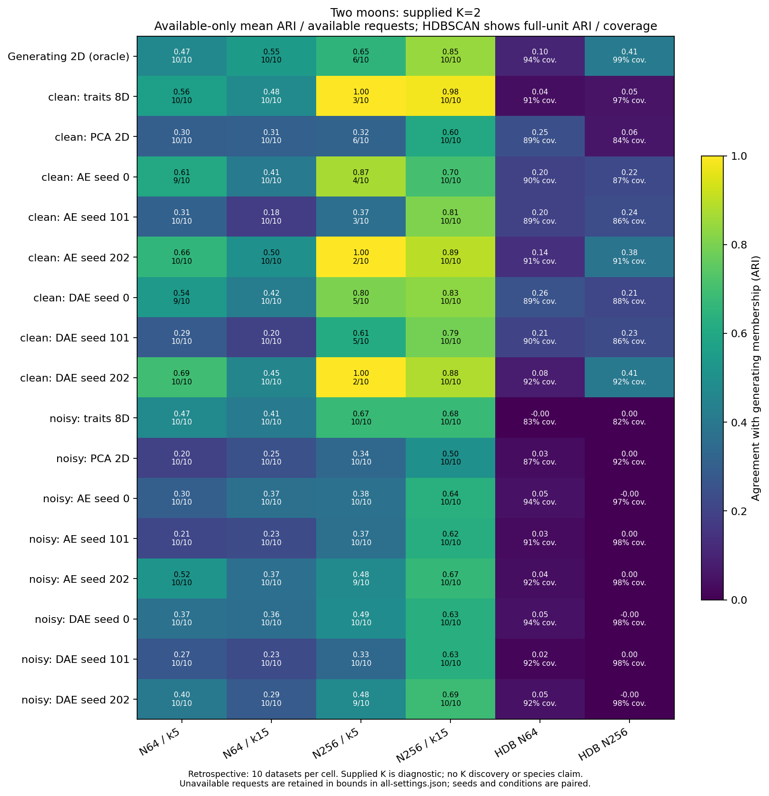
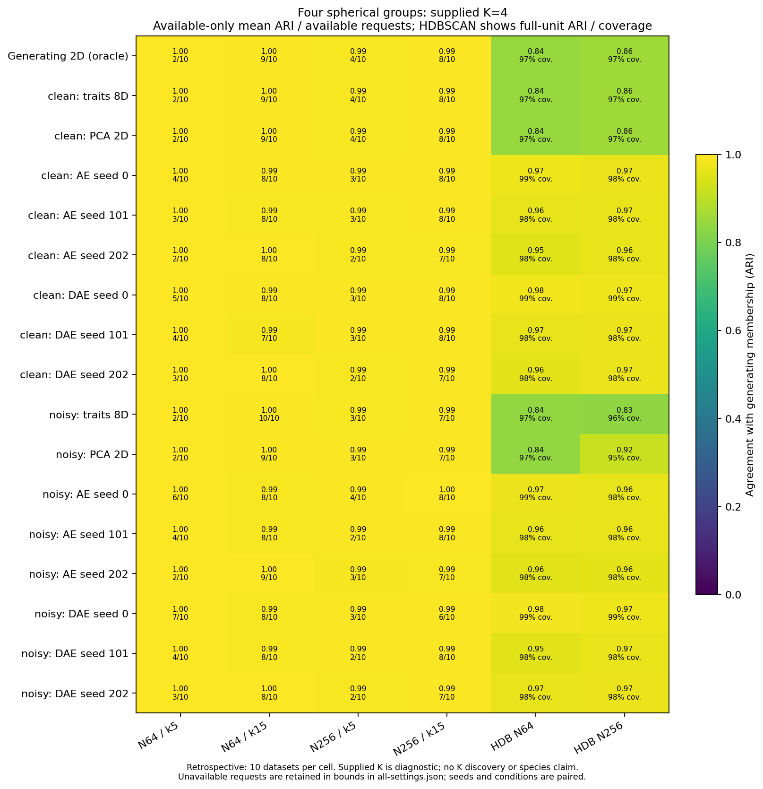

# Frozen spectral-graph diagnosis

This completed retrospective diagnostic supports a graph-based follow-up, but
does not repair automatic species discovery. Some archived moons coordinates
contain substantially more membership structure than the unchanged HDBSCAN
output reveals. Supplying two groups to a different graph partitioner can recover
that structure, especially in the clean eight-trait N=256 inputs. Small samples,
noise, representation choices and disconnected graphs still limit recovery.

No production model, default, configuration schema, p-value or empirical evidence
gate changed. No neural network was retrained, new scientific dataset generated,
new stability/significance analysis performed or author contacted. The CLI is a
separate archival diagnostic, not a deployable unknown-K model.

## Evidence and accounting

The source is the completed [denoising study](denoising-results.md): 60 archived
observations, ten each from Gaussian, four-spherical-group and two-moons laws at
N=64/256. Each has paired clean/noisy eight-trait inputs. The fixed comparison
uses 17 coordinate spaces, including all three neural seeds. It requests both
K=2 and K=4 at both graph neighbor counts for every space, independent of truth.
See the [protocol, guards and CLI](spectral-graphs.md).

The separate 504-evaluation preflight passed its independent audit and resource
gate. The conservative main-plus-audit projection was 244 seconds and 490 MiB
new evidence, below the approved one-hour/2 GiB limits. Main execution took
18.95 seconds; its independent numerical/source audit took 72.74 seconds.
These are local measurements, not hardware-independent speed claims.

| Main evidence | Count |
|---|---:|
| Point graph/K requests | 4,080 |
| Available point partitions | 3,419 |
| Direct component partitions among available points | 369 |
| Withheld point requests | 661 |
| Graph/K replay requests | 408 |
| Newly executed HDBSCAN point fits | 120 |
| HDBSCAN exact replays | 20 |
| Total main evaluations | 4,628 |

All 204 graph replays matched their numerical arrays exactly; all 20 density
replays matched labels and strengths. There were no failed evaluations. All 661
withheld point requests had unsupported disconnected-component counts; none was
repaired or replaced. Including replays, 707 requests were withheld, 383 used
direct components and 3,398 invoked the eigensolver. The 900 saved density
partitions were reused without refitting. Comparisons include 1,020 point density
baselines: those 900 plus the 120 raw-trait fits.

Gaussian had 1,360 available forced partitions. Four-group inputs had 881
available and 479 withheld requests; moons had 1,178 available and 182 withheld.
These totals span both requested K values and both neighbor counts. They are
not independent replicate counts or correct-K discovery rates.

## What the moons comparison shows

ARI measures agreement with generating membership: one is perfect; around zero
means chance-level agreement. HDBSCAN's full-unit ARI treats unassigned noise as
unresolved singletons. Spectral partitions assign every unit, which by itself
does not establish useful recovery. Coverage and assigned-only agreement remain
in the [density aggregates](../examples/spectral-graphs/results/density-baselines.json).

The following fixed k=15 presentation uses the prespecified seed zero. Every
spectral row here was available on all ten datasets. Values are mean ARI, with
sample standard deviation in parentheses. The complete export retains both graph
settings, every seed, common-available paired differences and all-request bounds.

| Coordinate space | N=64 spectral, supplied K=2 | N=256 spectral, supplied K=2 | N=256 HDBSCAN |
|---|---:|---:|---:|
| Clean eight traits | 0.480 (0.172) | 0.983 (0.042) | 0.054 |
| Clean two-PC scores | 0.307 (0.255) | 0.604 (0.142) | 0.061 |
| Clean ordinary AE, seed 0 | 0.410 (0.236) | 0.703 (0.166) | 0.220 |
| Clean denoising AE, seed 0 | 0.419 (0.231) | 0.831 (0.177) | 0.214 |
| Noisy eight traits | 0.409 (0.169) | 0.677 (0.126) | 0.001 |
| Noisy denoising AE, seed 0 | 0.363 (0.245) | 0.625 (0.153) | -0.000 |

At N=256, clean ordinary-AE means across seeds were 0.703–0.895; denoising-AE
means were 0.789–0.882. For noisy denoising coordinates they were 0.625–0.687.
At N=64, clean denoising means ranged from 0.197 to 0.454. These are ranges of
seed-specific means, not confidence intervals or evidence for choosing a seed.

This comparison documents a backend bottleneck on fixed coordinates, together
with representation and noise limitations. It does not isolate HDBSCAN branch
selection alone: graph construction, objective, supplied K and noise policy all
change. Eight standardized traits can also change distances relative to the
two-dimensional generating coordinates; they are not a neutral copy of those
coordinates. Neither a new neural architecture nor more training is established
as the necessary remedy.

The sparse k=5 graph was frequently disconnected. For clean eight-trait N=256
moons, only 3/10 requests were available, with mean ARI 1.000. Its all-request
bounds are -0.400 to 1.000. That conditional perfect score cannot be presented
as successful recovery on all ten datasets. The k=15 comparison above uses all
ten; it is still retrospective and cannot promote that setting to a default.

## Four groups and Gaussian controls

Available K=4 partitions usually had high agreement on the four-spherical-group
inputs. Availability matters: clean raw traits at k=15 had 9/10 available at
N=64 (mean ARI 0.995) and 8/10 at N=256 (0.993). Their all-request bounds are
0.796–0.996 and 0.595–0.995, respectively. Near-perfect conditional recovery
does not resolve unsupported disconnected graphs or discover four groups.

Every Gaussian graph received both requested counts and produced those forced
partitions. Their ARI against the one-population truth is zero, while the
fit-free constant K=1 reference has ARI one. This demonstrates why supplied-K
graph output cannot serve as a false-positive or species-boundary test.

## Audit, interpretation and next boundary

Independent checks passed for source identities/inventories, coordinate and
forward-pass binding, distances/ties, sparse affinities, degrees/components,
normalized-Laplacian spectra, actual embedding residuals/orthogonality/projectors,
QR/SVD assignment equations, labels, cut objectives, replay and complete counts.
A second contingency calculation verified all 3,419 available point ARIs and
1,020 density partition metrics. All 408 aggregate denominators, common-pair
comparisons, failure bounds and figure-data exports were checked separately.
Audits do not claim a second complete implementation of the library solver or
HDBSCAN. The numerical reference is NumPy 2.2.6, SciPy 1.15.3 and scikit-learn 1.6.1.

There are ten independent archived datasets per law/sample-size cell. Seeds,
conditions, graph settings and requested counts are repeated measurements, not
additional independent evidence. Standard deviations and paired differences
are descriptive; no new general post-selection confidence or stability claim
is made. Available-only results are conditional, and explicit [-1,1] ARI bounds
retain every unavailable request. Small clusters remain reported.

The single targeted follow-up is a separately frozen **fresh graph-model
validation with an explicit unknown-K/abstention strategy**, including
single-population controls before any species-discovery claim. This checkpoint
does not implement or select that strategy, repair disconnected graphs, tune on
truth or automatically promote k=15, raw traits or a neural seed.

Python 3.11/3.12 remain the supported versions. The local scientific suite passed
2,257 tests; the dependency-light suite passed 1,508 with 116 optional-dependency
skips. Wheel/source-distribution and installed CLI checks accompany publication;
final master CI is recorded in the local completion record.

Only code, documentation, figures and [small aggregates](../examples/spectral-graphs/results/summary.json)
are published. Coordinates, per-unit partitions, graph/embedding arrays, source
inventories, neural weights and full verification evidence remain local under
`~/.codex/outputs/super-deli/spectral-graph-diagnostic-20261101/`.
